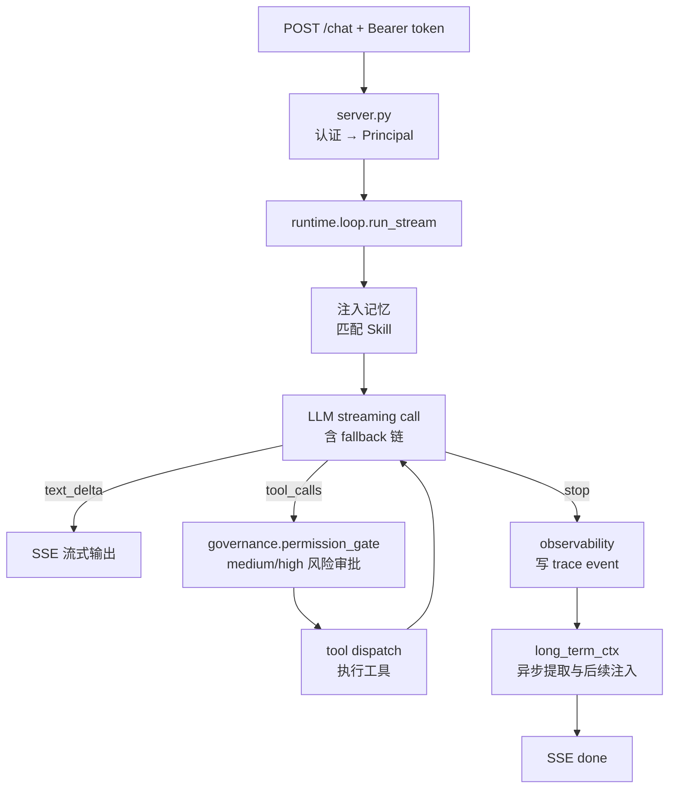
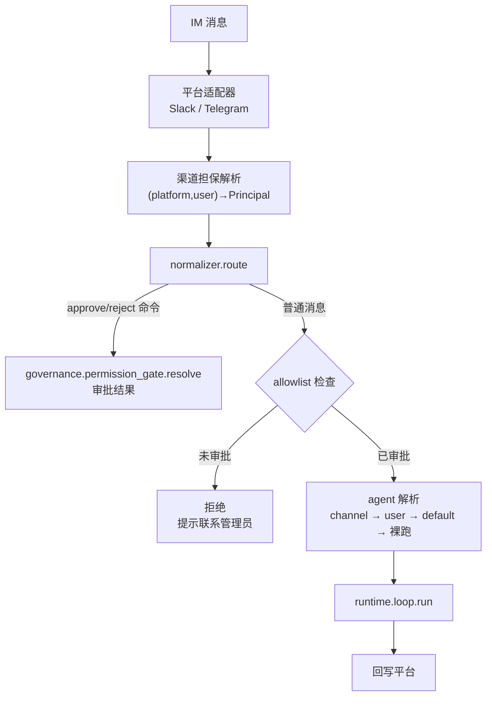
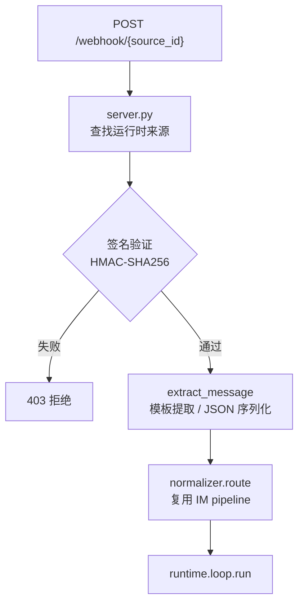
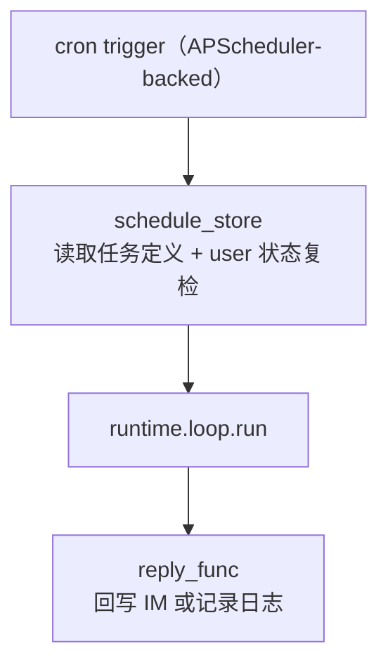

# fleetent 总体架构

> **总览 / 入口**。详细架构模型（核+4面+基座、模块边界、Identity、只读投影、现模块→目标归属）见 [`architecture/target-architecture.md`](architecture/target-architecture.md)；数据模型与物理库见 [`architecture/data-model.md`](architecture/data-model.md)；设计 rationale 见 [`records/decision-logs/`](records/decision-logs/)。

## 定位

面向企业 on-premises 部署的 Lean Agent 平台。核心主张：

- **部署主权**：跑在客户自己的服务器上，数据不出内网
- **可治理**：每次 agent 运行的 trace、成本、审批全部可查
- **可适配**：Skill 系统让领域专家无需改代码即可定制 agent 行为

技术哲学：最少依赖，直接调 SDK，不引入 AI 框架。

---

## 架构分层与模块组织

**心智模型 = 一个核（Agent 运行时）+ 四个面（① 边缘 / ② 控制 / ③ 编排 / ④ 摄取）+ 共享基座**。依赖单向：面 → 核（允许）、核 → 面（禁，核须脱离任何面独立跑）、任意 → 基座（允许）、基座 → 业务（禁）。模块边界由**依赖护栏测试**强制（`tests/unit/test_module_dependency_guardrails.py` 等）。

- 模型与各面/核/基座的职责：见 [`target-architecture.md` §1–§7](architecture/target-architecture.md)。
- **现模块 → 目标归属（速查）**：见 [`target-architecture.md` §10](architecture/target-architecture.md)。
- 模块边界为何这样切（根因/决策）：见 [`records/decision-logs/architecture-decisions.md`](records/decision-logs/architecture-decisions.md)。

---

## 端到端数据流

### HTTP 路径

### IM 路径

### Webhook 路径

### Cron 路径

---

## 关键设计决策

> 持久层 / 模块架构的详细决策与依据见 [`records/decision-logs/persistence-redesign-decisions.md`](records/decision-logs/persistence-redesign-decisions.md) 与 [`architecture-decisions.md`](records/decision-logs/architecture-decisions.md)。下表为项目级技术选型速查。

| 决策 | 结论 | 理由 |
|------|------|------|
| 部署结构 | 模块化单体，单进程 | on-premises 天敌是复杂度，微服务带来不必要运维负担 |
| LLM 调用 | 直接调 SDK，不用框架 | LangChain 频繁 breaking change，debug 困难 |
| 数据库 | SQLite-first，不引入 ORM；DB runtime + store 边界保留 PostgreSQL 迁移空间；按主体物理隔离（5 库拓扑，见 data-model） | 初期零运维、on-premises 友好；手写 SQL 可审计；合规"主体间互不可见"由文件边界保证 |
| Session 存储 | JSON 文件 + asyncio.Lock；元数据入 per-agent 库 | 可调试；原子写（.tmp → rename）防损坏 |
| 工具审批 | **agent 全权能力**：阻塞等审批人决定，platform 只读投影（R1） | 请求者≠审批人；agent 主动私信审批人；approvals 落 agent 侧 `approval_store`；agent 须脱离 platform 跑 |
| 认证 | 认证属 edge、核只消费 `Principal`；authn 经基座 Identity 端口 | agent 侧不 import platform，结构性根除反向依赖泄漏 |
| 代码执行隔离 | 可插拔后端：Docker（默认）/ microsandbox microVM（本地 microVM，需 KVM/HVF，is_installed() 探测，详见 sandbox.md） | 每个沙箱独立 Linux 内核，无逃逸风险；< 100ms 启动；无需 dockerd |
| MCP 工具命名 | `{server}__{tool}` 双下划线 | 避免与内置工具名冲突，来源可追溯 |
| 记忆提取 | 轻量模型异步提取，不阻塞响应 | 结构化语义记忆写入 per-agent 库 `memory_items`，vector_store 建索引；long_term_ctx 统一协调检索与注入 |

---

## 能力域文档索引

| 文档 | 覆盖范围 | 优先级 | 依赖的模块 | 负责人 | 状态 |
|------|---------|:------:|-----------|-----|------|
| [roadmaps/pilot-readiness-roadmap.md](capabilities/roadmaps/pilot-readiness-roadmap.md) | Pilot readiness 横向总览、Go / Conditional Go / No-Go 风险和验收入口 | P0 | 全项目 capability | - | 基础完成 |
| [roadmaps/intelligence-roadmap.md](capabilities/roadmaps/intelligence-roadmap.md) | Memory / Long-term Context / Reflection / Vector Store / Knowledge Base 能力簇 roadmap | P0 | memory · long-term-ctx · reflection · vector-store · knowledge-base | - | 基础完成 |
| [roadmaps/observability-deployment-roadmap.md](capabilities/roadmaps/observability-deployment-roadmap.md) | Observability / Diagnostics / Deployment / Config 能力簇 roadmap | P0 | observability · deployment | - | 基础完成 |
| [agent-runtime.md](capabilities/agent-runtime.md) | 核心循环、工具调度、上下文压缩、运行治理 | P0 | model-router · tools · session · skill · governance · observability | 张洋 | 部分完成 |
| [model-router.md](capabilities/model-router.md) | task_type 路由、provider 配置、fallback 链 | P0 | deployment | 张洋 | 部分完成 |
| [tools.md](capabilities/tools.md) | @tool 装饰器、schema 构建、dispatch、内置工具集 | P0 | governance · connectors | 张洋 | 部分完成 |
| [mcp.md](capabilities/mcp.md) | MCP 外部工具集成（stdio / HTTP） | P1 | connectors | 张洋 | 部分完成 |
| [sandbox.md](capabilities/sandbox.md) | 安全代码执行（microsandbox microVM） | P1 | - | 张洋 | 部分完成 |
| [skill.md](capabilities/skill.md) | Skill 发现、匹配、注入 | P1 | - | 张洋 | 部分完成 |
| [session.md](capabilities/session.md) | session 持久化、并发保护、生命周期管理 | P0 | - | 张洋 | 已实现 |
| [im-gateway.md](capabilities/im-gateway.md) | Slack / Telegram / WhatsApp 接入、用户映射 | P0 | session · governance · platform（用户身份） | 张亮 | 部分完成 |
| [platform.md](capabilities/platform.md) | 用户管理、API 认证、admin CLI | P1 | - | 张亮 | 部分完成 |
| [governance.md](capabilities/governance.md) | 权限审批、工具白名单、agent 定义与分配 | P0 | session | 张亮 | 部分完成 |
| [scheduling.md](capabilities/scheduling.md) | Cron 定时任务、Webhook 事件触发 | P1 | agent-runtime · session · im-gateway | 张亮 | 部分完成 |
| [connectors.md](capabilities/connectors.md) | 外部服务 Vault（external_services / external_credentials / agent_service_grants，支持 oauth2/apikey） | P2 | platform（用户身份） | 张亮 | 基础完成 |
| [memory.md](capabilities/memory.md) | User Memory、Shared Memory、维护 proposal、质量趋势 | P1 | model-router · vector-store · observability · reflection | 常乐 | 基础完成 |
| [long-term-ctx.md](capabilities/long-term-ctx.md) | 长期上下文调度与注入，memory / knowledge-base / Shared Memory provider 和 context policy | P1 | memory · knowledge-base | 常乐 | 基础完成 |
| [knowledge-base.md](capabilities/knowledge-base.md) | 企业文档知识库、local / Google Drive / Confluence 同步、hybrid / graph / rerank / planner | P1 | vector-store | 常乐 | 基础完成 |
| [vector-store.md](capabilities/vector-store.md) | 向量索引、SQLite backend、embedding / rerank provider、同步 reindex | P1 | deployment | 常乐 | 基础完成 |
| [reflection.md](capabilities/reflection.md) | User Memory / Skill / 知识库反思、proposal lifecycle、趋势聚合 | P2 | memory · skill · knowledge-base · observability | 常乐 | 基础完成 |
| [observability.md](capabilities/observability.md) | 评估日志、数据统计、链路追踪 | P0 | - | 常乐 | 基础完成 |
| [deployment.md](capabilities/deployment.md) | on-premises 打包、配置管理、SQLite upgrade / backup | P0 | - | 常乐 | 基础完成 |
