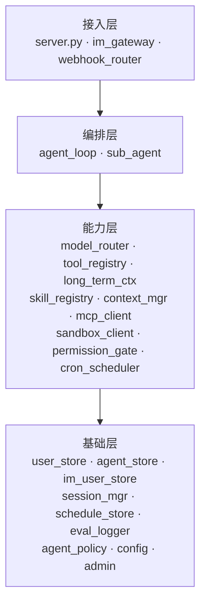
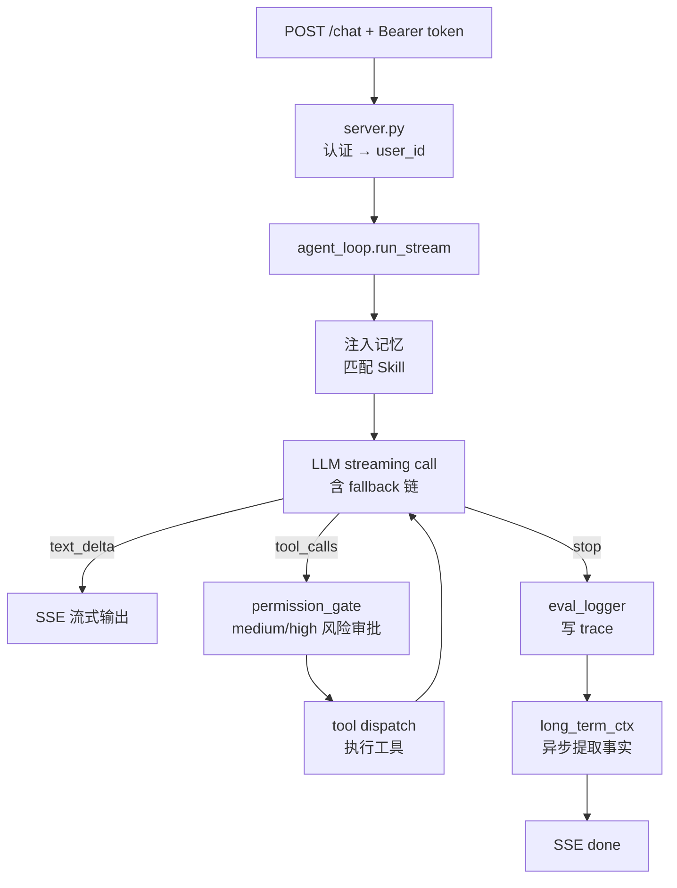
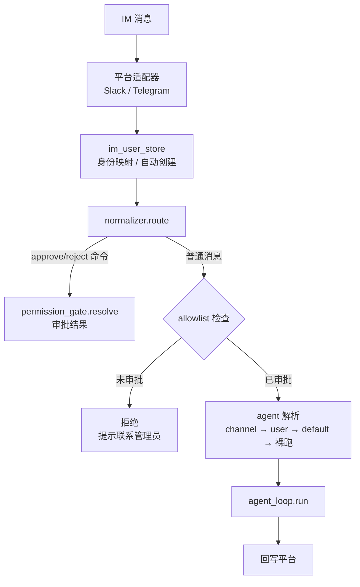
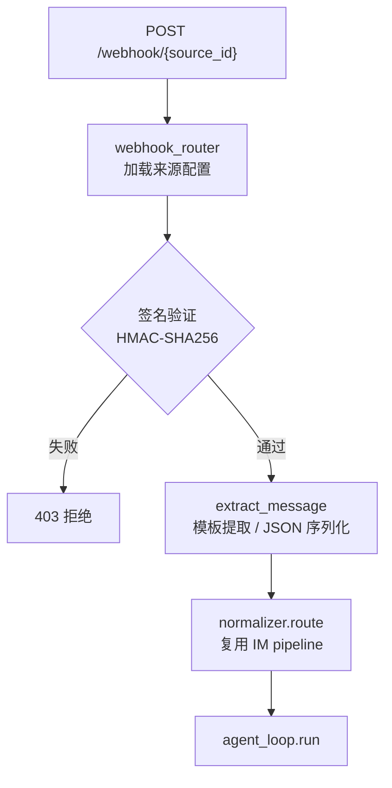
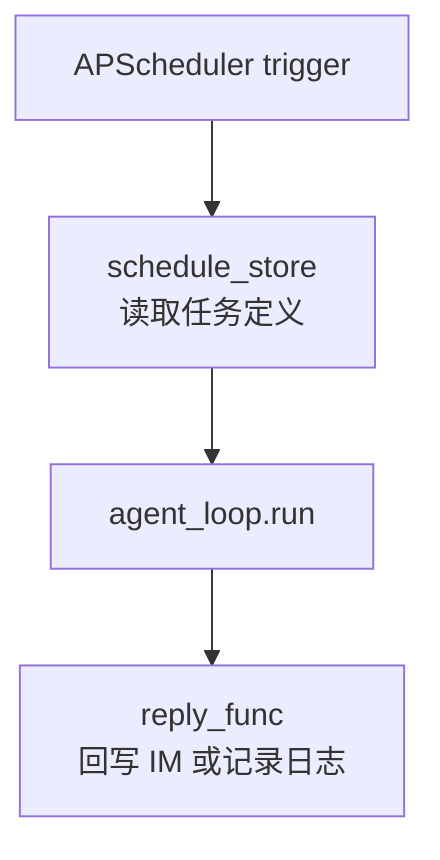

# fleetent 总体架构

## 定位

面向企业 on-premises 部署的 Lean Agent 平台。核心主张：

- **部署主权**：跑在客户自己的服务器上，数据不出内网
- **可治理**：每次 agent 运行的 trace、成本、审批全部可查
- **可适配**：Skill 系统让领域专家无需改代码即可定制 agent 行为

技术哲学：最少依赖，直接调 SDK，不引入 AI 框架。

---

## 架构分层



依赖方向单向向下，禁止反向或循环导入。

---

## 模块地图

```
src/fleetent/
  server.py          ← FastAPI：POST /chat (SSE)、GET /health、Bearer 认证
  im_gateway/
    normalizer.py    ← NormalizedMessage 统一路由 pipeline
    slack.py         ← slack-bolt Socket Mode 适配器
    telegram.py      ← python-telegram-bot polling 适配器
  agent_loop.py      ← while tool-use 核心循环；run() + run_stream()
  sub_agent.py       ← asyncio.gather 并行子 agent；最大深度 1
  model_router.py    ← task_type → provider 配置 + fallback 链
  tool_registry.py   ← @tool 注册、schema 构建、dispatch、访问控制
  tools.py           ← 内置工具（import 即注册，副作用）
  skill_registry.py  ← 扫描 skills/，关键词匹配，注入 system prompt
  context_mgr.py     ← in-session token 压缩
  memory_layer.py    ← 长期上下文：Haiku 提取事实 → SQLite → 注入（能力层称 long_term_ctx）
  mcp_client.py      ← MCP HTTP/stdio client；工具注册为 {server}__{tool}
  sandbox_client.py  ← Docker CLI 封装：隔离 Python 执行
  permission_gate.py ← asyncio.Event 人工审批门（medium/high 风险）
  cron_scheduler.py  ← APScheduler 定时任务；server 启动时初始化
  webhook_router.py  ← Webhook 来源配置加载、签名验证、消息提取
  user_store.py      ← SQLite 用户/API key 管理
  agent_store.py     ← SQLite：agent 定义 + 用户绑定 + channel 绑定
  im_user_store.py   ← (platform, platform_user_id) → 内部 User；allowlist
  session_mgr.py     ← JSON session 持久化；per-session asyncio.Lock
  schedule_store.py  ← SQLite：定时任务定义与状态持久化
  eval_logger.py     ← append-only JSONL trace 日志
  agent_policy.py    ← fnmatch 工具访问检查
  config.py          ← pydantic-settings；加载 .env + config/settings.yaml
  admin.py           ← CLI 管理工具
```

---

## 端到端数据流

### HTTP 路径



### IM 路径



### Webhook 路径



### Cron 路径



---

## 关键设计决策

| 决策 | 结论 | 理由 |
|------|------|------|
| 部署结构 | 模块化单体，单进程 | on-premises 天敌是复杂度，微服务带来不必要运维负担 |
| LLM 调用 | 直接调 SDK，不用框架 | LangChain 频繁 breaking change，debug 困难 |
| 数据库 | SQLite（可升 PostgreSQL）| 零运维，on-premises 友好；直接用 aiosqlite，不引入 ORM |
| Session 存储 | JSON 文件 + asyncio.Lock | 可调试；原子写（.tmp → rename）防损坏 |
| 工具审批 | asyncio.Event 门控 | 无轮询，优雅等待；重启后调用 cleanup_stale_approvals() 清理孤儿 |
| 代码执行隔离 | microsandbox（microVM） | 每个沙箱独立 Linux 内核，无命名空间逃逸风险；< 100ms 启动；无需 dockerd |
| MCP 工具命名 | `{server}__{tool}` 双下划线 | 避免与内置工具名冲突，来源可追溯 |
| 记忆提取 | Haiku 异步，不阻塞响应 | 廉价且快；JSONL 存储，top-20 条注入下次请求 |

---

## 能力域文档索引

| 文档 | 覆盖范围 | 负责人 |
|------|---------|-----|
| [agent-runtime.md](capabilities/agent-runtime.md) | 核心循环、工具调度、上下文压缩、运行治理 | 张洋 |
| [mcp.md](capabilities/mcp.md) | MCP 外部工具集成（stdio / HTTP） | 张洋 |
| [sandbox.md](capabilities/sandbox.md) | 安全代码执行（microsandbox microVM） | 张洋 |
| [skill.md](capabilities/skill.md) | Skill 发现、匹配、注入 | 张洋 |
| [im-gateway.md](capabilities/im-gateway.md) | Slack / Telegram / WhatsApp 接入、用户映射 | 张亮 |
| [platform.md](capabilities/platform.md) | 用户管理、API 认证、admin CLI | 张亮 |
| [memory.md](capabilities/memory.md) | 跨 session 记忆（语义 / 情节 / 程序 / 工作） | 常乐 |
| [long-term-ctx.md](capabilities/long-term-ctx.md) | 长期上下文调度与注入 | 常乐 |
| [knowledge-base.md](capabilities/knowledge-base.md) | 企业文档知识库、混合检索 | - |
| [vector-store.md](capabilities/vector-store.md) | 向量索引基础设施 | - |
| [connectors.md](capabilities/connectors.md) | 数据源连接器（Confluence / Google Drive 等） | - |
| [reflection.md](capabilities/reflection.md) | 记忆 / Skill / 知识库反思与自进化 | - |
| [governance.md](capabilities/governance.md) | 权限审批、工具白名单、agent 定义与分配 | 宋凯宇 |
| [scheduling.md](capabilities/scheduling.md) | Cron 定时任务、Webhook 事件触发 | 程鑫 |
| [observability.md](capabilities/observability.md) | 评估日志、数据统计、链路追踪 | 程鑫 |
| [user-center.md](capabilities/user-center.md) | 用户中心、多租户管理 | - |
| [deployment.md](capabilities/deployment.md) | on-premises 打包、配置管理 | 常乐 |
