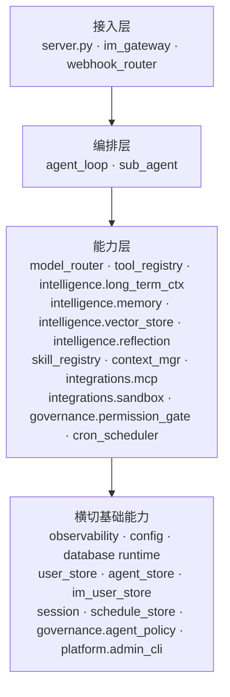
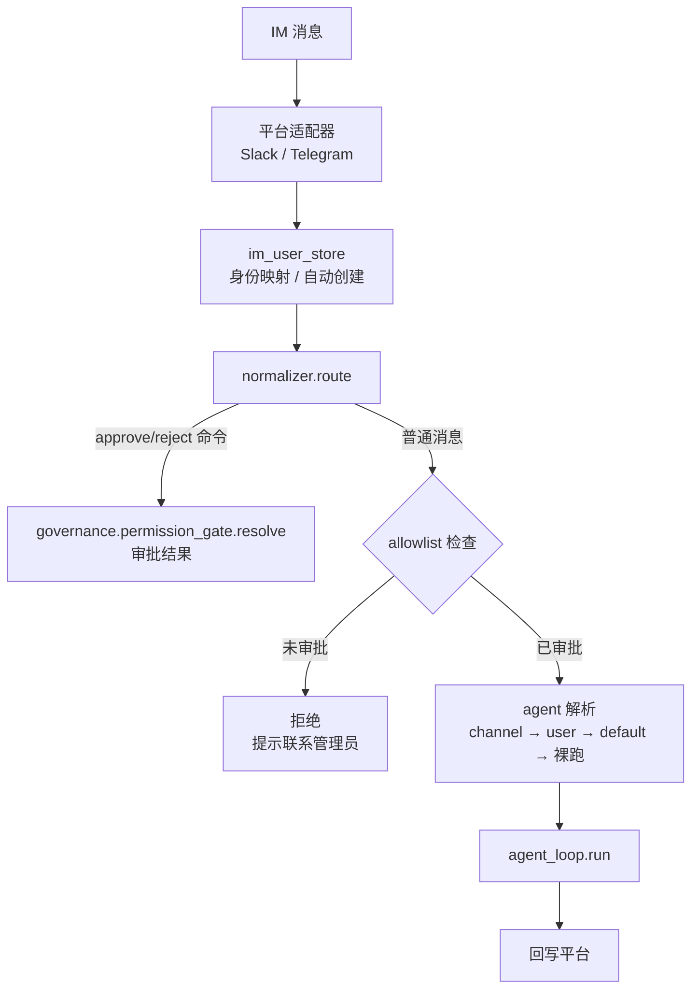
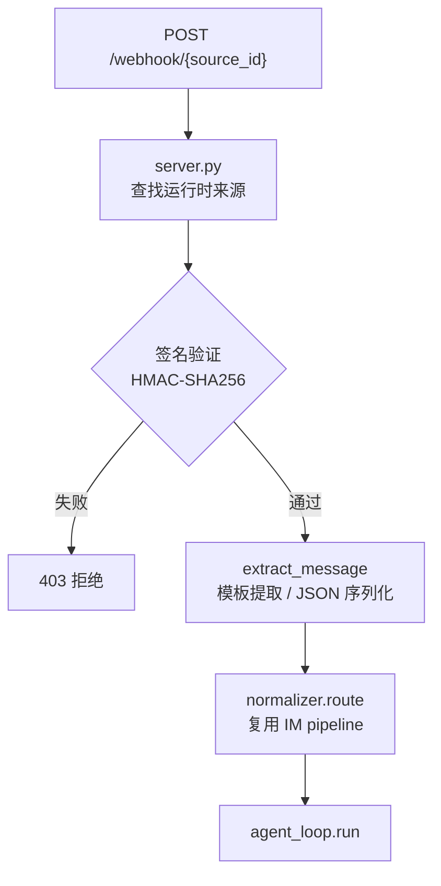
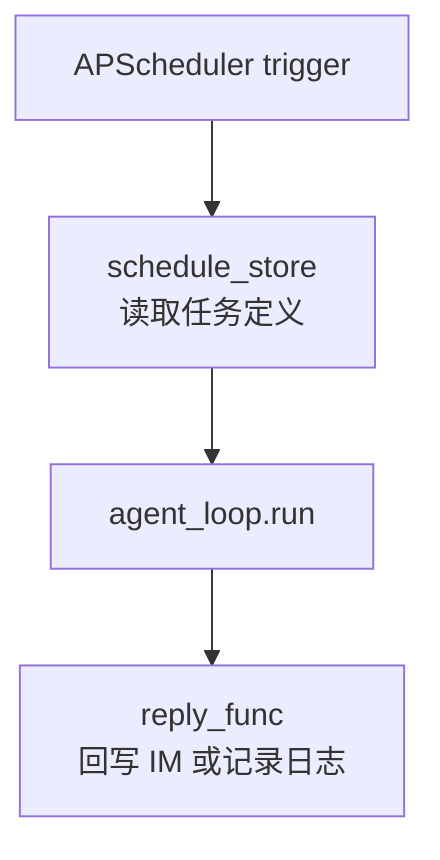

# fleetent 总体架构

## 定位

面向企业 on-premises 部署的 Lean Agent 平台。核心主张：

- **部署主权**：跑在客户自己的服务器上，数据不出内网
- **可治理**：每次 agent 运行的 trace、成本、审批全部可查
- **可适配**：Skill 系统让领域专家无需改代码即可定制 agent 行为

技术哲学：最少依赖，直接调 SDK，不引入 AI 框架。

---

## 架构分层



依赖方向单向向下，禁止反向或循环导入。

---

## 模块地图

### 目标 package map

fleetent 采用模块化单体：单进程、单仓库、统一部署，但代码按能力边界组织。现有平铺模块可渐进迁移；
新增模块优先进入目标 package。

```
src/fleetent/
  runtime/          ← loop(←agent_loop)、context(←context_mgr)、sub_agent、snapshot(←agent_runtime)、运行治理(termination/loop_detector/budget/cancellation/message_hygiene/error_classifier/tool_guardrails)
  model/            ← router(←model_router)、provider_health、vision_client、image_gen_client、multimodal
  tools/            ← registry(←tool_registry)、builtin_tools(←tools)、result_truncation、plugin_loader
  skills/           ← registry(←skill_registry)、audit(←skill_audit)
  session/          ← manager(←session_mgr)、index(←session_index)
  governance/       ← agent_policy、permission_gate、agent 能力边界
  platform/         ← user / agent / API key / admin / auth control plane
  channels/         ← im_gateway、webhook_router、cron_scheduler、schedule_store
  intelligence/     ← memory、knowledge_base、long_term_ctx、vector_store、reflection
  integrations/     ← mcp、sandbox(←sandbox_*,工具执行后端,与 mcp/connectors 同类)、connectors
  observability/    ← trace、log、usage、diagnostics
  infrastructure/   ← config、db runtime、底层 adapter
```

> 张洋负责的执行引擎 + 工具系统按 7 个 capability 边界细分为 `runtime` / `model` / `tools` / `skills` / `session` 五个独立顶层包 + `integrations/{mcp,sandbox}`;`sandbox` 归 integrations 因其是「工具依赖的可插拔外部执行后端」(Docker daemon 适配器),与 `mcp`(MCP server)、`connectors`(OAuth)同类。

能力边界说明：

- `intelligence/*` 负责 agent 的长期知识、记忆、检索、反思与上下文注入；其中 `vector_store`
  暂时同时承载向量后端与 embedding / rerank provider 边界，等多个模块直接复用 provider 后再评估是否抽出。
- `observability/*` 是横切基础能力，不归入 intelligence；它记录 logs、traces、usage 和 source attribution，
  供 agent-runtime、platform、reflection 等模块读取。
- `infrastructure/*` 只承载 config、database runtime 和底层 adapter，不拥有业务表或业务语义。

迁移规则：

- 新代码进入 owning package；旧平铺模块在被大幅触碰时迁移。
- **每个能力域是一个 package（目录 + `__init__.py`），公共 API 收口于 `__init__.py`**。
- 跨包调用只能使用目标包的 public API（其 `__init__.py` 导出），不 import 另一包的 internal module。
- **迁入 package 时去冗余前缀命名**（对齐 `mcp_client.py` → `mcp/client.py`；`sandbox_client.py` → `sandbox/client.py`、`tool_registry.py` → `tools/registry.py`）；用 `git mv` 保留 blame。
- 每张持久化表有且只有一个 owner module；其他模块通过 owner public API 访问。
- 每个模块拥有稳定配置命名空间，例如 `memory.*`、`knowledge_base.*`、`observability.*`。
- 平铺模块迁移期间可保留旧扁平路径的 re-export shim，但 **shim 只 re-export、不承载业务逻辑**；**所有包迁完且调用方改到新路径后，统一删除全部 shim**。
- 迁移为纯结构搬迁：**不改运行时行为、公共契约、数据库 schema**；每步全量测试绿、可回退。

迁移顺序（blast radius 由小到大，各为独立 change/PR，详见 `openspec/changes/runtime-package-blueprint`）：
`integrations/sandbox` → `session` → `skills` → `model` → `tools` → `runtime`(殿后)。

### 当前模块地图

> 反映**迁移过程中的实时状态**(以上「目标 package map」为终态)。张洋负责的执行/工具模块多数仍平铺,按上述顺序逐包迁移中。

```
src/fleetent/
  server.py          ← FastAPI：POST /chat (SSE)、GET /health、Bearer 认证
  im_gateway/
    normalizer.py    ← NormalizedMessage 统一路由 pipeline
    slack.py         ← slack-bolt Socket Mode 适配器
    telegram.py      ← python-telegram-bot polling 适配器
  agent_loop.py      ← while tool-use 核心循环；run() + run_stream()
  sub_agent.py       ← asyncio.gather 并行子 agent；最大深度 1
  model_router.py    ← task_type → provider 配置 + fallback 链
  tool_registry.py   ← @tool 注册、schema 构建、dispatch、访问控制
  tools.py           ← 内置工具（import 即注册，副作用）
  skill_registry.py  ← 扫描 skills/，关键词匹配，注入 system prompt
  context_mgr.py     ← in-session token 压缩
  intelligence/
    memory/         ← 结构化 User Memory + Shared Memory：提取、维护、SQLite source of truth、vector_store 索引
    knowledge_base/ ← 企业文档知识库：解析、导入、local / Google Drive / Confluence sync、hybrid / graph / rerank / planner
    vector_store/   ← 向量索引基础设施：in-memory / SQLite backend，embedding / rerank provider，reindex
    long_term_ctx.py ← 长期上下文调度：memory / knowledge_base / Shared Memory provider 与 context policy
    reflection.py   ← 反思报告与 proposal：读取 traces / memory / KB 信号，只读趋势，不自动写回
  integrations/
    mcp/            ← MCP HTTP/stdio client；工具注册为 {server}__{tool}
    sandbox/        ← Docker CLI 封装：隔离 Python 执行（已包化；旧 sandbox_*.py 为 re-export shim）
  governance/
    permission_gate.py ← asyncio.Event 人工审批门（medium/high 风险）
    agent_policy.py    ← fnmatch 工具访问检查
  cron_scheduler.py  ← APScheduler 定时任务；从 SQLite 动态任务恢复调度
  webhook_router.py  ← Webhook 签名验证、消息提取
  user_store.py      ← SQLite 用户/API key 管理
  agent_store.py     ← SQLite：agent 定义 + 用户绑定 + channel 绑定
  im_user_store.py   ← (platform, platform_user_id) → 内部 User；allowlist
  session/           ← manager(←session_mgr)：JSON session 持久化、per-session asyncio.Lock；index(←session_index)：会话元数据索引（已包化；旧 session_mgr.py / session_index.py 为 re-export shim）
  schedule_store.py  ← SQLite：定时任务定义与状态持久化
  observability/     ← trace、log、usage、diagnostics
  config.py          ← pydantic-settings；加载 .env + config/settings.yaml；读取 config/mcp.servers.yaml
  platform/
    admin_cli/       ← CLI 管理工具；console script 为 fleetent-admin
```

---

## 端到端数据流

### HTTP 路径


### IM 路径



### Webhook 路径



### Cron 路径



---

## 关键设计决策

| 决策 | 结论 | 理由 |
|------|------|------|
| 部署结构 | 模块化单体，单进程 | on-premises 天敌是复杂度，微服务带来不必要运维负担 |
| LLM 调用 | 直接调 SDK，不用框架 | LangChain 频繁 breaking change，debug 困难 |
| 数据库 | SQLite-first，不引入 ORM；通过 DB runtime + store 边界保留 PostgreSQL 迁移空间 | 初期零运维、on-premises 友好；手写 SQL 更可审计。业务层禁止直接依赖 SQLite 文件路径、连接实现或方言细节 |
| Session 存储 | JSON 文件 + asyncio.Lock | 可调试；原子写（.tmp → rename）防损坏 |
| 工具审批 | asyncio.Event 门控 | 无轮询，优雅等待；重启后调用 cleanup_stale_approvals() 清理孤儿 |
| 代码执行隔离 | Docker CLI（当前）→ microsandbox microVM（v1.0 目标） | 每个沙箱独立 Linux 内核，无命名空间逃逸风险；< 100ms 启动；无需 dockerd |
| MCP 工具命名 | `{server}__{tool}` 双下划线 | 避免与内置工具名冲突，来源可追溯 |
| 记忆提取 | 轻量模型异步提取，不阻塞响应 | 结构化语义记忆写入 SQLite `memory_items`，通过 vector_store 建索引；v1.0 由 long_term_ctx 统一协调检索与注入 |

---

## 能力域文档索引

| 文档 | 覆盖范围 | 优先级 | 依赖的模块 | 负责人 | 状态 |
|------|---------|:------:|-----------|-----|------|
| [owner-capability-roadmap.md](capabilities/owner-capability-roadmap.md) | 常乐负责模块总控板、完成度总览、MVP / Pilot 缺口、实施批次 | P0 | observability · memory · long-term-ctx · reflection · vector-store · knowledge-base · deployment | 常乐 | 已实现 |
| [agent-runtime.md](capabilities/agent-runtime.md) | 核心循环、工具调度、上下文压缩、运行治理 | P0 | model-router · tools · session · skill · governance · observability | 张洋 | 部分完成 |
| [model-router.md](capabilities/model-router.md) | task_type 路由、provider 配置、fallback 链 | P0 | deployment | 张洋 | 部分完成 |
| [tools.md](capabilities/tools.md) | @tool 装饰器、schema 构建、dispatch、内置工具集 | P0 | governance · connectors | 张洋 | 部分完成 |
| [mcp.md](capabilities/mcp.md) | MCP 外部工具集成（stdio / HTTP） | P1 | connectors | 张洋 | 部分完成 |
| [sandbox.md](capabilities/sandbox.md) | 安全代码执行（microsandbox microVM） | P1 | - | 张洋 | 部分完成 |
| [skill.md](capabilities/skill.md) | Skill 发现、匹配、注入 | P1 | - | 张洋 | 部分完成 |
| [session.md](capabilities/session.md) | session 持久化、并发保护、生命周期管理 | P0 | - | 张洋 | 已实现 |
| [im-gateway.md](capabilities/im-gateway.md) | Slack / Telegram / WhatsApp 接入、用户映射 | P0 | session · governance · user-center | 张亮 | 部分完成 |
| [platform.md](capabilities/platform.md) | 用户管理、API 认证、admin CLI | P1 | user-center | 张亮 | 部分完成 |
| [governance.md](capabilities/governance.md) | 权限审批、工具白名单、agent 定义与分配 | P0 | session | 张亮 | 部分完成 |
| [scheduling.md](capabilities/scheduling.md) | Cron 定时任务、Webhook 事件触发 | P1 | agent-runtime · session · im-gateway | 张亮 | 部分完成 |
| [connectors.md](capabilities/connectors.md) | 用户级外部工具授权连接器；区别于 knowledge-base 数据源 connector | P2 | user-center | 张亮 | 未开始 |
| [user-center.md](capabilities/user-center.md) | 用户中心、多租户管理 | P1 | - | 张亮 | 部分完成 |
| [memory.md](capabilities/memory.md) | User Memory、Shared Memory、维护 proposal、质量趋势 | P1 | model-router · vector-store · observability · reflection | 常乐 | 基础完成 |
| [long-term-ctx.md](capabilities/long-term-ctx.md) | 长期上下文调度与注入，memory / knowledge-base / Shared Memory provider 和 context policy | P1 | memory · knowledge-base | 常乐 | 基础完成 |
| [knowledge-base.md](capabilities/knowledge-base.md) | 企业文档知识库、local / Google Drive / Confluence 同步、hybrid / graph / rerank / planner | P1 | vector-store | 常乐 | 基础完成 |
| [vector-store.md](capabilities/vector-store.md) | 向量索引、SQLite backend、embedding / rerank provider、同步 reindex | P1 | deployment | 常乐 | 基础完成 |
| [reflection.md](capabilities/reflection.md) | User Memory / Skill / 知识库反思、proposal lifecycle、趋势聚合 | P2 | memory · skill · knowledge-base · observability | 常乐 | 基础完成 |
| [observability.md](capabilities/observability.md) | 评估日志、数据统计、链路追踪 | P0 | - | 常乐 | 基础完成 |
| [deployment.md](capabilities/deployment.md) | on-premises 打包、配置管理、SQLite upgrade / backup | P0 | - | 常乐 | 基础完成 |
