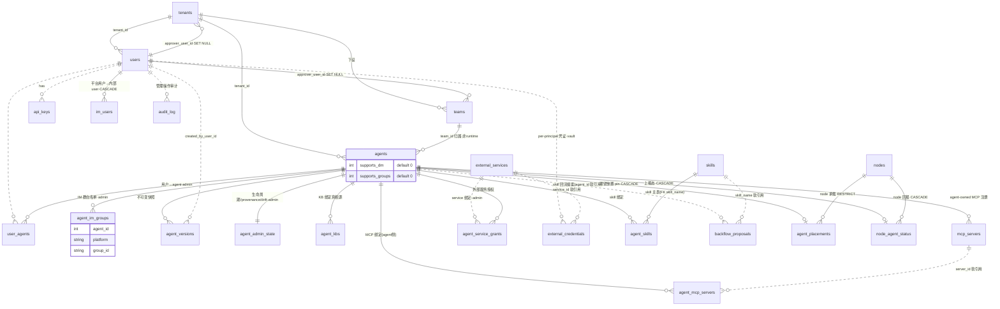
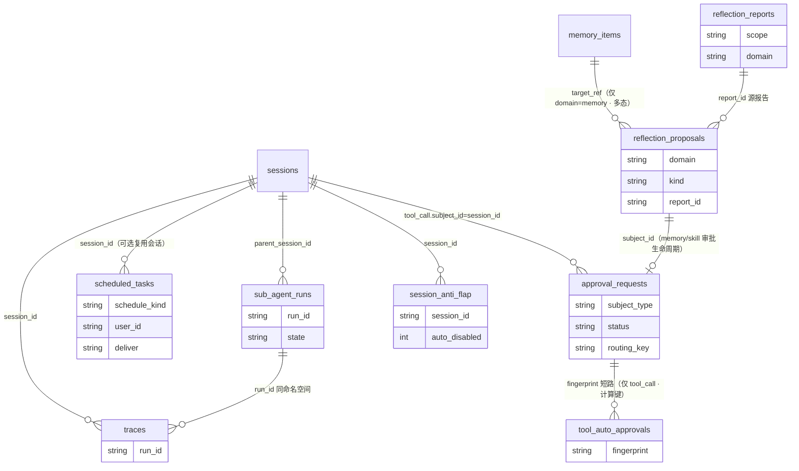
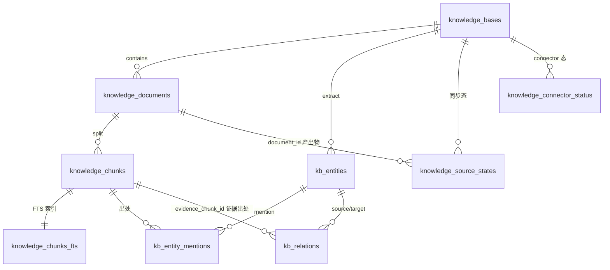

# fleetent 数据模型与物理拓扑（as-built）

> **现状权威参考**——只描述"当前 schema 是什么"。变更史（哪个迁移、哪一期落地）见 git 与 [`records/decision-logs/`](../records/decision-logs/)；设计 rationale（R1/R2/B2、物理 vs 逻辑、向量模型 A、实体减法等）见 [`persistence-redesign-decisions.md`](../records/decision-logs/persistence-redesign-decisions.md)。
> **列级 schema 真相源是迁移**：管理库 `migrations/`（Alembic）；agent 侧库 `runtime/agent_state_migrations.py` / `knowledge_base/core/migrations.py` / `memory/shared_memory_migrations.py`（嵌入式 Y）。本文实体清单为导航，不逐列复制。
> **维护规则**：任何 change 增删表 / 改列 / 改关系，MUST 同步对应实体清单**与 erDiagram**（图文同改）。
> **配套**：[`target-architecture.md`](./target-architecture.md)（核+4面+基座 · Identity §6 · 只读投影 §7）· [`agent-management.md`](./agent-management.md)（agent 生命周期/自管/绑定/编排）· [`skill-system.md`](./skill-system.md) · [`im-access-model.md`](./im-access-model.md)。

## 1. 物理拓扑（5 库类型 · 按主体物理分区）

数据分布在 **5 类物理库**，多主体时按**主体（tenant）物理分区**：

| 库类型 | 形态 | schema 权威 | 写者 / 访问 |
|---|---|---|---|
| **管理库** | 单库、跨主体（仅受管模式存在） | **Alembic** | platform 读写；agent 物理够不到 |
| **per-agent 运行库** | 每 (主体, agent) 一文件 | 嵌入式 Y | 该 agent 读写；platform 只读投影 |
| **共享记忆库** | per-tenant | 嵌入式 Y | 同主体多 agent 读写（真相源）；platform 只读 |
| **KB 关系库** | per-tenant | 嵌入式 Y | ingest 单写、agent 只读（派生视图）；platform 只读 |
| **向量底座** | 独立 substrate，按家族（`mem:`/`shared:`/`kb:`）路由到对应 scope 的向量库（可换 Qdrant） | 嵌入式 Y | 随各消费层 |

**目录布局与命名**（`X.db` 关系真相源 / `X_vectors.db` 向量索引配对）：

```
data/
  management.db                                   # 管理库（单库·跨主体·Alembic）
  <tenant>/
    kb.db / kb_vectors.db                         # KB 关系 / 向量（per-tenant）
    shared_memory.db / shared_memory_vectors.db   # 共享记忆 关系 / 向量（per-tenant）
    <agent_name>/
      agent_state.db                              # 该 agent 关系真相源
      agent_vectors.db                            # 该 agent 记忆向量
```

命名规则：per-tenant 层 `X`=资源名（`kb`/`shared_memory`，一资源一文件）；per-agent 层 `X`=归属（`agent_state`，一 agent 一文件、不按内容）。目录 `<tenant>/<agent_name>/` 用 agent 的可读 slug 圈定主体内的物理归属。

**物理库计数**：2 主体 × 各 2 agent = **17 库**（管理 1 + 每主体〔2 agent×(关系+向量)=4 + 共享 2 + KB 2〕×2）。"5" 是**类型数**，非部署文件数。

**跨主体隔离**：agent 进程经 `agent.yaml` 只开本主体目录下的文件，物理上够不到别主体的库——合规"主体间互不可见"由文件边界结构性保证，非纪律级 `WHERE tenant_id`。

## 2. schema 权威、路由与并发

- **双权威（按库分）**：管理库 **Alembic-only**；per-agent / 共享记忆 / KB 关系库走**嵌入式 forward-only 迁移（Y）**——schema 以代码中有序 `MIGRATIONS=[(ver,sql)]` 定义、DB 只存 `PRAGMA user_version`、**migrate-on-open**、每文件自迁、库版本 > 代码已知版本则拒启动（`SchemaTooNewError`）。空库与旧库同一代码路径。
- **关系完整性双层**：管理库经 `db.py` 的连接统一 `PRAGMA foreign_keys=ON`，声明了 FK 的管理表约束真实生效；store 写入校验承接 FK 难表达的语义约束（如 `agents.team_id` 与 `tenant_id` 的复合一致性）。agent 侧库以约定引用为主，其中 KB 关系库 `knowledge_documents → knowledge_chunks` 级联删除随 FK 真实生效。
- **FK 不回扫存量**：SQLite 只约束启用后的新写入/删除，不修复历史违规行；旧违规引用被触碰时在该次写路径迟发失败。
- **一文件一份 MIGRATIONS**：`agent_state.db` 由 `runtime/agent_state_migrations.py` 一份单调版本列表管——单文件单 `user_version`，不可每 store 各跑一份。
- **路由（租户作用域 + 可换后端）**：`tenant_router` 暴露 `tenant_scope(tenant)`（KB + 共享记忆句柄）与 `agent_scope(tenant, agent_name)`（per-agent 句柄）。SQLite 后端映射到上述目录文件，后端可换（将来 PG per-tenant DB / RLS，调用点不变）。物理路由主体取自 **agent 的归属主体**（`agents.team_id`/`tenant_id`）；请求者 `Principal.tenant_id` 仅用于 edge 跨主体校验（`agent_app._check_tenant`）。
- **并发**：所有 SQLite 连接启用 **WAL + busy_timeout**（关系库经 `db.py`、向量库经 `vector_store/backend.py`）——支撑只读投影读 + agent 写并发、共享记忆多 agent 写。
- **agent 侧表保留 `tenant_id` 列**：文件路由忽略它，作"可换后端"接缝（将来 RLS 按它行级强制）。

## 3. 实体模型（按库归类）

> 关系多为 `*_id` 约定引用；**物理库间无 DB 外键**。库内（同一物理库）声明的 FK 见各表"FK"列。
> **跨库引用孤儿契约**：消费方 **MUST** 容忍 `*_id` 指向已删/已 archive 的外库实体，按域语义拒绝或降级，不假设引用恒真；Identity / cron 复检类路径分域重查，不共享隐式一致性。

### 3.1 物理库全景（宏观）

5 物理库 + 库间**跨库逻辑引用**（虚线 = `*_id` 约定，非 DB 外键；agent 侧库物理分离、无跨文件外键）：

```mermaid
graph TD
  subgraph MGMT["管理库 management.db ｜ platform 侧 · 单库跨主体 · Alembic"]
    users
    tenants
    teams
    agents
    api_keys
    agent_kbs
    kb_connectors
    model_providers
    session_meta
  end
  subgraph AGENT["per-agent agent_state.db ｜ agent 侧 · 每 agent 一文件 · 嵌入式 Y"]
    sessions
    traces
    memory_items
    approval_requests
    reflection_reports
    reflection_proposals
    tool_auto_approvals
    scheduled_tasks
  end
  subgraph KB["KB 关系库 kb.db ｜ agent 侧 · per-tenant"]
    knowledge_bases
    knowledge_documents
    knowledge_chunks
    kb_entities
  end
  subgraph SHARED["共享记忆 shared_memory.db ｜ agent 侧 · per-tenant"]
    shared_memory_items
  end
  subgraph VEC["向量底座 ｜ agent 侧 · 按家族路由"]
    vector_items
  end
  memory_items -. user_id .-> users
  sessions -. user_id .-> users
  traces -. user_id .-> users
  traces -. agent_name .-> agents
  approval_requests -. requester_user_id .-> users
  scheduled_tasks -. session_id .-> sessions
  scheduled_tasks -. user_id .-> users
  shared_memory_items -. "scope_id(team|tenant)" .-> teams
  session_meta -. session_id .-> sessions
  agent_kbs -. kb_id .-> knowledge_bases
  kb_connectors -. "tenant_id,kb_id" .-> knowledge_bases
  vector_items -. "mem:" .-> memory_items
  vector_items -. "shared:" .-> shared_memory_items
  vector_items -. "kb:" .-> knowledge_chunks
```



> 宏观图只列各库主干实体；完整清单与库内关系见 §3.2–§3.6。`session_meta → sessions` 是全库唯一一条 mgmt→agent 方向跨库引用（platform 自有元数据挂 agent 会话，非 agent 反向写）。省略的跨库边：`reflection_proposals.*_user_id` / `approval_requests.approver_user_id` ⇢ `users`；agent 侧各表 `tenant_id` 接缝列 ⇢ `tenants`；`shared_memory_items.scope_id` 在 `scope_type=tenant` 时 ⇢ `tenants`。

### 3.2 管理库（Alembic · platform 侧）

> FK 列省略时表示无库内 FK（软引用）。`→X (CASCADE/RESTRICT)` 为库内 FK 及其 ondelete。

**身份 / 租户**

| 表 | 键 / 关键列 | FK | 用途 |
|---|---|---|---|
| `users` | 根主体；`tenant_id`；**无 key 列** | — | 唯一身份；key 真相源在 `api_keys`（SHA-256，明文不落库）|
| `api_keys` | `user_id` | — (软引用 users) | bearer key 哈希 |
| `tenants` | `approver_user_id` | — (软引用 users) | 主体（法人/商户）|
| `teams` | `tenant_id` · `approver_user_id` | → tenants | 主体下设团队 |
| `blocked_registrations` | 按 email 匹配 | — | 注册封禁名单（control-plane only）|
| `im_users` | `id` · UNIQUE`(platform, platform_user_id)` · `user_id` · `meta_json` | `user_id` → users (CASCADE) | 渠道身份 ⇄ 内部 user **纯双向映射**（无 owner_id/allowed；封禁走 `users.status`）|

**Agent 定义 / 绑定**（绑定族 `agent_id` 一律 → agents CASCADE）

| 表 | 键 / 关键列 | FK | 用途 |
|---|---|---|---|
| `agents` | `id`=不可变身份 · `name`=可读标签 · `active_version_id`(裸 INTEGER 无 FK) · `supports_dm`/`supports_groups`；无 status 列 | — | agent 定义；管理逻辑 → [agent-management](agent-management.md) |
| `agent_versions` | `agent_id` | → agents (CASCADE) | 不可变版本快照 |
| `agent_admin_state` | PK `agent_id`；`status`/`provenance`/`drift`/`archived_at` | → agents (CASCADE) | 管理态（生命周期+自管+drift）→ [agent-management §2](agent-management.md) |
| `user_agents` | `(user_id, agent_id)` | → agents (CASCADE) | 用户↔agent 准入；materialize → `im.allow_users`（admin 维护）|
| `agent_im_groups` | `(agent_id, platform, group_id)` | → agents (CASCADE) | IM 群白名单；materialize → `im.<platform>.allow_groups` |
| `agent_kbs` | `agent_id` · `created_by` | → agents (CASCADE) | agent↔KB 绑定真相源；`kb_id` 软引用本 tenant `kb.db` |
| `mcp_servers` | `agent_id` 可空 | → agents (CASCADE，agent-owned 行) | MCP 注册表（定义：transport/url/auth；含全局 `agent_id=NULL` 行）|
| `agent_mcp_servers` | `(agent_id, server_id)` | → agents (CASCADE) | agent↔MCP 挂载（绑定）；`server_id` 软引用 `mcp_servers` |
| `agent_service_grants` | `agent_id` · `run_as`(user/agent) | → agents (CASCADE) | agent↔外部服务授权；`service_id` 软引用 `external_services` |
| `agent_secrets` | `agent_id` 可空（agent/shared scope）| → agents (CASCADE) | 密文 secret（node 下发时注入）|
| `agent_skills` | `(agent_id, skill_name)`；drift 列 `base_version`/`base_commit`/`drift`/`drift_at` | → agents (CASCADE) · → skills(name) | skill 启用 + 部署副本 drift；→ [skill-system](skill-system.md) |
| `external_services` | 单层全局**无 `agent_id`**；`protocol`=oauth2/apikey | — | 工具 OAuth 服务注册表（`client_secret` 走 env 不落库）|
| `external_credentials` | PK `(user_id, service_id)`；`status`=authorized/needs_reauth/error | — (软引用 users/external_services) | per-principal Fernet 加密凭证（明文不出库）|

**节点编排**（→ [agent-management §6](agent-management.md)；desired/reported reconcile）

| 表 | 键 / 关键列 | FK | 用途 |
|---|---|---|---|
| `nodes` | `id` TEXT PK · `key_hash` 唯一 · `labels` JSON · `last_seen_at` | — | 节点注册表（worker；key_hash=bearer 鉴权、心跳）|
| `agent_placements` | PK `agent_id` · `node_id` · `pinned_by` | → agents (CASCADE) · → nodes (RESTRICT) | **期望态**：pin agent→node（node 有 pin 不可删）|
| `node_agent_status` | PK `agent_id` · `node_id` · `phase`/`pid`/`health`/`detail` | → agents (CASCADE) · → nodes (CASCADE) | **上报态投影**：node 回报实际运行态 |

**Skill 治理**（→ [skill-system](skill-system.md)）

| 表 | 键 / 关键列 | FK | 用途 |
|---|---|---|---|
| `skills` | PK `name`；`status`/`global_enabled`/`audit_verdict`/`audit_rules`/`forced`/`source`/`immutable_fields`/`current_version` | — | skill 主表（治理 + 溯源合一）|
| `backflow_proposals` | `id`；`base_version`/`base_commit`；`proposed_bundle`(多文件 JSON)；`status`/`conflict`/`overridden_head`/`forked_as` | — (软引用 agents/skills) | agent 运行时改 skill 的回流提案 |

**KB 管理 / 模型 / 治理**

| 表 | 键 / 关键列 | FK | 用途 |
|---|---|---|---|
| `kb_connectors` | connector 配置 + 自定义元数据 | — | KB 数据源配置（实际内容在 per-tenant `kb.db`）|
| `model_providers` | provider + api_key env | — | materialize 读：model_overrides → ModelTarget |
| `audit_log` | 管理操作审计 | — (软引用 users) | 平台管理操作审计 |
| `session_meta` | `session_id` · `agent_id` 可空 · origin/pinned/takeover | → agents (CASCADE) | platform chat 管理元数据（`session_id` 跨库逻辑引用 agent `sessions`）|

> 下图只画有库内关系的主干表；独立/弱关联表不入图：`blocked_registrations`、`agent_secrets`、`kb_connectors`、`session_meta`。
> **图例**：**实线** = 有 FK 约束的硬关系；**虚线** = 软引用（按 id/name 约定、无 FK）。边标记：`·admin` = FK 真实但仅 admin/console 消费、非 agent runtime；`·vault` = per-principal vault provider。



### 3.3 per-agent 运行库（嵌入式 Y · `agent_state.db` · agent 侧）

统一 MIGRATIONS（`runtime/agent_state_migrations.py`，单文件单 `user_version`）建 **10 张表**：

| 类 | 表 | 关键列 / 说明 |
|---|---|---|
| 会话/运行 | `sessions` | 会话元数据索引（`session_id`/`user_id`/timestamps/`message_count`，**无 `agent_name` 列**——归属由物理库圈定）|
| | `traces` | append-only 运行轨迹，挂 `session_id`/`run_id`；agent 维度列 `agent_name` |
| | `session_anti_flap` | 压缩防抖，per session |
| | `sub_agent_runs` | 子 agent 生命周期，`run_id` 与 traces 同命名空间 |
| 记忆 | `memory_items` | per-user 语义记忆（**无 namespace 列**，agent 隔离靠物理库）|
| 审批 | `approval_requests` | 审批生命周期**单一真相源**，`subject_type`=tool_call/memory_proposal/skill_proposal |
| | `tool_auto_approvals` | 工具 auto-approve 指纹表（仅 tool_call）|
| 反思 | `reflection_reports` | 观察日志，`domain`=memory/skill/knowledge_base/legacy |
| | `reflection_proposals` | memory/skill 提案实体；审批生命周期在 `approval_requests` |
| 调度 | `scheduled_tasks` | cron/once/interval；`task_type`=notify(直发)/generate(跑 agent 发回复)/action(自发不广播)|



> **库内不变量**：① `reflection_proposals.target_ref` 多态——memory 类指 `memory_items.id`、skill 类指文件系统 skill 名，完整性由 apply 路径兜底（无 FK；图中 `memory_items → reflection_proposals` 边仅 `domain=memory` 成立）。② `traces` 挂 `session_id`（查询过滤）+ `run_id`（与 `sub_agent_runs` 同命名空间，关联子 agent trace 树）。③ `session_id`/`run_id`/`report_id` 均约定引用、**无时序保证无外键**：`approval_requests`/`traces` 可先于 `sessions` 索引行写入，`report_id` 可空。④ `approval_requests` 是审批单一真相源：tool-call subject 在 session meta `pending_approvals`、memory/skill subject 是同 id `reflection_proposals`，统一 resolve router 按 `subject_type` 分派。⑤ `tool_auto_approvals` 经**计算键** `fingerprint=hash(scope_key, tool_name, tool_args)`（`scope_key=requester_user_id`）关联，非存储 FK。
> **跨库**：`memory_items.user_id` / `approval_requests.requester_user_id` ⇢ 管理库 `users`（managed 成立；standalone 可为不透明渠道 id）；tool-call `approval_requests.subject_id` ⇢ 本库 `sessions.session_id`。会话**内容**是 JSON 文件（`SESSIONS_DIR`，与元数据表物理分离）。

### 3.4 共享记忆库（嵌入式 Y · `shared_memory.db` · agent 侧 · per-tenant）

`shared_memory_items`：team/tenant scope 共享记忆，同主体多 agent 写的真相源。

### 3.5 KB 关系库（嵌入式 Y · `kb.db` · agent / ingest 侧 · per-tenant）

`knowledge_bases`(PK `(tenant_id, kb_id)`) · `knowledge_documents` · `knowledge_chunks`(+`chunks_fts`) · `knowledge_source_states` · `kb_entities` · `kb_entity_mentions` · `kb_relations` · `knowledge_connector_status`。

> 无 `kb_extraction_runs`：extraction run 摘要只同步返回 / 走 observability trace，不持久化。KB 反思**观察**落 agent `agent_state.db.reflection_reports(domain=knowledge_base)`；**remediation**（写回/sync）在 platform / ingest 面，不在 agent apply。



> KB 是 tenant 共享资源：platform ingest/sync 写本 tenant `kb.db`/`kb_vectors.db`，agent retrieval/graph_search 只读同名文件。可用 KB 由 `agent_kbs`（管理库绑定真相源，`kb_id` 跨库引用）materialize 进 `agent.yaml`，运行时读配置不查表。

### 3.6 向量底座（独立 substrate · 按家族路由）

`vector_items`：每 scope 一个向量库文件——`mem:`→当前 agent `agent_vectors.db`（库内再按 `mem:{user_id}` 分区）；`shared:`→`shared_memory_vectors.db`；`kb:`→`kb_vectors.db`。

## 4. 多租户与隔离

- **tenant = 主体（法人/商户）**，`teams` 在其下；`users.tenant_id` 给组织归属。v1 **不建 `team_members`**——共享记忆/KB/审批走 **agent 归属 team**（`agents.team_id`），不需请求者 team。
- **隔离 = 物理 per-tenant**：合规"主体间互不可见"由目录/文件边界保证。管理库单库跨主体（注册中心，不存业务对话/KB）；业务数据按主体分目录。
- **可换后端**：SQLite 文件路由是当下后端；保留 `tenant_id` 列以接住将来 PG（per-tenant DB 或 RLS）。
- **审批人**：`teams.approver_user_id` / `tenants.approver_user_id`，解析链 `agent.team_id 审批人 → tenant 审批人 → reject`（default-closed），部署时 materialize 进 `agent.yaml`。

## 5. 身份与认证

认证属 edge、核只消费已解析的 `Principal{user_id, tenant_id}`（agent 侧不 import platform）。详见 [`target-architecture.md` §6](./target-architecture.md)。

## 6. platform 读侧投影

platform 控制面经**只读连接**（`mode=ro`、不迁移）+ 共享 store 读函数 + management.db registry 读 agent 侧库；不物化副本、不要求 agent 反向写。身份翻译只收口两处：materialize/boot 写边界 `agents.id → name` 覆盖 agent 产物、read-projection/observability 读边界 `agents.name → id` 关联回平台实体。详见 [`target-architecture.md` §7](./target-architecture.md)。
