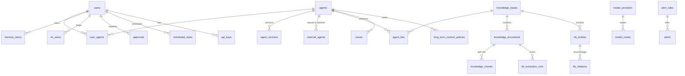

# fleetent 数据模型与实体关系（2026-06-09）

> **状态：草案 / 待讨论（DRAFT）**。供「数据库与实体关系设计」讨论用。
> 配套：[`target-architecture-proposal.md`](./target-architecture-proposal.md)（目标架构：核+4面+基座）、
> [`module-dependency-graph.md`](./module-dependency-graph.md)（模块依赖）。

## 0. 取数方法与口径

- **权威源**：Alembic 迁移（head = `062`）。本文实体/字段以 **dev `data/fleetent.db`（revision 046）实际 schema** 为骨架，并核对迁移 047–062 的增量。
- **已核实**：迁移 **047–062 不新增表，只改列/索引**——故 dev 库的 50 张表即 head 的完整表集合（个别新列在下文标注）。
- **三处需特别注意（也是发现）**：
  1. **迁移链是健康的**（更正早期误判）：用临时 ini 指向空库，`alembic upgrade head` 干净跑到 062（含 049）。早先「链坏了」是因 `migrations/env.py` **忽略 `DATABASE_URL`**、命令误打真实 `data/fleetent.db`（其 schema 已偏离历史）所致——非迁移代码问题。详见 §4-⑧。
  2. 部分表**不在 Alembic**，由 store `_init_db` 运行时创建：`users`、`audit_log`、`im_connectors`、`session_anti_flap`、`sub_agent_runs`、`api_keys`、`quotas`、`quota_usage`、`invites`、`im_channel_allowlist`、`sessions`(users.db)。后果：`alembic upgrade head` 从空库只建出**半套** schema（连 `users` 都缺）。（其中 `quotas`/`quota_usage`/`invites` v1 **删除**、不收编——见 §5.8。）
  3. **双 schema 权威是有意设计**：管理库走 alembic、per-agent 库走各 store 的 `ensure_schema()`（单机 agent 须脱离 alembic 启动）；二者对 agent-side 表各写一份 DDL、靠手工保持一致 → 可漂移。

## 1. 三个数据库（物理分布）

| DB 文件 | 内容 | 备注 |
|---|---|---|
| `data/fleetent.db` | 50 张主表（agent / KB / memory / 治理 / 监控 / 会话元…） | 主库，Alembic 管理 |
| `data/users.db` | **仅 `sessions`** | ⚠️ 名实不符：`users` 表反而在 fleetent.db；会话数据跨两库 |
| `data/vector_store.db` | `vector_items`（向量嵌入） | 基座向量 infra |

> **发现**：会话数据 split-brain——`sessions` 在 `users.db`、`session_meta` 在 `fleetent.db`。

## 2. 实体目录（按目标架构的「面」归类，字段级）

> 关系列以 **`x_id`** 标注；`→Y` 表示按约定引用 Y（多数**非 DB 外键**，见 §4-①）。

### 身份 & 用户（基座 / ②）
- **users** — `id`(PK) · name · api_key · email · password_hash · role · status · must_reset · totp_secret　〔根主体〕
- **api_keys**〔store〕 — `id` · `user_id`→users · key_hash · prefix · scope · expires_at · revoked_at · last_used_at · call_count
- **invites**〔store〕 — `id` · email · token_hash · expires_at · used_at　〔**✅ 已删**（`trim-user-auth` 合并，迁移 066）:自助注册不可达、不发邮件、与 admin 建用户重叠〕
- **im_users** — `id` · `owner_id`→users · platform · platform_user_id · `user_id`→users · allowed · meta_json　〔(platform,platform_user_id)→内部 user 映射〕
- **im_connectors** — `id` · `owner_id`→users · platform · enabled · allowlist_enforced · config · status · last_heartbeat_at
- **im_channel_allowlist**〔store〕 — `id` · `owner_id` · platform · scope_type · `scope_id` · allowed

### Agent 定义 & 绑定（②控制）
- **agents** — `id` · name · system_prompt · allowed_tools · `tenant_id` · `team_id` · `active_version_id`→agent_versions · features · plugins · allowed_skills · icon · config_overrides〔061〕
- **agent_versions** — `id` · `agent_id`→agents · version · system_prompt · allowed_tools · skills_dir · mcp_server_ids · model_overrides · memory_namespace · `created_by_user_id`→users · created_at　〔不可变版本快照〕
- **agent_admin_state** — agent_name · status · provenance · drift · archived_at　〔版本/部署态〕
- **user_agents** — `user_id` · `agent_id`　〔用户↔agent M:N〕
- **channel_agents** — `id` · platform · `channel_id` · `agent_id` · `bound_version_id`　〔渠道↔agent〕
- **agent_kbs** — `tenant_id` · `kb_id` · `agent_id`　〔agent↔KB 绑定〕
- **knowledge_base_agent_bindings** — `tenant_id` · `agent_id` · `kb_id`　⚠️**疑似与 agent_kbs 重复**
- **agent_mcp_servers** — `id` · `agent_id` · `server_id` · transport · url · auth_type · api_key_env · command · args · env · headers · enabled
- **agent_mcp_server_bindings** — `agent_id` · `server_id`　〔绑定〕
- **agent_oauth_bindings** — `agent_id` · `connector_id`→connectors
- **connectors** — `id` · `agent_id` · display_name · protocol · oauth_config · enabled　〔工具 OAuth 凭证〕
- **agent_skills** — `agent_id` · skill_name · enabled
- **long_term_context_policies** — `id` · `tenant_id` · `agent_id` · 各 *_enabled / *_max_tokens / *_top_k · conflict_preference

### 知识库（④摄取 / 核检索）
- **knowledge_bases** — **PK(`tenant_id`,`kb_id`)** · description · archived_at　⚠️复合键（与他表 `id` 风格不一致）
- **knowledge_documents** — `id` · `tenant_id` · `kb_id` · filename · source · source_url · archived_at
- **knowledge_chunks** — `id` · `document_id`→knowledge_documents〔FK,CASCADE〕 · `tenant_id` · `kb_id` · position · content · metadata_json
- **kb_entities** — `id` · `tenant_id` · `kb_id` · entity_type · name · normalized_name　〔知识图谱节点〕
- **kb_entity_mentions** — `id` · `entity_id` · `document_id` · `chunk_id` · `extraction_run_id` · text · confidence
- **kb_relations** — `id` · `tenant_id` · `kb_id` · relation_type · `source_entity_id` · `target_entity_id` · `evidence_document_id` · `evidence_chunk_id` · confidence　〔图谱边〕
- **kb_extraction_runs** — `id` · `tenant_id` · `kb_id` · `document_id` · extractor · status · *_scanned/*_written 统计
- **knowledge_source_states** — `source_id` · `tenant_id` · `kb_id` · source_path · mtime_ns · content_hash · `document_id`　〔增量同步态〕
- **knowledge_connector_status** — `connector_id` · connector_type · `tenant_id` · `kb_id` · last_status · last_error　〔connector 同步态〕

### 记忆（核能力）
- **memory_items** — `id` · `user_id`→users · type · content · ~~namespace~~ · expires_at　〔per-user 语义记忆;**`namespace` 列 R2-叉2 废弃**(agent 隔离改物理 per-agent 库),#3 落地〕
- **memory_maintenance_proposals** — `id` · `user_id` · action · proposed_content · risk · status　〔记忆自维护建议〕
- **shared_memory_items** — `id` · scope_type · `scope_id` · type · content · status · source　〔团队/租户共享记忆〕

### 自进化（核生成 / ②管理）
- **reflection_reports** — `id` · scope · time_window_start/end · findings_json
- **kb_reflection_reports** — `id` · scope · time_window · findings_json · signal_summary_json
- **skill_proposals** — `id` · type · target_skill · suggested_draft · suggested_diff · status · `reviewer_user_id` · `actor_user_id` · applied_at
- **skill_provenance** — skill_name · source · drift · immutable_fields · last_deploy_at
- **skill_admin_state** — skill_name · status · global_enabled · audit_verdict · forced

### 会话 & 运行数据（核 → 基座）
- **sessions**〔users.db〕 — 会话 JSON 持久化
- **session_meta** — `session_id` · `user_id` · origin · status · takeover_actor · takeover_at · pinned · pin_note · agent_name · channel　⚠️**禁忌表**（见 §4-⑤）
- **session_anti_flap** — `session_id`(PK) · recent_savings · turns_since · auto_disabled
- **sub_agent_runs** — `run_id`(PK) · `parent_session_id` · name · state · timeout_seconds
- **traces** — `id` · `run_id` · `span_id` · `parent_span_id` · `session_id` · `user_id` · `agent_id` · `tenant_id` · event_type · payload_json　〔append-only 轨迹〕

### 编排（③）
- **scheduled_tasks** — `id` · name · cron_expr · timezone · `user_id` · agent_name · message · `session_id` · source

### 治理（核执行 / 基座数据）
- **approvals** — `id` · `session_id` · `requester_user_id` · risk_level · tool_name · tool_args · status · `approver_actor`(不透明) · resolved_at　〔**已迁 agent 侧 `governance/approval_store`**(R1/A 已合并);alembic 060 的旧定义待 #2/#3 退场(双权威延后项)〕
- **audit_log** — `id`(PK) · `actor_user_id` · action · target_type · `target_id` · detail · `batch_id`
- **quotas / quota_usage**〔store，懒建〕 — per-user / 全局配额与用量　〔**✅ 已删**（`descope-quota` 合并，迁移 065）:曾 check/record 全仓零调用、非功能态〕

### 模型（②控制）
- **model_providers** — `id` · base_url · model · api_key · max_tokens · 价格字段 · vendor/protocol/params〔050〕
- **model_routes** — task_type · `provider_id`→model_providers · priority

### 监控（基座 observability）〔**✅ 已外置移除**（`externalize-monitoring` 合并，迁移 063 drop 下列 4 表 + resource_monitoring 模块已删）〕
- **alert_rules** — `id` · metric · target · comparator · threshold · severity · channels
- **alerts** — `id` · `rule_id`→alert_rules · target · status · fired_at · acked_by
- **metric_samples** — `id` · metric · target · value · ts
- **maintenance_windows** — `id` · target · start_ts · end_ts

### Askit（②控制）〔任务队列三表 DEAD、**✅ 已删**（`dead-schema-cleanup` 合并，迁移 064）;`agent_apply_api` 保留、不依赖它们〕
- **askit_tasks** — `id` · series · command · params · workspace · status · exit_code · artifact
- **askit_task_logs** — `id` · `task_id`→askit_tasks · seq · stream · line
- **askit_workspaces** — `id` · env · repo_path · endpoint

### 向量（基座，vector_store.db）
- **vector_items** — 嵌入向量（独立库）

## 3. 关系骨架（ER 图）



**幻影实体（已决议解决，见 §5.7）**：`tenant_id` / `team_id` 贯穿 agents / KB / traces / policies，但**当前没有 `tenants` / `teams` 表**——多租户是裸列、无根实体（§4-②）。2026-06-09 决议：立 `tenants`(=主体)/`teams` 实体 + 物理 per-tenant 隔离。

## 4. 设计问题（讨论议程）

1. **关系几乎全隐式**：全库**仅 3 条 SQL 外键**（`agent_id`→agents、`document_id`→knowledge_documents CASCADE、复合 `(tenant_id,kb_id)`→knowledge_bases）。其余引用整性全靠 `*_id` 约定 + store 逻辑，DB 无保障。→ **要不要补外键？** 权衡：SQLite-first/可审计/手写 SQL ⟷ 完整性与级联删除。
2. **多租户无根实体**：无 `tenants`/`teams` 表。→ **✅ 已决议（2026-06-09，见 §5.7）**：立 `tenants`(=主体/法人实体)/`teams` 实体做根，主体间**物理 per-tenant 强隔离**。
3. **身份策略不统一**：多数表 surrogate `id`；KB 用复合自然键 `(tenant_id,kb_id)`；绑定表用复合自然键（user_id+agent_id）。→ **是否统一**（全 surrogate id？还是明确「聚合根用自然键」）？
4. **疑似重复绑定**：`agent_kbs` 与 `knowledge_base_agent_bindings` 均为 agent↔KB。→ **核实(2026-06-09)**：两表分属平台侧(agent_kbs,带 `created_by` 审计)与 agent 侧(无审计),**之间无同步**;`dead-schema-cleanup` 清了 KB binding 死代码 + scope.py/bindings.py 去重,但**表收敛(R1a)仍 deferred**(收敛成"单一真相源+派生只读",随 #3)。
5. **`session_meta` 禁忌表**：CLAUDE.md 明令 agent 运行时数据不得入 platform 管理表；迁移 `054–059` 正是「加运行时列（compaction/token/resume_pending）→删」的返工实证。但残留 `origin/status/takeover/pinned/agent_name/channel` 等——→ **逐列审计**：哪些是 platform 治理（合法）、哪些是运行时残留（该回 session 文件）？
6. **`users.db` 残留 / 会话数据 split-brain**：`sessions`(users.db, 裸 sqlite3) / `session_meta`(fleetent.db) / `vector_items`(vector_store.db)。→ **已决议三层拓扑**（§5）：消灭 users.db、vector 独立成共享库。
7. **Schema lifecycle 分裂**：`users`/`audit_log`/`im_connectors`/`session_anti_flap`/`sub_agent_runs`/`api_keys`/`quotas`/`quota_usage`/`invites`/`im_channel_allowlist`/`sessions` 由 store `_init_db` 运行时建，不在 Alembic → `alembic upgrade head` 只建半套。`im_channel_allowlist` 源码还有**两处 CREATE TABLE** 重复。→ 管理表收编 Alembic（roadmap #2）；agent-side 表保留 ensure_schema 但加漂移护栏（#1）。**例外**：`quotas`/`quota_usage`/`invites` v1 **删除**（不收编，见 §5.8）。
8. **迁移链健康，但 env.py 与 app 脱节**（更正）：迁移链空库可重放到 062。真问题是 `migrations/env.py` 忽略 `DATABASE_URL`、用 ini 硬编码 url → app 与迁移指向不同库；dev 库因「`_init_db` + 部分 alembic + stamp」混合路径建出而**偏离历史**。→ env.py 读 `DATABASE_URL`（roadmap #1）。

## 5. 目标拓扑与决议（已定，2026-06-09）

经讨论敲定的 DB 终态——**逻辑 4 层 / 物理 5 库 + 嵌入式迁移（Y）+ Identity 端口**，外加横切的向量 infra 按 namespace 家族路由分层。它是 §6 roadmap 的标尺。（2026-06-09 R1/R2 收口后更新，取代早期「三层库 + 双权威」措辞。）

### 5.1 物理拓扑（逻辑 4 层 / 物理 5 库）

| 逻辑层 | 库形态 | 装什么 | schema 权威 |
|---|---|---|---|
| **管理库** | 单库（仅受管模式存在） | users · agent 定义/版本/绑定 · connectors · providers · audit · monitoring · askit · api_keys/quotas/invites/im allowlist · **审批治理记录**（身份解析后 who/when，R1） | **Alembic（唯一 alembic 库）** |
| **per-agent 运行库** | **每 agent 一个文件** | sessions · traces · session_meta(运行列) · session_anti_flap · sub_agent_runs · memory_items(**仅 `user_id` 键、无 namespace 列**，R2-叉2) · skill 提案草稿 · per-agent reflection · **审批请求+门状态**(R1) | **嵌入式迁移**（Y） |
| **共享记忆库** | 跨 agent | shared_memory(team/tenant)——多 agent 写的**真相源** | **嵌入式迁移**（Y） |
| **KB 关系库** | 跨 agent | knowledge_*/kb_*/chunks_fts · 摄取/同步态——**ingest 单写、agent 只读**的派生视图 | **嵌入式迁移**（Y） |

**第 5 个物理库 = 向量底座**：`vector_store` 是横切 **infra**（非 KB 子件），后端**按 namespace 家族路由分层**——`mem:`→per-agent 向量库、`shared:`→共享记忆向量库、`kb:`→KB 向量库（可换 Qdrant）。同一套 `vector_store` API，连接目标由 config 驱动（单机=本地文件、受管=各连各服务）。

**决议依据**：
- **管理库 ≠ agent 库**（物理分开）= agent/platform 解耦契约的 DB 层落实：agent 不打开管理库，物理上无法写管理表（根治 `#1 泄漏`、`session_meta` 反例那类越界）。platform **只读** agent 库。
- **per-agent 库**：隔离、爆炸半径小、单机/受管同一套存储布局、SQLite 写不互锁。（PR #190 已起步）
- **共享层按写者再拆（R2-叉1=1b）**：shared_memory 是**多 agent 写的真相源**、KB 是 **ingest 单写 / agent 只读的派生视图**，两类写者/生命周期不混 → 各自成库；每层回到「单一写者域」，无多写者协调。一个 KB = **关系底座 + 向量底座**两个物理 substrate。
- **向量随消费侧分层**：per-agent 记忆的向量必须落 per-agent 向量库，否则 per-agent 隔离在向量层是假的。
- **多租户维度**：受多租户时，以上各层按**主体（tenant）物理分区**——共享记忆库 / KB 库 / per-agent 库 per-tenant，管理库保持单库跨主体（详见 §5.7）。

### 5.2 schema 权威：管理库 Alembic、agent 侧库嵌入式迁移（Y，R2-叉3）

仅**管理库 alembic-only**（管理表只在受管模式存在、单机无对应 → 单一权威，不会漂移）。**per-agent / 共享记忆 / KB 关系库走嵌入式 forward-only 迁移**：

- schema 定义在**代码**（有序 `MIGRATIONS = [(ver, sql), ...]` + `CURRENT` 版本号），随 agent 发版、进 PR review；
- DB 文件只存**版本戳**（SQLite `PRAGMA user_version`，或自建极小 `_schema_meta` 表）；
- **migrate-on-open**（开库即迁）、**每文件自迁**（每 agent 启动迁自己那份，无需中央编排）、每步在事务内执行且成功才 bump 版本、**库版本 > 代码已知版本则拒启动**（防降级）；
- 空库（v=0 跑全部步）与旧库（只跑增量步）**同一代码路径**。

> 取代今天「无版本 `CREATE IF NOT EXISTS` + 手工 ALTER」的乱补——是结构化升级，不是开倒车。
> **漂移护栏（#1 已立）降级为过渡件**：仅在 #3 物理拆分前（agent 表仍混在 `fleetent.db`、与 Alembic 双定义，如 `approvals`）防漂移；#3 拆完 agent 库与管理库表集合不相交，护栏退役。
> **需同步改 CLAUDE.md**：「schema lifecycle 归 Alembic / 不要 ensure_schema 补列」→「仅管理库归 Alembic；agent 侧库用结构化嵌入式迁移」。

### 5.3 Identity 端口

authn 抽成基座端口（`凭证→principal`）：单机本地实现 + 平台实现 + **OIDC/Google 适配器**；users/key 归管理库；核只依赖端口、不 import 管理面 → 结构性根除 `#1 泄漏`。详见 `target-architecture-proposal.md` §6。

### 5.4 仍待后续决定（不阻塞 roadmap，留作 schema 设计专题）

§4-①②③④：DB 外键 vs store 约定、立 tenants/teams 实体、身份键统一、合并 `agent_kbs`/`knowledge_base_agent_bindings`。这些是**schema 设计**，与下方「卫生/拓扑」roadmap 正交，单独成题。（R2 收口的是**拓扑/归属**，这 4 项 schema 设计仍未决。）

### 5.5 审批/提案归属契约（R1，2026-06-09）

审批是 **agent 全权能力**，platform 不参与握手、只做最终一致的**只读下游投影**（CQRS：agent 侧=写模型/真相源，platform=只读投影）。闭环全程 agent 侧，**请求者 ≠ 审批人**：

1. agent 撞风险门 → 查**审批人路由** → 经 im_gateway **主动外呼/私信**指定审批人；
2. 审批人人工 approve/reject（agent 阻塞等、带超时）；
3. agent 据结果继续执行 + 把记忆/skill/KB 等产物**写 agent 侧**（落点按 §5.1 + 下方 copy-up 分叉）。

**承重假设**：platform **不能同步 gate、不能事后回拦**已被 agent 本地批准并执行的动作；中央治理只以**配置时**表达（agent.yaml / allowlist / `agent_policy` 白名单），不以运行时 gate 表达。这是「agent 必须脱离 platform 跑」唯一自洽的模型，也是 CLAUDE.md 既有「读产物不反向写」「curated 源→sync→KB」从 KB **推广到所有审批/提案流**。

**copy-up 语义按真相源/派生视图分叉**：user-memory=platform 可选读投影；shared-memory=读投影；skill 提案=platform **二次部署门**（本地批准≠全局生效，部署成全局资产落管理库+skills_dir）；KB=**sync 重建**（绕审批门，受信运维）。

**现状判定**（`governance/permission_gate.py` 摸查）：delivery 方向已对（审批请求顺响应流回、resolve 走 agent 自己的 API，TUI/IM/HTTP 皆其客户端）；但 **state 模型错且只因单体未暴露**——① 活门是进程内 `asyncio.Event`，跨进程 resolve 直接失效（platform 消费者全是 placeholder 佐证）；② `approvals` 表在管理库（经 `user_store._conn`），**agent runtime 写管理库** = 越界 + #1 泄漏链；③ `approvals` 双 schema 权威（alembic 060 + `_init_db`）；另：`session_id` 永远写 `""`、重启把 pending 全标 timeout（「重启存活」是假的）。**需重构**——自成一个 change（见 §6「审批重设计」）。Identity 端口（§5.3）是其前提：agent 侧只存**不透明 actor 标签**，platform 负责解析真实身份。

**审批人路由 schema（基线）**：挂在 `AgentFile`（agent.yaml）的 `approval` 块，主轴 = **风险等级 `by_risk` + 按工具 `by_tool` 覆盖**；approver 用内部 user_id（经 im_user_store 解析成 IM 地址）；多人策略先 **any/all**（N-of-M 后置）；兜底 `on_no_approver: reject`（没配/DM 发失败/超时一律拒，default-closed）；新 `approval` 块**取代**连接器级 `require_approval`。⚠️**Gap A（承重）**：现有 im_gateway **无「主动外呼指定人」能力**（出站只有 telegram 打字指示器），必须新增出站发送原语（Slack `chat_postMessage` DM / Telegram `send_message`）；平台约束：Telegram bot 不能私信没 /start 过的用户、Slack 可向任意工作区用户开 DM → 可达性按平台校验。

### 5.6 向量 namespace 命名整改（R2，必做）

namespace 家族（`mem:` / `shared:` / `kb:`）现在**就是路由到物理后端的键**，须：① 家族判别符**显式枚举** `VectorFamily` + 单一 `family_of()` 路由入口（禁 ad-hoc `startswith`，未知前缀 raise）；② 拆解「namespace」一词的**三重过载**（向量路由串 / agent 隔离字段 `memory_namespace` / `memory_namespace()` 第二参）。叉2 锁死后 `memory_namespace()` 第二参删除、`mem:{user_id}` 即足；token 按层改名（如 `umem`/`smem`/`kb`）为可选低优项。

### 5.7 多租户：tenant=主体 + 物理 per-tenant 隔离（2026-06-09 决议）

**背景**：客户公司存在多法人主体（如 A 主体 / B 主体），主体间数据（尤其财务的 KB / 记忆 / 会话）**必须强隔离、互不可见**（合规 / 数据主权硬要求）。故 §4-② 幻影实体的决议是 **立实体 + 物理隔离**，而非裁掉多租户。

**实体**（裸列 → 真实体/外键）：
- `tenants`（= 主体）：`id · name · status · created_at · approver_user_id · 主体级配额/配置`
- `teams`：`id · tenant_id`→tenants `· name · approver_user_id · created_at`
- `users` 补 `tenant_id`→tenants（**今天 users 无任何组织归属——真缺口**）
- `team_members`：`team_id`→teams `· user_id`→users（M:N）
- agents/KB/traces/policies 的 `tenant_id`/`team_id` 升真外键；`shared_memory.scope_id` 按 `scope_type` 指向 tenants/teams

**审批人(org 两级,2026-06-10)**：`teams.approver_user_id` / `tenants.approver_user_id` —— agent 可被多 team 的人使用,但其共享记忆/KB/高危工具的**审批归 agent 归属 team 的审批人**(非请求者 team)。解析链:`agent.team_id 的审批人 → (无) tenant 的审批人 → (无) reject(default-closed)`。部署/materialize 时沿链解析出审批人写进 agent.yaml `approval` 块,核运行只读配置、不实时查 org（保解耦);默认单审批人,config 可覆盖多人 + `any/all`。详见 `target-architecture-proposal.md §6.5`。

**隔离 = 物理 per-tenant**（不靠 `tenant_id` 列 + 纪律）：
- `管理库`：**单库、跨主体注册中心**（tenants/teams/users/team_members/agent 定义，带 `tenant_id` 列），platform 专用，**不存业务对话/KB**。
- 每主体一个目录 `<tenant>/`，内含：每 agent 一个 `per-agent 库` + **per-tenant 的 `共享记忆库`** + **per-tenant 的 `KB 库(+向量)`**。
- agent 进程经 `agent.yaml` 只开本主体目录下的文件，**物理上够不到别主体的库**。
- 示例（2 主体 × 各 2 agent）：`管理库`×1 + 每主体（2×per-agent + 1 共享记忆 + 1 KB）= **9 库**。

**与 R2 的关系**：给 §5.1「共享层」补上 tenant 维度——共享记忆库 / KB 库 / per-agent 库**按主体物理分区**。物理 vs 逻辑的实际差别**只在共享层**（KB + 共享记忆：per-主体一库靠文件分 vs 共用一库靠 `tenant_id` 列分）；`管理库` 与 `per-agent 库` 两方案相同。

**物理 vs 逻辑(2026-06-10 重估,结论:保持物理)**：重估过"单库 + `tenant_id` 列做逻辑隔离"。保持物理,因为:① "财务互不可见"是**合规硬要求** → 需结构性保证;② **SQLite 无 RLS**,逻辑隔离在 SQLite 上只能纪律级、非结构性(漏一个 `WHERE tenant_id` 即泄漏);③ 个位数主体 → 物理多文件/fan-out 成本可忽略;④ per-agent 物理本就要做,tenant 物理只是路由加目录前缀、增量小;⑤ 最敏感的财务数据住共享/KB 层,正是不该用纪律级隔离之处。

**实现成"租户作用域边界 + 可换后端"(接住将来上 PG)**：隔离做成抽象——调用点只表达"在 tenant X 作用域里访问",后端**可插拔**:今天 SQLite=路由到 `<tenant>/` 文件;将来 PG 可换 **per-tenant database**(同路由换 DSN)或 **RLS**(单库 + 会话 tenant 变量、DB 按行强制,调用点基本不动)。**故物理现在做不浪费**——它建立的是"租户作用域边界",SQLite 文件只是当下后端。(团队已规划上 PG,时机待定。)

**连带**：① **amends #3**——五库拓扑带 tenant 维度、按主体物理分区(#3 设计成"租户作用域边界 + 可换后端";加"不迁移数据/上线前重建内测环境"可大幅简化,见 §6 roadmap 笔记);② 喂 **#4 Identity**——principal 组织归属从 `users.tenant_id` + `team_members` 解析(§5.3 F2「tenant 来自 agent 配置」的折中升级为「真有归属」)。

### 5.8 v1 实体减法（2026-06-09 决议）

对 ~50 表做减法审计（4 个 Explore agent 代码核实），定 v1 范围。被砍/外置的表 §2 仍列出（现状），各 change 合并后移除：

| 处置 | 实体 | change / 去向（状态） |
|---|---|---|
| **砍** | askit 三表 · KB binding 死代码 | `dead-schema-cleanup` **✅ 已合并 main**（迁移 064 drop askit 表） |
| **砍** | `invites` · 2FA(`totp_secret`/`_enforce_2fa`) | `trim-user-auth` **✅ 已合并 main**（迁移 066 drop invites）。`totp_secret` 列物理 drop 留 #2 |
| **descope** | `quotas`/`quota_usage` | `descope-quota` **✅ 已合并 main**（迁移 065 drop quota 表）——曾为非功能态(check/record 零调用) |
| **外置** | `alert_rules`/`alerts`/`metric_samples`/`maintenance_windows` + resource_monitoring | `externalize-monitoring` **✅ 已合并 main**（迁移 063 drop 监控表；模块删除；server 残留死函数 `_run_monitoring_cycle` 后补删）→ Prometheus/Grafana/Alertmanager |
| **保留** | 知识图谱(`kb_entities`/`mentions`/`relations`,检索零用但留作未来) · 自进化(reflection/proposals) · `session_anti_flap` · `sub_agent_runs` · KB 同步态 | 不动 |
| **defer** | `connectors.agent_id` | spec 与 MCP scoping + `client_secret`-不持久化安全保证纠缠、store 织进 5 函数;effort/benefit 差,留 OAuth 重做时一并 |
| **路由别处** | `users.tenant_id`+team 归属 → §5.7 tenancy · OIDC → #4 · 邮件/SMTP → 暂缓 | — |

> 模式发现：仓库有多个**"逻辑实现了但生产没接线"的半成品**(invites / 2FA enable / quota enforcement)——审减法按"有无真路由/调用点"核实,不被"有 store/函数/spec"误导。

---

## 6. 执行 roadmap（串行，护栏保底）

各 change **都动同一批文件/表**（db.py、各 store、migrations、agent_app、users/api_keys）→ **串行执行**（并行只增冲突）。#1 的漂移护栏已立，作为过渡件保后续不退步（§5.2）。

```
#1 persistence-hygiene ✅ ──(地基/护栏已立)──┐
                                            ├─→ A 审批重设计 ──┐
                                            ├─→ #2 管理表收编 ──┤
                                            │                  ├─→ #4 Identity 端口
                                            └─→ #3 五库物理分离 ┘（吸收 R2 全部拓扑）
```

| # | change | 范围 | 状态 |
|---|---|---|---|
| **1** | `persistence-hygiene` | env.py 读 DATABASE_URL · 漂移护栏 · 消灭 users.db · 文档对齐 | **✅ 已完成并合并 main**（98de655 实现 / 9bbcd48 archive） |
| **A** | 审批重设计（R1，§5.5） | im_gateway 出站原语（Gap A）+ 审批人路由 schema（AgentFile）+ permission_gate 重构（请求者≠审批人、门状态落 per-agent、停 `import user_store`、`approvals` 移出管理库）+ platform 只读投影 | 待 `opsx:propose`；**提前吃掉 #2/#3 部分管理表搬迁** |
| 2 | 管理表收编 alembic | users/api_keys/quotas/invites/im_allowlist/audit_log 等 `_init_db` 表纳入迁移，使 `upgrade head` 建出完整管理 schema | 待该期 `opsx:propose` |
| 3 | 五库物理分离（吸收 R2） | 落实 管理/per-agent/共享记忆/KB关系/向量(按家族路由) 五库；**嵌入式迁移（Y）取代 ensure_schema**；`memory_items` 去 `namespace` 列；shared/KB 拆库；vector 后端分层；platform 只读 agent 库 | 待该期（最大、最可能返工，detailed spec 即时生成） |
| 4 | Identity 端口 | authn 抽端口 + 本地/平台/OIDC 适配器；users/key 归管理库；agent 侧只认不透明 principal；根除 #1（亦为 A 的前提） | 待该期 |

**节奏**：蓝图（本节）现在锁定；各期 detailed spec **即时生成**（反映当时真实代码，避免 #3 类返工）；一期一个聚焦会话，串行推进。A 与 #2 谁先视实现耦合而定，但 A 解耦收益大且为 #4 铺路，倾向先 A。
