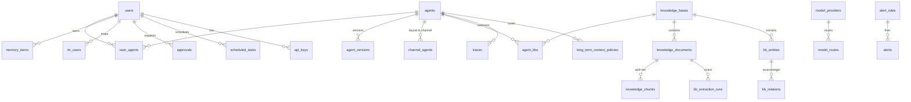

# fleetent 数据模型与实体关系（2026-06-09）

> **状态：草案 / 待讨论（DRAFT）**。供「数据库与实体关系设计」讨论用。
> 配套：[`target-architecture-proposal.md`](./target-architecture-proposal.md)（目标架构：核+4面+基座）、
> [`module-dependency-graph.md`](./module-dependency-graph.md)（模块依赖）。

## 0. 取数方法与口径

- **权威源**：Alembic 迁移（head = `062`）。本文实体/字段以 **dev `data/fleetent.db`（revision 046）实际 schema** 为骨架，并核对迁移 047–062 的增量。
- **已核实**：迁移 **047–062 不新增表，只改列/索引**——故 dev 库的 50 张表即 head 的完整表集合（个别新列在下文标注）。
- **三处需特别注意（也是发现）**：
  1. **迁移链是健康的**（更正早期误判）：用临时 ini 指向空库，`alembic upgrade head` 干净跑到 062（含 049）。早先「链坏了」是因 `migrations/env.py` **忽略 `DATABASE_URL`**、命令误打真实 `data/fleetent.db`（其 schema 已偏离历史）所致——非迁移代码问题。详见 §4-⑧。
  2. 部分表**不在 Alembic**，由 store `_init_db` 运行时创建：`users`、`audit_log`、`im_connectors`、`session_anti_flap`、`sub_agent_runs`、`api_keys`、`quotas`、`quota_usage`、`invites`、`im_channel_allowlist`、`sessions`(users.db)。后果：`alembic upgrade head` 从空库只建出**半套** schema（连 `users` 都缺）。
  3. **双 schema 权威是有意设计**：管理库走 alembic、per-agent 库走各 store 的 `ensure_schema()`（单机 agent 须脱离 alembic 启动）；二者对 agent-side 表各写一份 DDL、靠手工保持一致 → 可漂移。

## 1. 三个数据库（物理分布）

| DB 文件 | 内容 | 备注 |
|---|---|---|
| `data/fleetent.db` | 50 张主表（agent / KB / memory / 治理 / 监控 / 会话元…） | 主库，Alembic 管理 |
| `data/users.db` | **仅 `sessions`** | ⚠️ 名实不符：`users` 表反而在 fleetent.db；会话数据跨两库 |
| `data/vector_store.db` | `vector_items`（向量嵌入） | 基座向量 infra |

> **发现**：会话数据 split-brain——`sessions` 在 `users.db`、`session_meta` 在 `fleetent.db`。

## 2. 实体目录（按目标架构的「面」归类，字段级）

> 关系列以 **`x_id`** 标注；`→Y` 表示按约定引用 Y（多数**非 DB 外键**，见 §4-①）。

### 身份 & 用户（基座 / ②）
- **users** — `id`(PK) · name · api_key · email · password_hash · role · status · must_reset · totp_secret　〔根主体〕
- **api_keys**〔store〕 — `id` · `user_id`→users · key_hash · prefix · scope · expires_at · revoked_at · last_used_at · call_count
- **invites**〔store〕 — `id` · email · token_hash · expires_at · used_at
- **im_users** — `id` · `owner_id`→users · platform · platform_user_id · `user_id`→users · allowed · meta_json　〔(platform,platform_user_id)→内部 user 映射〕
- **im_connectors** — `id` · `owner_id`→users · platform · enabled · allowlist_enforced · config · status · last_heartbeat_at
- **im_channel_allowlist**〔store〕 — `id` · `owner_id` · platform · scope_type · `scope_id` · allowed

### Agent 定义 & 绑定（②控制）
- **agents** — `id` · name · system_prompt · allowed_tools · `tenant_id` · `team_id` · `active_version_id`→agent_versions · features · plugins · allowed_skills · icon · config_overrides〔061〕
- **agent_versions** — `id` · `agent_id`→agents · version · system_prompt · allowed_tools · skills_dir · mcp_server_ids · model_overrides · memory_namespace · `created_by_user_id`→users · created_at　〔不可变版本快照〕
- **agent_admin_state** — agent_name · status · provenance · drift · archived_at　〔版本/部署态〕
- **user_agents** — `user_id` · `agent_id`　〔用户↔agent M:N〕
- **channel_agents** — `id` · platform · `channel_id` · `agent_id` · `bound_version_id`　〔渠道↔agent〕
- **agent_kbs** — `tenant_id` · `kb_id` · `agent_id`　〔agent↔KB 绑定〕
- **knowledge_base_agent_bindings** — `tenant_id` · `agent_id` · `kb_id`　⚠️**疑似与 agent_kbs 重复**
- **agent_mcp_servers** — `id` · `agent_id` · `server_id` · transport · url · auth_type · api_key_env · command · args · env · headers · enabled
- **agent_mcp_server_bindings** — `agent_id` · `server_id`　〔绑定〕
- **agent_oauth_bindings** — `agent_id` · `connector_id`→connectors
- **connectors** — `id` · `agent_id` · display_name · protocol · oauth_config · enabled　〔工具 OAuth 凭证〕
- **agent_skills** — `agent_id` · skill_name · enabled
- **long_term_context_policies** — `id` · `tenant_id` · `agent_id` · 各 *_enabled / *_max_tokens / *_top_k · conflict_preference

### 知识库（④摄取 / 核检索）
- **knowledge_bases** — **PK(`tenant_id`,`kb_id`)** · description · archived_at　⚠️复合键（与他表 `id` 风格不一致）
- **knowledge_documents** — `id` · `tenant_id` · `kb_id` · filename · source · source_url · archived_at
- **knowledge_chunks** — `id` · `document_id`→knowledge_documents〔FK,CASCADE〕 · `tenant_id` · `kb_id` · position · content · metadata_json
- **kb_entities** — `id` · `tenant_id` · `kb_id` · entity_type · name · normalized_name　〔知识图谱节点〕
- **kb_entity_mentions** — `id` · `entity_id` · `document_id` · `chunk_id` · `extraction_run_id` · text · confidence
- **kb_relations** — `id` · `tenant_id` · `kb_id` · relation_type · `source_entity_id` · `target_entity_id` · `evidence_document_id` · `evidence_chunk_id` · confidence　〔图谱边〕
- **kb_extraction_runs** — `id` · `tenant_id` · `kb_id` · `document_id` · extractor · status · *_scanned/*_written 统计
- **knowledge_source_states** — `source_id` · `tenant_id` · `kb_id` · source_path · mtime_ns · content_hash · `document_id`　〔增量同步态〕
- **knowledge_connector_status** — `connector_id` · connector_type · `tenant_id` · `kb_id` · last_status · last_error　〔connector 同步态〕

### 记忆（核能力）
- **memory_items** — `id` · `user_id`→users · type · content · namespace · expires_at　〔per-user 语义记忆〕
- **memory_maintenance_proposals** — `id` · `user_id` · action · proposed_content · risk · status　〔记忆自维护建议〕
- **shared_memory_items** — `id` · scope_type · `scope_id` · type · content · status · source　〔团队/租户共享记忆〕

### 自进化（核生成 / ②管理）
- **reflection_reports** — `id` · scope · time_window_start/end · findings_json
- **kb_reflection_reports** — `id` · scope · time_window · findings_json · signal_summary_json
- **skill_proposals** — `id` · type · target_skill · suggested_draft · suggested_diff · status · `reviewer_user_id` · `actor_user_id` · applied_at
- **skill_provenance** — skill_name · source · drift · immutable_fields · last_deploy_at
- **skill_admin_state** — skill_name · status · global_enabled · audit_verdict · forced

### 会话 & 运行数据（核 → 基座）
- **sessions**〔users.db〕 — 会话 JSON 持久化
- **session_meta** — `session_id` · `user_id` · origin · status · takeover_actor · takeover_at · pinned · pin_note · agent_name · channel　⚠️**禁忌表**（见 §4-⑤）
- **session_anti_flap** — `session_id`(PK) · recent_savings · turns_since · auto_disabled
- **sub_agent_runs** — `run_id`(PK) · `parent_session_id` · name · state · timeout_seconds
- **traces** — `id` · `run_id` · `span_id` · `parent_span_id` · `session_id` · `user_id` · `agent_id` · `tenant_id` · event_type · payload_json　〔append-only 轨迹〕

### 编排（③）
- **scheduled_tasks** — `id` · name · cron_expr · timezone · `user_id` · agent_name · message · `session_id` · source

### 治理（核执行 / 基座数据）
- **approvals** — `id` · `session_id` · `requester_user_id` · risk_level · tool_name · tool_args · status · `approver_user_id` · resolved_at
- **audit_log** — `id`(PK) · `actor_user_id` · action · target_type · `target_id` · detail · `batch_id`
- **quotas / quota_usage**〔store，懒建〕 — per-user / 全局配额与用量

### 模型（②控制）
- **model_providers** — `id` · base_url · model · api_key · max_tokens · 价格字段 · vendor/protocol/params〔050〕
- **model_routes** — task_type · `provider_id`→model_providers · priority

### 监控（基座 observability）
- **alert_rules** — `id` · metric · target · comparator · threshold · severity · channels
- **alerts** — `id` · `rule_id`→alert_rules · target · status · fired_at · acked_by
- **metric_samples** — `id` · metric · target · value · ts
- **maintenance_windows** — `id` · target · start_ts · end_ts

### Askit（②控制）
- **askit_tasks** — `id` · series · command · params · workspace · status · exit_code · artifact
- **askit_task_logs** — `id` · `task_id`→askit_tasks · seq · stream · line
- **askit_workspaces** — `id` · env · repo_path · endpoint

### 向量（基座，vector_store.db）
- **vector_items** — 嵌入向量（独立库）

## 3. 关系骨架（ER 图）



**幻影实体**：`tenant_id` / `team_id` 贯穿 agents / KB / traces / policies，但**没有 `tenants` / `teams` 表**——多租户是裸列、无根实体（§4-②）。

## 4. 设计问题（讨论议程）

1. **关系几乎全隐式**：全库**仅 3 条 SQL 外键**（`agent_id`→agents、`document_id`→knowledge_documents CASCADE、复合 `(tenant_id,kb_id)`→knowledge_bases）。其余引用整性全靠 `*_id` 约定 + store 逻辑，DB 无保障。→ **要不要补外键？** 权衡：SQLite-first/可审计/手写 SQL ⟷ 完整性与级联删除。
2. **多租户无根实体**：无 `tenants`/`teams` 表。→ **要不要立 tenants/teams 实体**做多租户根、承载配额/隔离/级联？
3. **身份策略不统一**：多数表 surrogate `id`；KB 用复合自然键 `(tenant_id,kb_id)`；绑定表用复合自然键（user_id+agent_id）。→ **是否统一**（全 surrogate id？还是明确「聚合根用自然键」）？
4. **疑似重复绑定**：`agent_kbs` 与 `knowledge_base_agent_bindings` 均为 agent↔KB。→ **核实并合并其一**。
5. **`session_meta` 禁忌表**：CLAUDE.md 明令 agent 运行时数据不得入 platform 管理表；迁移 `054–059` 正是「加运行时列（compaction/token/resume_pending）→删」的返工实证。但残留 `origin/status/takeover/pinned/agent_name/channel` 等——→ **逐列审计**：哪些是 platform 治理（合法）、哪些是运行时残留（该回 session 文件）？
6. **`users.db` 残留 / 会话数据 split-brain**：`sessions`(users.db, 裸 sqlite3) / `session_meta`(fleetent.db) / `vector_items`(vector_store.db)。→ **已决议三层拓扑**（§5）：消灭 users.db、vector 独立成共享库。
7. **Schema lifecycle 分裂**：`users`/`audit_log`/`im_connectors`/`session_anti_flap`/`sub_agent_runs`/`api_keys`/`quotas`/`quota_usage`/`invites`/`im_channel_allowlist`/`sessions` 由 store `_init_db` 运行时建，不在 Alembic → `alembic upgrade head` 只建半套。`im_channel_allowlist` 源码还有**两处 CREATE TABLE** 重复。→ 管理表收编 Alembic（roadmap #2）；agent-side 表保留 ensure_schema 但加漂移护栏（#1）。
8. **迁移链健康，但 env.py 与 app 脱节**（更正）：迁移链空库可重放到 062。真问题是 `migrations/env.py` 忽略 `DATABASE_URL`、用 ini 硬编码 url → app 与迁移指向不同库；dev 库因「`_init_db` + 部分 alembic + stamp」混合路径建出而**偏离历史**。→ env.py 读 `DATABASE_URL`（roadmap #1）。

## 5. 目标拓扑与决议（已定，2026-06-09）

经讨论敲定的 DB 终态——**三层库 + 双 schema 权威 + Identity 端口**。它是 §6 roadmap 的标尺。

### 5.1 三层库（物理拓扑）

| 层 | 库形态 | 装什么 | schema 权威 |
|---|---|---|---|
| **管理库** | 单库（平台） | users · agent 定义/版本/绑定 · connectors · providers · approvals · audit · monitoring · askit · api_keys/quotas/invites/im allowlist | **Alembic** |
| **per-agent 运行库** | **每 agent 一个文件** | sessions · traces · session_meta · session_anti_flap · sub_agent_runs · memory_items(按 `memory_namespace` 隔离) · per-agent reflection | **ensure_schema**（单机须脱离 alembic） |
| **共享资源库** | 跨 agent 独立 | KB(+vector) · shared_memory(team/tenant) · 自进化建议 | （随其消费侧；单机时退化为本 agent 自己的） |

**决议依据**：
- **管理库 ≠ agent 库**（物理分开）= agent/platform 解耦契约的 DB 层落实：agent 不打开管理库，物理上无法写管理表（根治 `#1 泄漏`、`session_meta` 反例那类越界）。platform **只读** agent 库。
- **per-agent 库**：隔离、爆炸半径小、单机/受管同一套存储布局、SQLite 写不互锁。（PR #190 已起步）
- **共享资源库（A 决策）**：KB/共享记忆**天然跨 agent**，不能塞进单个 agent 库；独立成层，单机退化无成本。

### 5.2 双 schema 权威 + 漂移护栏

管理库 alembic、per-agent 库 ensure_schema——**不合并**（合并会破坏单机 agent）。靠**自动漂移护栏**（测试断言 `alembic head` 与 `ensure_schema` 同名表列一致）防分叉，取代手工保持一致。

### 5.3 Identity 端口

authn 抽成基座端口（`凭证→principal`）：单机本地实现 + 平台实现 + **OIDC/Google 适配器**；users/key 归管理库；核只依赖端口、不 import 管理面 → 结构性根除 `#1 泄漏`。详见 `target-architecture-proposal.md` §6。

### 5.4 仍待后续决定（不阻塞 roadmap，留作 schema 设计专题）

§4-①②③④：DB 外键 vs store 约定、立 tenants/teams 实体、身份键统一、合并 `agent_kbs`/`knowledge_base_agent_bindings`。这些是**schema 设计**，与下方「卫生/拓扑」roadmap 正交，单独成题。

---

## 6. 执行 roadmap（串行，护栏保底）

4 个 change **都动同一批文件/表**（db.py、各 store、migrations、agent_app、users/api_keys）→ **串行执行**（并行只增冲突）。#1 的漂移护栏一旦立起，后续每步自动校验不退步。

```
#1 persistence-hygiene ──(地基/护栏先立)──┐
                                          ├─→ #2 管理表收编 alembic ──┐
                                          │                          ├─→ #4 Identity 端口
                                          └─→ #3 三层库分离 ─────────┘
```

| # | change | 范围 | 状态 |
|---|---|---|---|
| **1** | `persistence-hygiene` | env.py 读 DATABASE_URL · 漂移护栏 · 消灭 users.db · 文档对齐 | **proposal 已写**（`openspec/changes/persistence-hygiene/`） |
| 2 | 管理表收编 alembic | users/api_keys/quotas/invites/im_allowlist/audit_log 等 `_init_db` 表纳入迁移，使 `upgrade head` 建出完整管理 schema | 待该期 `opsx:propose` |
| 3 | 三层库物理分离 | 落实管理/per-agent/共享三库；KB+vector+共享记忆迁入共享库；vector 库改名 `fleetent_vector.db`；platform 只读 agent 库 | 待该期（最大、最可能返工，detailed spec 即时生成） |
| 4 | Identity 端口 | authn 抽端口 + 本地/平台/OIDC 适配器；users/key 归管理库；根除 #1 | 待该期 |

**节奏**：蓝图（本节）现在锁定；各期 detailed spec **即时生成**（反映当时真实代码，避免 #3 类返工）；一期一个聚焦会话，串行推进。
