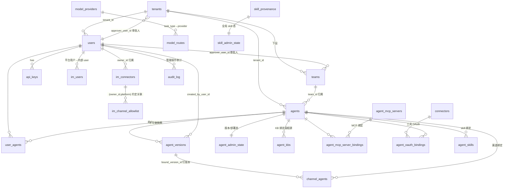
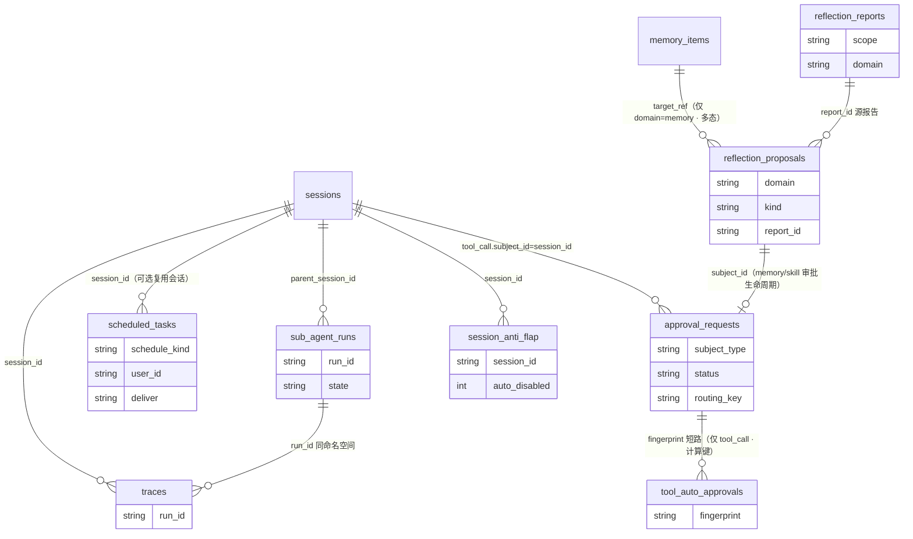
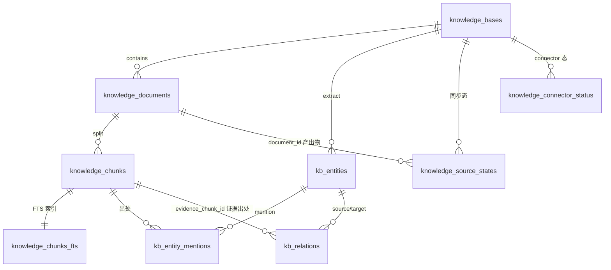

# fleetent 数据模型与物理拓扑（as-built）

> **现状权威参考**。持久层重设计（#1–#4）已全部落地——五物理库、按主体物理隔离、嵌入式迁移（Y）、Identity 端口、platform 只读投影均已实现。
> **本文只描述"现状是什么"**；"为什么这样设计"（R1/R2/B2、物理 vs 逻辑、向量模型 A、实体减法等 rationale）见 [`records/decision-logs/persistence-redesign-decisions.md`](../records/decision-logs/persistence-redesign-decisions.md)。
> **列级 schema 的真相源是迁移**：管理库 = `migrations/`（Alembic）；agent 侧库 = `runtime/agent_state_migrations.py`、`knowledge_base/core/migrations.py`、`memory/shared_memory_migrations.py`（嵌入式 Y）。本文实体清单为导航，不逐列复制。
> **维护规则**：任何 change 增删表、改列或改关系时，MUST 同步本文对应的实体清单**与 erDiagram**（图文同改）——历次审计发现的漂移几乎全是"改了文本忘了图"。
> 配套：[`target-architecture.md`](./target-architecture.md)（核+4面+基座 · Identity §6 · platform 只读投影 §7）。

## 1. 物理拓扑（5 库类型 · 按主体物理分区）

数据分布在 **5 类物理库**，多主体时按**主体（tenant）物理分区**：

| 库类型 | 形态 | schema 权威 | 写者 / 访问 |
|---|---|---|---|
| **管理库** | 单库、跨主体（仅受管模式存在） | **Alembic** | platform 读写；agent 物理够不到 |
| **per-agent 运行库** | 每 (主体, agent) 一文件 | 嵌入式 Y | 该 agent 读写；platform 只读投影 |
| **共享记忆库** | per-tenant | 嵌入式 Y | 同主体多 agent 读写（真相源）；platform 只读 |
| **KB 关系库** | per-tenant | 嵌入式 Y | ingest 单写、agent 只读（派生视图）；platform 只读 |
| **向量底座** | 独立 substrate，按家族（`mem:`/`shared:`/`kb:`）路由到对应 scope 的向量库（可换 Qdrant） | 嵌入式 Y | 随各消费层 |

**目录布局与命名**（`X.db` 关系真相源 / `X_vectors.db` 向量索引配对）：

```
data/
  management.db                                   # 管理库（单库·跨主体·Alembic）
  <tenant>/
    kb.db / kb_vectors.db                         # KB 关系 / 向量（per-tenant）
    shared_memory.db / shared_memory_vectors.db   # 共享记忆 关系 / 向量（per-tenant）
    <agent_id>/
      agent_state.db                              # 该 agent 关系真相源
      agent_vectors.db                            # 该 agent 记忆向量
```

命名规则：per-tenant 层 `X`=资源名（`kb`/`shared_memory`，一资源一文件）；per-agent 层 `X`=归属（`agent_state`，一 agent 一文件、不按内容）。目录 `<tenant>/<agent_id>/` 已圈定主体与 agent。

**物理库计数**：2 主体 × 各 2 agent = **17 库**（管理 1 + 每主体〔2 agent×(关系+向量)=4 + 共享 2 + KB 2〕×2）。"5"是**类型数**，非部署文件数。

**跨主体隔离**：agent 进程经 `agent.yaml` 只开本主体目录下的文件，物理上够不到别主体的库——合规"主体间互不可见"由文件边界结构性保证，非纪律级 `WHERE tenant_id`。

## 2. schema 权威、路由与并发

- **双权威（按库分）**：管理库 **Alembic-only**；per-agent / 共享记忆 / KB 关系库走**嵌入式 forward-only 迁移（Y）**——schema 以代码中有序 `MIGRATIONS=[(ver,sql)]` 定义、DB 只存 `PRAGMA user_version`、**migrate-on-open**、每文件自迁、库版本 > 代码已知版本则拒启动（`SchemaTooNewError`）。空库与旧库同一代码路径。
- **关系完整性双层语义**：管理库经 `db.py` 打开的连接统一启用 `PRAGMA foreign_keys=ON`，声明了 FK 的管理表约束会真实生效；store 写入校验继续承接 FK 难以表达的语义级约束（例如 `agents.team_id` 与 `agents.tenant_id` 的复合一致性）。agent 侧库仍以约定引用为主；其中 KB 关系库的 `knowledge_documents → knowledge_chunks` 级联删除已随 FK 开启真实生效。
- **FK 启用不回扫存量行**：SQLite 只约束启用后的新连接写入/删除，不会自动修复历史违规行；旧违规引用若后续被触碰，会在那次写路径上迟发失败。
- **一文件一份统一 MIGRATIONS**：`agent_state.db` 由 `runtime/agent_state_migrations.py` 一份单调版本列表管（sessions/traces/reflection/memory/approvals 各占若干 v）——单文件单 `user_version`，不可每 store 各跑一份。
- **路由（租户作用域 + 可换后端）**：`tenant_router` 暴露两个平级解析器——`tenant_scope(tenant)`（KB + 共享记忆句柄）、`agent_scope(tenant, agent_id)`（per-agent 句柄）。SQLite 后端映射到上述目录文件；后端可换（将来 PG per-tenant DB / RLS，调用点不变）。物理路由的主体取自 **agent 的归属主体**（`agents.team_id`/`tenant_id`，配置）；请求者 `Principal.tenant_id` 仅用于 edge 跨主体校验（`agent_app._check_tenant`）。
- **并发**：所有 SQLite 连接启用 **WAL + busy_timeout**（关系库经 `db.py`、向量库经 `vector_store/backend.py`，同值）——支撑 platform 只读投影读 + agent 写并发、共享记忆多 agent 写。
- **agent 侧表保留 `tenant_id` 列**：文件路由忽略它，作"可换后端"接缝（将来 RLS 后端按它行级强制）。

## 3. 实体模型（按库归类）

> 实体名 + 一句话职责；列级以迁移为准（见文首）。关系多为 `*_id` 约定引用（非 DB 外键）。

本节分**宏观**（§3.1 物理库全景 + 跨库引用）与**按库明细**（§3.2–§3.6，每库完整实体 + 库内关系）。所有关系均为 `*_id` 逻辑约定，**物理库间无 DB 外键**。

**跨库引用孤儿契约**：物理库之间没有 DB 级 FK，消费方 **MUST** 容忍 `*_id` 指向已删或已 archive 的外库实体，并按域语义处理为拒绝或降级，而不是假设引用恒真。Identity / cron 复检类路径应继续采用分域重查，不共享隐式一致性。

### 3.1 物理库全景（宏观）

5 物理库 + 库间**跨库逻辑引用**（虚线 = `*_id` 约定，非 DB 外键；agent 侧库物理分离、无跨文件外键）：

```mermaid
graph TD
  subgraph MGMT["管理库 management.db ｜ platform 侧 · 单库跨主体 · Alembic"]
    users
    tenants
    teams
    agents
    api_keys
    agent_kbs
    kb_connectors
    channel_agents
    model_providers
    session_meta
  end
  subgraph AGENT["per-agent agent_state.db ｜ agent 侧 · 每 agent 一文件 · 嵌入式 Y"]
    sessions
    traces
    memory_items
    approval_requests
    reflection_reports
    reflection_proposals
    tool_auto_approvals
    scheduled_tasks
  end
  subgraph KB["KB 关系库 kb.db ｜ agent 侧 · per-tenant"]
    knowledge_bases
    knowledge_documents
    knowledge_chunks
    kb_entities
  end
  subgraph SHARED["共享记忆 shared_memory.db ｜ agent 侧 · per-tenant"]
    shared_memory_items
  end
  subgraph VEC["向量底座 ｜ agent 侧 · 按家族路由"]
    vector_items
  end
  memory_items -. user_id .-> users
  sessions -. user_id .-> users
  traces -. user_id .-> users
  traces -. agent_id .-> agents
  approval_requests -. requester_user_id .-> users
  scheduled_tasks -. session_id .-> sessions
  scheduled_tasks -. user_id .-> users
  shared_memory_items -. "scope_id(team|tenant)" .-> teams
  session_meta -. session_id .-> sessions
  agent_kbs -. kb_id .-> knowledge_bases
  kb_connectors -. "tenant_id,kb_id" .-> knowledge_bases
  vector_items -. "mem:" .-> memory_items
  vector_items -. "shared:" .-> shared_memory_items
  vector_items -. "kb:" .-> knowledge_chunks
```



> 宏观图只列各库主干实体；完整清单与库内关系见下方各库明细（§3.2–§3.6）。
> 跨库边的省略约定：① `reflection_proposals` 的 `subject/actor_user_id` 与 `approval_requests.approver_user_id` 同样 ⇢ `users`，从略；② agent 侧各表的 `tenant_id` 接缝列（§2"可换后端"）⇢ `tenants`，全部从略；③ `shared_memory_items.scope_id` 在 `scope_type=tenant` 时指向 `tenants`（图仅画 teams 一条代表边）。`session_meta → sessions` 是全库唯一一条 mgmt→agent 方向的跨库引用（platform 自有元数据挂 agent 侧会话，非 agent 反向写）。

### 3.2 管理库（Alembic · platform 侧）
- **身份/租户**：`users`(根主体，含 `tenant_id`；**无 key 列**——key 唯一真相源在 `api_keys`，SHA-256 哈希、明文不落库) · `api_keys`(→users) · `tenants`(主体，含 `approver_user_id`→users) · `teams`(→tenants，含 `approver_user_id`→users) · `blocked_registrations`(注册封禁名单，control-plane only，agent 运行时不 import)
- **IM**：`im_users`(渠道身份归并真相源；managed 运行时由注入 resolver 消费，standalone 不消费) · `im_connectors` · `im_channel_allowlist`——三表均带 **`owner_id` → users**（connector 注册归属的平台用户，默认 built-in admin，为将来 per-owner 接入预留）；`im_channel_allowlist` 与 `im_connectors` 经 `(owner_id, platform)` 复合约定关联（allowlist 无 connector id 列）
- **Agent 定义/绑定**：`agents`(定义，含 `tenant_id`/`team_id`/`active_version_id`；当前仍由 `name` 承载可读 slug / 物理目录名，identity-model 阶段 5 再完成全文 hybrid 收尾) · `agent_versions`(不可变快照) · `agent_admin_state`(版本/部署态；**`agent_id` INTEGER 主键 + FK→agents.id ON DELETE CASCADE**，identity-model 阶段 3) · `user_agents`(用户↔agent) · `channel_agents`(渠道↔agent) · `agent_kbs`(**agent↔KB 绑定唯一真相源**；`agent_id` 已在 agent-identity-model 阶段 2 规整为 **INTEGER FK→agents.id ON DELETE CASCADE**，带 `created_by` 审计) · `agent_mcp_servers` · `agent_mcp_server_bindings` · `agent_oauth_bindings` · `agent_secrets`(agent / shared scope 密文 secret) · `connectors`(工具 OAuth；含**休眠列 `agent_id`**——运行路径未消费) · `agent_skills`（`agent_id` 已在 agent-identity-model 阶段 2 规整为 **INTEGER FK→agents.id ON DELETE CASCADE**；控制台 name/id 混写导致的绑定静默失效 bug 已修复）
- **KB 管理**：`kb_connectors`(connector 配置与自定义元数据；实际 KB 内容仍在 per-tenant `kb.db`)
- **模型**：`model_providers` · `model_routes`(task_type→provider)
- **治理/编排**：`audit_log`(平台管理操作审计) · `session_meta`(仅 playground / chat admin 创建路径会写入的 platform chat 管理元数据，如 origin / pinned / admin takeover；`agent_id` 为可空 **INTEGER FK→agents.id ON DELETE CASCADE**，identity-model 阶段 3；与 agent 侧 `sessions` 索引分责，`session_id` 仅作跨库逻辑引用)
- **Skill 治理**：`skill_provenance` · `skill_admin_state`（全局 skill 态）

> 下图只画有库内关系的主干表；独立/弱关联表不入图：`blocked_registrations`（按 email 匹配，无 FK）、`agent_secrets`（→agents，密文配置）、`kb_connectors`（KB 数据源配置）、`session_meta`（`session_id` 仅跨库逻辑引用 agent 侧 `sessions`）。



### 3.3 per-agent 运行库（嵌入式 Y · `agent_state.db` · agent 侧）
统一 MIGRATIONS（`runtime/agent_state_migrations.py`，单文件单 `user_version`）建 **10 张表**：

- **会话/运行**：`sessions`(会话元数据索引，仅 `session_id` / `user_id` / timestamps / `message_count`，**无 `agent_name` 列**——归属由 per-agent 物理库圈定) · `traces`(append-only 运行轨迹，挂 `session_id` / `run_id`) · `session_anti_flap`(压缩防抖，per session) · `sub_agent_runs`(子 agent 生命周期)
- **记忆**：`memory_items`(per-user 语义记忆，**无 namespace 列**，agent 隔离靠物理库)
- **审批**：`approval_requests`(审批生命周期**单一真相源**，`subject_type=tool_call|memory_proposal|skill_proposal`；tool-call 的挂起上下文留在 session meta `pending_approvals`) · `tool_auto_approvals`(工具调用 auto-approve 指纹表，仅 tool_call)
- **反思**：`reflection_reports`(观察日志，domain=`memory|skill|knowledge_base|legacy`) · `reflection_proposals`(memory/skill 提案实体，domain=`memory|skill`；仅存提案内容 + apply 产出，审批生命周期在 `approval_requests`)
- **调度**：`scheduled_tasks`(cron/once/interval 定时任务；`task_type`=`notify`/`generate`/`action` + `notify_text`——notify 调度器直发不跑 agent、generate 跑 agent 按投递契约发回复、action 由 agent 自发不广播)



> 历史行不迁移：旧管理库中既有的 `session_anti_flap` / `sub_agent_runs` 行属 ephemeral 运行时数据，按「上线前不迁移数据」新建即可，旧行作孤儿由部署方按需清理。
> 跨库（见 §3.1）：`memory_items.user_id` ⇢ 管理库 `users`（managed 模式成立；standalone 中该字段可为不透明渠道原生 id）；`approval_requests.requester_user_id` ⇢ 管理库 `users`（managed 成立；standalone 同样允许 opaque id）；tool-call 审批的 `approval_requests.subject_id` 约定为本库 `sessions.session_id`。会话**内容**仍是 JSON 文件（`SESSIONS_DIR`，与元数据 DB 表物理分离）。
>
> 语义注记：① `reflection_proposals.target_ref` 为多态引用——memory 类提案指向 `memory_items.id`，skill 类提案指向文件系统 skill 名（字符串路径），完整性由 apply 路径兜底，无 FK 约束（图中 `memory_items → reflection_proposals` 边即此引用，仅 `domain=memory` 成立）。② `traces` 同时挂 `session_id`（→`sessions`，`query_trace_events` 按它过滤）与 `run_id`（与 `sub_agent_runs.run_id` 同命名空间，均 UUIDv4，可按 `run_id` 关联出子 agent 的完整 trace 树）。③ 库内 `session_id` / `run_id` / `report_id` 都是约定引用，**无时序保证、无外键**：`approval_requests`/`traces` 行可先于 `sessions` 索引行写入（工具门控、首事件在会话首圈即触发），`reflection_proposals.report_id` 可回指生成它的 `reflection_reports.id`，但历史行或非反思来源行允许为 `NULL`。④ `approval_requests` 是审批生命周期单一真相源：tool-call 审批的 subject 是 session meta `pending_approvals` 里的挂起上下文；memory/skill 审批的 subject 是同 id 的 `reflection_proposals` 行；统一 resolve router 按 `subject_type` 分派到工具恢复或提案 apply。⑤ `tool_auto_approvals` 与 tool-call `approval_requests` 经**计算键**关联（非存储 FK）：`fingerprint = hash(scope_key, tool_name, tool_args)`，其中 `scope_key = requester_user_id`；审批前算 fingerprint 查表，命中即 auto-approve。`created_by` 为授予放行的审批人（`*_user_id` 同语义，⇢ 管理库 `users`，可空 opaque）。

### 3.4 共享记忆库（嵌入式 Y · `shared_memory.db` · agent 侧 · per-tenant）
`shared_memory_items`(team/tenant scope 共享记忆，多 agent 写的真相源)

### 3.5 KB 关系库（嵌入式 Y · `kb.db` · agent / ingest 侧 · per-tenant）
**已在本库（`knowledge_base/core/migrations.py` 的 Y）**：`knowledge_bases`(PK `(tenant_id,kb_id)`) · `knowledge_documents` · `knowledge_chunks`(+`chunks_fts`) · `knowledge_source_states` · `kb_entities` · `kb_entity_mentions` · `kb_relations` · `knowledge_connector_status`。

> 无 `kb_extraction_runs`：entity extraction 的 run 摘要只同步返回调用方、要审计走 observability trace，不持久化。KB 反思**观察**落 agent 的 `agent_state.db.reflection_reports(domain=knowledge_base)`。KB **remediation**（写回/sync）在 platform / ingest 面，不在 agent 侧 apply。



> KB 是 tenant 共享资源：platform ingest/sync 写本 tenant 的 `kb.db` / `kb_vectors.db`，agent retrieval/graph_search 只读本 tenant 的同名文件。agent 可用的 KB 由 `agent_kbs`（管理库，绑定真相源，经 `kb_id` 跨库引用本库）materialize 进 `agent.yaml`，运行时读配置不查表。

### 3.6 向量底座（独立 substrate · 按家族路由）
`vector_items`（每个 scope 一个向量库文件：`mem:`→当前 agent 的 `agent_vectors.db`，同库内再按 `mem:{user_id}` 分区；`shared:`→共享记忆 `shared_memory_vectors.db`；`kb:`→KB `kb_vectors.db`）

## 4. 多租户与隔离

- **tenant = 主体（法人实体/商户）**，`teams` 在其下；`users.tenant_id` 给出组织归属。v1 **不建 `team_members`**——共享记忆/KB/审批都走 **agent 归属 team**（`agents.team_id`），不需请求者的 team。
- **隔离 = 物理 per-tenant**：合规"主体间互不可见"（财务等）由目录/文件边界保证。`管理库` 单库跨主体（注册中心，不存业务对话/KB）；业务数据（per-agent / 共享记忆 / KB / 向量）按主体分目录。
- **可换后端**：SQLite 文件路由是当下后端；保留 `tenant_id` 列以接住将来 PG（per-tenant DB 或 RLS）。
- **审批人**：`teams.approver_user_id` / `tenants.approver_user_id`，解析链 `agent.team_id 审批人 → tenant 审批人 → reject`（default-closed），部署时 materialize 进 `agent.yaml`。

## 5. 身份与认证

认证属 edge、核只消费已解析的 `Principal{user_id, tenant_id}`（agent 侧不 import platform）。详见 [`target-architecture.md` §6](./target-architecture.md)。

## 6. platform 读侧投影

platform 控制面经**只读连接**（不迁移、`mode=ro`）+ 共享 store 读函数 + management.db registry 读 agent 侧库；不物化副本、不要求 agent 反向写。详见 [`target-architecture.md` §7](./target-architecture.md)。
