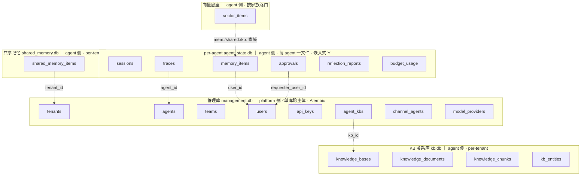
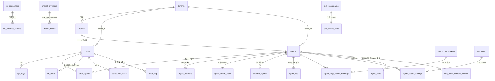
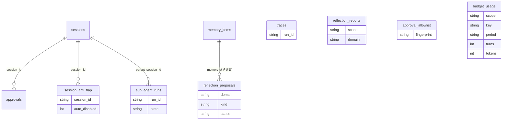
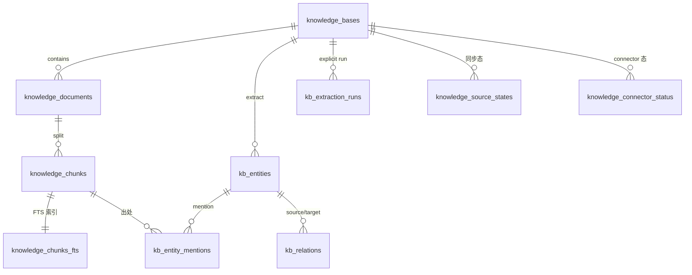

# fleetent 数据模型与物理拓扑（as-built）

> **现状权威参考**。持久层重设计（#1–#4）已全部落地——五物理库、按主体物理隔离、嵌入式迁移（Y）、Identity 端口、platform 只读投影均已实现。
> **本文只描述"现状是什么"**；"为什么这样设计"（R1/R2/B2、物理 vs 逻辑、向量模型 A、实体减法等 rationale）见 [`records/decision-logs/persistence-redesign-decisions.md`](../records/decision-logs/persistence-redesign-decisions.md)。
> **列级 schema 的真相源是迁移**：管理库 = `migrations/`（Alembic）；agent 侧库 = `runtime/agent_state_migrations.py`、`knowledge_base/core/migrations.py`、`memory/shared_memory_migrations.py`（嵌入式 Y）。本文实体清单为导航，不逐列复制。
> 配套：[`target-architecture.md`](./target-architecture.md)（核+4面+基座 · Identity §6 · platform 只读投影 §7）。

## 1. 物理拓扑（5 库类型 · 按主体物理分区）

数据分布在 **5 类物理库**，多主体时按**主体（tenant）物理分区**：

| 库类型 | 形态 | schema 权威 | 写者 / 访问 |
|---|---|---|---|
| **管理库** | 单库、跨主体（仅受管模式存在） | **Alembic** | platform 读写；agent 物理够不到 |
| **per-agent 运行库** | 每 (主体, agent) 一文件 | 嵌入式 Y | 该 agent 读写；platform 只读投影 |
| **共享记忆库** | per-tenant | 嵌入式 Y | 同主体多 agent 读写（真相源）；platform 只读 |
| **KB 关系库** | per-tenant | 嵌入式 Y | ingest 单写、agent 只读（派生视图）；platform 只读 |
| **向量底座** | 独立 substrate，按家族（`mem:`/`shared:`/`kb:`）路由到对应 scope 的向量库（可换 Qdrant） | 嵌入式 Y | 随各消费层 |

**目录布局与命名**（`X.db` 关系真相源 / `X_vectors.db` 向量索引配对）：

```
data/
  management.db                                   # 管理库（单库·跨主体·Alembic）—— 真实文件名（旧 fleetent.db 已改名落地；存量部署经 upgrade-time 重命名平滑迁移）
  <tenant>/
    kb.db / kb_vectors.db                         # KB 关系 / 向量（per-tenant）
    shared_memory.db / shared_memory_vectors.db   # 共享记忆 关系 / 向量（per-tenant）
    <agent_id>/
      agent_state.db                              # 该 agent 关系真相源
      agent_vectors.db                            # 该 agent 记忆向量
```

命名规则：per-tenant 层 `X`=资源名（`kb`/`shared_memory`，一资源一文件）；per-agent 层 `X`=归属（`agent_state`，一 agent 一文件、不按内容）。目录 `<tenant>/<agent_id>/` 已圈定主体与 agent。

**物理库计数**：2 主体 × 各 2 agent = **17 库**（管理 1 + 每主体〔2 agent×(关系+向量)=4 + 共享 2 + KB 2〕×2）。"5"是**类型数**，非部署文件数。

**跨主体隔离**：agent 进程经 `agent.yaml` 只开本主体目录下的文件，物理上够不到别主体的库——合规"主体间互不可见"由文件边界结构性保证，非纪律级 `WHERE tenant_id`。

## 2. schema 权威、路由与并发

- **双权威（按库分）**：管理库 **Alembic-only**；per-agent / 共享记忆 / KB 关系库走**嵌入式 forward-only 迁移（Y）**——schema 以代码中有序 `MIGRATIONS=[(ver,sql)]` 定义、DB 只存 `PRAGMA user_version`、**migrate-on-open**、每文件自迁、库版本 > 代码已知版本则拒启动（`SchemaTooNewError`）。空库与旧库同一代码路径。
- **一文件一份统一 MIGRATIONS**：`agent_state.db` 由 `runtime/agent_state_migrations.py` 一份单调版本列表管（sessions/traces/reflection/memory/approvals 各占若干 v）——单文件单 `user_version`，不可每 store 各跑一份。
- **路由（租户作用域 + 可换后端）**：`tenant_router` 暴露两个平级解析器——`tenant_scope(tenant)`（KB + 共享记忆句柄）、`agent_scope(tenant, agent_id)`（per-agent 句柄）。SQLite 后端映射到上述目录文件；后端可换（将来 PG per-tenant DB / RLS，调用点不变）。物理路由的主体取自 **agent 的归属主体**（`agents.team_id`/`tenant_id`，配置）；请求者 `Principal.tenant_id` 仅用于 edge 跨主体校验（`agent_app._check_tenant`）。
- **并发**：所有 SQLite 连接启用 **WAL + busy_timeout**（关系库经 `db.py`、向量库经 `vector_store/backend.py`，同值）——支撑 platform 只读投影读 + agent 写并发、共享记忆多 agent 写。
- **agent 侧表保留 `tenant_id` 列**：文件路由忽略它，作"可换后端"接缝（将来 RLS 后端按它行级强制）。

## 3. 实体模型（按库归类）

> 实体名 + 一句话职责；列级以迁移为准（见文首）。关系多为 `*_id` 约定引用（非 DB 外键）。

本节分**宏观**（§3.1 物理库全景 + 跨库引用）与**按库明细**（§3.2–§3.6，每库完整实体 + 库内关系）。所有关系均为 `*_id` 逻辑约定，**物理库间无 DB 外键**。

### 3.1 物理库全景（宏观）

5 物理库 + 库间**跨库逻辑引用**（虚线 = `*_id` 约定，非 DB 外键；agent 侧库物理分离、无跨文件外键）：



> 宏观图只列各库主干实体；完整清单与库内关系见下方各库明细（§3.2–§3.6）。

### 3.2 管理库（Alembic · platform 侧）
- **身份/租户**：`users`(根主体，含 `tenant_id`) · `api_keys`(→users) · `tenants`(主体，含 `approver_user_id`) · `teams`(→tenants，含 `approver_user_id`) · `blocked_registrations`(注册封禁名单，control-plane only，agent 运行时不 import)
- **IM**：`im_users`((platform,platform_user_id)→内部 user) · `im_connectors` · `im_channel_allowlist`
- **Agent 定义/绑定**：`agents`(定义，含 `tenant_id`/`team_id`/`active_version_id`) · `agent_versions`(不可变快照) · `agent_admin_state`(版本/部署态) · `user_agents`(用户↔agent) · `channel_agents`(渠道↔agent) · `agent_kbs`(**agent↔KB 绑定唯一真相源**，带 `created_by` 审计) · `agent_mcp_servers` · `agent_mcp_server_bindings` · `agent_oauth_bindings` · `connectors`(工具 OAuth) · `agent_skills` · `long_term_context_policies`
- **模型**：`model_providers` · `model_routes`(task_type→provider)
- **治理/编排**：`audit_log`(平台管理操作审计) · `scheduled_tasks`(cron)
- **Skill 治理**：`skill_provenance` · `skill_admin_state`（全局 skill 态）



### 3.3 per-agent 运行库（嵌入式 Y · `agent_state.db` · agent 侧）
统一 MIGRATIONS（`runtime/agent_state_migrations.py`，单文件单 `user_version`）建 **10 张表**：`sessions`(会话元数据索引) · `traces`(append-only 运行轨迹) · `reflection_reports`(统一反思观察日志，domain=`memory|skill|knowledge_base|legacy`) · `reflection_proposals`(统一 memory/skill 提案与审批生命周期，domain=`memory|skill`) · `memory_items`(per-user 语义记忆，**无 namespace 列**，agent 隔离靠物理库) · `approvals`/`approval_allowlist`(审批请求+门状态，**agent 全权真相源**，actor 为不透明标签) · `session_anti_flap`(压缩防抖，per session) · `sub_agent_runs`(子 agent 生命周期) · `budget_usage`(预算滑窗累计，PK `(scope,key,period)`，**per-agent 物理隔离**，不落管理库)。后四张归属本 change 及前序 change：`session_anti_flap`/`sub_agent_runs` 改经 `agent_scope` + `db.py`（去 `user_store.DB_PATH` + 裸 `sqlite3.connect`），reflection 域收口到 `reflection_reports` + `reflection_proposals` 两表，`budget_usage` 由 `retire-raw-sqlite-connect` 从管理库迁入。



> 历史行不迁移：旧管理库中既有的 `session_anti_flap` / `sub_agent_runs` 行属 ephemeral 运行时数据，按「上线前不迁移数据」新建即可，旧行作孤儿由部署方按需清理。
> 跨库（见 §3.1）：`memory_items.user_id` ⇢ 管理库 `users`；`approvals.requester_user_id` ⇢ 管理库 `users`、`approvals.session_id` → 本库 `sessions`。会话**内容**仍是 JSON 文件（`SESSIONS_DIR`，与元数据 DB 表物理分离）。

### 3.4 共享记忆库（嵌入式 Y · `shared_memory.db` · agent 侧 · per-tenant）
`shared_memory_items`(team/tenant scope 共享记忆，多 agent 写的真相源)

### 3.5 KB 关系库（嵌入式 Y · `kb.db` · agent 侧 · per-tenant）
**已在本库（`core/migrations.py` 的 Y，核心 5 表）**：`knowledge_bases`(PK `(tenant_id,kb_id)`) · `knowledge_documents` · `knowledge_chunks`(+`chunks_fts`) · `knowledge_source_states`。

> ⚠️ **仍在管理库（alembic）、尚未 lift 进本 per-tenant 库**：知识图谱 `kb_entities` / `kb_entity_mentions` / `kb_relations`、抽取 `kb_extraction_runs`、`knowledge_connector_status`（建于 alembic 013/026，未被 drop）。当年 KB lift 只覆盖核心 5 表，这几张留在管理库（跨主体，与 per-tenant 隔离不符）——**第二处 #3 未切干净**，与 `budget_usage` 同类，待后续 change 归位。KB reflection report 现已统一落 agent 自己的 `agent_state.db.reflection_reports(domain=knowledge_base)`；KB remediation 仍在平台 / 摄取面后续 change 处理。下方 ER 为 **KB 概念模型/目标归属**，物理现状以本注为准。



> ingest 单写、agent/retrieval 只读；agent 可用的 KB 由 `agent_kbs`（管理库，绑定真相源，经 `kb_id` 跨库引用本库）materialize 进 `agent.yaml`，运行时读配置不查表。

### 3.6 向量底座（独立 substrate · 按家族路由）
`vector_items`（每个 scope 一个向量库文件：`mem:`→per-agent 向量库、`shared:`→共享记忆向量库、`kb:`→KB 向量库）

## 4. 多租户与隔离

- **tenant = 主体（法人实体/商户）**，`teams` 在其下；`users.tenant_id` 给出组织归属。v1 **不建 `team_members`**——共享记忆/KB/审批都走 **agent 归属 team**（`agents.team_id`），不需请求者的 team。
- **隔离 = 物理 per-tenant**：合规"主体间互不可见"（财务等）由目录/文件边界保证。`管理库` 单库跨主体（注册中心，不存业务对话/KB）；业务数据（per-agent / 共享记忆 / KB / 向量）按主体分目录。
- **可换后端**：SQLite 文件路由是当下后端；保留 `tenant_id` 列以接住将来 PG（per-tenant DB 或 RLS）。
- **审批人**：`teams.approver_user_id` / `tenants.approver_user_id`，解析链 `agent.team_id 审批人 → tenant 审批人 → reject`（default-closed），部署时 materialize 进 `agent.yaml`。

## 5. 身份与认证

认证属 edge、核只消费已解析的 `Principal{user_id, tenant_id}`（agent 侧不 import platform）。详见 [`target-architecture.md` §6](./target-architecture.md)。

## 6. platform 读侧投影

platform 控制面经**只读连接**（不迁移、`mode=ro`）+ 共享 store 读函数 + management.db registry 读 agent 侧库；不物化副本、不要求 agent 反向写。详见 [`target-architecture.md` §7](./target-architecture.md)。

## 命名对齐（已落地）

- **管理库文件改名 `fleetent.db → management.db`**：已落地。`database_url` 默认、`alembic.ini`、`scripts/install*.sh`、`scripts/upgrade.py` 与 `read_projection.py` 注释均指真实文件 `management.db`；存量部署经 `scripts/upgrade.py` 的 upgrade-time 重命名（backup 后、migrate 前、幂等、含 `-wal`/`-shm` sidecar）平滑迁移。standalone agent 的 `runtime/agent_app.py` DB 属 agent 侧、不在此改名范围内。
