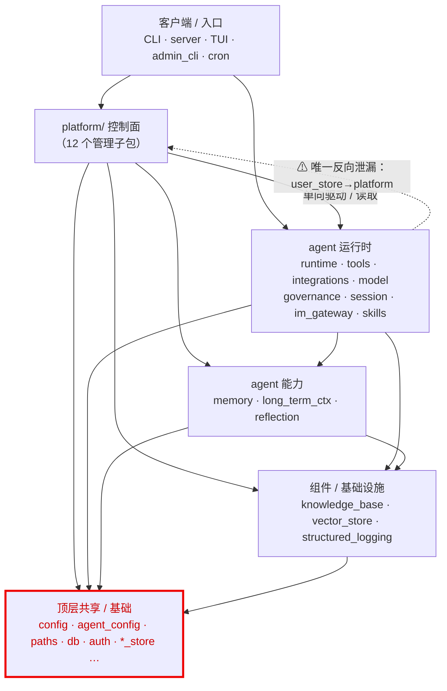
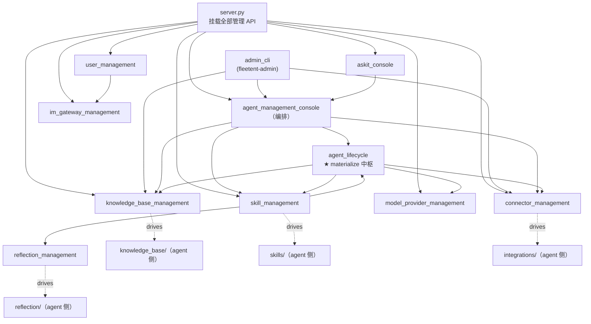
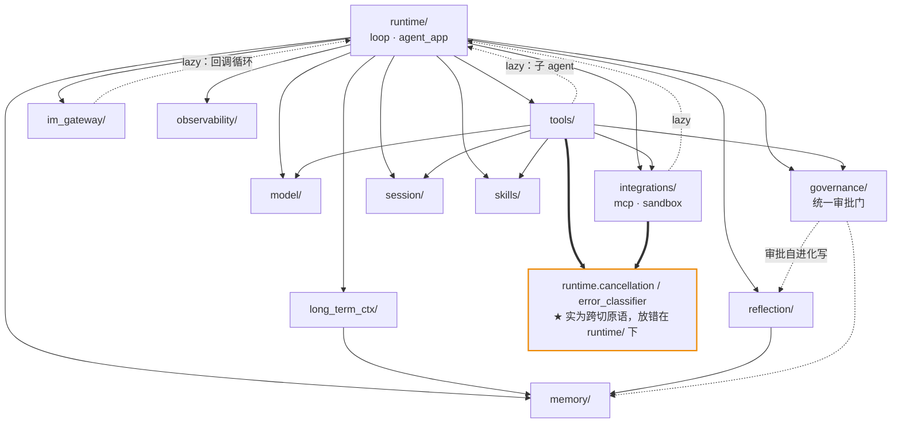
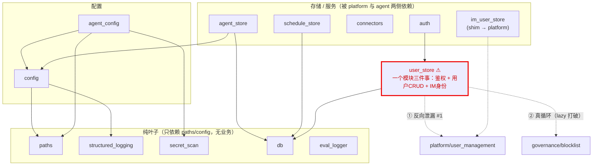
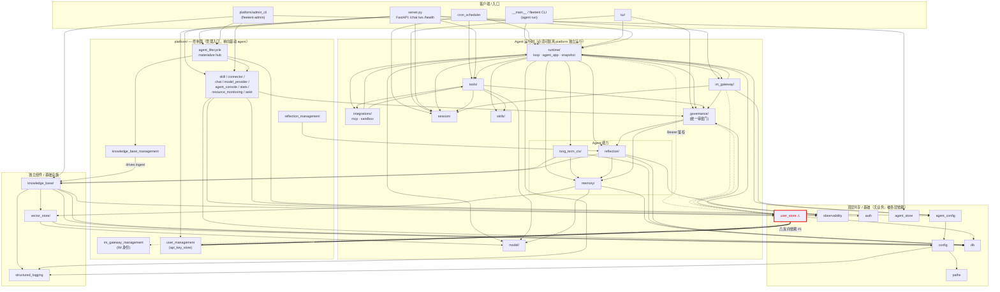

# fleetent 模块依赖图（2026-06-09）

> 本文的依赖图**由真实 import 扫描生成**：对 `src/fleetent/**/*.py` 做 AST 解析，收集所有
> `fleetent.*` import（含函数内 lazy import），按架构层聚合成模块间有向边。括号内数字是 import
> 次数，反映耦合强度。生成基线：`main @ 9307525`。

这张图回答两个问题：**模块之间实际怎么依赖**，以及**哪些边违反了 agent / platform 解耦契约**。

---

## 依赖契约（一句话）

```
platform（控制面，管理入口） ──→ agent runtime（被启停 / 被读取）   ✅ 允许，单向
agent runtime ──✗──→ platform                                      ❌ 严格禁止
```

agent 运行时必须能在**没有 platform、platform 的 DB 表不存在**的环境下完成 `fleetent agent run`。
完整规则见 `CLAUDE.md`「Agent / Platform 解耦」。本图用红色标出唯一一条现存反向依赖。

---

## 怎么看这组图

全景图把 30 个模块画在一起必然是毛球，**看清靠分层切片**：先看「① 宏观 6 层」建立坐标，再按需看
某一层的细节。每张切片只讲一个故事。文末附密集全景图供对照。

---

## ① 宏观 6 层（先看这张）



只有一条边逆着层走（红色虚线，即 #1）。在这个粒度上结构是**无环、自上而下**的——骨架是健康的。

---

## ② platform 控制面内部



**故事**：`server` 挂载所有管理 API；`agent_management_console` 做编排；`agent_lifecycle` 是
**materialize 中枢**——把各域 store（connector / kb / model / skill）组装成 `agent.yaml`。每个
`*_management` 单向驱动 agent 侧对应物（虚线）。这是清晰的「中枢 + 每域驱动」结构。

---

## ③ agent 运行时 + 能力层



**故事**：`runtime` 是编排中枢（高扇出是合理的）。三条 `-.->` 虚线（im_gateway / integrations /
tools 回调 `runtime.loop`）**全是函数内 lazy import**——适配器调用核心循环的标准做法，不是 smell，
只是聚合图上看着像环。橙色 `==>` 才是真问题：`CancelToken` / `error_classifier` 是跨切原语却住在
`runtime/`，凭空制造了 `runtime↔tools`、`runtime↔integrations` 双向耦合——下沉到中性模块即可消除。

---

## ④ 顶层共享 / 基础（「乱感」的主战场）



**故事**：这一层没有内部结构——~17 个模块平铺在 `src/fleetent/` 根目录，被两侧一起依赖。「叶子 /
配置 / 存储服务」三类本应分开，现在混在一起，这是「formless」的根本来源。`user_store` 是单点最乱的
模块：同时干鉴权、用户 CRUD、IM 身份三件事，还① 泄漏进 platform、② 和 governance 形成真循环。

---

## 全景图（参考 · 密集，看清请用上面的切片）



> 这是 Mermaid 源码，可在 GitHub/Bitbucket markdown、VS Code 预览、Obsidian 或
> [mermaid.live](https://mermaid.live) 渲染查看。

---

## 怎么读

**分层（从上到下）**：入口/客户端 → platform 控制面 → agent 运行时（含能力层）→ 独立组件/基础设施
→ 顶层共享/基础。依赖基本自上而下。

**契约视角**：
- `platform/* → agent runtime`（如 `knowledge_base_management → knowledge_base`、
  `reflection_management → reflection`、`agent_lifecycle → agent_config`）**全部合法**——platform 是
  管理入口，单向驱动 / 读取 agent。
- `agent runtime → platform` **严格禁止**。图中唯一红色反向边是
  `user_store ⟹ platform/user_management`（及虚线 `→ im_gateway_management`），即下方 **#1**。

**为可读性所做的聚合**（图不是 1:1 全边）：
- platform 的 8 个 admin 子包合并成 `PADMIN`。
- `paths / db / auth` 等被几乎所有模块依赖的基础边未全画，否则满屏连线。
- `server.py` 同时挂载全部 platform admin API + agent runtime，是唯一合法横跨两侧的**组装根**
  （composition root）——它不属于任何受护栏约束的组件目录，故不违反契约。

---

## 真实耦合最强的边（Top，来自扫描）

| 边 | import 次数 | 解读 |
|----|-----------:|------|
| `knowledge_base → db` | 34 | KB 是依赖最重的组件，持久化密集 |
| `knowledge_base → config` | 27 | |
| `runtime → structured_logging` | 27 | runtime 全链路结构化日志 |
| `platform/knowledge_base_management → knowledge_base` | 25 | platform 单向驱动 KB ingest（合法） |
| `runtime → tools` | 20 | runtime 是 agent 侧中枢 |
| `runtime → model` | 15 | |
| `im_user_store → platform/im_gateway_management` | 14 | shim，canonical home 已搬到 platform |
| `platform/im_gateway_management → user_store` | 14 | platform 读 user_store（合法方向） |
| `runtime → integrations` | 14 | mcp / sandbox |
| `governance → user_store` | 12 | 审批 / 配额读用户 |

`structured_logging`、`vector_store` 是**叶子基础设施**（只被依赖、不反向依赖业务），定位与
`CLAUDE.md` 一致。`governance` 被 runtime / tools / im_gateway / platform 共同依赖——审批门是横切
关注点，符合「自进化写经统一审批门」。

---

## 唯一现存反向依赖（#1，待修）

**模块**：`fleetent.user_store`

`user_store.authenticate()`（无条件 `import fleetent.platform.user_management`）和
`get_or_create_im_user()`（`import fleetent.platform.im_gateway_management`）在函数体内 hard-import
platform。standalone `fleetent agent run` 的 Bearer 鉴权路径
`runtime/agent_app.py::_authenticate` → `user_store.authenticate()` 会触发它，**违反「无 platform
基线」**（`authenticate()` 里的 legacy-key 兜底因 import 先失败而永不可达）。

对比：同文件 `_validate_tui_token` 故意只用环境变量、不碰 user_store——`/ws` 路径已脱 platform，
HTTP Bearer 路径漏了。

**护栏现状**：`tests/unit/test_module_dependency_guardrails.py::test_no_transitive_platform_leak_through_shared_modules`
已对 agent 组件做 import 传递闭包检查，把 `user_store` pin 在棘轮式 allowlist
`_KNOWN_TRANSITIVE_PLATFORM_LEAKS` 里——任何**新增**传递泄漏立即失败；该集合只能缩小。

**修法**：给 platform import 加降级（platform 缺席时走 legacy-key 兜底），修完从 allowlist 移除
`user_store`，棘轮断言会确认它确实不再泄漏。

---

## 复现方法

依赖边由 AST 扫描生成。重跑（更新本文数字 / 验证新边）的脚本逻辑：遍历 `src/fleetent/**/*.py`，
`ast.walk` 收集 `ast.Import` / `ast.ImportFrom`（`level == 0`）里的 `fleetent.*` 名称，
按最长前缀解析到真实模块，再聚合到架构层。传递闭包与泄漏检测的权威实现见上述护栏测试。
