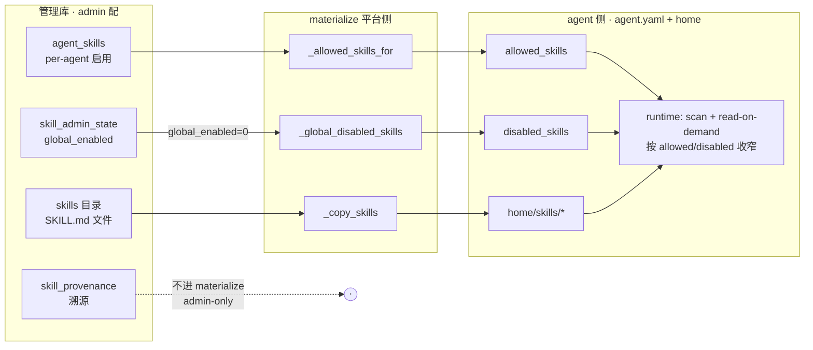
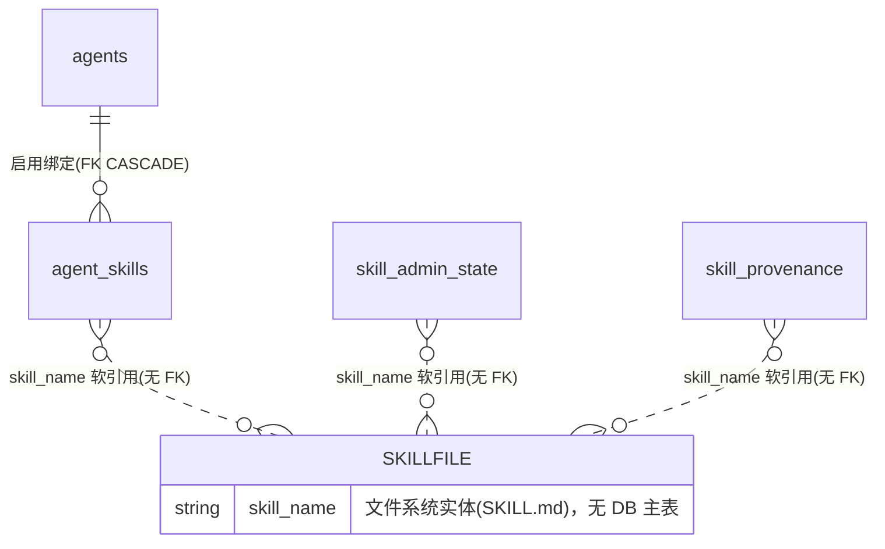

# Skill 子系统（as-built 全貌）

> **状态：as-built 参考（2026-06-14 双路调研）**。一份图 + 文，讲清 skill 横跨 **agent 侧（定义/运行/审计）** 与 **平台侧（绑定/治理/溯源）** 的完整逻辑、同步契约、以及**哪些活、哪些 inert**。与 [data-model](data-model.md)、[agent-identity-model](agent-identity-model.md) 配套。

## 0. 一句话

Skill = `skills/` 下的 **SKILL.md 包**（可复用指令/playbook），agent 运行时 **read-on-demand** 注入；平台侧三张表分管 **绑定/治理/溯源**，经 **materialize** 单向同步进 agent.yaml；agent 侧零 platform 依赖、只读 agent.yaml。

---

## 1. 什么是 skill（agent 侧定义）

- **物理**：一个目录含 `SKILL.md`（YAML frontmatter + 正文）+ 可选脚本/资源。两个物理根：包内 builtin（`src/fleetent/builtin_skills/`）+ 用户根（`FLEETENT_SKILLS_DIR` > `./skills`）。builtin 幂等 copy 进用户根（用户覆盖 builtin）。
- **frontmatter 字段**（`metadata.fleetent-<key>` 优先 → legacy 顶层 → 默认）：`name`/`description`；`enabled`（作者硬关，胜过下者）/`enabled_by_default`；`disable_model_invocation`（catalog 隐藏、仍可被 read_skill 按名加载）；`requires_tools`（render 时按会话工具集过滤）；`required_env_vars`（仅元数据、经 skill_readiness 报告、不挡 catalog）；`tags`/`platforms`/`version`。

## 2. agent 侧运行时（`src/fleetent/skills/`，零 platform import）

### 2.1 read-on-demand 模型（live）
模型平时只看到 **catalog**（`available_skills_prompt`）——每个**合格**skill 的 `name/description/location`，作为**稳定可缓存的 system 前缀**（base_system + catalog 为首条 system message，per-request memory/KB 后置以保前缀缓存）。**全文只在模型调 `read_skill(name)` 工具时**加载注入。预算：≤150 skill / ≤18000 字符，超则压缩（仅名）→截断+告警。
> 注：`match()`（关键词挑 skill）是 legacy auto-inject 路径；live 运行时用 read-on-demand catalog，不用 match。

### 2.2 合格性单判据 `_disabled_reason`（优先级）
catalog/读取全经这一个判据过滤，优先级：`audit_blocked` > `model_invocation_disabled`（disable_model_invocation）> `frontmatter_disabled`（enabled:false）> `config_disabled`（在 disabled_skills 里）> `default_disabled`（enabled_by_default:false）。
- **`allowed_skills`**（agent-skill-scoping）：catalog **可见性收窄**（空=不收窄、全可见；非空=只留列出的，且与 disable 判据 AND）。**不是授权边界**——read_skill 按名 load 不受其限。
- **`disabled_skills`**：全局强制禁用，喂进上面判据。

### 2.3 注入审计（`audit.py`，纯静态、无 LLM/无网/不出内网）
正则规则扫**两个会到达模型的面**：SKILL.md 正文 + frontmatter description。命中分 `severe`/`suspicious`。**何时跑 + 怎么处理**：
- **scan 时**：每个 skill 审计；severe→`audit_blocked`（留索引供人工排查、但**踢出 catalog** 且 **read_skill 在 load 前拒绝**、写 `skill.read_refused` 审计；suspicious→记录+告警、仍可用。
- **write/upload 时**：severe→`ValueError` 中止发布。
- 裸 `load()` 忽略 audit_blocked（人工/admin 排查用）。

### 2.4 边界
skill 包零 `import fleetent.platform.*`；agent 只经 agent.yaml 读 `allowed_skills`/`disabled_skills`/`skills_dir`。agent 侧 skill 事件（skill_hit）落 agent observability trace，**绝不写 platform 表**。

## 3. 平台侧三张表（management.db · Alembic 018）

| 表 | 关注点 | 列 | 键/FK |
|---|---|---|---|
| **agent_skills** | **绑定**（agent↔skill 启用矩阵）| agent_id, skill_name, enabled, updated_* | PK(agent_id,skill_name)；**FK agent_id→agents.id ON DELETE CASCADE**（082 加，并修了 str(id)/name 混写脏值）|
| **skill_admin_state** | **治理** | skill_name, status(active/archived/quarantined), global_enabled, audit_verdict, audit_rules, forced, archived_at, updated_at | PK skill_name；**无 FK**（skill 是文件系统实体、无 skills 主表）|
| **skill_provenance** | **溯源/self-managed** | skill_name, source(managed/adhoc), drift, immutable_fields(JSON), ~~last_deploy_at~~, updated_at | PK skill_name；**无 FK** |

> `skill_admin_state` 与 `skill_provenance` 均 1:1 per-skill、同 owner（skill_admin_api/store）、无 FK——但**关注点不同**（治理 vs 溯源）。

## 4. 平台 ↔ agent 同步（materialize，单向）

- `_allowed_skills_for`：agent 有绑定行→取 `enabled=1` 子集（空=显式收窄到无）；无绑定行→回退 authored `agent.allowed_skills`；缺表→authored 回退。
- `_global_disabled_skills`：`skill_admin_state.global_enabled=0` 的 skill 名 → `disabled_skills`。
- skill 文件整目录 `copytree` 进 `<home>/skills/`，运行时再按 allowed/disabled 收窄。
- **skill_provenance 不进 materialize**（纯 admin 元数据）。
- 触发：绑定改→`materialize_from_store(name)`；全局启停→`rematerialize_all()`。
- 注入审计在平台 admin 上传/创建/编辑路径**真实跑**（engine_audit→set_audit_result 写 audit_verdict/rules；severe→quarantined+不发布；force_publish 可经 `X-Confirm` 覆盖）。

## 5. 数据关系图

三张表都以 **skill_name（文件系统 skill）** 为软引用键——没有 `skills` 主表，故 skill_admin_state/skill_provenance 无 FK（合理）；agent_skills 仅 agent 侧有 FK→agents.id。

## 6. self-managed 溯源：AGENT 活、SKILL inert（关键）

self-managed 模型（[fleetent-self-managed-provenance]）：`source=managed`（spec 拥有，部署恢复、immutable 字段保护）vs `adhoc`（DB/UI 临时）；UI 改 managed→`drift=1`；promote/discard 经 askit override-reflow 调和。

| | AGENT | SKILL |
|---|---|---|
| 怎么变 managed | **apply API**（`POST /admin/agents/apply`，askit_console）真写 `set_provenance(managed)`、支持 adhoc→managed adopt | **无路径**——`set_provenance(managed)` 在平台**从不被调**（所有路径产 adhoc）|
| drift/immutable | 活 | 机器件在（mark_drift/is_immutable_change/immutable_fields），但**只在已 managed 时才触发**，而 skill 永远造不成 managed → **实际不触发** |
| promote/discard 调和 | —— | `askit_override` 是 **no-op 占位**；promote/discard 只清 drift 标志、无真调和（**P1-F 暂缓**：需先在 askit 建 skill-authoring/apply surface，skill≠agent 不能复用 agent apply）|
| last_deploy_at | —— | **死列**（从不写）|

**结论**：**agent 的 self-managed 是 live 的；skill 的 self-managed（skill_provenance 这套）当前 inert**——没有 managed-skill 创建路径，drift/immutable/promote/discard 全是空转的脚手架，等一个尚未存在的"askit skill-authoring"。

> askit 关系：askit 是**外部** agent 编译/部署工具；fleetent 只暴露 apply API 当其目标。**askit 服务端任务队列三表已砍**（migration 064 + 护栏测试）。agent apply API **有意保留**（= agent self-managed 机制）。skill-authoring-via-askit **未建**。

## 7. live / dead 速查（决策相关）

| 项 | 状态 |
|---|---|
| agent_skills（绑定）+ 其 store/materialize | ✅ live |
| skill_admin_state：status/global_enabled/audit_verdict/audit_rules/forced/archived | ✅ live（global_enabled→disabled_skills；audit→list 过滤；force-publish）|
| skill_provenance：source/drift/immutable_fields | ◐ **存储+UI 在，但自管流 inert**（无 managed-skill 路径）|
| skill_provenance.last_deploy_at | ❌ 死列（从不写）|
| askit_override（promote/discard 调和）| ❌ no-op 占位（P1-F 暂缓）|
| read-on-demand / catalog / 注入审计 | ✅ live |

## 8. Open Questions（你需要拍的）

1. **skill 的 self-managed（skill_provenance）怎么办？** 三选一：
   - **(a) descope inert 部分**：删 skill_provenance + mark_drift/is_immutable_change/askit_override 占位 + last_deploy_at（保留 agent_skills + skill_admin_state）。等真要 askit skill-authoring 时再正经建。
   - **(b) 保留脚手架**：若 askit skill-authoring 是近期路线。
   - **(c) 最小清理**：仅砍 last_deploy_at 死列，其余留。
2. **skill_admin_state + skill_provenance 合并？** 二者 1:1 同键，但治理 vs 溯源两关注点。若 (a) descope provenance，则无合并问题；若保留，可议是否合。
3. 命名残留：`askit_override`（其实是 self-managed drift 操作）等 askit 品牌挂在机制上——可选正名。

> 我（调研结论）倾向 **(a)**：skill 自管流当前是 inert 脚手架（没有 managed-skill 上游），与 agent 自管（live）不同；descope 它最干净，等 askit skill-authoring 真立项再正经建。但这是产品判断，看你 v1/近期要不要"managed skill / agent 自进化 skill"。
