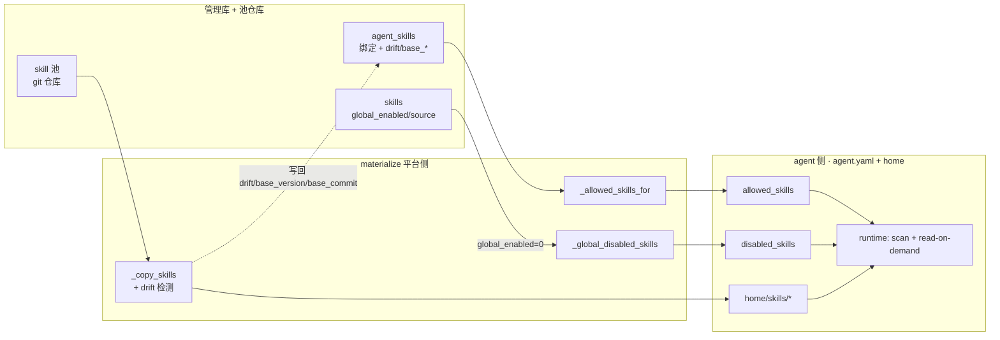

# Skill 子系统（as-built 行为模型）

> **状态：as-built 行为参考（2026-06-15 schema 重设计后重写）**。本文只讲**逻辑怎么运转**（谁调谁、数据流、决策点、约束），**不复述列级 schema**——表/列/FK 的真相源是 [data-model](data-model.md)（Skill 段 + erDiagram）与迁移 092/094/095。设计 rationale 见 [`records/decision-logs/`](../records/decision-logs/)（`skill-system-enhancements-decisions.md`、`wave2-apply-decisions.md`）。配套 [agent-identity-model](../records/decision-logs/agent-identity-model.md)。

## 0. 一句话

Skill = `skills/` 下的 **SKILL.md 包**（可复用指令/playbook），agent 运行时 **read-on-demand** 注入；公共 skill 池是一个 **git-on-disk 仓库**，平台侧管 **绑定/治理/溯源 + 池版本 + drift + 回流**，经 **materialize** 单向同步进 agent.yaml + agent home；agent 侧零 platform 依赖、只读自己的副本，**绝不反写 platform**。

---

## 1. 什么是 skill（agent 侧定义）

- **物理**：一个目录含 `SKILL.md`（YAML frontmatter + 正文）+ 可选脚本/资源。两个物理根：包内 builtin（`src/fleetent/builtin_skills/`）+ 用户池（`FLEETENT_SKILLS_DIR` > `./skills`）。builtin 幂等 copy 进用户池（用户覆盖 builtin）。
- **frontmatter 字段**（`metadata.fleetent-<key>` 优先 → legacy 顶层 → 默认）：`name`/`description`；`enabled`（作者硬关，胜过下者）/`enabled_by_default`；`disable_model_invocation`（catalog 隐藏、仍可被 read_skill 按名加载）；`requires_tools`（render 时按会话工具集过滤）；`required_env_vars`（仅元数据、经 skill_readiness 报告、不挡 catalog）；`tags`/`platforms`/`version`。
- **运行时溯源注记**：反射/自进化写出的 skill，`write_skill()` 经 `_inject_skill_provenance()` 在 frontmatter 注入 `source`/`proposal_id`/`applied_at`——这是 platform 侧 drift 检测的"产物信号"（见 §6）。

## 2. agent 侧运行时（`src/fleetent/skills/`，零 platform import）

> 本节这一轮**未改动**——read-on-demand / 合格性判据 / 注入审计与重设计前一致。

### 2.1 read-on-demand 模型（live）
模型平时只看到 **catalog**（`available_skills_prompt`）——每个**合格** skill 的 `name/description/location`，作为**稳定可缓存的 system 前缀**（base_system + catalog 为首条 system message，per-request memory/KB 后置以保前缀缓存）。**全文只在模型调 `read_skill(name)` 工具时**加载注入。预算：≤150 skill / ≤18000 字符，超则压缩（仅名）→截断+告警。
> 注：`match()`（关键词挑 skill）是 legacy auto-inject 路径；live 运行时用 read-on-demand catalog，不用 match。

### 2.2 合格性单判据 `_disabled_reason`（优先级）
catalog/读取全经这一个判据过滤，优先级：`audit_blocked` > `model_invocation_disabled`（disable_model_invocation）> `frontmatter_disabled`（enabled:false）> `config_disabled`（在 disabled_skills 里）> `default_disabled`（enabled_by_default:false）。
- **`allowed_skills`**（agent-skill-scoping）：catalog **可见性收窄**（空=不收窄、全可见；非空=只留列出的，且与 disable 判据 AND）。**不是授权边界**——read_skill 按名 load 不受其限。
- **`disabled_skills`**：全局强制禁用，喂进上面判据。

### 2.3 注入审计（`audit.py`，纯静态、无 LLM/无网/不出内网）
正则规则扫**两个会到达模型的面**：SKILL.md 正文 + frontmatter description。命中分 `severe`/`suspicious`。**何时跑 + 怎么处理**：
- **scan 时**：每个 skill 审计；severe→`audit_blocked`（留索引供人工排查、但**踢出 catalog** 且 **read_skill 在 load 前拒绝**、写 `skill.read_refused` 审计）；suspicious→记录+告警、仍可用。
- **write/upload 时**：severe→`ValueError` 中止发布。
- 裸 `load()` 忽略 audit_blocked（人工/admin 排查用）。

### 2.4 边界
skill 包零 `import fleetent.platform.*`；agent 只经 agent.yaml 读 `allowed_skills`/`disabled_skills`/`skills_dir`。agent 侧 skill 事件（skill_hit）落 agent observability trace，**绝不写 platform 表**；**drift 也由 platform 判定、agent 不反写**（§6）。

## 3. 平台侧职责（management.db · 表见 data-model）

四个关注点，落在 data-model 的 Skill 段（`skills` / `agent_skills` / `backflow_proposals`）+ 公共池目录：

| 关注点 | 落点 | 说明 |
|---|---|---|
| **绑定** | `agent_skills` | agent↔skill 启用矩阵 + 该副本的 drift 状态（`base_version`/`base_commit`/`drift`/`drift_at`）|
| **治理 + 溯源**（合一）| `skills` 主表 | 092 把旧 `skill_admin_state`（治理）+ `skill_provenance`（溯源）**合并为单表**（PK=name）：`status`/`global_enabled`/`audit_*`/`forced` + `source`/`immutable_fields`/`current_version` |
| **回流提案** | `backflow_proposals` | agent 运行时改动 skill → 回流公共池的提案（§6）|
| **池版本** | 公共池 git 仓库 | skill 池 = git-on-disk（§5）|

> 合并要点：以前没有 skills 主表、两张元数据表无 FK；092 后有了主表，`agent_skills.skill_name` **FK→skills(name)**，治理与溯源同库同行、按 skill name 寻址。

## 4. 平台 ↔ agent 同步（materialize，单向 + drift 感知）

- `_allowed_skills_for`：agent 有绑定行→取 `enabled=1` 子集（空=显式收窄到无）；无绑定行→回退 authored `agent.allowed_skills`；缺表→authored 回退。
- `_global_disabled_skills`：`skills.global_enabled=0` 的 skill 名 → `disabled_skills`。
- `_copy_skills`：池 skill 整目录 `copytree` 进 `<home>/skills/`，**同时**做 drift 检测并把 `drift`/`base_version`/`base_commit` 写回 `agent_skills`（§6）；运行时再按 allowed/disabled 收窄。
- 注入审计在平台 admin 上传/创建/编辑路径**真实跑**（engine_audit→写 `skills.audit_verdict/rules`；severe→quarantined+不发布；force_publish 可经 `X-Confirm` 覆盖）。

## 5. skill 池 = git-on-disk 版本仓库（`pool_git.py`）

- 公共池（`FLEETENT_SKILLS_DIR`）升级为 **git 仓库**，用 **dulwich**（纯 Python，不依赖宿主 git 二进制）；`init_pool()` 幂等：首次 `git init` 并提交当前内容为初始 commit。
- **所有池写路径**（create/edit/upload/archive + 回流 accept/fork）改文件后调 `commit_pool(message, author, skill_name)`，每次 commit 携带可归因信息。
- **写串行化**：单机文件锁 `<pool>/.git/fleetent.lock`（`O_CREAT|O_EXCL` 自旋），防并发 worker 损坏仓库。
- **版本指针**：`skills.current_version` = 该 skill 子树最后被改的 pool commit sha（`set_current_version`；`pool_version_for_skill()` 用 dulwich walker 求）。`pool_bundle_at(sha)` 可取回任意版本的完整 bundle，供回流重建 base / diff（§6）。

## 6. drift 检测 + backflow 回流（self-managed 的活路径）

### 6.1 drift 检测（platform 单向判定）
`agent_skills.drift`（per-agent-per-skill）标记该部署副本是否分叉。materialize `_copy_skills()` 期间检测，两个信号：
- **产物信号**：`_skill_has_runtime_provenance()` 扫 home 副本 SKILL.md frontmatter，有运行时写入迹象（§1 注入的 `source` 等）→ 疑似 drift。
- **内容哈希**：`_skill_dir_version()` 对 home 副本逐文件 SHA256，与存储的 `base_version` 比对，不一致→`drift=1`。

> 分工：`base_version`（内容哈希）**专用 drift 检测**；`base_commit`（pool git sha）**专供回流重建 base 内容**。drift 只由 platform 写，agent 运行时禁止反写（核心架构契约）。

### 6.2 backflow 生命周期（`backflow_store.py` + `backflow_api.py`）
agent 运行时改了 skill（drift=1）后，把进化回流到公共池的完整流程：

1. **Nominate（提名）**：`nominate(agent_id, skill_name, pool_dir)`，前置 drift=1。捕获 home 副本**完整 bundle**（所有文件→`proposed_bundle` JSON）+ `base_version`/`base_commit` 快照；`_detect_conflict()` 比对 base 与池当前内容、标 `conflict`；写 `backflow_proposals`（status=pending）。
2. **Review（diff）**：`get_proposal_diff()` 返回三向比较——`diff_vs_base`（用 `base_commit` 从池 git 取回基准）、`diff_vs_head`（vs 池当前 head）、`conflict` 标志（部署后池已被他人推进时显式暴露）。
3. **决策（admin 控制台，平台治理鉴权 `_require_admin`）**：
   - **Accept**：evolved bundle 原子写回池 → `commit_pool()` 新 commit → `set_current_version()` 前移指针 → 清该副本 drift → proposal=accepted（冲突时 `overridden_head` 记被覆盖的 head 供审计）。其余绑定该 skill 的 agent 下次 materialize 拿新版本。
   - **Reject**：池不改、清 drift → 下次 materialize 该副本被池版本**覆盖**（进化丢弃）→ proposal=rejected。
   - **Fork**：evolved bundle 作为**新命名 skill** 写回池（原 skill 不变）→ commit → 解绑原 skill、改绑 fork → 清原 skill drift → proposal=forked，`forked_as`=新名。

> **为何不走 `approval_requests`**：回流改的是**共享池、影响整个 fleet**，是平台治理决策；与 agent 自进化审批（agent-owned/DM、只改单副本，走 approval_requests）性质不同。

### 6.3 self-managed source 现状：仍 inert
`skills.source`（managed/adhoc）字段结构在，create/edit/upload/import 的 API 也接受 source 参数，但**代码中无任何处把 source 置 managed**——默认全 adhoc，**managed-skill 注册/采纳路径仍未启用**（留待未来 change）。backflow 让"skill 进化回流"这条**自管路径活了**，但"spec 拥有的 managed skill"那条仍是空结构。

## 7. live / dead 速查

| 项 | 状态 |
|---|---|
| read-on-demand / catalog / 注入审计（agent 侧）| ✅ live（本轮未改）|
| `agent_skills` 绑定 + materialize | ✅ live |
| `skills` 治理（global_enabled→disabled_skills / audit→list 过滤 / force-publish）| ✅ live |
| skill 池 git 版本化（pool_git）| ✅ live（本轮新增）|
| drift 检测（双信号，platform 单向）| ✅ live（本轮新增）|
| backflow 回流（nominate→diff→accept/reject/fork）| ✅ live（本轮新增）|
| self-managed `source=managed` 创建/采纳路径 | ◐ 结构在、**仍 inert**（无 managed 上游）|
| ~~askit_override / promote-discard 端点 / last_deploy_at / skill_provenance 表~~ | ❌ **已删**（092 清理）|

> 历史 Open Questions（skill_provenance 怎么办 / 两表合并 / askit 命名）**已被这轮重设计拍掉**：选择"合并为 `skills` 主表 + 重设计 drift 保护 + 引入 backflow/pool-git"，而非 descope；inert 占位与死列已清。详见决策日志。
