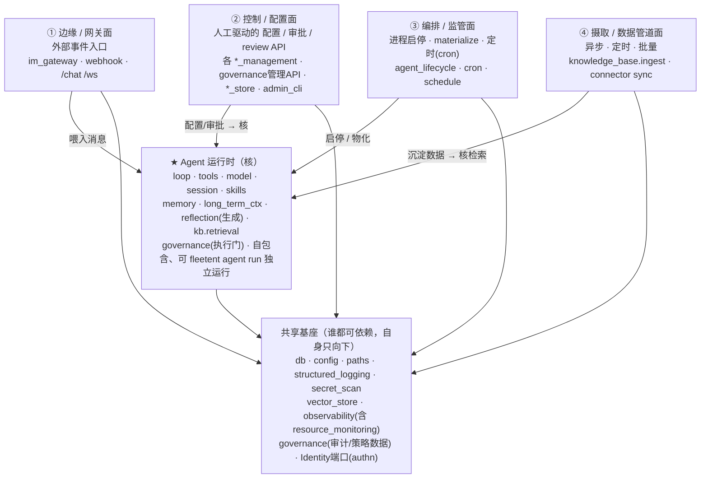

# fleetent 目标架构提案：一个核 + 四个面 + 共享基座

> **状态：草案 / 待讨论（DRAFT）**。这不是已批准的设计，是供讨论的靶子。
> 配套阅读现状文档 [`module-dependency-graph.md`](./module-dependency-graph.md)（当前模块依赖 + 切片图）。
> 基线：`main @ 9307525`，2026-06-09。

---

## 0. 这篇要回答的问题

项目「怎么看怎么乱」的根因，经依赖扫描 + 模块体量分析，定位为：

1. 把**四种性质完全不同**的外围功能压进了一个 `platform/` 命名空间 + 一堆顶层散文件；
2. 少数**巨型文件**（`loop.py` 2591 行、`reflection.py` 1747 行、`agent_store.py` 685 行…）一个文件干多件事；
3. 几个模块（`user_store`、`knowledge_base`、`governance`）的职责**横跨了本应分开的边界**。

包级（package-level）的职责切分其实**大体健康**——乱不在「切错了架构」，而在「外围没有结构」+「少数模块太胖/横跨边界」。

本提案给出一个能收编以上全部问题的目标模型。

---

## 1. 心智模型：核 + 面 + 基座

系统 = **1 个自包含的核（Agent 运行时）** + **4 个围绕它的「面（plane）」** + **1 层共享基座**。
这是 hexagonal / ports-and-adapters 的直觉：**所有依赖指向核与基座，核不向外依赖任何面。**



**依赖铁律（可被护栏强制）**：
- 面 → 核：允许（面驱动/喂养/读取核）。
- 核 → 面：**禁止**（核必须能脱离任何面独立运行）。
- 任意 → 基座：允许；基座 → 任意业务：禁止（基座是叶子）。
- 面 ↔ 面：默认禁止直接依赖；需要协作走核或基座的共享契约，不互相 import。

---

## 2. 核：Agent 运行时

**判据**：凡是「关于 agent 自己」、且 `fleetent agent run` 必须具备的能力，归核。

| 子域 | 现模块 | 说明 |
|---|---|---|
| 主循环与执行 | `runtime/`（loop, context, snapshot, sub_agent, budget, termination, hooks, steering…） | while tool-use 核心 |
| 会话 | `session/` | 持久化 + 锁 |
| 模型 | `model/` | provider 解析 + 健康 |
| 工具 | `tools/`、`integrations/`（mcp, sandbox） | 工具注册/分发 + 外部工具后端 |
| Skill | `skills/` | 扫描/注入（运行时侧） |
| 能力（关于自己） | `memory/`、`long_term_ctx/`、`reflection/`(生成) | 记忆/上下文/反思 |
| 知识检索 | `knowledge_base.retrieval` | **仅消费侧**，不含 ingest |
| 治理执行 | `governance`(permission_gate, agent_policy, quota 执行) | 运行时侧的门 |

> 核内部的「巨型文件」（`loop.py`/`reflection.py`/`context.py`）是**正交的内聚问题**：拆它们不改外部行为、不动依赖方向，可独立先做。

---

## 3. 四个面

### ① 边缘 / 网关面 —— 接外部流量
- **性质**：事件驱动、长连接/轮询、把外部消息归一化后喂给核。
- **模块**：`im_gateway/`（slack, telegram, 各 supervisor, normalizer, access）、`webhook_router`、`im_user_store`（IM 身份解析）、`server` 的 `/chat` `/ws` 端点。

### ② 控制 / 配置面 —— 人工驱动的配置编写
- **性质**：同步 CRUD API，管理员/控制台操作；产出「核去读取」的配置与绑定。
- **模块**：`platform/` 的 `askit_console`、`agent_management_console`、`connector_management`、`knowledge_base_management`（绑定/管理 API）、`model_provider_management`、`skill_management`、`user_management`、`chat_management`；`agent_store`（定义+版本）、`user_store`(用户 CRUD)、`connectors`(OAuth)、`auth`；`admin_cli` + `server` 的管理端点。

### ③ 编排 / 监管面 —— 管 agent 的生命周期
- **性质**：把②的配置 materialize 成 `agent.yaml`、启停 agent 进程、定时触发。**daemon / 调度** character，独立于②的同步 CRUD（独立可用性：本面挂了配置照样能改，跑着的 agent 才失去监管）。
- **模块**：`platform/agent_lifecycle`（materialize, controller, secret_store, credential_slots）、`cron_scheduler` + `schedule_store`。
- **边界注记**：`materialize`（store 配置 → `agent.yaml`）是 **②→③ 的转换桥**——由②动作触发、产出③要用的运行时产物，归③（执行侧），别误当②的一部分。`resource_monitoring` **已移出本面 → 基座 `observability`**（§4）：它是可观测性，不是编排。

### ④ 摄取 / 数据管道面 —— 异步把数据沉淀进可检索源
- **性质**：异步、定时、批量、数据重；外部源 → 解析/向量化 → 写入核可检索的 store。
- **模块**：`knowledge_base.ingest`（config, connectors/sync, runtime ingest）、connector sync。
- **关键**：与核的 `knowledge_base.retrieval` **同源数据、反向流向**——retrieval 读、ingest 写，二者不互相 import（现有护栏已强制 retrieval ✗→ ingest，本提案把它升级为「核 ✗→ ④面」的硬边界）。
- **为何独立成面（而非并入②）**〔已决议保留独立〕：判据是**定义 vs 执行**——② 控制面是「人同步定义配置」（绑定一个 KB 数据源，点完即返回）；④ 是「系统异步执行数据处理」（cron/webhook 触发、解析、本地 embedding 上千 chunk、写入）。运行特征、失败模式（断点/重试/幂等）、扩容需求都不同；④ 也是整个系统**最可能将来需独立扩容/加队列**的部分。今天住户只有 KB ingest，但面的成立靠「运行特征 + 已存在的 retrieval✗→ingest 硬边界」，不靠模块数量。

---

## 4. 共享基座

谁都可依赖、自身只向下的叶子：`db`、`config`、`paths`、`structured_logging`、`secret_scan`、`eval_logger`、`vector_store`（向量 infra）、`observability`（核发射 trace、面读取；**含 `resource_monitoring` 运行健康监控**）、`Identity` 端口（authn：本地 key / OIDC 适配器，详见 §6）。

---

## 5. 横跨边界的模块 —— 必须沿面边界拆开

有三个「模块」今天横跨了本应分开的面，这正是混乱的来源，目标态要拆：

| 模块 | 现状（一个模块多职责） | 目标（沿边界拆） |
|---|---|---|
| `user_store` | 鉴权 + 用户 CRUD + IM 身份，且反向 import platform/governance | **authn→基座 `Identity` 端口**、用户/key 管理→②控制面、IM 身份→①边缘；解开与 governance 的循环、消除 platform 泄漏(#1)。详见 §6 |
| `knowledge_base` | retrieval(消费) 与 ingest(管道) 同包 | retrieval→核、ingest→④面；用现有护栏升级为硬边界 |
| `governance` | 执行门(policy/permission/quota/blocklist) 与 管理 API 与 审计数据 混在一起 | **执行→核**、**管理 API→②**、**审计/策略数据→基座**（详见下表） |
| `reflection` | 反思「生成」与「管理 API」分属不同面（`platform/reflection_management` 已半成形） | **生成→核**、**review/approve API→②**（详见下表） |

**一般规则**：一个模块若横跨两个面，就是该拆的信号。

### governance 三拆（能力本体 vs 管理面 vs 数据）

| 现成员 | 职责 | 目标归属 |
|---|---|---|
| `agent_policy` | fnmatch 工具白名单检查（运行时） | **核** |
| `permission_gate`（门机制） | medium/high 风险工具调用阻塞等审批（`asyncio.Event`，运行时） | **核** |
| `quota` 检查 / `blocklist` 检查 | 运行时按用户限流 / 拦截调用 | **核** |
| 审批**解析**、封禁/配额**管理** API | 人对治理的管理（薄暴露面） | **② 控制面** |
| `audit_log`（平台管理操作审计）、策略/封禁数据 | 横切数据落地 | **基座** |

要点：**`permission_gate` 的「门」在核里阻塞、「批准动作」从 ②/① 进来**——机制与管理分两处，正是 CLAUDE.md 已写的「审批门 ≠ 归控制面」。自进化的「写」仍统一经这道门（核 ↔ ② 的明确契约）。

### reflection 两拆（生成 vs 管理）

| 现成员 | 职责 | 目标归属 |
|---|---|---|
| 反思**生成**（`reflection.py`：读 trace/memory/KB → 产出 skill/memory/KB 改进建议） | 自进化元能力本体（纵向贯穿各能力域） | **核** |
| `platform/reflection_management` | 建议 review / approve API | **② 控制面** |
| 反思建议**存储**（skill_proposals / kb_reflection_reports） | 核产出的数据 | **基座 / agent 侧 store**——核**写 agent 侧产物**，②的管理 API **只读**它做 review，**不可让核反向写 platform 表**（遵 §1 解耦：platform 读 agent 产物，不要求 agent 反向写入） |

注：建议经审批后的「落地写」遵 §1 自进化规则——**真相源**（memory/shared-memory/skill）经门直接写、**派生视图**（KB）不直接写（走 agent-curated 沉淀源 → connector sync）。

---

## 6. 身份与认证（identity & auth）

> **结论：内置模块，不做独立服务；authn 下沉为基座端口，user 管理留在 ②。**

「用户体系」其实是两件性质相反的事，分两处放：

| 关注点 | 是什么 | 归属 |
|---|---|---|
| **authn（核验）** | `凭证 → principal 或拒绝`；核服务 /chat /ws 必须有、且要脱离 platform | **基座的 `Identity` 端口** |
| **user/key/角色管理** | 建用户、签发/吊销 key、邀请、封禁 | **② 控制面** CRUD |
| **per-user 配额/封禁** | 运行时策略 | 横切治理（基座侧策略数据） |

**为何不做独立服务**：外部 SaaS 身份违反数据主权；自托管独立进程的运维负担违背 lean；企业客户多半自带 IdP（LDAP/AD/OIDC），自建反而和客户身份系统冲突。正解是**依赖反转**——核定义 `Identity` 端口，多种实现作适配器接入。

**端口与适配器**：
- **单机 agent**：最小本地实现（env / static token，如现 `_validate_tui_token`）。
- **platform**：完整实现（api_keys 表、角色、吊销）。
- **企业 / 外部登录**：**OIDC 适配器，首发 Google**（Google 是认证过的 OIDC Provider）；同一适配器天然覆盖 Okta / Azure AD / Keycloak。主权要求严格的客户改挂内网 IdP（自托管 Keycloak / 客户 AD），**端口不变**。

**两类凭证、一个出口**：`Identity` 端口统一解析二者，返回统一 principal。

| 凭证 | 谁用 | 解析 |
|---|---|---|
| OIDC `id_token`(JWT) | 人（登录 / 控制台） | OIDC 适配器验签 |
| API key(`ma-`) | 服务间 · IM · TUI · cron | 本地 key store |

**这结构性修掉 #1**：核只 import `Identity` 端口，**永不** import platform 的 user 管理——standalone agent 鉴权不再反向够进 platform，泄漏从根消失（不是打补丁）。

> 主权注记：Google OIDC 登录流需联通 `accounts.google.com`、身份/邮箱经过 Google。当前 pilot 客户**接受外部登录**，故首发 Google；气隙 / 严格内网客户改挂内网 IdP。

---

## 7. 物理形态：先单体，边界按「可拆服务」画

项目哲学是 **on-prem · lean · 模块化单体 · 不引框架 · 数据主权**。因此：

- **不建议**现在拆微服务——多进程运维负担违背 lean/on-prem。
- **建议**：四个面在单体内做成**一等的限界上下文**，边界画得像将来能独立成服务一样干净。
- **可拆性预留**：哪天某个面需要独立扩容（最可能是 ④摄取管道——数据重、可异步），能整面抽出为独立服务而不必重写。判据是「面之间不互相 import、只经契约通信」。

---

## 8. 这个模型如何收编已发现的问题

| 已发现问题 | 在目标模型里如何消解 |
|---|---|
| 顶层「杂物抽屉」17 个散文件 | 每个文件归入某个面或基座，抽屉消失 |
| `platform/` 一个命名空间塞四种东西 | 拆成①②③④四个面 |
| `user_store` 三职责 + 泄漏#1 + 与 governance 真循环 | 沿面边界拆三处（§6）；authn 走 `Identity` 端口，泄漏#1 结构性消失 |
| `knowledge_base` retrieval/ingest 混 | 升级为核↔④面硬边界 |
| 巨型文件（loop/reflection/agent_store…） | 核/面**内部**的内聚拆分，正交，可独立先做 |
| A/B 严格分层之争 | 退化为「面→核单向 + 全员→基座向下」，比抽象 N 层好懂，且就是「核+外围」直觉的精确版 |

---

## 9. 现模块 → 目标归属（速查）

```
核    : runtime · session · model · tools · integrations · skills
        memory · long_term_ctx · reflection(生成) · knowledge_base.retrieval
        governance(执行: agent_policy · permission_gate机制 · quota/blocklist检查)
        agent_config         〔依赖 Identity 端口，不依赖其实现〕
①边缘 : im_gateway · webhook_router · im_user_store · server(/chat /ws)
②控制 : platform/{askit_console, agent_management_console, connector_management,
        knowledge_base_management, model_provider_management, skill_management,
        user_management, chat_management, reflection_management}
        · governance 管理 API(审批解析/封禁/配额) · agent_store · user_store(CRUD)
        · connectors · admin_cli · server(管理端点)
③编排 : platform/agent_lifecycle · cron_scheduler · schedule_store
④摄取 : knowledge_base.ingest · connector sync
基座  : db · config · paths · structured_logging · secret_scan · eval_logger
        · vector_store · observability(含 resource_monitoring)
        · governance(audit_log + 策略/封禁数据) · 反思建议 store(核写、②读)
        · Identity 端口 + 适配器(本地 key / OIDC-Google / 企业 IdP)   ← 新增，#1 修法核心
```

---

## 10. 决议记录与待讨论

### 已决议（本轮讨论确定）
- **面的数量 = 4**：① 边缘、② 控制、③ 编排、④ 摄取，互不合并。
  - ④ 摄取**保持独立**（不并入②）。理由见 §3-④。
  - ②控制 与 ③编排**不合并**：靠「定义 vs 执行」同一把尺——③ 是 daemon/调度 character、独立可用性，与 ② 的同步人工 CRUD 是两种东西。
  - `resource_monitoring` **移出 ③ → 基座 `observability`**（可观测性，非编排）；`materialize` 标为 ②→③ 的转换桥。
- **物理形态 = 单体**：四个面做成一等限界上下文，边界按「可拆服务」画；不现在拆微服务。
- **用户体系 = 内置模块 + `Identity` 端口**（§6）：authn→基座端口、user 管理→②；**首发 OIDC/Google 适配器**（pilot 客户接受外部登录）；结构性修掉泄漏 #1。
- **governance / reflection 拆分**（§5 两节）：**能力本体/运行时执行→核**、**管理/审批/review API→②**、**审计/策略/建议数据→基座**（核写、②只读，不反向写 platform 表）。沿用 CLAUDE.md「审批门≠归控制面」与「自进化纵向元能力」判据。

### 仍待讨论
1. **迁移顺序**（方向认可后细化）：先拆巨型文件（正交、低风险）还是先立面边界（结构优先）？
```
