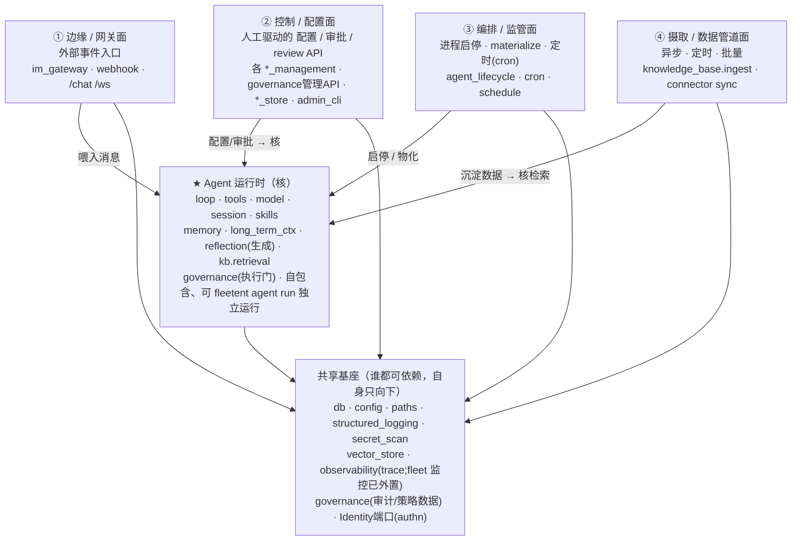

# fleetent 目标架构提案：一个核 + 四个面 + 共享基座

> **状态：草案 / 待讨论（DRAFT）**。这不是已批准的设计，是供讨论的靶子。
> 当前模块依赖与切片以 §10（现模块→目标归属速查）+ 依赖护栏测试为准。
> 基线：`main @ 9307525`，2026-06-09。

---

## 0. 这篇要回答的问题

项目「怎么看怎么乱」的根因，经依赖扫描 + 模块体量分析，定位为：

1. 把**四种性质完全不同**的外围功能压进了一个 `platform/` 命名空间 + 一堆顶层散文件；
2. 少数**巨型文件**（`loop.py` 2591 行、`reflection.py` 1747 行、`agent_store.py` 685 行…）一个文件干多件事；
3. 几个模块（`user_store`、`knowledge_base`、`governance`）的职责**横跨了本应分开的边界**。

包级（package-level）的职责切分其实**大体健康**——乱不在「切错了架构」，而在「外围没有结构」+「少数模块太胖/横跨边界」。

本提案给出一个能收编以上全部问题的目标模型。

---

## 1. 心智模型：核 + 面 + 基座

系统 = **1 个自包含的核（Agent 运行时）** + **4 个围绕它的「面（plane）」** + **1 层共享基座**。
这是 hexagonal / ports-and-adapters 的直觉：**所有依赖指向核与基座，核不向外依赖任何面。**



**依赖铁律（可被护栏强制）**：
- 面 → 核：允许（面驱动/喂养/读取核）。
- 核 → 面：**禁止**（核必须能脱离任何面独立运行）。
- 任意 → 基座：允许；基座 → 任意业务：禁止（基座是叶子）。
- 面 ↔ 面：默认禁止直接依赖；需要协作走核或基座的共享契约，不互相 import。

---

## 2. 核：Agent 运行时

**判据**：凡是「关于 agent 自己」、且 `fleetent agent run` 必须具备的能力，归核。

| 子域 | 现模块 | 说明 |
|---|---|---|
| 主循环与执行 | `runtime/`（loop, context, snapshot, sub_agent, budget, termination, hooks, steering…） | while tool-use 核心 |
| 会话 | `session/` | 持久化 + 锁 |
| 模型 | `model/` | provider 解析 + 健康 |
| 工具 | `tools/`、`integrations/`（mcp, sandbox） | 工具注册/分发 + 外部工具后端 |
| Skill | `skills/` | 扫描/注入（运行时侧） |
| 能力（关于自己） | `memory/`、`long_term_ctx/`、`reflection/`(生成) | 记忆/上下文/反思 |
| 知识检索 | `knowledge_base.retrieval` | **仅消费侧**，不含 ingest |
| 治理执行 | `governance`(permission_gate, agent_policy, blocklist 执行) | 运行时侧的门（`quota` v1 descope，见 data-model §5.8） |

> 核内部的「巨型文件」（`loop.py`/`reflection.py`/`context.py`）是**正交的内聚问题**：拆它们不改外部行为、不动依赖方向，可独立先做。

---

## 3. 四个面

### ① 边缘 / 网关面 —— 接外部流量
- **性质**：事件驱动、长连接/轮询、把外部消息归一化后喂给核。
- **模块**：`im_gateway/`（slack, telegram, 各 supervisor, normalizer, access）、`webhook_router`、`im_user_store`（IM 身份解析）、`server` 的 `/chat` `/ws` 端点。

### ② 控制 / 配置面 —— 人工驱动的配置编写
- **性质**：同步 CRUD API，管理员/控制台操作；产出「核去读取」的配置与绑定。
- **模块**：`platform/` 的 `askit_console`、`agent_management_console`、`connector_management`、`knowledge_base_management`（绑定/管理 API）、`model_provider_management`、`skill_management`、`user_management`、`chat_management`；`agent_store`（定义+版本）、`user_store`(用户 CRUD)、`connectors`(OAuth)、`auth`；`admin_cli` + `server` 的管理端点。

### ③ 编排 / 监管面 —— 管 agent 的生命周期
- **性质**：把②的配置 materialize 成 `agent.yaml`、启停 agent 进程、定时触发。**daemon / 调度** character，独立于②的同步 CRUD（独立可用性：本面挂了配置照样能改，跑着的 agent 才失去监管）。
- **模块**：`platform/agent_lifecycle`（materialize, controller, secret_store, credential_slots）、`cron_scheduler` + `schedule_store`。
- **边界注记**：`materialize`（store 配置 → `agent.yaml`）是 **②→③ 的转换桥**——由②动作触发、产出③要用的运行时产物，归③（执行侧），别误当②的一部分。`resource_monitoring` **v1 整体外置移除**（→ Prometheus/Grafana，change `externalize-monitoring`，见 data-model §5.8）——原拟移入基座 `observability`，现因自建监控是 Prometheus 生态的弱重造而整体删除;`observability` 仅保留 agent 运行 trace。

### ④ 摄取 / 数据管道面 —— 异步把数据沉淀进可检索源
- **性质**：异步、定时、批量、数据重；外部源 → 解析/向量化 → 写入核可检索的 store。
- **模块**：`knowledge_base.ingest`（config, connectors/sync, runtime ingest）、connector sync。
- **关键**：与核的 `knowledge_base.retrieval` **同源数据、反向流向**——retrieval 读、ingest 写，二者不互相 import（现有护栏已强制 retrieval ✗→ ingest，本提案把它升级为「核 ✗→ ④面」的硬边界）。
- **为何独立成面（而非并入②）**〔已决议保留独立〕：判据是**定义 vs 执行**——② 控制面是「人同步定义配置」（绑定一个 KB 数据源，点完即返回）；④ 是「系统异步执行数据处理」（cron/webhook 触发、解析、本地 embedding 上千 chunk、写入）。运行特征、失败模式（断点/重试/幂等）、扩容需求都不同；④ 也是整个系统**最可能将来需独立扩容/加队列**的部分。今天住户只有 KB ingest，但面的成立靠「运行特征 + 已存在的 retrieval✗→ingest 硬边界」，不靠模块数量。

---

## 4. 共享基座

谁都可依赖、自身只向下的叶子：`db`、`config`、`paths`、`structured_logging`、`secret_scan`、`eval_logger`、`vector_store`（向量 infra）、`observability`（核发射 trace、面读取；**fleet 资源监控 v1 已外置 Prometheus，不再含 `resource_monitoring`**，见 §5.8）、`Identity` 端口（authn：本地 key / OIDC 适配器，详见 §6）。

**`db` 与 `vector_store` 的物理形态**（决议详见 `data-model.md` §5.1–§5.2、§5.7）：

- **5 物理库**：管理库（Alembic 唯一权威，受管模式专用）/ per-agent 运行库（每 agent 一文件）/ 共享记忆库 / KB 关系库 / 向量底座；各层**按主体（tenant）物理分区**（多租户，§5.7）。
- **schema 权威二元**：管理库 Alembic-only；agent 侧三库（per-agent / 共享记忆 / KB 关系）用**嵌入式 forward-only 迁移**（schema 定义在代码、`migrate-on-open`、无需 Alembic 编排），取代 `ensure_schema`。
- **`vector_store`** 按 `VectorFamily`（`mem:` / `shared:` / `kb:`）枚举路由到不同物理后端，namespace 标识是路由键而非自由字符串。

---

## 5. 横跨边界的模块 —— 必须沿面边界拆开

有三个「模块」今天横跨了本应分开的面，这正是混乱的来源，目标态要拆：

| 模块 | 现状（一个模块多职责） | 目标（沿边界拆） |
|---|---|---|
| `user_store` | 鉴权 + 用户 CRUD + IM 身份，且反向 import platform/governance | **authn→基座 `Identity` 端口**、用户/key 管理→②控制面、IM 身份→①边缘；解开与 governance 的循环、消除 platform 泄漏(#1)。详见 §6 |
| `knowledge_base` | retrieval(消费) 与 ingest(管道) 同包 | retrieval→核、ingest→④面；用现有护栏升级为硬边界 |
| `governance` | 执行门(policy/permission/blocklist) 与 管理 API 与 审计数据 混在一起（`quota` v1 descope） | **执行→核**、**管理 API→②**、**审计/策略数据→基座**（详见下表） |
| `reflection` | 反思「生成」与「管理 API」分属不同面（`platform/reflection_management` 已半成形） | **生成→核**、**review/approve API→②**（详见下表） |

**一般规则**：一个模块若横跨两个面，就是该拆的信号。

### governance 三拆（能力本体 vs 管理面 vs 数据）

| 现成员 | 职责 | 目标归属 |
|---|---|---|
| `agent_policy` | fnmatch 工具白名单检查（运行时） | **核** |
| `permission_gate`（门机制） | medium/high 风险工具调用阻塞等审批（`asyncio.Event`，运行时） | **核** |
| `blocklist` 检查 | 运行时拦截被封用户调用 | **核**（`quota` 检查 v1 descope，删除，见 data-model §5.8） |
| 审批**解析**、封禁/配额**管理** API | 人对治理的管理（薄暴露面） | **② 控制面** |
| `audit_log`（平台管理操作审计）、策略/封禁数据 | 横切数据落地 | **基座** |

要点：**`permission_gate` 的「门」在核里阻塞、「批准动作」从 ②/① 进来**——机制与管理分两处，正是 CLAUDE.md 已写的「审批门 ≠ 归控制面」。自进化的「写」仍统一经这道门（核 ↔ ② 的明确契约）。

### reflection 两拆（生成 vs 管理）

| 现成员 | 职责 | 目标归属 |
|---|---|---|
| 反思**生成**（`reflection.py`：读 trace/memory/KB → 产出 skill/memory/KB 改进建议） | 自进化元能力本体（纵向贯穿各能力域） | **核** |
| `platform/reflection_management` | 建议 review / approve API | **② 控制面** |
| 反思建议**存储**（skill_proposals / kb_reflection_reports） | 核产出的数据 | **基座 / agent 侧 store**——核**写 agent 侧产物**，②的管理 API **只读**它做 review，**不可让核反向写 platform 表**（遵 §1 解耦：platform 读 agent 产物，不要求 agent 反向写入） |

注：建议经审批后的「落地写」遵 §1 自进化规则——**真相源**（memory/shared-memory/skill）经门直接写、**派生视图**（KB）不直接写（走 agent-curated 沉淀源 → connector sync）。

### 审批门泛化：自进化提案的路由

> R1（§6.5）实现了**工具调用**的审批门；这里是它向**自进化提案**的泛化设计（部分未实现，设计保留）。审批门是 agent 侧 governance 能力（`permission_gate` 的异步非阻塞泛化），不是 platform 服务；proposal/approval 存 agent 数据。**统一一道门，按 proposal 类型路由渠道/审批人**：

| proposal 类型 | 渠道 | 找谁 |
|---|---|---|
| user memory | IM（agent 自主，`reply_func` 式推送） | 该 user 本人 |
| shared memory | IM（agent 自主） | team/tenant 负责人 |
| skill | platform console（`list_*` 拉取展示） | 管理员 |
| KB（经 agent-curated 沉淀源） | platform console | 管理员 |

- **判据 = 影响范围/权限层级**：个人贴身·轻量·高频 → agent 自主 IM；组织级·重·影响面大 → platform 集中审。
- **落地**：门 `resolve()` 后**调对应真相源的写接口**（memory/shared 直接写、skill 写 skill 库、KB 写沉淀源 → sync）。**reflection 只「分析 + 生成 proposal」，memory 不 import reflection——memory↔reflection 循环经审批门居中而破。**

### knowledge_base 组件内四分

KB 是顶层独立组件（未来服务雏形，见 data-model §5.7 KB 库），内部沿读写边界四分：
- `core/` — `store`（Readable/Writable Protocol）· `models`（数据底层）
- `retrieval/` — `search` · `graph_search` · `scope`（**agent 消费，只读**）
- `ingest/` — `connectors` · `parsers` · `sync` · `extraction` · 内容写（**platform 驱动，唯一写 KB 内容的路径**）
- `management/` — 建库/归档/改描述 · agent↔KB 绑定（platform 驱动）

**KB = 唯一派生视图**：内容是数据源的投影；agent 贡献**不直接写 KB**（否则下次 sync 不一致/孤儿/不可追溯），而是写 agent-curated 沉淀源 → connector sync 流入 KB，保证 KB 可追溯/可重新摄取。**KB 写入路径单一（只 ingest/sync）。**

> **与 #3 物理库的接缝（B2，详见 data-model §6「B2 协调」）**：四分已落地，`KnowledgeStore(database)` 构造注入连接即 #3 租户路由的插入点（`core/store` 零改动）。agent↔KB 绑定走**平台真相源 → 部署 materialize 进 agent.yaml** 的同款模式（同 §6.5 审批人），`retrieval/scope` 读配置不查表，消灭 agent 侧绑定表。

---

## 6. 身份与认证（identity & auth）

> **结论：认证(authn)属 edge，核只消费已解析的 `Principal`、自己从不认证；authn 实现按部署可插拔(基座 `Identity` 端口)；user 管理留 ②；一切身份落到 User。**（2026-06-10 讨论细化,取代早先"核 import 端口"的框架。）

### 6.1 核心原则:一切是 User;认证在 edge、不在核

- **一切落 User**：不分"人 principal / 服务 principal"——服务账号就是"为服务建的、用 key 认证的 user"。`Principal` 携带的就是一个 user 引用。**凭证 ≠ 身份**:`api_key` / `session` / `Slack 用户id` 是**凭证**,解析后得到 `user_id` 才是**身份**。
- **认证是 edge 的事**:每个入口(`im_gateway`、`/chat`、`/ws`)各用自己方式确立身份 → 递进核一个**已解析的 `Principal`**;**核从不认证、只消费**。这把"核调 `user_store.authenticate`(耦合 platform)= #1 泄漏"从根拆掉。

| 关注点 | 是什么 | 归属 |
|---|---|---|
| **authn(核验)** | `凭证 → Principal 或拒绝` | **edge 调用基座 `Identity` 端口** |
| **user/key/角色管理** | 建用户、签发/吊销 key、封禁(自助注册/邀请 v1 砍,§5.8) | **② 控制面** CRUD |
| **运行时策略** | blocklist 拦截(quota 已 descope,§5.8) | 横切治理(基座策略数据) |

### 6.2 Principal 怎么得到(4 条路,终点都是 User;system 例外)

- **① 验活凭证(2 个解析器)**:`bearer token → user`(API key `ma-` 与登录 session **同类合一**)；`渠道担保 → user`(IM:`(platform,platform_user_id)` → 内部 user 映射,信任渠道、无密钥)。
- **② 继承**:sub-agent / 回合内内部调用(压缩/记忆抽取/反思)← 父/会话已解析的 Principal,不重认。
- **③ 存档复检**:cron ← `scheduled_tasks.user_id`(创建时存),触发时 load + **复检状态**(可能已封/删/移出主体)。
- **④ 纯基础设施**(session TTL 清理 / KB sync,无人类 owner)→ 显式 `system` 标识,**不冒充 user**、不走此模型(审计如实记 system)。
- OIDC/Google 折进 ①(验完发 session 或当 bearer 验),不新增第三种。

### 6.3 Principal 契约

```
Principal { user_id, tenant_id }
```
- **`user_id`**:内部 user id(与 `memory_items.user_id` 等同值);核用它 scope 记忆/会话。
- **`tenant_id`**:主体;核用它路由到该主体的物理库(§5.7);单机 = `default`。
- **刻意精瘦**:`role` / 密码 / `scopes` / `display_name` 挡在端口外(edge/governance/platform 的事);**不带 team**——共享记忆/KB/审批都走 **agent 的归属 team**(配置),不需要请求者的 team(见 §6.5)。字段名沿用全库惯例(`user_id`/`tenant_id`),不用裸 `id`。

**`Principal`(请求者) ≠ `AgentContextIdentity`(运行的 agent)** —— 核运行时同时握两个身份对象,别混:

| 对象 | 是谁 | 字段 | 来源 |
|---|---|---|---|
| `Principal` | 请求者(谁在问) | `{ user_id, tenant_id }` | edge 从凭证解析 |
| `AgentContextIdentity` | 运行的 agent | `{ agent_id, tenant_id, team_id }` | agent 配置/定义 |

- **`team_id` 只在 `AgentContextIdentity`**(= **agent 的归属 team**,驱动共享记忆 team-scope);**用户的 team 不带**——所以 "Principal 不带 team" 与 `long_term_ctx` 用 `AgentContextIdentity.team_id` **不冲突**(那是 agent 的 team)。
- **两个 `tenant_id`**:edge 校验 `Principal.tenant_id == agent 主体`(**跨主体不许访问**);核**物理路由按 agent 的主体**开库(经校验后二者相等)。Principal 留 `tenant_id` 供 edge 校验 + 审计 + 防御性核对。

### 6.4 一条流程(Slack 消息)

```
1. 到 edge     im_gateway 收到 Slack(U123) 消息
2. 解析身份     (slack,U123) → user_id  → Principal{user_id, tenant_id=连接器的主体}
3. 访问控制     该 user 能用此 agent?(查绑定/allowlist,用到"人的 team")  ← 人的 team 在 edge 用掉、不进核
4. 递进核       loop.run(principal, message)
5. 核运行       principal.user_id → scope 记忆/会话;tenant_id → 路由库;agent 配置的归属 team → 共享记忆桶
```

### 6.5 审批人解析(归属 team/主体,materialize 进配置)

agent 可被**多个 team 的人使用**,但对它的**共享记忆/KB/高危工具审批**,归 **agent 归属 team 的审批人**(非请求者的 team)。解析链:

```
agent.team_id 的审批人  ──无──►  tenant(主体) 的审批人  ──无──►  on_no_approver: reject(default-closed)
```
- 需 org 字段:**`teams.approver_user_id`、`tenants.approver_user_id`**(§5.7)。
- **部署/materialize 时**沿链解析出审批人(IM 地址)写进 agent.yaml 的 `approval` 块;核运行**只读配置**、不实时查 org 表(保解耦)。默认=归属 team/主体审批人,config 可覆盖成多人 + `any/all`(R1)。

### 6.6 端口与适配器(实现按部署"插")

- **单机 agent**:最小本地实现(env / static token,如现 `_validate_tui_token`)——无 platform。
- **platform**:完整实现(api_keys 表、角色、吊销)。
- **企业/外部登录**:**OIDC 适配器,首发 Google**;同一适配器覆盖 Okta / Azure AD / Keycloak;严格内网客户改挂内网 IdP(Keycloak / 客户 AD),**端口不变**。

| 凭证 | 谁用 | 解析 |
|---|---|---|
| bearer token(`ma-` key / 登录 session) | 服务 · IM 回执 · TUI · cron / 控制台登录 | 本地 token store → user |
| 渠道担保(IM 平台用户 id) | IM 终端用户 | im_users 映射 → user |
| OIDC `id_token`(将来) | 人(企业登录) | OIDC 适配器验签 →(发 session) |

**修掉 #1**:核只依赖 `Principal` 类型 + 基座 `Identity` 端口,**永不** import platform 的 user 管理——standalone agent 鉴权不再够进 platform,泄漏从根消失(不是打补丁)。

> 主权注记:Google OIDC 登录流需联通 `accounts.google.com`、身份/邮箱经过 Google。当前 pilot 客户**接受外部登录**,故首发 Google;气隙 / 严格内网客户改挂内网 IdP。

---

## 7. Platform 读侧投影（control plane 只读 agent 产物）

物理分库后（§4、data-model §5.7），agent 侧状态散落在 N 个 agent 拥有的库里。Platform 控制面要观测这些状态（chat 管理 / 统计 / 审批状态 / 自进化审核等），其读取方式由本节定，确保不破坏 agent/platform 解耦。

### 7.1 原则：读，不是复制

"投影"**不是物化副本**。否决"agent 把数据推一份到 platform 读模型"——那是 `session_meta` 反例的翻版（agent 反向写 platform 表 + agent 不能脱离 platform 跑），违反解耦。正确形态 = **platform 只读地打开 agent 自己拥有的库**，是 §1 依赖铁律「platform 读 agent 产物、agent ✗→ platform」在物理分库后的直接落地。

| 选项 | 做法 | 判 |
|---|---|---|
| **A 直接只读** | platform 用只读连接开 agent 库查 | ✅ 采纳 |
| B agent 出 API | platform 调 agent HTTP 取数 | ✗ 要 agent 在跑才读得到历史；耦合可用性 |
| C 物化副本 | agent 推送到 platform 读模型 | ✗ 违反解耦（= `session_meta` 反例） |

A 的好处：读停掉的 agent 的历史也行（读文件不需进程）；零复制；不要 agent 参与；SQLite WAL 下 platform 读 / agent 写并发安全。

### 7.2 模型：只读 router + 共享读函数 + registry 发现

> **platform 读侧 = 只读 router（可换后端）+ 各 store 的只读查询函数 + 管理库 registry（发现）**

- **发现**：从 `management.db`（tenants/agents registry）知道有哪些主体/agent → 用同一个 `tenant_router` 按 `<tenant>/<agent_id>/` 布局定位文件。
- **打开**：router 提供**只读模式**句柄（如 SQLite `mode=ro`），结构上写不进去。
- **查询**：platform **不手写 SQL**，调 **agent 侧 store 的只读查询函数**（与 agent 共享同一份代码、喂只读连接）——schema 变时读函数随之改，不漂移。
- **聚合**：跨 agent/主体统计 = 遍历 registry → 逐个只读开 → app 内聚合（fleetent 个位数主体规模够用）；热路径统计读 append-only `trace`（`observability/usage.py` 已是此模式）。

依赖方向仍单向：platform → 读 agent 侧（允许）；agent ✗→ platform。**配置反向也是 platform→agent 单向**：platform 的决定（绑定/审批人等）部署时 **materialize 进 `agent.yaml`（推）**，agent 只读自己 home（不拉 `management.db`）。

### 7.3 各资源的读侧应用

| 资源 | 真相源（物理） | platform 读什么 | 聚合 |
|---|---|---|---|
| user memory | per-agent `agent_state.db` | **维护提案审核**（自进化）；用户记忆**内容投影 = 可选、v1 暂不接 console**（隐私） | 跨该 user 谈过的 agent 遍历 |
| approvals | per-agent `agent_state.db` | R1 只读下游投影：审批状态/历史 | 单 agent；**join 身份**（不透明 actor → 真实身份经 #4/management 解析） |
| shared memory | per-tenant `shared_memory.db` | R2 读投影：团队/租户共享记忆审核 | per-tenant 一库直读（不遍历 agent） |

注：approvals 的"显示是谁批"软依赖 #4（身份解析）；读部分独立可先做。shared memory 的**多写者协调是写侧问题、与本读侧投影正交**。

### 7.4 schema 读耦合（取舍）

platform 经"共享 store 读函数"读 = 依赖 agent 侧库的**读 schema**。这是**允许方向的读耦合**，单体同仓里 schema 与读函数原子同改、无漂移。将来若把 agent 拆独立服务，这层换成稳定读 API 契约——"可换后端"接得住：SQLite=只读开文件，PG=只读连同库，**只读 router 抽象不变**。

---

## 8. 物理形态：先单体，边界按「可拆服务」画

项目哲学是 **on-prem · lean · 模块化单体 · 不引框架 · 数据主权**。因此：

- **不建议**现在拆微服务——多进程运维负担违背 lean/on-prem。
- **建议**：四个面在单体内做成**一等的限界上下文**，边界画得像将来能独立成服务一样干净。
- **可拆性预留**：哪天某个面需要独立扩容（最可能是 ④摄取管道——数据重、可异步），能整面抽出为独立服务而不必重写。判据是「面之间不互相 import、只经契约通信」。

---

## 9. 这个模型如何收编已发现的问题

| 已发现问题 | 在目标模型里如何消解 |
|---|---|
| 顶层「杂物抽屉」17 个散文件 | 每个文件归入某个面或基座，抽屉消失 |
| `platform/` 一个命名空间塞四种东西 | 拆成①②③④四个面 |
| `user_store` 三职责 + 泄漏#1 + 与 governance 真循环 | 沿面边界拆三处（§6）；authn 走 `Identity` 端口，泄漏#1 结构性消失 |
| `knowledge_base` retrieval/ingest 混 | 升级为核↔④面硬边界 |
| 巨型文件（loop/reflection/agent_store…） | 核/面**内部**的内聚拆分，正交，可独立先做 |
| A/B 严格分层之争 | 退化为「面→核单向 + 全员→基座向下」，比抽象 N 层好懂，且就是「核+外围」直觉的精确版 |

---

## 10. 现模块 → 目标归属（速查）

```
核    : runtime · session · model · tools · integrations · skills
        memory · long_term_ctx · reflection(生成) · knowledge_base.retrieval
        governance(执行: agent_policy · permission_gate机制 · blocklist检查)
        agent_config         〔依赖 Identity 端口，不依赖其实现〕
①边缘 : im_gateway · webhook_router · im_user_store · server(/chat /ws)
②控制 : platform/{askit_console, agent_management_console, connector_management,
        knowledge_base_management, model_provider_management, skill_management,
        user_management, chat_management, reflection_management}
        · governance 管理 API(审批解析/封禁) · agent_store · user_store(CRUD)
        · connectors · admin_cli · server(管理端点)
③编排 : platform/agent_lifecycle · cron_scheduler · schedule_store
④摄取 : knowledge_base.ingest · connector sync
基座  : db · config · paths · structured_logging · secret_scan · eval_logger
        · vector_store · observability(trace;fleet 监控已外置)
        · governance(audit_log + 策略/封禁数据) · 反思建议 store(核写、②读)
        · Identity 端口 + 适配器(本地 key / OIDC-Google / 企业 IdP)   ← 新增，#1 修法核心
```

---

## 11. 决议记录与待讨论

### 已决议（本轮讨论确定）
- **面的数量 = 4**：① 边缘、② 控制、③ 编排、④ 摄取，互不合并。
  - ④ 摄取**保持独立**（不并入②）。理由见 §3-④。
  - ②控制 与 ③编排**不合并**：靠「定义 vs 执行」同一把尺——③ 是 daemon/调度 character、独立可用性，与 ② 的同步人工 CRUD 是两种东西。
  - `resource_monitoring` **v1 整体外置移除 → Prometheus/Grafana**（change `externalize-monitoring`，见 data-model §5.8）；原拟移入基座 `observability`，现因是 Prometheus 生态弱重造而整体删除。`materialize` 标为 ②→③ 的转换桥。
- **物理形态 = 单体**：四个面做成一等限界上下文，边界按「可拆服务」画；不现在拆微服务。
- **用户体系 = 内置模块 + `Identity` 端口**（§6）：authn→基座端口、user 管理→②；**首发 OIDC/Google 适配器**（pilot 客户接受外部登录）；结构性修掉泄漏 #1。
- **governance / reflection 拆分**（§5 两节）：**能力本体/运行时执行→核**、**管理/审批/review API→②**、**审计/策略/建议数据→基座**（核写、②只读，不反向写 platform 表）。沿用 CLAUDE.md「审批门≠归控制面」与「自进化纵向元能力」判据。
- **多租户物理隔离**（data-model.md §5.7，2026-06-09；实体已由 `establish-tenancy` 落地，迁移 067-070）：`tenant`=主体实体；各层（per-agent 运行库 / 共享记忆库 / KB 库）**按主体物理分区**；管理库单库跨主体注册中心；`Principal` 携带 `tenant_id`（**从 `users.tenant_id` 解析，不带 team**——agent 的 team 来自 `agents.team_id` 配置，见 §6.3；**v1 不建 `team_members`**）。
- **持久层执行 roadmap**（data-model.md §6）：#1 persistence-hygiene → A 审批重设计 → #2 管理表收编 → #2.5 establish-tenancy（以上**均 ✅ 已合并 main**）→ #3 五库物理分离（吸收 R2 全部拓扑，**待做**，绑上线前窗口）→ #4 Identity 端口（**设计定稿**、实现最后）；串行推进，各期 detailed spec 即时生成。
- **v1 实体减法**（data-model.md §5.8，2026-06-09，**4 个 change 均 ✅ 已合并 main，迁移 063-066**）：**砍** askit/KB 死代码(`dead-schema-cleanup`)、`invites`+2FA(`trim-user-auth`)；**descope** `quotas`/`quota_usage`(`descope-quota`)；**外置** 自建 fleet 监控 → Prometheus/Grafana(`externalize-monitoring`)；**保留** 知识图谱/自进化;**defer** `connectors.agent_id`。对本提案的影响:`resource_monitoring` 不入基座而整体外置;`governance` 执行门去掉 `quota`(留 blocklist)；②用户管理去掉自助邀请。

### 仍待讨论
1. **模块迁移顺序**（本提案范围）：先拆巨型文件（正交、低风险）还是先立面边界（结构优先）？注：DB 层执行顺序已在 data-model.md §6 独立锁定，与本问题正交。
```
