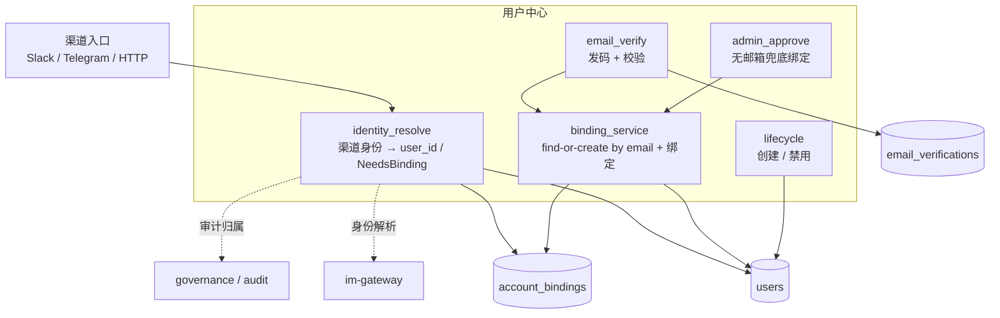
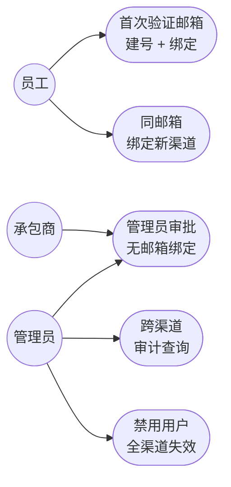

# user-center

> **已归档（2026-06-11）**：本文档描述的邮箱前置验证 / 多渠道绑定 / `account_bindings` 等规划从未实现，
> 且与后来定稿的身份模型冲突（一切是 User、认证属 edge、`Principal{user_id, tenant_id}`，
> 见 `docs/architecture/target-architecture.md` §6）。自动注册等已在 trim-user-auth 中 descope。
> 当前真实实现：`im_user_store` 维护 IM 身份映射 + allowlist；用户由管理员经 `fleetent admin` 创建。
> 仅留档作历史参考，不代表任何当前规划。

> 写作提醒：功能描述只写可观察的行为，不写内部实现细节。验收标准只写端到端可验证的行为。

## 概述

agent 系统自建的用户中心：不依赖外部 IdP，自己维护用户身份。**任何渠道（Slack / Telegram / HTTP API）首次使用 bot 前，都必须先做邮箱验证**；验证后该渠道身份绑定到以邮箱为唯一键的内部用户。同一邮箱在不同渠道验证，自然落到同一个 `user_id`。主要目的是**用户审计** —— 让一个人在所有渠道的行为可以归并查询。

边界：只负责"这个人是谁、他绑了哪些渠道"。不负责工具权限（见 governance）、不负责渠道接入与消息归一化（见 im-gateway）、不负责外部系统访问（外部系统支持 OAuth 则各自走 OAuth）。

**调用关系**：
- 依赖：user_store、im_user_store
- 被依赖：im-gateway（身份解析）、governance（审计归属）、platform（用户管理 CLI）

## 现状

尚未实现。当前 `im_user_store.py` 维护平台用户 allowlist，但无邮箱验证和多渠道身份归并机制。

## 规划中（v1.0）

- [ ] **邮箱前置验证（统一,无例外）**：任何渠道首次使用都必须先通过邮箱验证码确立身份，**Slack 也不例外**。未验证身份的请求不进入 agent_loop
- [ ] **邮箱为唯一键**：内部 `user_id` 为稳定主键，邮箱为 UNIQUE 去重键。验证邮箱时"查到则绑、查无则建"，所以同一邮箱跨渠道天然归到同一 `user_id` —— 不存在未验证的 provisional 用户，**没有事后归并**
- [ ] **多渠道绑定**：`(channel, channel_user_id) → 同一 user_id`，一个用户可绑多个渠道
- [ ] **管理员手动审批（兜底）**：无公司邮箱的人（外包 / 承包商）由管理员手动绑定到指定 user_id
- [ ] **邮箱域名白名单**：只接受公司域（如 `@acme.com`），其他域拒绝
- [ ] **验证码时效与限流**：6 位码 10 分钟过期、错 5 次锁定、同邮箱 1 分钟限发一次
- [ ] **用户生命周期**：管理员可禁用用户；禁用时该用户所有渠道立即失效

## 身份建立（邮箱前置验证）

模型很简单：渠道在"邮箱确立之后"才绑定到用户，绝不先建无邮箱用户，因此**没有 provisional、没有归并、没有 alias**。

**消息进入时的解析**：
```
resolve(channel, channel_user_id):
    binding = account_bindings.find(channel, channel_user_id, active)
    if binding:
        user = users.get(binding.user_id)
        return Blocked if user.status == "disabled" else Resolved(user.id)
    return NeedsBinding          # 无绑定 → 提示先验证邮箱,不自动建号
```

**邮箱验证通过后的绑定（find-or-create by email）**：
```
on verify_email_code 成功(email 已校验域名 + 验证码):
    user = users.find_by_email(email)         # email 是 UNIQUE 去重键
    if not user:
        user = users.create(email=email, status="active")
    account_bindings.insert(channel, channel_user_id, user.id, bound_via="email_code")
    return Verified(user.id)
```

同一邮箱第二个渠道来验证时，`find_by_email` 直接命中已有 user，把新渠道绑过去 —— 这就是"跨渠道归到同一人"，全程没有两个用户需要合并。

## 模块图



## 模块设计（单模块 user_center）

第一版作为**一个模块** `user_center`，对外暴露下面的接口，内部承担身份解析 / 邮箱验证 / 绑定 / 管理员兜底 / 生命周期五件事。底层复用 `user_store`（users 表）和绑定数据访问，不拆成多个模块。

**公开接口（其他模块调用的全部入口）**：

```
resolve_identity(channel, channel_user_id) -> ResolveResult
  # 主入口:渠道身份 → user_id
  # ResolveResult = Resolved(user_id) | NeedsBinding(reason) | Blocked
  # 无绑定 → 返回 NeedsBinding,不自动建号(必须先验证邮箱)

request_email_code(channel, channel_user_id, email) -> RequestResult
  # 发起邮箱验证:校验域名白名单 + 限流 → 发码
  # RequestResult = CodeSent | DomainRejected | RateLimited

verify_email_code(channel, channel_user_id, code) -> VerifyResult
  # 校验验证码 → find-or-create by email → 绑定该渠道
  # VerifyResult = Verified(user_id) | CodeInvalid | CodeExpired | Locked

admin_bind(channel, channel_user_id, user_id, operator) -> None
  # 管理员手动绑定(无公司邮箱承包商兜底)

disable_user(user_id, operator) -> None
  # 禁用用户,全渠道失效
```

**内部 helper（不对外）**：`_find_or_create_user_by_email(email)`、`_gen_and_send_code(email)`、`_check_rate_limit(email)`。

**依赖**：
- `user_store`：users 表读写（含 `find_by_email`）
- account_bindings 数据访问（第一版可并入 user_center 或薄封装）
- email sender（SMTP）：只调用，不实现

**边界（明确不做）**：
- 不验证渠道 webhook 签名 → im-gateway
- 不做工具/MCP 权限判断 → governance
- 不存储外部 SaaS 的 OAuth token → governance / ServiceAdapter
- 不实际投递邮件 → 调用 email sender 依赖
- 不从渠道 profile 自动取邮箱（统一走验证码，不依赖 Slack `users.info`）

## 数据模型

```sql
-- 用户主表（身份视角；与 user_store 共用 users 表）
users (
  id          TEXT PRIMARY KEY,   -- 稳定主键
  email       TEXT UNIQUE,        -- 已验证的公司邮箱,作为去重键;管理员兜底用户可为 NULL
  name        TEXT,
  status      TEXT,               -- "active" | "disabled"
  created_at  DATETIME
)

-- 多渠道绑定
account_bindings (
  id               INTEGER PRIMARY KEY,
  user_id          TEXT,          -- → users.id
  channel          TEXT,          -- "slack" | "telegram" | ...
  channel_user_id  TEXT,
  bound_via        TEXT,          -- "email_code" | "admin_approval"
  bound_at         DATETIME,
  unbound_at       DATETIME,      -- 软删除,保留历史用于审计
  UNIQUE(channel, channel_user_id) WHERE unbound_at IS NULL
)

-- 邮箱验证码
email_verifications (
  id               INTEGER PRIMARY KEY,
  email            TEXT,
  code_hash        TEXT,          -- 6 位码的 hash,不存明文
  channel          TEXT,          -- 发起绑定的渠道
  channel_user_id  TEXT,
  expires_at       DATETIME,      -- 默认 10 分钟
  attempts         INTEGER,       -- 错误次数,达 5 次锁定
  consumed_at      DATETIME       -- 用过即作废
)
```

## 验收标准（E2E test case）

**场景 1：任何渠道首次使用必须先验证邮箱（含 Slack）**
- Given：一个从未出现过的渠道用户（Slack 或 Telegram 均同）
- When：用户首次发消息
- Then：`resolve_identity` 返回 NeedsBinding，用户被提示"请先验证公司邮箱"，消息不进入 agent_loop

**场景 2：邮箱验证码绑定与建号**
- Given：用户首次进入，输入公司域邮箱并收到验证码
- When：回填正确验证码
- Then：`find_by_email` 查无则创建 users（email 唯一）+ account_bindings（bound_via=email_code，status=active），用户随后可正常对话

**场景 3：同一邮箱第二渠道直接归到同一用户（无归并）**
- Given：用户已在 Slack 用 alice@acme.com 建了 user_A，现在从 Telegram 进入
- When：在 Telegram 验证同一个 alice@acme.com
- Then：`find_by_email` 命中 user_A，Telegram 直接绑定到 user_A；全程不创建第二个用户、不触发任何合并

**场景 4：邮箱域名白名单拒绝**
- Given：邮箱白名单为 `@acme.com`
- When：用户输入 `someone@gmail.com` 请求验证码
- Then：拒绝发送，提示"仅支持公司邮箱"

**场景 5：验证码过期 / 错误锁定**
- Given：用户已请求验证码
- When：超过 10 分钟后回填 / 或连续错误 5 次
- Then：验证失败，提示重新获取；锁定后需重新请求新码

**场景 6：管理员审批绑定（无邮箱兜底）**
- Given：一个无公司邮箱的承包商从 Telegram 进入
- When：管理员执行 admin_bind，将该 Telegram 身份绑定到指定 user_id
- Then：account_bindings 写入 bound_via=admin_approval，该用户后续正常进入

**场景 7：跨渠道审计查询**
- Given：用户绑定了 Slack 和 Telegram（均归到同一 user_id）
- When：按 user_id 查询审计记录
- Then：返回该用户在两个渠道的全部行为，归并在同一 user_id 下（无需 alias 链，user_id 本就唯一）

**场景 8：禁用用户全渠道失效**
- Given：用户绑定了多个渠道，status=active
- When：管理员将该用户 status 置为 disabled
- Then：该用户从任意已绑定渠道进入都被拒绝（resolve 命中绑定后检查 status）

## Smoke Test 用例图



冒烟测试覆盖这 5 条主路径即可判断用户中心基本可用：邮箱验证建号、同邮箱绑新渠道、人工兜底绑定、审计归并查询、禁用生效。

## 测试边界

**需要单元测试的行为**：
- `resolve_identity`：有绑定时返回 Resolved，无绑定时返回 NeedsBinding，禁用用户返回 Blocked
- `request_email_code`：域名白名单校验（非白名单域 → DomainRejected），限流（1 分钟内重复发 → RateLimited）
- `verify_email_code`：正确码触发 find-or-create by email + 绑定渠道；过期码返回 CodeExpired；连错 5 次返回 Locked
- find-or-create 幂等：同一邮箱第二个渠道验证时，直接绑到已有用户，不创建第二个用户
- `disable_user`：users.status 置为 disabled 后，`resolve_identity` 对该用户任意渠道返回 Blocked

**需要 mock 的依赖**：
- email sender（SMTP）：注入可控的发送函数，不发真实邮件
- 时间（`datetime.utcnow`）：控制验证码过期时间
- SQLite DB 路径：`monkeypatch` 到 `tmp_path`

## 待决问题

- [ ] 邮箱发送依赖：on-premises 部署时接公司 SMTP 的配置方式（负责人：待认领）
- [ ] 邮箱变更处理：员工公司邮箱变更时，是更新 users.email 还是新建（影响 UNIQUE 键与历史审计）（负责人：待认领）
- [ ] 同一渠道下一个用户能否绑定多个 channel_user_id（工作号 + 个人号）（负责人：待认领）
- [ ] 验证流程的承载形态：纯 IM 内对话式输码 vs 跳转一个轻量 Web 页（负责人：待认领）
