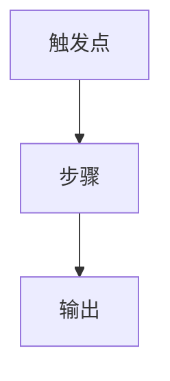

# [能力域名称]

> 写作提醒：功能描述只写可观察的行为，不写内部实现细节。验收标准只写端到端可验证的行为。

## 概述

一段话说明这个域的职责和边界。包含：负责什么、不负责什么。

**调用关系**：
- 依赖：列出这个域依赖哪些其他域或外部系统
- 被依赖：哪些域会调用这个域

**模块归属**：
- owning package：例如 `runtime` / `governance` / `platform` / `channels` / `intelligence` / `integrations` / `observability` / `infrastructure`
- public API：列出允许其他模块 import / 调用的函数、dataclass 或 service interface；无则写「无」
- owned tables：列出本模块拥有的持久化表；无则写「无」
- config namespace：列出本模块拥有的配置命名空间；无则写「无」

## 关键流程

> 可选。流程复杂、文字难以描述清楚时才加。用 Mermaid 图展示数据流向或触发关系。
> 适合场景：有明确数据流的模块用 flowchart，有状态转换的用 stateDiagram，多模块交互的用 sequenceDiagram。



## 数据模型

> 可选。模块有持久化存储时才加。只列关键字段，注明用途。

```sql
table_name (
  field  TYPE  -- 说明
)
```

## 接口定义

> 可选。模块暴露给其他域调用的公开函数才列。包含函数签名和返回类型。

```python
def function_name(param: Type) -> ReturnType:
    """一句话说明用途。"""
```

## 现状

- ✅ **功能名称**：一句话说明做什么
  - 细节（可选，有必要才加）
  - 边界或约束（可选）

- ✅ **功能名称**：一句话说明做什么

## 规划中（v1.0）

- [ ] **功能名称**：一句话说明做什么
  - 细节（可选）
  - 边界或约束（可选）

- [ ] **功能名称**：一句话说明做什么

## 验收标准

> 对应集成测试级别。用 Given / When / Then 描述端到端可观察的行为，每个场景对应一个独立功能点。

**场景 1：[场景名称]**
- Given：前置条件
- When：触发动作
- Then：预期结果

**场景 2：[场景名称]**
- Given：
- When：
- Then：

## 测试边界

> 可选。模块内部逻辑复杂时才加。说明单元测试应覆盖哪些行为、需要 mock 哪些依赖。

**需要单元测试的行为**：
- 行为描述

**需要 mock 的依赖**：
- `dependency`：原因

## 待决问题

> 实施前需要确认的问题。每条注明负责人。

- [ ] 问题描述（负责人：xxx）
