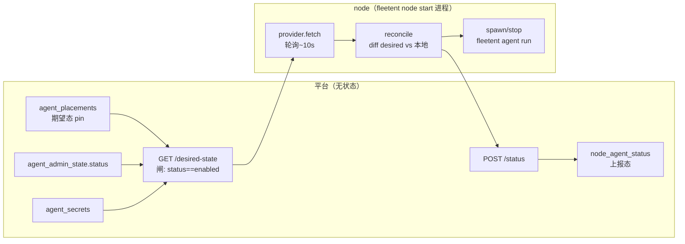

# Agent 管理子系统（as-built 行为模型）

> **状态：as-built 行为参考（2026-06-16）**。把"管理一个 agent"的完整故事串起来——身份/版本 → 管理态 → 自管溯源 → 绑定 → materialize → node 编排。**只讲行为/关系/数据流，不复述列级 schema**（表/列/FK 真相源是 [data-model](../architecture/data-model.md) §3.2 + erDiagram）。设计 rationale 见 [`records/decision-logs/`](../records/decision-logs/)。
> **枢纽文档**：身份 id/name 模型见 [agent-identity-model](../records/decision-logs/agent-identity-model.md)（已冻结）；编排高层平面见 [`target-architecture.md`](../architecture/target-architecture.md)；绑定细节见 [skill-system](skill-system.md) / [im-access-model](im-access-model.md)；认证见 [[identity-auth-model]]。

## 0. 一句话

平台侧把 agent 的**定义 + 管理态 + 绑定**维护在管理库，经 **materialize** 单向刷成 agent 侧 `agent.yaml`；**node** 拉取"期望态"在自己进程里启停 agent、回报"上报态"。agent 运行时零 platform 依赖、只读自己的 `agent.yaml`。

---

## 1. 实体网络全景（按一个 agent 的生命周期串）

| 环节 | 表（schema 见 data-model）| 角色 |
|---|---|---|
| **身份/定义** | `agents`(id 不可变身份 / name 可读标签) · `agent_versions`(不可变快照) · `agents.active_version_id`(当前版本指针) | agent 是谁、定义历史 |
| **管理态** | `agent_admin_state`(§2) | 开关意图 + 定义所有权 + drift |
| **绑定族**（agent "拥有"什么）| `agent_kbs` · `mcp_servers`+`agent_mcp_servers` · `agent_skills` · `agent_service_grants` · `agent_secrets` · `agent_im_groups` · `user_agents` + 能力列 `agents.supports_dm/groups` | KB/工具/技能/凭证/密钥/IM 群/用户准入/能力 |
| **桥** | （materialize，§5）| 平台表 → agent.yaml |
| **编排** | `agent_placements`(期望态 pin→node) · `node_agent_status`(上报态) · `nodes`(节点注册) | 在哪跑 / 跑成啥样 |

所有绑定族表都是 `agent_id` FK→agents.id **ON DELETE CASCADE**——删 agent 一刀清。

## 2. `agent_admin_state`：管理态的交汇点

`agents` 的 **1:1 侧表扩展**（PK agent_id + FK CASCADE，当年特意不 ALTER agents 主表）。装**三件正交**的"平台管它的状态"：

| 列 | 含义 | 流向 |
|---|---|---|
| `status` | enabled / disabled / archived = **开关意图** | → §6 node 下发闸（非 enabled 不下发→不跑）|
| `provenance` | managed / adhoc = **定义所有权**（spec-owned vs DB 临时）| → §3 自管治理 |
| `drift` | managed 被带外编辑的告警旗 | → §3 |

> **命名消歧（别当怪名/死表）**：`admin` 是用来区分**平台管理态** vs **agent 侧运行态**——agent 侧另有一张 `agent_state.db`（per-agent 运行库，[data-model](data-model.md) §3.3）。若改名 `agent_state` 会与之撞名。它当年（迁移 023）照 `skill_admin_state` 起名，而后者已在 092 并入 `skills` 主表——所以这是个参照物已消失的孤儿命名，但 `admin` 的消歧作用仍然成立、不建议改名。

## 3. 自管溯源（agent self-managed，live）

agent 的"定义谁拥有"治理——**这条是活的**（区别于 skill 自管的 inert，见 [skill-system](skill-system.md) §6.3）：

- **apply API**（`askit_console/agent_apply_api.py`，`POST /admin/agents/apply`）写 `provenance=managed`（"spec-owned"）。已存在的 adhoc agent 被 apply = **adopt**（adhoc→managed）。这是外部编排器（askit）把 agent 纳管的入口。
- apply 的定义面现在包含 `model_overrides`：payload 形状为 `{routes: {<route_key>: [{provider, model, base_url, api_key_env, protocol?, max_tokens?, params?}]}}`，镜像 materialize 后 `agent.yaml` 的 `models` 段。该字段进入 `agent_versions.model_overrides` 版本快照；省略或传 `null` 时沿用既有 `_UNSET` 语义，不主动改写当前模型策略。
- `model_overrides` 只携带 `api_key_env`（环境变量名），**不携带密钥值**。真实 key 仍经 `PUT /admin/agents/{name}/secrets/{env_name}` 写入 `agent_secrets`，node 在下发 desired-state/拉起 agent 时把对应 secret 注入运行环境。
- **drift 置位**：控制台 UI 编辑一个 managed agent → `mark_drift()`（adhoc 时 no-op），标记"人工改动与外部源不一致"。
- **⚠️ 调和半闭环（已知缺口）**：`clear_drift()` 当前**零调用**，apply 重新断言 spec 也不清 drift，无 promote/discard 路径 → **drift 标得上、清不掉**。功能缺口，非冗余（列有读有写）。归 backlog。

## 4. 版本生命周期（`agent_versions`）

- **创建 agent** → 自动建 version 1 并设 active。
- **编辑（console PATCH / HTTP `PATCH /admin/agents/{name}`）** → `create_version(activate=True)`：建新版本快照并把 `active_version_id` 指过去。版本快照 system_prompt/allowed_tools/skills_dir/mcp_server_ids/model_overrides 等。
- **apply（managed）本身不建版本**——只创建/更新定义 + 置 provenance=managed；后续若 console 编辑 managed agent 仍走 create_version（**版本与 provenance 正交**）。
- **显式激活**：`POST /admin/agents/{name}/versions/{v}/activate` 只改 `active_version_id`、不建新版本。**无自动回滚路径**——切版本是人工触发的唯一手段。
- **agent 级能力**（features/plugins/allowed_skills/config_overrides/supports_dm/groups）**不版本化**，存 `agents` 表——避免"回滚版本→能力/IM 闸跟着变"的耦合。

## 5. materialize：平台 → agent.yaml（单向桥）

平台把 `agents`(活跃版本) + config_overrides + 绑定族 **刷成** agent 侧 `<FLEETENT_HOME>/agents/<name>/agent.yaml`：

1. 组装 AgentFile（活跃版本数据）→ 应用 config_overrides（深合并）。
2. 投影 IM 访问（`user_agents`/`agent_im_groups` → `im.allow_users`/`allow_groups`，见 [im-access-model](im-access-model.md)）。
3. **剥离密钥字段**（含 `env`/`credential_ref` 的字段名去掉）——agent.yaml 不落明文密钥。
4. 写文件。

触发：create/update/apply/clone 后 `materialize_from_store(name)`；skill 全局改动 `rematerialize_all()`。**agent runtime MUST NOT import platform**——平台单向写产物，agent 只读。

## 6. node 编排（分布式，retire-inmemory-controller 之后）

单机部署与分布式部署在编排机制上完全一致：都由 node 轮询 desired-state 并拉起
`fleetent agent run`。差别只在于单机把 platform、node、agent 放在同一台机器上，
此时 node 通过 localhost 与 platform 通信。

kubelet 式 **desired / reported** 模型，平台无状态、node 自治：

- **期望态**：`agent_placements` 把 agent pin 到某 node（CLI `node pin`）。
- **下发闸**：node 拉 `GET /nodes/{id}/desired-state`，平台只返回该 node 上**且 `agent_admin_state.status==enabled`** 的 agent，带 materialize 后的 config + 从 `agent_secrets` 取出的注入 secret。→ **disable/archive 一个 agent，它就不再被下发、不再运行**（status 真生效的落点；旧死函数 `agent_routing_status` 已删）。
- **reconcile**：node supervisor 每 ~10s（`FLEETENT_NODE_INTERVAL_SECONDS`）对比 desired 与本地进程（PID 文件 + signal 0）——缺则写 agent.yaml + `spawn`（`fleetent agent run`，secret 经 env 注入）、多则 `stop`、配置哈希变则重启。
- **上报态**：reconcile 后 `POST /nodes/{id}/status` → `node_agent_status`（phase/pid/health，可观测）。
- **离线自治**：拉取失败降级到本地 `desired-state-cache.json`；缓存无 secret 时延迟启动新 agent（已跑的继续）。
- **node 鉴权**：service key `ma-<hex>`，平台存 SHA256 到 `nodes.key_hash`，每请求 `Authorization: Bearer`。
- **三态正交**：`agent_admin_state.status`=该不该跑（意图）、`agent_placements`=在哪跑（期望）、`node_agent_status`=实际跑成啥样（上报）。

## 7. 控制面操作面（API / CLI）

| 操作 | 入口 | 改表 | 触发 |
|---|---|---|---|
| create | `POST /admin/agents` | agents(v1)+versions+admin_state | materialize |
| update | `PATCH /admin/agents/{name}` / HTTP `PATCH /admin/agents/{name}` | versions(vN)+admin_state(drift) | materialize |
| clone | `POST /admin/agents/{name}/clone` | agents(v1)+versions+admin_state(adhoc) | materialize |
| delete | `DELETE /admin/agents/{name}` | agents(CASCADE 清所有绑定) | 需 references 校验(user_agents)+X-Confirm；`_delete_agent_hook` 清外部凭证 |
| enable/disable/archive/restore | `POST /admin/agents/{name}/{op}` | admin_state(status) | —（下次 desired-state 生效）|
| apply / apply:batch | `POST /admin/agents/apply` | agents/versions + admin_state(provenance=managed) | materialize |
| list/activate version | `GET\|POST /admin/agents/{name}/versions[/{v}/activate]` | agents(active_version_id) | 无自动 materialize |
| pin / unpin | **仅 CLI** `node pin\|unpin` | agent_placements | 下次 desired-state 生效 |
| assign/unassign user | `POST` / `DELETE /admin/agents/{name}/bindings/users/{user_id}` | user_agents | materialize(IM allow_users) |

## 8. live / dead 速查

| 项 | 状态 |
|---|---|
| `agent_admin_state.status` → node 下发闸 | ✅ live（node 模型接线后真生效）|
| `provenance` managed/adhoc + apply/adopt | ✅ live |
| 版本 create-on-edit / activate | ✅ live |
| materialize 平台→agent.yaml | ✅ live |
| node desired/reported reconcile + secret 注入 + 离线缓存 | ✅ live |
| ~~`agent_routing_status()` 旧死函数~~ | ❌ 已删（被 node 下发闸取代）|
| `drift` 调和（`clear_drift`/promote/discard）| ◐ **半闭环**——drift 标得上清不掉（`clear_drift` 零调用、apply 不清），功能缺口待补 |
| 版本回滚 | ◐ 无自动路径，只有人工 activate-version |
