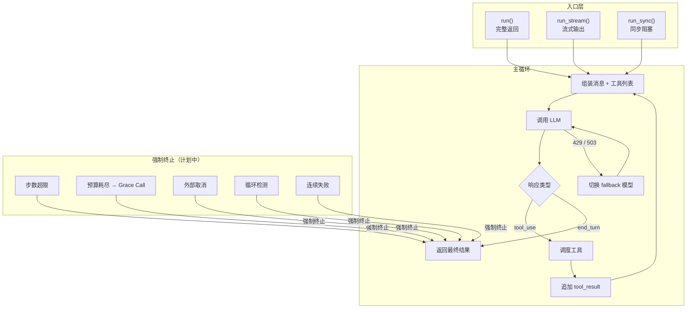
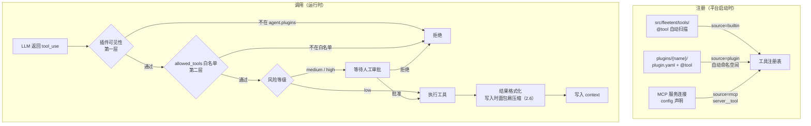
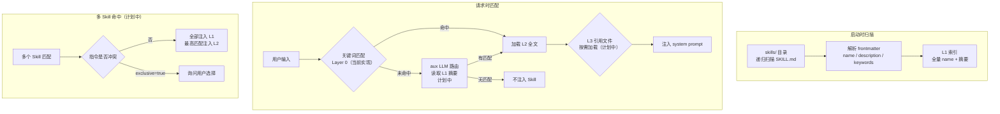
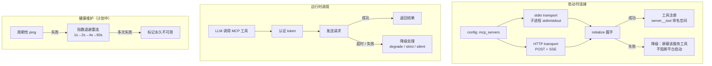
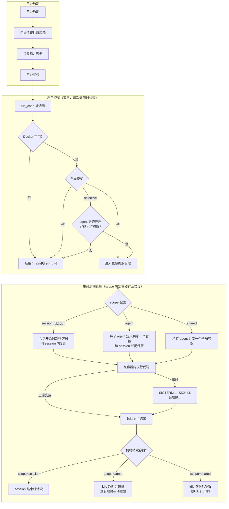
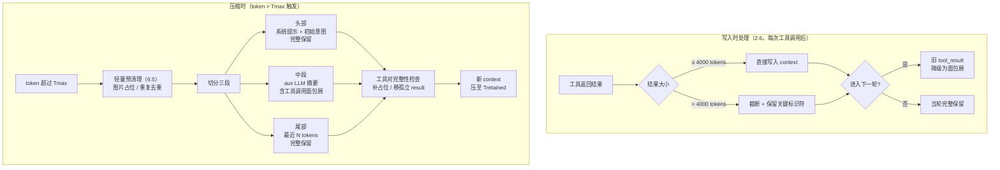
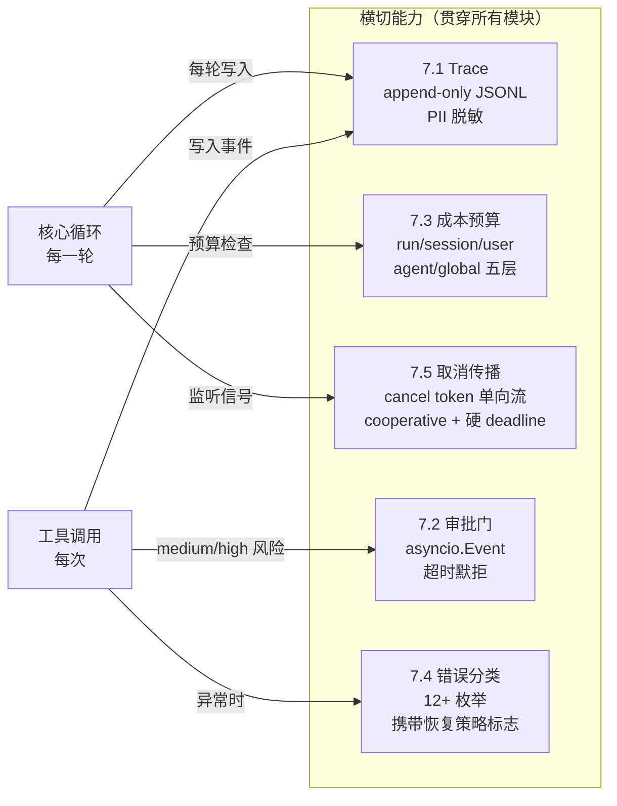

# Agent Runtime 功能指南

> **定位**：面向工程师 onboarding 与技术对齐的半技术说明文档。介绍「做什么、为什么、关键约束」，不涉及具体实现代码。
>
> **配套文档**：
> - 技术契约（接口、行为约定、边界）→ [`agent-runtime-capabilities.md`](./agent-runtime-capabilities.md)
> - 产品功能需求（优先级、用户场景）→ [`agent-runtime-product-requirements.md`](./agent-runtime-product-requirements.md)
> - 验收场景（Given/When/Then）→ [`agent-runtime-acceptance-criteria.md`](./agent-runtime-acceptance-criteria.md)
>
> **状态标注说明**：✅ 已完成　⚡ 部分实现　❌ 未实现　⏳ v1+ 推迟

---

## 实现进度总览

| 模块 | 子功能数 | ✅ | ⚡ | ❌ | ⏳ |
|------|:---:|:---:|:---:|:---:|:---:|
| 1. 核心循环 | 10 | 2 | 1 | 7 | 0 |
| 2. 工具 | 11 | 3 | 4 | 4 | 0 |
| 3. Skill | 8 | 0 | 3 | 5 | 0 |
| 4. MCP | 9 | 3 | 3 | 2 | 1 |
| 5. 沙箱 | 9 | 1 | 3 | 4 | 1 |
| 6. 上下文压缩 | 9 | 0 | 4 | 5 | 0 |
| 7. 横切关注点 | 7 | 1 | 2 | 3 | 1 |
| **合计** | **63** | **10** | **20** | **30** | **3** |

---

# 模块一：核心循环（Agent Loop）

> 整个平台的执行引擎。IM 消息、HTTP 请求、定时任务、Webhook 触发——所有入口最终都交给核心循环完成实际执行。其他模块提供能力，核心循环决定何时、以何种顺序使用这些能力。
>
> **当前状态**：基础执行跑通；预算管理、取消信号、循环检测、错误分类尚未实现。

**关键流程**



---

### 1.1 主循环执行　⚡ 部分实现

AI 完成一个任务的基本节拍：向 AI 发请求 → AI 决定调用工具 → 执行工具 → 把结果告诉 AI → 再次向 AI 发请求，循环直到任务完成。

**执行流程：**
- 每轮：向 AI 发请求 → AI 返回「需要调用工具」→ 执行工具 → 把结果追加到对话 → 进入下一轮
- AI 返回「任务完成、不需要再调工具」时自然退出循环
- 任意轮出现可恢复错误（如限流），进入重试或切换备用模型的子流程

**终止方式（计划中，尚未接入）：**
- 自然结束：AI 主动判断任务完成
- 强制结束：执行步数超限 / token 用量超限 / 成本超限 / 外部取消信号

**关键约束：**
- 每次工具调用与它的返回结果必须成对出现——这是 AI 接口的强制要求，缺少任一侧会直接报错
- 每轮执行过程需写入运行日志，后续的问题排查、成本统计都依赖这份记录
- 主循环必须能被外部信号随时中断，否则失控的任务会拖垮整个进程

**当前缺失：** 强制终止（步数、预算、取消信号）逻辑未实现；终止原因无结构化记录。

---

### 1.2 三种调用入口　✅ 已完成

同一套执行逻辑提供三种调用形式，适配不同使用场景：

| 调用方式 | 行为 | 适用场景 |
|---------|------|---------|
| 完整调用 `run` | 等任务全部完成后一次性返回结果 | IM 回复、程序对接 |
| 流式调用 `run_stream` | 边生成边输出，实时推送 | HTTP 接口、前端展示 |
| 同步调用 `run_sync` | 阻塞等待直到完成 | 命令行、定时脚本 |

**关键约束：**
- 三种方式共用同一套循环逻辑，行为完全一致
- 流式调用中，AI 输出是逐词推送的，但遇到「需要调工具」时必须先收齐完整的工具调用指令再执行，不能边流边执行

---

### 1.3 终止条件管理　❌ 未实现

循环在何时停止、因何停止，需要统一管理，不能把判断逻辑散落在代码各处。

**计划支持的终止原因：**
- `natural_end`：AI 判断任务已完成
- `max_turns`：执行步数达到上限
- `budget_exceeded`：token 用量或成本超限
- `cancelled`：收到外部取消信号
- `approval_rejected`：高风险操作被人工拒绝
- `loop_detected`：检测到无意义的重复操作（见 1.7）
- `consecutive_failures`：连续多次工具调用或 AI 请求失败

**为什么原因码很重要：**
- 不同原因的收尾行为不同——预算将耗尽时，系统还会给 AI 一次机会输出摘要回复；外部取消则直接停止
- 原因码写入运行日志，用于统计「任务为何失败」
- 展示给用户的错误提示内容也依赖原因码区分

---

### 1.4 模型故障自动切换　✅ 已完成

当首选 AI 模型出现限流或服务故障时，自动按配置顺序切换到备用模型继续执行，对用户无感知。

**触发条件：**
- 模型返回限流错误（429）
- 模型返回服务不可用（503）

**行为：**
- 按配置中的备用模型列表依次尝试，直到有一个成功
- 所有备用模型均失败时，任务终止并报错，不静默失败
- 实际使用的模型记录在运行日志中，便于成本归因和问题排查

**一个容易混淆的边界：**
- 上下文过长（token 超限）不走这条切换流程——系统会先压缩历史对话腾出空间，再用原来的模型重试，这是两套独立机制

---

### 1.5 工具调度（串行与并行）　❌ 未实现

AI 单轮可能同时请求调用多个工具，是逐个执行还是同时执行取决于工具的特性。

**计划中的工具并发分级：**
- **完全可并行**：工具之间没有依赖、没有共享资源（如同时查询多个独立数据源）→ 并行执行，节省时间
- **按路径隔离**：工具操作的是不同文件或资源路径时可并行，操作同一路径时转串行
- **必须串行**：有副作用、依赖前一步结果、或需要人工审批的工具 → 始终串行

**关键约束：**
- 并行执行的多个工具，结果必须按 AI 原本请求的顺序回填——顺序错乱会导致 AI 上下文混乱
- 某个并行工具失败时，其他正在执行的工具如何处理（继续还是取消）需要明确策略

**当前状态：** 所有工具均串行执行，并行调度尚未实现。

---

### 1.6 中断与取消信号传播　❌ 未实现

外部的停止信号（用户取消、HTTP 断开、审批拒绝、超时）需要能穿透整个执行链，真正让所有进行中的操作停下来。

**计划中的行为：**
- 优雅中断：等当前工具执行完毕 → 不再发起新的 AI 请求 → 写入运行日志 → 返回已有的部分结果
- 强制中断：优雅中断超时后，强制终止当前操作（包括沙箱容器、MCP 连接）

**穿透范围：**
- AI 请求
- 工具调用（含沙箱代码执行）
- MCP 外部服务调用

**关键约束：**
- 取消信号必须能重复发送而不冲突——同一个信号可能同时传到多个层级
- 取消后运行日志必须正常写入，否则无法复盘

---

### 1.7 循环检测　❌ 未实现

当 AI 陷入无意义的重复操作（反复调用同一工具、反复输出相同内容）时，系统自动识别并打断。

**检测逻辑（计划中）：**
- 对每次工具调用计算签名（工具名 + 参数的归一化 hash）
- 相同签名在滑动窗口内连续出现 N 次 → 先向 AI 注入「已检测到循环」提示
- AI 仍重复 → 强制终止，终止原因码记为 `loop_detected`
- AI 输出文本完全重复 → 同等处理

**关键约束：**
- 参数签名要忽略键的顺序、多余空格等无关差异，只判断语义是否相同
- 向 AI 注入的「循环提示」本身不能成为新一轮循环的诱因

---

### 1.8 迭代预算与 Grace Call　❌ 未实现

为每次任务设置三维安全边界，防止任务无限运行或失控消耗资源；同时在边界触发时，保证用户能收到一个有意义的结果，而不是空手而归。

**三维预算（计划中）：**
- 执行步数上限（防止工具调用无限循环）
- Token 用量上限（控制单次对话消耗）
- 美元成本上限（精确成本管控）

**Grace Call 机制：**
- 任意一维预算将要耗尽时，系统不立即切断，而是给 AI 最后一次机会：带着「请给出当前最终总结」的提示发起一次 AI 请求
- Grace Call 本身也有独立的 token 预算，失败则返回已有的部分结果

---

### 1.9 错误分类与重试策略　❌ 未实现

运行过程中会遇到各种错误（限流、超时、权限失败、格式错误等），不同错误需要不同的应对方式，这套映射关系需要集中管理。

**计划中的错误类型（12+ 种）：**
- `rate_limit`：AI 服务限流 → 重试 + 切换备用模型
- `context_overflow`：对话超出长度限制 → 触发压缩后重试
- `tool_timeout`：工具调用超时 → 返回超时结果，不中断循环
- `tool_crash`：工具执行异常 → 返回错误结果，由 AI 决定下一步
- `mcp_disconnect`：外部服务断开 → 尝试重连，失败则降级
- `sandbox_oom`：沙箱内存耗尽 → 返回失败结果并告警
- `auth_failed`：认证失败 → 提示用户，不重试
- `unknown`：未识别错误 → 默认不重试，向用户报错

**关键约束：**
- 主循环只读取错误类型上挂载的标志位（「是否重试」「是否压缩」「是否切换模型」），不重复解析错误内容
- 错误分类必须集中维护，散落在多处的字符串匹配是维护噩梦

---

### 1.10 消息卫生与契约修复　❌ 未实现

发给 AI 的对话消息必须满足严格的格式要求（角色交替、工具调用与结果成对、JSON 合法）。在压缩、错误恢复、跨模型切换等场景下，消息序列可能出现违规，需要一道自动修复层。

**计划中的修复规则：**
- 连续两条同一角色的消息 → 合并，或插入空占位消息
- 有工具调用但缺少对应结果 → 补充「工具执行失败」占位结果
- 有工具结果但找不到对应的调用 → 移除该孤立结果
- 工具调用的参数 JSON 格式损坏（未闭合引号、尾随逗号）→ 尝试自动修复；修复失败则报错

**关键约束：**
- 修复动作必须写入运行日志，否则出了问题无法复盘
- 修复失败应尽早报错，不能把不合法的消息继续传给 AI

---

# 模块二：工具（Tools）

> 工具是 AI 的「双手」——AI 通过调用工具完成实际操作（计算、读写文件、执行代码、调用外部服务）。本模块管理所有工具的注册、描述生成、调用执行、访问控制和安全防护。
>
> 工具来源分三类：**内置工具**（平台开发者编写，随平台发布）、**插件工具**（企业或团队自行扩展，无需改平台代码）、**MCP 外部服务**（通过协议接入，仅需配置）。
>
> **当前状态**：注册机制、风险分级、访问控制已完成；插件工具机制、调用超时保护、结果截断、守卫机制、参数消毒尚未实现。

**关键流程**



---

### 2.1 工具注册　⚡ 部分实现

平台工具有三种接入方式，适用于不同角色和场景，彼此独立、不互相干扰。

---

**方式一：内置工具（平台开发者，需改代码）**　✅ 已完成

适用于向平台本身添加新的通用能力（如新增一种计算工具、文件操作工具）。

- 将 Python 函数放入 `src/fleetent/tools/` 目录并加上 `@tool` 装饰器
- 平台启动时自动扫描并注册该目录下所有带 `@tool` 的函数，`source=builtin`
- 注册时自动生成供 AI 读取的工具描述（见 2.2）
- 当前内置工具：时间查询、数学计算、文件读写、代码执行、子任务并发
- **代价**：需要修改平台源码并重新部署

**关键约束：**
- 同名工具重复注册时，后注册的覆盖先注册的
- 未配置任何插件时，内置工具行为完全不变——插件机制不影响现有流程

---

**方式二：插件工具（企业团队，无需改平台代码）**　❌ 未实现

适用于各业务团队将自己的工具封装成插件，按需挂载给特定 agent，而无需接触平台源码。

- 在 `plugins/{插件名}/` 目录下放置两个文件：
  - `plugin.yaml`：声明插件元信息
  - `__init__.py`：编写带 `@tool` 装饰器的 Python 函数
- 平台启动时自动扫描 `plugins/` 目录，加载所有 `enabled: true` 的插件，`source=plugin`
- 插件工具自动加命名空间前缀：`{插件名}__{工具名}`（见 2.3），避免与内置工具和 MCP 工具冲突

**plugin.yaml 格式：**

```yaml
name: crm_tools           # 即插件目录名，也是命名空间前缀
description: CRM 相关工具（客户查询、合同检索）
version: "1.0"
author: 销售平台团队
enabled: true             # false = 禁用该插件，工具不加载，不报错
```

**访问控制（重要）：**
- 插件工具默认只对显式声明该插件的 agent 可见
- agent 定义中须列出 `plugins: [crm_tools]`，否则该插件的所有工具对该 agent 不可见、不可调（见 2.8）

**关键约束：**
- 未配置任何插件时，平台行为与插件机制不存在完全相同
- 插件目录缺失或 `plugin.yaml` 格式错误 → 跳过该插件并记录警告，不阻断启动
- 插件工具同样受 `allowed_tools` 白名单约束（见 2.8）

---

**方式三：外部服务（企业用户，仅需配置）**　✅ 已完成

适用于企业将自有系统（内部 API、数据库、第三方服务）的能力接入平台，无需接触平台源码，也无需编写 Python 代码。

- 企业将自有系统包装为符合 MCP 协议的服务（本地进程或远程 HTTP）
- 在平台配置文件中声明该服务的地址或启动命令
- 平台启动时自动连接，将该服务暴露的所有工具注册进来，AI 即可调用
- **代价**：需要实现 MCP 协议（业界开源实现丰富，常见语言均有 SDK）

> 外部工具接入的完整机制见**模块四：MCP**。

---

### (删除)2.2 工具描述自动生成　⚡ 部分实现

AI 调用工具之前需要知道这个工具「能做什么、接受什么参数」。平台根据函数的类型声明和文档注释自动生成这份描述，无需手动维护 JSON。

**当前实现：**
- 从函数签名推导参数名和类型（支持 `int`、`float`、`bool`、`str`）
- 从函数文档注释的第一行提取工具描述

**尚未支持：**
- 可选参数（`Optional`）、多类型（`Union`）、枚举值（`Literal`）、嵌套对象
- 从文档注释中提取每个参数的单独说明
- 未声明类型的参数拒绝注册（目前会静默处理）

---

### (删除)2.3 工具命名规范　⚡ 部分实现

所有工具名遵循统一规则，按来源使用命名空间前缀区分，避免不同来源的同名工具冲突，并确保来源可追溯。

**命名规则：**

| 来源 | 命名格式 | 示例 |
|------|---------|------|
| 内置工具 | 无前缀 | `calculate`、`read_file` |
| 插件工具 | `{插件名}__{工具名}` | `crm_tools__search_customer` |
| MCP 外部工具 | `{服务名}__{工具名}` | `github__create_issue` |
| 子任务工具 | 固定名称 | `sub_agent` |

**关键约束：**
- 双下划线是命名空间分隔符，插件工具和 MCP 工具统一遵守；单下划线（如 `read_file`）是工具名称自身的一部分，不是分隔符
- 插件名和服务名不得含双下划线，否则会产生歧义

**当前缺失：** 注册时的命名格式校验尚未实现。

---

### (删除)2.4 工具描述规范　⚡ 部分实现

工具描述的质量直接影响 AI 能否选对工具、用对工具——这是 agent 性能调优最重要的杠杆之一。

**高质量描述应包含：**
- 这个工具能做什么
- 什么情况下用这个工具（而不是其他工具）
- 出错时会返回什么
- 参数的具体含义（避免歧义，如 `user_id` 而不是 `id`）

**当前状态：** 内置工具均有基础文档注释，但尚未按上述规范系统性梳理。

---

### 2.5 工具调用与超时保护　⚡ 部分实现

每次工具调用都需要超时保护和异常隔离——工具卡住或崩溃不能拖垮整个任务，而是转为一条 AI 可以继续处理的错误反馈。

**计划中的行为：**
- 每次工具调用有超时上限（内置工具 30s / MCP 工具 60s / 用户工具 30s，可配置）
- 超时 → 取消该工具调用，返回超时错误结果给 AI（不抛出异常中断循环）
- 工具内部抛出任何异常 → 捕获后转为错误结果返回（AI 可据此决定是否重试）

**关键约束：**
- 工具失败必须返回结果，不能让异常冒泡打断主循环——这是业界共识
- 超时取消必须真正释放资源（沙箱容器、MCP 连接），不能只是放弃等待

**当前缺失：** dispatch 函数存在，但无超时机制，异常直接冒泡。

---

### 2.6 工具结果格式化与写入时压缩　❌ 未实现

工具结果在**写入 context 时**立即做格式化和大小控制，而不是等到压缩触发后再处理。这样 context 从一开始就保持紧凑，压缩层只需要处理对话文本，不需要理解工具语义。

**写入时的两层处理：**

**第一层：当轮完整结果（立即可用）**
- 工具结果写入 context，但做大小上限截断（上限约 4000 tokens）
- 截断时保留开头 + 结尾，中间插入 `[截断了 N 行，关键标识符：{ids}]`
- AI 在当轮可以读取完整（截断后的）结果

**第二层：跨轮面包屑降级（过了当轮之后）**
- 进入下一轮时，尾部之外的旧 `tool_result` 自动降级为面包屑格式
- 面包屑提取逻辑按工具类型定制：

| 工具类型 | 面包屑格式 |
|---------|-----------|
| `read_file` | `read_file("path") → N 行，含 {key_fields}` |
| `write_file` | `write_file("path") → 成功写入 N 行` |
| `calculate` | `calculate(...) → {result}` |
| `search` / 列表类 | `search(...) → 返回 N 条，ID 范围 {id_range}` |
| `run_code` | `run_code(...) → exit_code={n}，stdout N 字节` |
| 图片 / 二进制 | `[图片：{尺寸}，{时间戳}]` |

**关键约束：**
- 面包屑中必须保留：文件路径、数据库 ID、哈希值、关键数值——AI 后续操作可能引用
- 单次结果 token 上限和 session 总上限均在此层强制，不依赖压缩层兜底
- 压缩层（6.5）不再承担工具结果处理职责，只处理图片占位这类轻量清理

---

### (删除)2.7 风险分级与审批联动　✅ 已完成

每个工具声明自己的风险等级，决定是否需要人工审批才能执行。

**风险等级：**
- `low`（默认）：自动执行，无需审批
- `medium`：等待人工确认，短超时（超时默认拒绝）
- `high`：必须等待人工审批，长超时

**关键约束：**
- 审批拒绝时，工具不执行，AI 收到一条「操作已被拒绝」的结果，可以调整策略
- 服务重启后，遗留的未处理审批请求会自动清理，不会一直阻塞

---

### 2.8 工具访问控制（白名单）　⚡ 部分实现

每个 agent 可以配置允许使用的工具范围，超出范围的工具既不会出现在 AI 的选项里，也会在意外被调用时被拦截。访问控制分两层，按顺序执行。

**第一层：插件可见性（agent 级别）**　❌ 插件机制未实现

- agent 定义中配置 `plugins: [crm_tools, hr_tools]`，只有列出的插件工具对该 agent 可见
- 未列出的插件工具对该 agent 完全不存在——AI 不会看到，dispatch 层也会拦截
- 未配置 `plugins` 字段 → 无插件工具可用（内置工具不受影响）

**第二层：工具名白名单（工具名级别）**　✅ 已完成

- agent 定义中配置 `allowed_tools` 列表，支持通配符（如 `read_*` 匹配所有以 read 开头的工具）
- 构建 AI 请求时，自动过滤掉不在白名单内的工具，AI 看不到这些工具
- 即使 AI 幻觉出一个未授权的工具名，dispatch 层也会拦截

**关键约束：**
- 两层控制独立运作，均通过后才允许执行
- 风险分级（见 2.7）在两层控制之后：通过访问控制 → 再判断是否需要人工审批

---

### 2.9 工具来源分层　❌ 未实现

工具按来源（内置 / 插件 / MCP 外部 / 子任务）分层管理，不同来源有不同的信任级别和默认超时。

**计划中的来源分级：**

| 来源标记 | 信任级别 | 默认超时 | 备注 |
|---------|---------|---------|------|
| `builtin` | 高 | 30s | 平台内置，随平台发布 |
| `plugin` | 中 | 30s | 企业自扩展，隔离级别同内置 |
| `mcp` | 中 | 60s | 外部进程/服务，失败时可降级 |
| `sub_agent` | — | — | 递归深度限制（最多 1 层） |

**来源信息会进入运行日志**，便于按来源统计错误率和成本分布。

---

### 2.10 工具调用守卫（Guardrails）　❌ 未实现

在工具调用前后检测异常调用模式，防止 AI 进入「反复调用同一工具却毫无进展」的低效状态。

**计划中的检测规则：**
- 相同工具 + 相同参数连续重复 N 次 → 先向 AI 注入警告提示
- AI 忽略警告仍重复 → 停止该工具的调用
- 同一工具连续失败 M 次 → 同等处理
- 幂等工具（如搜索）无进展（结果相同）→ 触发警告

**关键约束：**
- 与 1.7 循环检测有分工：循环检测在主循环层做粗判断，调用守卫在工具层做细粒度检测

---

### 2.11 参数消毒与 Secret 过滤　❌ 未实现

工具调用参数在执行前做格式修复，沙箱执行环境中严格过滤敏感信息，防止密钥泄露。

**参数消毒（计划中）：**
- 参数 JSON 格式损坏（未闭合引号、尾随逗号）→ 尝试自动修复
- 修复失败 → 向 AI 报错，不执行

**Secret 过滤（计划中）：**
- 沙箱启动时对环境变量做三层过滤：
  1. 保留显式白名单中的变量（如 `PATH`、`LANG`）
  2. 排除名称中含有 `KEY`、`TOKEN`、`SECRET` 的变量
  3. 其余全部不传入

---

# 模块三：Skill

> Skill 是平台「可适配」核心主张的载体。领域专家只需编写一个 Markdown 文件，就能把专业知识和操作规范「教给」AI，无需改任何代码。本模块管理 Skill 的发现、加载、匹配和安全检查。
>
> **当前状态**：基础扫描和关键词匹配可用；渐进式加载、热更新、安全审计、禁用机制均未实现。

**关键流程**



---

### 3.1 Skill 扫描与发现　⚡ 部分实现

平台启动时自动扫描指定目录下的所有 Skill，建立可查询的索引。

**当前行为：**
- 扫描 `skills/` 目录下一级子目录中的 `SKILL.md` 文件
- 解析文件头部的元数据（名称、描述）并建入索引
- 每次 CLI 调用时重新扫描；HTTP 服务启动时扫描一次后不再更新

**当前缺失：**
- 只扫描一级目录，不支持深层嵌套的 Skill 目录结构
- 同名 Skill 冲突时无警告，静默覆盖
- 环境变量名称使用的是旧版名称（`MINI_AGENT_SKILLS_DIR`），应为 `FLEETENT_SKILLS_DIR`

---

### 3.2 Skill 元数据解析　⚡ 部分实现

每个 `SKILL.md` 文件头部有一段 YAML 格式的元数据，平台解析这段元数据来了解这个 Skill 的基本信息。

**当前支持的字段：**
- `name`：Skill 名称（必填）
- `description`：用途描述（必填，用于关键词匹配）

**当前缺失：**
- 仅用简单的行扫描解析，不是完整的 YAML 解析器，遇到复杂格式会出错
- 计划中的其他字段（`platforms`、`tags`、`version`、`enabled_by_default`）尚未解析
- 解析失败时不报警，静默跳过

---

### (删除)3.3 平台与上下文过滤　❌ 未实现

Skill 可以声明自己只适用于特定环境（如特定操作系统、特定 agent），平台据此在当前环境自动决定是否启用这个 Skill。

**计划中的过滤维度：**
- `platforms`：限定操作系统（如 `[linux, macos]`）
- `agent`：限定适用的 agent 名称
- 未声明字段 → 默认在所有环境启用

---

### 3.4 渐进式加载（L1 / L2 / L3）　❌ 未实现

当 Skill 数量增多时，把所有 Skill 的完整内容都塞进 AI 的每次请求，会浪费大量对话空间。渐进式加载将 Skill 内容分三层，按需加载。

**三层加载策略（计划中）：**
- **L1（始终加载）**：所有 Skill 的名称和一句话描述列表，让 AI 知道「有哪些 Skill 可用」
- **L2（按需加载）**：当用户消息命中某个 Skill 时，加载该 Skill 的完整 `SKILL.md` 内容
- **L3（延迟加载）**：`SKILL.md` 中引用的附属文件，由 AI 通过文件读取工具按需获取

**当前状态：** 仅实现了 L2 层（命中即注入全文），没有 L1 筛选层，没有 L3 延迟加载。这是当前与业界最大的差距点。

---

### 3.5 多 Skill 共存与冲突　⚡ 部分实现

同一次请求可能同时命中多个 Skill，需要明确的规则决定如何处理。

**当前行为：**
- 按索引顺序匹配，命中第一个 Skill 即停止，只注入该 Skill 的内容

**计划中的改进：**
- 引入 L1 层后，所有 Skill 的简介共存于 system prompt
- L2 层仍保持首次命中原则（避免注入过多内容）
- 同名 Skill 在扫描时报警并明确选定一个

---

### 3.6 Skill 热加载　❌ 未实现

管理员可以在不重启服务的情况下更新 Skill（新增、修改、删除），立即生效。

**计划中的行为：**
- 通过 admin CLI 命令或管理 API 触发重新扫描
- 重扫描期间继续使用旧索引，完成后原子切换
- 扫描失败时保留旧索引并告警，不影响服务
- 正在执行中的任务继续使用旧版 Skill，不受影响

---

### 3.7 Skill 安全审计（注入防护）　❌ 未实现

Skill 文件是由人工编写的，存在被植入恶意内容的风险（诱导 AI 忽略既有规则、执行越权操作）。加载时做基本的安全扫描是低成本的兜底。

**计划中的检测内容（16 类已知注入模式）：**
- 类似「忽略之前的指令」「你现在是另一个角色」的话术
- 伪装成 system 指令的内容（如 ` ``` role: system ``` `）
- 包含 shell 注入命令的片段

**处理方式：**
- 命中可疑模式 → 写入审计日志 + 启动时控制台警告
- 命中严重模式 → 拒绝加载该 Skill

---

### 3.8 Skill 禁用机制　❌ 未实现

管理员可通过配置显式关闭某个 Skill，使其不参与任何请求的匹配和注入。

**计划中的控制层级：**
- 全局禁用：对所有 agent 生效
- agent 级禁用：只对指定 agent 生效
- 平台级禁用：只在指定平台（如 Telegram）禁用

**关键约束：** 禁用状态需要记录在运行日志中，便于排查「为什么这个 Skill 没有生效」。

---

# 模块四：MCP（外部工具集成）

> MCP（Model Context Protocol）是业界标准的外部工具接入协议。通过 MCP，平台可以安全地接入企业已有的工具和系统（如 GitHub、内部 API、文件系统），把它们的能力注册为 AI 可调用的工具。
>
> **当前状态**：本地和远程服务接入、工具注册已完成；健康检查、标准会话管理、OAuth 认证、运行时降级尚未完整实现。

**关键流程**



---

### 4.1 本地服务接入（stdio）　✅ 已完成

通过启动子进程的方式接入运行在本机的 MCP 服务，适合文件系统、内部脚本等本地工具。

**工作方式：**
- 平台启动 MCP 服务的子进程，通过标准输入/输出进行双向通信
- 子进程的日志和调试输出通过错误流输出，不干扰通信协议

**关键约束：**
- 子进程的标准输出只能写符合协议的消息，绝对不能有 `print()` 调试输出混入——这是最常见的故障原因

---

### 4.2 远程服务接入（HTTP）　⚡ 部分实现

通过 HTTP 协议接入远程运行的 MCP 服务，适合企业内部 API、第三方平台等。

**当前实现：**
- 自定义 JSON-RPC over HTTP 协议，支持基本的工具列表获取和工具调用

**尚未支持（标准 MCP Streamable HTTP 规范）：**
- SSE（Server-Sent Events）流式响应
- `Mcp-Session-Id` 会话标识管理
- 断线重连时的流恢复（`Last-Event-ID`）

---

### 4.3 服务注册与启动配置　✅ 已完成

在配置文件中声明需要接入哪些 MCP 服务，平台启动时自动建立连接并注册工具。

**行为：**
- 按配置文件中的服务列表依次建立连接
- 某个服务连接失败 → 该服务的工具不可用，但不影响其他服务和平台正常启动
- 连接成功后，服务暴露的所有工具自动注册到工具注册表

---

### (删除)4.4 工具命名空间隔离　✅ 已完成

来自不同 MCP 服务的工具自动加上服务名前缀，避免同名工具冲突，并使来源一目了然。

**命名规则：** `{服务名}__{工具名}`，如 `github__create_issue`、`filesystem__read_file`

**关键约束：** 必须使用双下划线——单下划线是工具名本身的合法字符，不能用来分隔。

---

### 4.5 会话管理（Session）　❌ 未实现

与远程 MCP 服务的多次交互之间，需要维护会话连续性——服务端可能依赖会话状态来处理请求。

**计划中的行为：**
- initialize 时获取服务端分配的 Session ID
- 后续所有请求的 header 中携带该 Session ID
- 服务端返回 404（会话过期）→ 自动重新 initialize 获取新会话

---

### 4.6 认证管理　⚡ 部分实现

接入需要认证的 MCP 服务时，自动处理身份凭证。

**当前支持：**
- API Key 认证：从环境变量读取 key，自动附加到请求 header

**尚未支持：**
- OAuth2 认证流程
- Token 过期时自动刷新
- 认证失败时标记服务不可用并提示重新授权

---

### 4.7 健康检查与重连　❌ 未实现

持续监测已接入服务的可用状态，异常时自动尝试重连。

**计划中的行为：**
- 定期发送探活请求（stdio 服务：检查子进程存活；HTTP 服务：发送 initialize ping）
- 检测到异常 → 按指数退避策略重连（1s → 2s → 4s → ... 最长 60s）
- 多次重连失败 → 标记为永久不可用，需手动触发重连
- 重连期间，该服务的工具返回「服务暂时不可用」，不静默卡住

---

### 4.8 故障降级策略　⚡ 部分实现

单个 MCP 服务故障时，控制影响范围，不让一个服务的问题影响整体。

**当前实现：** 服务在启动时连接失败，打印警告日志，该服务的工具不可用。

**计划中的完整行为：**
- `degrade`（默认）：从 AI 可见的工具列表中临时移除该服务的所有工具，其他功能正常
- `strict`：服务不可用时停止整个 agent
- `silent`：记录日志，不做任何外部通知
- 服务恢复后自动重新启用

---

### 4.9 服务端反向调用 AI（Sampling）　⏳ v1+ 推迟

MCP 服务在处理请求时可以反过来调用平台的 AI 能力。此功能在 v1 架构中预留接口，不在 v1 实现范围内。

---

# 模块五：沙箱（安全代码执行）

> 让 AI 能真正「动手跑代码」——数据处理、计算、文件操作，同时把代码关在隔离环境里，确保不威胁主机安全。
>
> **启用控制分两层**：全局三态开关（`off / selective / all`）决定平台是否提供代码执行能力；agent 级别开关决定具体 agent 能否使用。Docker 不可用时自动检测降级，不硬崩。
>
> **生命周期**：沙箱按 `scope` 配置决定存活粒度（`run / session / shared`），平台启动时清理上次崩溃遗留的孤儿容器。
>
> **当前状态**：Docker 沙箱基本运行，资源限制生效；生命周期管理、启用/关闭控制、环境变量过滤、输出截断、执行超时保护尚未实现。

**关键流程**



---

### 5.1 沙箱管理（生命周期、启用控制、隔离方式）　❌ 未实现

---

**生命周期 Scope（参考 OpenClaw）**

沙箱实例的存活粒度通过 `scope` 配置决定，三档可选：

| scope         | 存活范围 | 适用场景 |
|---------------|---------|---------|
| `session`（默认） | 会话开始时创建，同一会话内复用，会话结束时销毁 | 同一对话内代码状态连续（变量、文件），不同会话完全隔离 |
| `agent`       | 每个 agent 定义独享一个容器，跨会话长期保留 | 保留已安装的依赖包、预置工具链，多个用户共用同一 agent 时共享环境 |
| 删除`shared`    | 所有 agent 和会话共享一个全局容器 | 平台级公共工具链（需谨慎，存在跨用户、跨 agent 的隔离泄漏风险） |

**孤儿容器清理：**
- 平台启动时扫描 `docker ps --filter name=sandbox-*`，销毁上次崩溃遗留的容器
- `idle_hours`：沙箱闲置超过 N 小时后自动销毁（默认 2 小时，适用于 `agent` / `shared` scope）

---

**启用/关闭控制（参考 OpenClaw 三态模式）**

```yaml
# settings.yaml（全局配置）
sandbox:
  mode: "all"       # 三态：off / selective / all
  scope: "session"  # 生命周期粒度：session / agent / shared
  backend: "docker" # 隔离后端：docker / gvisor / firecracker / ssh
  idle_hours: 2     # 闲置容器清理时限（小时）
```

```yaml
# agent 定义（agent 级别覆盖）
features:
  code_execution: true   # false = 该 agent 不可使用 run_code 工具
```

**三态模式说明：**

| mode | 行为 |
|------|------|
| `off` | `run_code` 工具不注册，AI 完全不知道代码执行能力存在；适合无 Docker 环境或高安全要求部署 |
| `selective` | 全局默认关闭，仅 agent 定义中 `features.code_execution: true` 的 agent 可用 |
| `all`（默认） | 所有 agent 默认可用，除非 agent 定义中显式设置 `features.code_execution: false` |

**Docker 不可用时的降级：**
- 平台启动时检测 Docker 是否可用
- 不可用 → 自动将 `mode` 降级为 `off`，记录警告，不阻断平台启动

---

**隔离后端（可插拔）**

| backend | 隔离强度 | 冷启动 | 适用场景 |
|---------|---------|--------|---------|
| `docker` | 容器级（当前实现） | ~1s | 可信内网环境 |
| `gvisor` | 内核级 | ~1s | 中等不可信场景 |
| `firecracker` | 微虚拟机级 | ~125ms | 高不可信/多租户场景 |
| `ssh` | 远程主机隔离 | 网络延迟 | 有专用沙箱机器的部署 |

**关键约束：** 所有后端实现统一接口（`create / exec / destroy`），上层调用无需感知底层实现。

---

### 5.2 资源限制　⚡ 部分实现

每个沙箱实例都受到全方位的资源约束，防止异常代码耗尽主机资源。

**当前实现：** 限制生效，但全部硬编码在 `sandbox_client.py` 中，无法通过配置调整。

**计划中的可配置方式（纳入 5.1 的 `settings.yaml`）：**

```yaml
sandbox:
  mode: "all"
  scope: "run"
  backend: "docker"
  idle_hours: 2
  resources:
    cpu: 0.5          # 核数，浮点数
    memory: "256m"    # 支持 m / g 单位
    pids_limit: 256   # 最大进程数
    network: "none"   # none / bridge / 自定义网络名
    tmpfs_size: "512m" # /tmp 可写空间大小
```

**关键约束：**
- 未配置时使用安全默认值（CPU 0.5 核 / 内存 256m / 网络禁用），不允许无限制运行
- `network: none` 是默认值且推荐值；开放网络需要明确配置并说明理由
- `pids_limit` 防止 fork bomb，不可设为无限制

---

### 5.3 环境变量过滤　❌ 未实现

沙箱进程不应能读取主机上的敏感信息（API Key、密码、Token 等）。

**计划中的三层过滤：**
1. 白名单通过：`PATH`、`LANG`、`VIRTUAL_ENV` 等安全变量允许传入
2. 名称过滤：变量名含 `KEY`、`TOKEN`、`SECRET` 的直接排除
3. 其余全部不传入（默认拒绝）

---

### 5.4 文件系统隔离　⚡ 部分实现

沙箱内的代码只能访问指定的工作目录，越界访问被拦截。

**当前实现：** `--read-only` 挂载模式，整个文件系统只读，`/tmp` 目录可写。

**当前缺失：**
- 没有显式的工作区路径边界检查
- 不防范符号链接攻击（代码通过符号链接跳出沙箱目录）

---

### 5.5 输出截断　❌ 未实现

代码执行产生的输出（stdout/stderr）需要有大小上限，防止海量输出占满对话空间。

**计划中的行为：**
- stdout 上限：50KB；stderr 上限：10KB
- 超限时保留开头 + 结尾 + 中间插入截断说明
- 非 UTF-8 字符做安全转义处理

---

### (删除)5.6 执行超时与强制终止　❌ 未实现

代码执行有时间上限，超时后按步骤强制终止，确保不留失控进程。

**计划中的行为：**
- 默认超时 30 秒（可配置，前台执行最长 600 秒）
- 超时触发：先发 SIGTERM，等待 5 秒优雅退出
- 仍未退出：发 SIGKILL 强制终止
- 终止后按 scope 决定后续处理：
  - `scope=session`：终止当次执行，容器保留供同 session 内下次使用；session 结束时销毁
  - `scope=agent`：终止当次执行，容器继续运行，供该 agent 其他 session 继续使用
  - `scope=shared`：终止当次执行，容器继续运行，不影响其他 agent 和 session

---

### (删除)5.7 多语言支持　⚡ 部分实现

沙箱支持多种编程语言，通过工具参数指定要执行的语言。

**当前状态：** 沙箱使用 `python:3.12-slim` 镜像，默认支持 Python。

**计划中：**
- v1 必须支持：Python
- v1+ 可选扩展：Node.js、Bash
- 不支持的语言返回明确错误提示

---

### 5.8 执行过程可观测　⚡ 部分实现

沙箱内的执行细节需要对外可见，不能因为「代码在隔离环境里运行」就成了黑盒。

**当前状态：** 代码执行后返回 `stdout`、`stderr`、`exit_code`，但这些信息没有写入运行日志。

**计划中需要记录的内容：**
- 执行时长
- 退出状态码
- 输出大小
- 使用的沙箱类型

---

### (删除)5.9 沙箱预热池　⏳ v1+ 推迟

预先启动一批沙箱实例备用，新请求直接复用，避免每次冷启动等待。此功能推迟到 v1+ 根据性能压测决定是否引入。

---

# 模块六：上下文压缩（Context Compression）

> 解决「对话越来越长，AI 记不住或报错」的问题。当对话历史接近 AI 的处理上限时，自动精简较早的内容、保留关键信息，让长任务和长对话能够稳定持续。
>
> **当前状态**：基础压缩流程可用（单阈值触发 + LLM 摘要 + 保留最近消息）；分层保留策略、增量摘要、工具结果预修剪、可追溯记录均未完整实现。

**关键流程**



---

### 6.1 触发条件（双阈值）　⚡ 部分实现

当对话消息占用的 token 超过预设上限时，触发压缩。

**当前实现：**
- 当消息总量超过 `最大 token 数 × 80%` 时触发压缩

**计划中的改进：**
- 引入两个阈值：`Tmax`（触发压缩）和 `Tretained`（压缩目标）
- 两个阈值之间保持足够间距，避免压缩完立刻又触发（导致频繁压缩、缓存失效、延迟暴增）
- 支持手动触发（`/compact` 命令）
- 支持 AI 服务报「上下文过长」错误时自动触发

---

### 6.2 头-中-尾分层保留　⚡ 部分实现

压缩时不是简单地截掉最早的消息，而是分三段区别对待。

**计划中的分段策略：**
- **头部（完整保留）**：系统提示 + 最初几条消息（用户最初的需求意图不能丢）
- **中段（摘要）**：早期对话压缩为摘要文本
- **尾部（完整保留）**：最近的若干 token 完整保留

**当前实现：** 系统提示保留 + 最近若干条消息保留 + 中间部分摘要，基本结构正确，但「头部意图」没有作为独立分段单独保护。

---

### 6.3 持久化增量摘要　❌ 未实现

多次压缩时，不应每次都把所有历史重新摘要，而是在已有摘要的基础上只摘新增的部分。

**计划中的行为：**
- 第一次压缩：直接摘要中段内容
- 后续压缩：只摘要自上次压缩以来新产生的中段内容，合并进已有摘要

**关键约束：** 摘要文本需要标注「这是历史对话摘要，仅供参考」——否则 AI 可能把摘要中的历史内容当作新的用户指令来处理（实际中确实发生过）。

---

### 6.4 工具调用完整性保护　⚡ 部分实现

压缩时绝对不能产生「有工具调用但没有对应结果」的残缺消息——这会导致 AI 接口直接报错拒绝请求。

**当前实现：** 保留最近消息时，会向前扩展以避免保留了工具结果但丢失了对应的工具调用。

**当前缺失：**
- 不处理反方向的孤立情况（有工具调用但结果被截掉）
- 没有在压缩完成后扫描整个消息序列做全面检查

**计划中的完整行为：**
- 压缩边界必须落在工具调用对之外
- 压缩后扫描全部消息：孤立的工具调用 → 补充「结果已截断」占位；孤立的工具结果 → 移除

---

### 6.5 压缩前轻量清理　❌ 未实现

工具结果的语义压缩已在写入时由 2.6 完成，进入压缩阶段的 tool_result 已经是面包屑格式。本步骤只做两件轻量的事，在调用 LLM 摘要前降低输入体积：

**清理规则：**
- 图片 / 二进制占位块（`[图片：...]`）→ 检查是否已在 2.6 替换，漏网的在此兜底
- 同一工具 + 同参数多次调用且结果相同 → 只保留最新的一条，其余替换为 `[重复调用，已去重]`

**不再承担的职责（已移至 2.6）：**
- 大结果截断
- 面包屑提取
- 关键标识符保留

**关键约束：** 本步骤是纯规则处理，不调用 LLM，耗时应在毫秒级。

---

### (删除)6.6 摘要质量与失败处理　⚡ 部分实现

用轻量 AI 模型生成结构化摘要，明确覆盖任务的关键维度；摘要失败时安全降级，不损坏对话。

**计划中的摘要结构：**
- 已完成的工作
- 尚未完成的工作
- 关键标识符（文件路径、ID、哈希等）
- artifact 列表（已生成的文件、链接等）

**当前实现：** 摘要失败时有 try/except 兜底，返回「摘要不可用」占位文本。结构化摘要尚未实现。

---

### 6.7 压缩过程可追溯　❌ 未实现

每次压缩都需要留下记录，便于排查「为什么这段对话被截掉了」。

**计划中需要记录的信息：**
- 触发原因（自动超限 / 手动触发 / 溢出错误）
- 压缩前后的消息数量和 token 数
- 压缩耗时
- 使用的摘要模型
- 压缩失败时的失败原因

---

### 6.8 图片与二进制内容处理　❌ 未实现

消息中的图片或大体积二进制内容在压缩时替换为文字占位，大幅节省 token 空间。

**计划中的处理规则：**
- 图片 → `[图片：{尺寸}，{时间戳}]`
- 二进制内容 → `[二进制内容：{大小}]`

这在使用了计算机操作类工具（会产生大量截图）的场景下尤为重要。

---

### 6.9 压缩反抖动　❌ 未实现

如果连续多次压缩都几乎没有效果，说明继续压缩已无意义，应主动停下来。

**计划中的行为：**
- 若连续 3 次压缩的「节省率」均低于 10% → 关闭自动压缩
- 同时触发告警，提示需要人工介入（扩大 context 上限或拆分任务）

**为什么需要这个：** 避免系统陷入「反复压缩 → 效果接近零 → 立刻再次触发」的死循环，这会导致持续的 AI 调用消耗而毫无产出。

---

# 模块七：横切关注点

> 不属于某一个具体功能，但贯穿所有模块的基础能力。这些是平台「可治理」主张的支柱——让每次 AI 运行都可追溯、可审批、可控成本、可安全停止。
>
> **当前状态**：运行日志和审批门已实现；成本预算、错误分类、取消传播尚未实现。

**关键流程**



---

### 7.1 运行日志（Trace）　⚡ 部分实现

平台的每次操作都需要留有记录，这是后续问题排查、效果评估、成本归因的唯一依据。

**计划中需要记录的事件类型：**
- `llm_call`：每次向 AI 发起的请求（含 token 用量、耗时、实际使用的模型）
- `tool_call`：每次工具调用（含工具名、参数、结果、耗时）
- `compaction`：每次上下文压缩（见 6.7）
- `approval`：每次人工审批请求（含结果、等待时长）
- `error`：运行中出现的错误
- `cancellation`：任务取消事件

**当前实现：** 每次任务完成后写入一条汇总日志（含总耗时、token 用量、最终回复）。逐事件的细粒度记录尚未实现。

**关键约束：** 日志中的敏感信息（API Key、个人信息）必须在写入前脱敏。

---

### 7.2 人工审批门　✅ 已完成

高风险操作在执行前暂停，等待人工确认。

**工作方式：**
- 任务执行到高风险工具时自动暂停，向用户发送审批请求（含工具名、参数、风险说明）
- 用户发送 approve 命令 → 继续执行；发送 reject 命令 → 取消该操作
- 等待超时（medium 级较短，high 级较长）→ 自动按拒绝处理

**关键约束：**
- 系统重启后，遗留的未处理审批请求自动清理，不会永久阻塞
- 等待审批期间不占用系统线程（基于异步事件实现，无轮询）

---

### 7.3 成本预算管控　❌ 未实现

在多个层级设置成本上限，防止单次任务或单个用户失控消耗。

**计划中的预算层级（从小到大）：**
- 单次任务：一次 `run` 调用的上限
- 单 session：一个会话的累计上限
- 单用户：某个用户的累计上限
- 单 agent：某个 agent 的累计上限
- 全局：整个平台的总上限

**三个计量维度：** 执行步数 / token 用量 / 美元成本

**关键约束：**
- 达到上限时优雅停止（给 AI 最后一次输出摘要的机会），不硬切断
- 系统内部操作（压缩本身消耗的 AI 调用）可以豁免计入预算

---

### 7.4 错误分类（统一管理）　❌ 未实现

所有运行时错误归一化为固定分类，每类错误关联明确的应对策略，主循环只看分类结果决策。

**计划中的错误类型（12+）：**

| 错误类型 | 应对策略 |
|---------|---------|
| `rate_limit` | 重试 + 切换备用模型 |
| `context_overflow` | 触发压缩后重试 |
| `tool_timeout` | 返回超时结果，不中断循环 |
| `tool_crash` | 返回错误结果，由 AI 决策 |
| `mcp_disconnect` | 尝试重连，失败则降级 |
| `sandbox_oom` | 返回失败结果，告警 |
| `sandbox_timeout` | 返回失败结果，清理容器 |
| `auth_failed` | 提示用户，不重试 |
| `unknown` | 不重试，向用户报错 |

**关键约束：** 所有错误分类集中在一处维护。散落在多个文件里的字符串匹配是最难维护的反模式。

---

### 7.5 取消与超时传播　❌ 未实现

用户的取消操作或系统超时需要从任务层一路传达到底层的每个操作，真正做到「叫停就能停」。

**信号传播路径：**
```
外部取消 / 超时
  └─ 主循环
       └─ AI 请求
       └─ 工具调用
            └─ 沙箱代码执行
            └─ MCP 外部服务调用
```

**计划中的行为：**
- 每个外部调用（AI / 工具 / 沙箱 / MCP）都接受取消信号
- 信号单向传播，从调用方传向被调用方
- 取消信号可以重复发送，不冲突
- 任务取消后，运行日志必须正常写入

---

### 7.6 沙箱执行细节可见性　⚡ 部分实现

沙箱内部的执行情况需要对外可见，不能因为「代码在隔离环境里」就成了黑盒。

**当前状态：** 沙箱执行后返回 stdout、stderr、exit_code，但这些信息没有进入运行日志。

**计划中：** 将沙箱执行的关键信息（耗时、退出码、输出大小、使用的沙箱类型）作为 `tool_call` 事件的一部分写入运行日志。

---

### 7.7 扩展钩子（Plugin Hooks）　⏳ v1+ 推迟

在任务执行的关键节点开放扩展接口，让第三方组件能够在不修改核心代码的前提下观察或影响平台行为。计划预留接口，v1 不实现。
