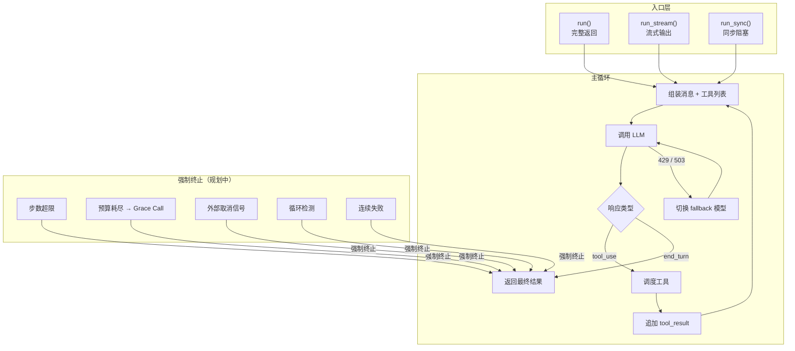

# agent-runtime

> 写作提醒：功能描述只写可观察的行为，不写内部实现细节。验收标准只写端到端可验证的行为。

## 概述

核心 agent 执行引擎，负责 LLM 调用循环、工具调度、上下文压缩和运行治理。是平台所有入口（HTTP、IM、定时任务、Webhook）的最终执行层。

**负责**：主循环执行（LLM 调用 → 工具调度 → 迭代）、内置工具管理、上下文压缩、sub_agent 并行、成本预算管控、取消传播、错误分类。

**不负责**：MCP 外部工具连接（→ [mcp](./mcp.md)）、沙箱代码执行（→ [sandbox](./sandbox.md)）、Skill 管理（→ [skill](./skill.md)）、长期记忆注入（→ long_term_ctx）、工具注册与访问控制（→ tool_registry / agent_policy）。

**调用关系**：
- 依赖：model_router、tool_registry、skill_registry、context_mgr、long_term_ctx、observability、session_mgr
- 被依赖：server.py（HTTP 路径）、normalizer（IM 路径）、cron_scheduler（定时路径）

**观测边界**：agent-runtime 产生 run / model / tool / context / termination 事件；observability 负责 trace schema、持久化和查询接口。agent-runtime 不直接决定 trace 的存储介质。

## 关键流程

## 现状

- ✅ **tool-use 循环**：while 循环持续调用 LLM，处理 tool_calls 直到 finish_reason=stop
  - `run()`：完整循环，返回 string，供 CLI / IM 使用
  - `run_stream()`：async generator，yield SSE event dicts，供 HTTP 使用
  - `run_sync()`：`asyncio.run(run())` 的同步封装

- ✅ **model fallback 链**：LLM 返回 429/503 时自动重试 fallback 模型
  - `RouteConfig` 支持 `fallbacks: list[str]`
  - 重试耗尽后抛出异常，trace 中记录实际使用的模型

- ✅ **内置工具**：`time`、`calculate`、`read_file`、`write_file`、`run_code`、`sub_agent`
  - `@tool` / `@tool(risk_level="medium/high")` 装饰器注册
  - import `tools.py` 即触发注册（副作用）

- ✅ **MCP 工具集成**：详见 [mcp.md](./mcp.md)

- ✅ **Docker 沙箱代码执行**：详见 [sandbox.md](./sandbox.md)

- ✅ **Skill 注入**：详见 [skill.md](./skill.md)

- ✅ **in-session 上下文压缩**：token 超 80% 阈值时自动压缩历史消息
  - `keep_tail` 保留最后 n 条，使用 identity check（`m is tail[0]`）防误判
  - 保留完整 tool pair，不在 tool call 中间截断

- ✅ **sub_agent 并行**：`asyncio.gather` 并发执行多个子 agent
  - 最大深度 1，sub_agent 内过滤 `sub_agent` 工具防递归
  - 每个子 agent 使用全新上下文
  - child trace 记录 `parent_session_id`，可通过 traces 追踪完整调用链

## 规划中（v1.0）

### 核心循环增强

- [ ] **终止条件管理**：强制终止条件接入主循环，每种原因对应不同的收尾行为
  - `max_turns`：执行步数超限
  - `budget_exceeded`：token 用量或成本超限 → 触发 Grace Call
  - `cancelled`：收到外部取消信号 → 直接停止
  - `approval_rejected`：高风险操作被人工拒绝 → 停止当次任务
  - `loop_detected`：检测到无意义重复操作
  - `consecutive_failures`：连续多次工具调用或 AI 请求失败
  - 终止原因码写入 observability trace event，用于统计「任务为何失败」和生成面向用户的提示

- [ ] **迭代预算与 Grace Call**：任意预算维度耗尽时优雅停止
  - 三维预算：执行步数上限 / token 用量上限 / 美元成本上限
  - 预算将耗尽时不直接切断，而是给 AI 最后一次机会生成「当前进展总结」（Grace Call）
  - Grace Call 有独立的 token 预算；失败则返回已有的部分结果

- [ ] **工具并行调度**：AI 单轮可能同时请求多个工具，按依赖关系决定是否并行
  - **完全可并行**：工具之间无依赖、无共享资源（如同时查询多个独立数据源）→ 并行执行
  - **按路径隔离**：操作不同文件/资源路径时可并行，操作同一路径时转串行
  - **必须串行**：有副作用、依赖前步结果、或需人工审批的工具 → 始终串行
  - 并行结果必须按 AI 原始请求的顺序回填，顺序错乱会导致 AI 上下文混乱
  - 当前状态：所有工具均串行执行，并行调度未实现

- [ ] **循环检测**：识别 AI 陷入「反复调用同一工具却毫无进展」的状态
  - 主循环层做粗粒度检测，细粒度检测见工具调用守卫
  - 检测到循环 → 注入警告提示；AI 忽略仍重复 → 强制停止

- [ ] **错误分类与重试策略**：运行时错误归一化为固定分类，每类关联恢复策略

  | 错误类型 | 应对策略 |
  |---------|---------|
  | `rate_limit` | 重试 + 切换备用模型 |
  | `context_overflow` | 触发压缩后重试 |
  | `tool_timeout` | 返回超时结果，不中断循环 |
  | `tool_crash` | 返回错误结果，由 AI 决策 |
  | `mcp_disconnect` | 尝试重连，失败则降级 |
  | `sandbox_oom` | 返回失败结果并告警 |
  | `sandbox_timeout` | 返回失败结果，清理沙箱实例 |
  | `auth_failed` | 提示用户，不重试 |
  | `unknown` | 默认不重试，向用户报错 |

  主循环只读取错误类型上挂载的标志位（是否重试 / 是否压缩 / 是否切换模型），不重复解析错误内容。

- [ ] **消息卫生与契约修复**：发给 LLM 的消息序列必须满足严格格式要求，自动修复违规
  - 连续两条同一角色消息 → 合并或插入占位消息
  - 有工具调用但缺少对应结果 → 补充「工具执行失败」占位结果
  - 有工具结果但找不到对应调用 → 移除孤立结果
  - 修复动作必须写入 observability trace event；修复失败尽早报错，不传不合法消息给 LLM

### 工具层增强

- [ ] **插件工具机制**：企业团队无需修改平台代码即可扩展工具
  - 在 `plugins/{插件名}/` 目录下放 `plugin.yaml` + `__init__.py`（含 `@tool` 函数）
  - 平台启动时自动扫描加载 `enabled: true` 的插件，工具自动加命名空间前缀 `{插件名}__{工具名}`
  - agent 定义中须列出 `plugins: [crm_tools]`，否则该插件工具对该 agent 不可见
  - `plugin.yaml` 格式错误 → 跳过该插件并警告，不阻断启动

- [ ] **工具超时保护**：每次工具调用有超时上限（内置 30s / MCP 60s / 插件 30s，可配置）
  - 超时 → 取消调用，向 AI 返回超时错误结果（不抛异常中断循环）
  - 取消必须真正释放资源（沙箱容器、MCP 连接）

- [ ] **工具结果写入时压缩**：工具结果写入 context 时立即做大小控制，context 从一开始就保持紧凑
  - 第一层（当轮）：结果超 4000 tokens 时截断，保留开头 + 结尾 + 关键标识符（文件路径、ID、哈希值）
  - 第二层（跨轮）：进入下一轮时，尾部之外的旧 `tool_result` 自动降级为面包屑格式

- [ ] **工具调用守卫（Guardrails）**：检测异常调用模式，防止 AI 反复调用同一工具毫无进展
  - 相同工具 + 相同参数连续重复 N 次 → 注入警告提示；AI 忽略仍重复 → 停止调用
  - 同一工具连续失败 M 次 → 同等处理

- [ ] **参数消毒与 Secret 过滤**：工具调用参数在执行前做格式修复；沙箱环境严格过滤敏感变量（见 sandbox.md 环境变量过滤）
  - 参数 JSON 格式损坏 → 尝试自动修复；修复失败则向 AI 报错

### 上下文压缩增强

- [ ] **双阈值触发**：引入 `Tmax`（触发压缩）和 `Tretained`（压缩目标）两个阈值
  - 两个阈值保持足够间距，避免压缩后立即再次触发（导致频繁压缩、缓存失效）
  - 支持手动触发（`/compact` 命令）和 LLM 报「上下文过长」错误时自动触发

- [ ] **分层保留改进**：明确保护「用户最初的需求意图」不被截断
  - 头部：系统提示 + 初始意图消息，完整保留
  - 中段：早期对话，LLM 摘要压缩
  - 尾部：最近若干 token，完整保留

- [ ] **持久化增量摘要**：多次压缩时，在已有摘要基础上只摘新增部分
  - 摘要文本须标注「这是历史对话摘要，仅供参考」，防止 AI 将摘要内容误作新指令
  - 摘要失败时降级为静态保留头尾截断中段，不崩溃

- [ ] **压缩前轻量清理**：进入摘要前的纯规则预处理（毫秒级，不调用 LLM）
  - 图片/二进制占位块兜底替换为 `[图片：{尺寸}，{时间戳}]`
  - 同工具 + 同参数多次调用且结果相同 → 只保留最新一条

- [ ] **压缩过程可追溯**：每次压缩写入 observability trace event，记录：触发原因、压缩前后消息数/token 数、压缩耗时、使用的摘要模型

- [ ] **压缩反抖动**：连续 3 次压缩节省率均低于 10% → 关闭自动压缩并告警（提示扩大 context 上限或拆分任务）

### 运行治理

- [ ] **成本预算管控（五层）**：单次任务 / 单 session / 单用户 / 单 agent / 全局，各自可配置上限
  - 三个计量维度：执行步数 / token 用量 / 美元成本
  - 系统内部操作（如压缩调用）可豁免计入预算
  - 到达上限触发 Grace Call，不硬切断

- [ ] **取消与超时传播**：cancel token 单向流贯穿主循环和所有工具调用
  - 外部取消到达时，正在进行的工具执行（沙箱容器、MCP 连接）真正中止并释放资源
  - 含 cooperative（协作停止）+ 硬 deadline 两层保护

- [ ] **sub_agent 生命周期管理**：当前为 fire-and-forget，无法感知子任务阻塞或失败
  - 加 SQLite 状态表：`pending → in_progress → done/failed`
  - 支持超时检测与失败重试

- [ ] **多模态输入支持**：接收图片等非文本内容并透传给 LLM
  - 支持 base64 编码图片作为消息内容
  - 边界：音频/视频暂不支持

## 验收标准

**场景 1：无工具直接回复**
- Given：用户通过 HTTP 发送消息，LLM 无需调用工具
- When：POST /chat
- Then：SSE 流式返回文本，最终发送 done 事件；traces 写入一条记录

**场景 2：工具调用循环**
- Given：用户消息触发工具调用（如 calculate）
- When：LLM 返回 tool_calls
- Then：工具执行结果回传 LLM，LLM 继续生成最终回复；运行记录中留有工具调用条目

**场景 3：model fallback**
- Given：RouteConfig 配置了 fallbacks，主模型返回 429
- When：agent_loop 发起 LLM 调用
- Then：自动切换到 fallback 模型重试；trace 记录实际使用的模型；用户无感知

**场景 4：高风险工具审批**
- Given：工具 `risk_level="high"`
- When：agent_loop 准备调用该工具
- Then：暂停执行，通知用户审批；用户 approve 后继续；用户 reject 后取消；超时按拒绝处理

**场景 5：上下文压缩**
- Given：session 历史超过 token 阈值（80%）
- When：新一轮 LLM 调用前
- Then：历史被压缩，保留最后若干条完整 turn；LLM 调用正常继续

**场景 6：流式输出实时推送**
- Given：用户通过 HTTP 接口发送消息，触发工具调用
- When：agent 处理过程中
- Then：用户端实时收到逐步推送的文字；工具执行完成后继续推送后续内容；整个过程连续不中断

**场景 7：任务预算耗尽给出总结（v1.0）**
- Given：当前任务已消耗到配置的最大步数上限，任务仍未完成
- When：预算耗尽
- Then：agent 不直接截断，而是给用户一个「当前已完成部分」的总结回复；用户不会收到空响应

**场景 8：工具超时不中断任务（v1.0）**
- Given：某工具执行时间超出上限（如调用外部接口无响应）
- When：超时触发
- Then：该工具调用以超时失败结束；agent 收到超时反馈后继续处理；整个任务不崩溃

**场景 9：大结果不占满对话空间（v1.0）**
- Given：agent 读取了一个大文件（数千行），对话继续进行后续操作
- When：后续轮次组装上下文
- Then：上一轮的文件内容已自动压缩为关键摘要（含文件路径、核心字段）；不因单次大结果导致后续对话报错

**场景 10：压缩后工具调用记录不残缺（v1.0）**
- Given：对话中含有多次工具调用；触发压缩
- When：压缩完成后 agent 继续处理
- Then：压缩后的上下文中不存在「只有工具调用请求、没有对应结果」的残缺记录；LLM 接口不因格式错误报错

**场景 11：成本超限任务自动停止并给出总结（v1.0）**
- Given：当前 agent 运行已达到配置的成本上限
- When：下一次模型调用前检查预算
- Then：任务停止继续执行；用户收到当前进展的总结回复，而非直接断开；运行记录标注停止原因为预算超限

**场景 12：取消操作真正停止所有执行（v1.0）**
- Given：agent 正在执行一个耗时工具（如代码执行或外部服务调用）
- When：用户发出取消操作
- Then：正在进行的工具执行被真正中止（不只是停止等待）；相关资源（容器、连接）被释放；运行记录注明取消时间点

## 测试边界

**需要单元测试的行为**：
- 主循环：`finish_reason=stop` 时退出；`tool_use` 时调度工具并追加结果继续循环
- model fallback：429/503 时切换 fallback；重试耗尽后抛异常
- 工具对完整性：保留 `keep_tail` 时向前扩展，不在 tool call 中间截断
- 压缩触发：token > 80% 阈值时调用压缩；压缩失败时主循环不崩溃
- sub_agent 深度：sub_agent 内调用 sub_agent 被过滤，防递归

**需要 mock 的依赖**：
- LLM 调用：`patch get_client_and_config`，模拟 tool_use / end_turn / 429 响应
- `tool_registry.dispatch`：mock 工具执行结果
- `context_mgr.compress`：mock 压缩行为，验证触发条件
- `session_mgr`：`monkeypatch SESSIONS_DIR` 到 `tmp_path`

## 待决问题

- [ ] Grace Call 的 token 预算如何与主任务预算隔离？单独配置还是固定比例？（负责人：待认领）
- [ ] sub_agent 状态表设计：状态机字段、超时时间默认值（负责人：待认领）
- [ ] 工具调用守卫阈值：「相同工具相同参数重复 N 次」中的 N 默认值是多少？是否可配置？（负责人：待认领）
