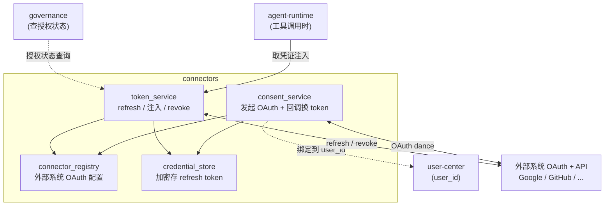
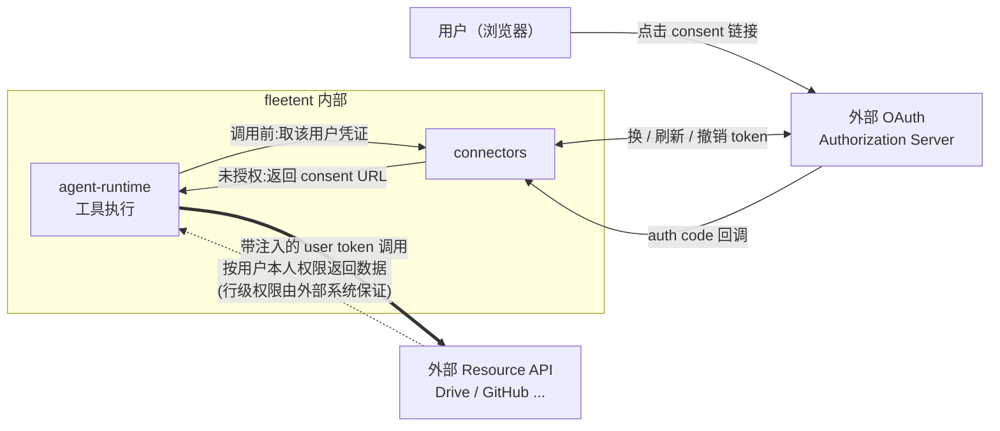
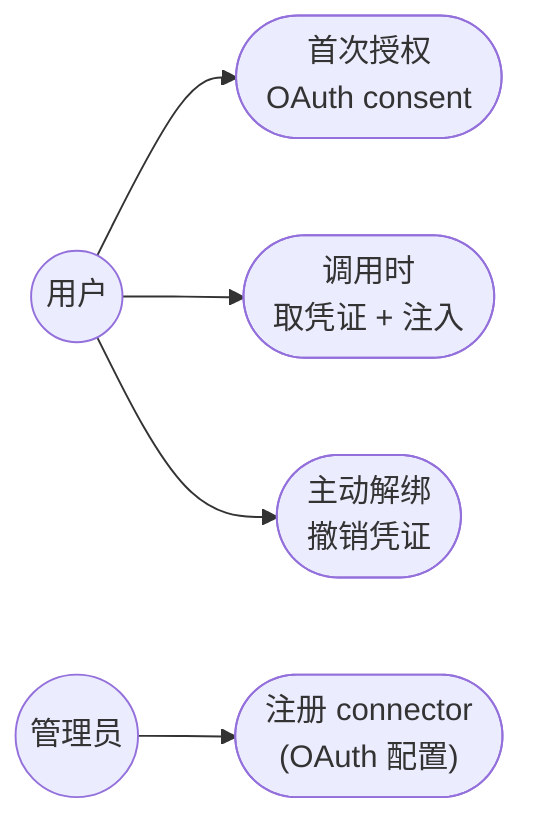

# connectors

> 写作提醒：功能描述只写可观察的行为，不写内部实现细节。验收标准只写端到端可验证的行为。

## 概述

工具调用时的 **per-user 外部系统授权与凭证层**。当某个工具需要访问外部系统（Google Drive、GitHub、Notion 等）时，由本模块负责：用户**独立授权**该外部系统（OAuth consent）、安全保管这个用户的凭证、并在工具调用时把凭证注入到对外请求。

"独立"指：这是**每个用户、每个外部系统各自一次**的授权 —— Alice 授权她自己的 Drive，与 agent 配置、与别的用户都无关。governance 决定"能不能调这个工具"，connectors 决定"调用时拿谁的凭证、用户授权了没"。

边界（明确不做）：
- 不判断"能不能调这个工具"（agent 能力边界）→ **governance**
- 不判断"操作的人是不是本人"→ **user-center**（已验证身份是前提）
- 不执行工具逻辑 → **agent-runtime**
- 不判断"外部资源行级该不该看"→ **外部系统自身权限**（如 Drive ACL）

**接入硬约束**：外部系统接入**只接受 OAuth 2.x**。不支持 OAuth 的系统（长期 API key / Basic Auth / 私有协议）不在接入范围 —— 业务对话简化为"它支持 OAuth 吗?支持→接;不支持→等它支持"。

**调用关系**：
- 依赖：user-center（user_id）、加密凭证存储、email/web（consent 承载）
- 被依赖：agent-runtime（工具调用时取凭证）、governance（查授权状态以决定是否提示 consent）
- 对外：各外部系统的 OAuth Authorization Server + Resource API

## 核心功能

- **Connector 抽象**：每个外部系统一个 connector，声明它的 OAuth 配置（authorize/token endpoint、scopes、client_id）。加新外部系统 = 加一个 connector 配置，不改核心代码
- **per-user OAuth 授权（consent）**：用户首次需要某外部系统时，引导走 OAuth consent（浏览器跳转），授权后保存该用户对该 connector 的 refresh token
- **凭证生命周期**：加密存储 refresh token（不存明文）；access token 过期前自动 refresh；用户可主动解绑（revoke）
- **凭证注入**：工具调用外部系统时，按 (user_id, connector) 取出有效 access token，注入到对外请求
- **授权状态查询**：回答"用户 X 授权过 connector Y 吗、scope 够不够"，供 agent / governance 在调用前决定是否先引导 consent
- **离职 / 禁用联动**：user-center 禁用某用户时，撤销其全部 connector 凭证并调用各外部系统的 revoke endpoint

## 授权与凭证流程

```
[首次授权 consent]
用户让 agent 用某外部系统(如查 Drive)
  → connectors 查 (user_id, "google-drive") 授权状态:未授权
  → 返回 NeedsConsent + consent URL,agent 提示用户点击
  → 用户浏览器打开 → 外部系统 OAuth consent 页 → 同意
  → 回调到 connectors 的 callback 端点 → 用 auth code 换 refresh token
  → 加密存入 connector_grants(user_id, connector_id, refresh_token, scopes)

[后续调用注入]
工具要访问外部系统
  → connectors 取该 user 对该 connector 的凭证
  → access token 过期(<60s) → 用 refresh token 换新的
  → 注入到工具的对外请求(Authorization: Bearer <access token>)
  → 外部系统按"该用户本人"权限返回数据(行级权限由外部系统保证)

[撤销]
用户主动解绑 / 离职被禁用
  → 删 connector_grants 记录 + 调外部系统 revoke endpoint
```

## 凭证如何注入工具（声明 + dispatch 单点注入）

工具作者写**零凭证代码** —— 只声明它要哪个 connector，框架在 dispatch 这个**单一注入点**统一注入。绝不让每个工具自己 fetch / refresh / 处理未授权。

**工具声明依赖**：

```
@tool(connector="google-drive", scopes=["drive.readonly"])
def drive_search(query: str, *, client):     # client 是隐藏参数,不进 LLM schema
    return client.files.list(q=query)         # 拿到的就是认证好的 client
```

`client` 由框架填充，对 LLM 不可见（工具的 JSON schema 里只有 `query`）。工具体内没有任何 OAuth / token / refresh 代码。

**dispatch 单点注入**（对所有工具统一，工具不感知）：

```
dispatch(tool_name, args, acting_user):
  meta = registry.get(tool_name)
  if meta.connector:                                       # 工具声明了要外部系统
     cred = connectors.get_credential(acting_user, meta.connector, meta.scopes)
     if cred is NeedsConsent:
         return NeedsConsent(consent_url)                  # 短路!工具不执行,agent 提示授权
     inject(cred)                                          # 见下,按工具类型注入
  call tool(...)
```

**两种工具类型，同一注入点**：

| 工具类型 | 注入方式 |
|---|---|
| **原生 `@tool` 工具** | 认证好的 client / token 作为**隐藏参数**注入函数（不进 LLM schema） |
| **MCP 工具** | 按 transport 注入 user token:HTTP=每请求 `Authorization` header;SSE=每用户连接建连时注入 —— 详见下节《MCP 工具的接入与 token 注入》 |

**connectors 对 dispatch 暴露的契约**（`tool_registry` / dispatch 属 agent-runtime，这里只定义 connectors 这侧的接口与 dispatch 必须遵守的约定）：

- 接口：`connectors.get_credential(user_id, connector_id, scopes) -> Credential | NeedsConsent`
- 工具元数据约定：`connector: str | None`、`scopes: list[str]`
- dispatch 必须：调用工具前检查 `meta.connector` → 调 `get_credential` → 若 NeedsConsent 则短路返回（不执行工具）→ 否则按工具类型注入 → 再执行

**与 governance 的次序**（三层在 dispatch 前后接力，对工具透明）：

```
LLM 要调 drive.search
  → governance:  在 agent allowed_tools 里吗?        (能力边界)
  → dispatch:    声明了 connector? 用户授权了吗?      (connectors 注入)
       未授权 → NeedsConsent,提示用户授权,不执行
       已授权 → 注入 token
  → 执行工具 → 带 token 打外部 API → 外部按用户本人权限返数据
```

核心好处：**"未授权 → 引导 consent" 对 LLM 和工具都透明** —— dispatch 一看声明的 connector 没授权就短路返回 consent URL，工具作者完全不用写"如果没授权怎么办"。

## MCP 工具的接入与 token 注入

MCP server 是**独立运行的东西**(远程服务 / 本地子进程),不是 import 进代码的库。多用户场景下能不能用、token 怎么注入,取决于它的**安装形态**和**transport**。

### 安装形态决定多用户可行性

| 形态 | 是什么 | 多用户 |
|---|---|---|
| **远程 HTTP/SSE**(配一个 URL) | 跑在厂商或你自托管的服务端,你连过去 | ✅ 每用户带自己的 token |
| **本地 stdio**(配命令,npx 起子进程) | 一个子进程 = 一套 env 凭证 | ❌ 单账号;多用户要每用户起一进程,过重,不采用 |

→ **多用户 agent 平台只走远程 HTTP/SSE,不用 stdio 单账号那种**(那是 Claude Desktop / openclaw 单用户玩法)。

### transport 决定 token 怎么注入

| transport | 注入方式 | 例子 |
|---|---|---|
| **Streamable / 普通 HTTP** | 每请求 header 塞 user token,**无状态、无连接池** | Google Drive `drivemcp.googleapis.com` |
| **老 SSE(两端点)** | token 绑在**建连接时** → 每用户一条 SSE 连接(**连接池**) | Atlassian `/v1/sse` |
| **stdio** | 不看请求 token,用 env 凭证 | 本地社区 server |

→ 优先选 **HTTP**(每请求注入,mcp_client 改一行);**SSE** 要维护 per-user 连接池(key=`(user, server)`,建连注入 token,空闲淘汰,refresh 时重连)。

### 单 token vs 两 token —— 决定你能不能直接注入

| server 类型 | token 情况 | 你能注入吗 |
|---|---|---|
| **厂商自己的**(Atlassian→Atlassian、Google→Google) | 单 token,你传的就是终点 token | ✅ 直接注入 per-user token |
| **第三方代理**(代理一个它不拥有的 API) | 你传给它的是 Token A,它自己管上游 Token B | ⚠️ 你只能给 Token A,碰不到上游凭证;别依赖此类做多用户核心 |

> 注:MCP 的认证是 OAuth 模型,**禁止 token 透传**。所以"第三方代理 server 替你调上游"那条天然有两-token 裂缝;厂商自己的 server 无此问题。**多用户核心只走厂商自己的 server 或直连 API。**

### 接入决策:什么时候用 MCP,什么时候直连 API

- **SaaS 集成(Jira/Drive/Gmail)= 薄壳**(只是把厂商 API 包成 MCP 协议,无自有逻辑)→ 优先 **① 厂商远程 HTTP MCP**(每请求注入)或 **② 直连厂商 API + connectors**(全控)。两者料源相同,选可维护的那个
- **重逻辑 MCP(浏览器自动化 / RAG / 记忆 / 编排)** → 通常**不需要** per-user SaaS 授权,直接用现成的,与 connectors 不冲突
- **不要**把多用户核心押在:本地 stdio 单账号 server,或"取数+处理捆死、且认证不适配多用户"的黑盒。后者**拆开**:薄取数(connectors 注 token)+ 免认证处理工具(如 markitdown / unstructured)

### connectors 这侧的契约

- HTTP transport:dispatch 每请求调 `connectors.get_credential(user, server)` 取 token,塞 `Authorization`
- SSE transport:连接池属 mcp_client(agent-runtime),**connectors 只负责提供 per-user token**,建连/重连时由 mcp_client 取用
- 不论 transport,**token 的 consent / 存储 / refresh / revoke 始终在 connectors**,MCP server 不替平台管(厂商 server 只是"拿 token 去取数")

## 模块图



## 对外系统交互图

这是 governance "对外系统交互图"里那条**绕过 governance 的粗箭头**真正的落点 —— connectors 是平台里唯一直接和外部系统 OAuth/API 打交道的模块。



**关键边界**：consent / token 管理走 connectors ↔ 外部 OAuth Server;真正的资源调用是 agent-runtime 带着 connectors 注入的 token 去打外部 API（粗箭头）。外部返回**哪些**数据，由外部系统按该用户本人权限决定，平台不复制其权限模型。

## 数据模型

```sql
-- connector 定义（每个外部系统一个）
connectors (
  id            TEXT PRIMARY KEY,   -- "google-drive" | "github" | ...
  display_name  TEXT,
  oauth_config  TEXT,               -- JSON: authorize_url / token_url / scopes / client_id
  enabled       BOOLEAN,
  created_at    DATETIME
)
-- 注:client_secret 不入此表,走 env / 密钥注入(参考 deployment 的密钥不落 DB 原则)

-- per-user 授权与凭证
connector_grants (
  id              INTEGER PRIMARY KEY,
  user_id         TEXT,             -- → users.id (user-center)
  connector_id    TEXT,             -- → connectors.id
  refresh_token   BLOB,             -- 加密存储,不存明文
  scopes          TEXT,             -- 已授权 scope
  granted_at      DATETIME,
  revoked_at      DATETIME,         -- 软删除,保留历史用于审计
  UNIQUE(user_id, connector_id) WHERE revoked_at IS NULL
)

-- OAuth consent 进行中的一次性 state（防 CSRF,回调校验后即弃）
connector_oauth_states (
  state        TEXT PRIMARY KEY,    -- 随机,绑定本次 consent
  user_id      TEXT,
  connector_id TEXT,
  expires_at   DATETIME             -- 短时效
)
```

## 验收标准（E2E test case）

**场景 1：未授权触发 consent 引导**
- Given：用户从未授权过 Google Drive，agent 的工具含 drive.search
- When：用户让 agent 查 Drive
- Then：connectors 返回 NeedsConsent + consent URL，agent 提示用户去授权；工具不执行

**场景 2：授权后凭证保存**
- Given：用户点击 consent URL 并在 Google 同意
- When：OAuth 回调到 connectors（state 校验通过）
- Then：connector_grants 写入该 (user_id, google-drive) 的加密 refresh token + scopes，状态变为已授权

**场景 3：调用时注入与自动刷新**
- Given：用户已授权 Drive，access token 已过期
- When：agent 再次查 Drive
- Then：connectors 用 refresh token 换新 access token 并注入请求；Drive 按 Alice 本人权限返回她能看到的文件

**场景 4：per-user 隔离**
- Given：Alice 和 Bob 都授权了 Drive
- When：Bob 让 agent "查 Alice 的私有文档"
- Then：connectors 注入的是 Bob 自己的 token，Drive 按 Bob 权限返回为空 —— 跨用户拿不到对方数据

**场景 5：主动解绑撤销**
- Given：用户已授权某 connector
- When：用户解绑
- Then：connector_grants 标记 revoked，并调用外部系统 revoke endpoint；后续调用回到 NeedsConsent

**场景 6：离职禁用联动**
- Given：用户授权了多个 connector，被 user-center 禁用
- When：禁用生效
- Then：该用户全部 connector_grants 被撤销 + 调用各外部 revoke endpoint

**场景 7：非 OAuth 系统拒绝接入**
- Given：某外部系统只支持长期 API key、不支持 OAuth
- When：尝试为它注册 connector
- Then：注册被拒绝（connector 必须基于 OAuth 2.x）

**场景 8：dispatch 单点注入（工具零凭证代码）**
- Given：工具 `drive_search` 仅声明 `connector="google-drive"`，函数体不含任何 token / OAuth 代码，用户已授权
- When：agent 调用 drive_search
- Then：dispatch 取该用户凭证并以隐藏参数注入认证好的 client，工具直接可用；`client` 不出现在 LLM 可见的工具 schema 中

**场景 9：未授权时 dispatch 短路**
- Given：工具声明了 connector，但用户未授权该 connector
- When：agent 调用该工具
- Then：dispatch 在执行前短路，返回 NeedsConsent + consent URL，工具体一行都不执行，agent 提示用户授权

## Smoke Test 用例图



冒烟测试覆盖这 4 条主路径即可判断 connectors 基本可用：OAuth 授权、凭证注入、解绑撤销、connector 注册。

## 待决问题

- [ ] 加密凭证存储后端：自维护加密 SQLite（Lean，零额外依赖）vs Vault / OpenBao（重但成熟）（负责人：待认领）
- [ ] OAuth consent 的 callback 端点承载：复用 server.py 还是独立 web 入口（on-prem 公网可达性）（负责人：待认领）
- [ ] 各厂商 MCP 的 transport 核实:接入前确认它是 Streamable HTTP(每请求注入,简单)还是老 SSE(要连接池)。Google Drive=HTTP;Atlassian=`/v1/sse`,需查它有无 streamable-http 端点（负责人：待认领）
- [ ] SSE 类 MCP 的 per-user 连接池:何时实现、连接数上限 / 空闲淘汰策略（负责人：待认领）
- [ ] incremental scope：按工具按需追加 scope（如先 drive.readonly，后续加 calendar）vs 首次一次性申请全量（负责人：待认领）
- [ ] connector 注册形态：配置文件 vs admin CLI vs DB（负责人：待认领）
