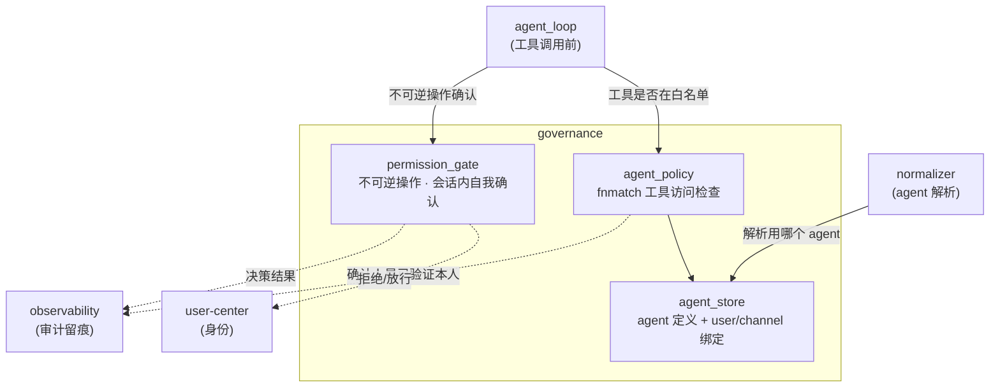
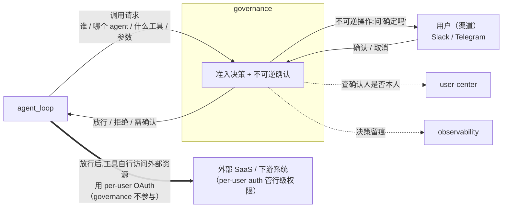

# governance

> 写作提醒：功能描述只写可观察的行为，不写内部实现细节。验收标准只写端到端可验证的行为。

## 概述

agent 工具执行前的治理层：在 agent 即将调用某个工具的那一刻，决定 **(1) 这个 agent 被允许用哪些工具、(2) 这次调用准不准、(3) 不可逆操作要不要发起人本人在会话里确认**。它是工具执行前的决策闸门，配合 user-center（身份）和 per-user auth（资源行级权限）共同构成完整的访问控制。

边界（明确不做）：
- 不判断"操作的人是不是本人" → **user-center**（已验证身份是前提）
- 不判断"外部资源的行级权限"（如某文档该不该给看）→ **per-user auth / 下游系统**
- 不存储审计日志 → **observability**（governance 只产生决策，落盘是 observability 的事）

**调用关系**：
- 依赖：agent_store、agent_policy、permission_gate、user-center（确认人身份）
- 被依赖：agent_loop（工具访问检查、审批门）、normalizer（agent 解析）
- 产出：决策结果交 observability 留痕

## 核心职责

- ✅ **Agent 能力边界**：每个 agent 有 name、system_prompt、allowed_tools 白名单（fnmatch 通配符，如 `read_*`、`github__*`）。这是 agent 的**能力面**，per-user auth 管不到
- ✅ **工具访问控制**：dispatch 时检查 tool_name 是否在该 agent 的 allowed_tools 内，不在则直接拒绝、原因回给 LLM
- ✅ **Agent 定义与分配**：user→agent、channel→agent 绑定 + 全局默认 agent
- 🔄 **不可逆操作的会话内自我审批**：当前已有 medium/high 风险审批门，**目标态收敛为**"仅不可逆操作 + 发起人本人在会话内确认"（详见"审批机制定位"）

> "工具能不能用"（能力边界，governance）和"工具访问到的资源该不该给看"（行级权限，per-user auth / 下游系统）是两层。governance 只管前者。

## 审批机制定位

审批**不是授权机制**（授权由 per-user auth 解决），而是**用户对自己 AI 的意图确认**：

> 防的威胁是 —— AI 被 prompt injection / 幻觉操纵后，用用户**自己的合法权限**做了用户**没打算做**的不可逆操作。per-user auth 把爆炸半径限定在"用户能做的事"以内，但拦不住"在这个半径内做出用户没意图的破坏"。审批就是补这个洞。

由此确定的设计（v1）：

| 维度 | 定位 |
|---|---|
| **性质** | 不可逆操作的自我意图确认（防注入，非授权） |
| **范围** | 极小：删除 / 外发邮件消息 / 转账 / 对外发布等不可逆高影响动作。读操作、可逆操作**一律不审批** |
| **确认人** | 发起人本人（self-confirm）。因为要回答"这是不是**你**的本意"，只有本人能答 |
| **时序** | 同步 —— 人就在会话里，几秒内响应 |
| **作用域** | **限定在 session 内**，是会话流里的一个对话回合（类似 agent 问澄清问题），不是跨会话的权限子系统 |
| **超时** | fail-closed：超时未确认按"未批准"处理，中止该工具 |
| **留痕** | 确认 / 取消结果交 observability 审计 |

明确不做（留口，v1 之外）：
- ❌ **外部 / 双人审批（dual-control）**：需要任务注册中心（挂起-恢复基础设施），太重。仅组织级影响 / 强合规场景才需要
- ❌ **异步审批**：审批人不在场才需要异步；自我审批人就在会话里，同步即可。等真有外部审批需求再做

## 模块图



## 对外系统交互图

governance 只做"决策"，本身**不直接访问任何外部系统**。工具放行后，真正去外部 SaaS / 下游取数据的是工具自己（用 per-user auth），governance 不参与那一步。



**关键边界**：图中粗箭头（工具 → 外部 SaaS）**绕过 governance** —— governance 决定"能不能调这个工具"，至于工具调用时怎么用用户的 OAuth token 访问外部资源、外部返回哪些数据，是 per-user auth 和下游系统的事。

## 数据模型

```sql
-- Agent 定义
agents (
  id            INTEGER PRIMARY KEY,
  name          TEXT UNIQUE,
  system_prompt TEXT,
  allowed_tools TEXT,    -- JSON 数组,fnmatch 通配符,如 ["read_*", "github__*"]
  created_at    DATETIME
)

-- 用户 → Agent 分配
user_agents (
  user_id   TEXT,        -- → users.id
  agent_id  INTEGER,     -- → agents.id
  PRIMARY KEY (user_id, agent_id)
)

-- Channel → Agent 绑定
channel_agents (
  platform    TEXT,      -- "slack" | "telegram" | ...
  channel_id  TEXT,
  agent_id    INTEGER,   -- → agents.id
  PRIMARY KEY (platform, channel_id)
)

-- 不可逆操作审批记录（会话内自我确认 + 审计留痕）
approvals (
  id                TEXT PRIMARY KEY,
  session_id        TEXT,       -- 审批限定在此 session 内
  requester_user_id TEXT,       -- → users.id；自我确认时确认人 = 发起人
  tool_name         TEXT,
  tool_args         TEXT,       -- JSON,确认时以可读意图呈现给用户
  status            TEXT,       -- "pending" | "approved" | "rejected" | "timeout"
  created_at        DATETIME,
  resolved_at       DATETIME
)
```

> 说明：`approvals` 记录用于审计追溯；状态机限定在单 session 生命周期内。原 `risk_level` / `approver_user_id` 字段在"会话内自我确认"模型下退化（确认人恒为发起人、范围恒为不可逆操作），如何精简到实现时定。

## 验收标准（E2E test case）

**场景 1：工具不在白名单被拦截**
- Given：agent 的 allowed_tools = ["read_*"]
- When：LLM 尝试调用 write_file
- Then：governance 拒绝调用，返回"工具不可用"给 LLM，工具不执行

**场景 2：不可逆操作触发会话内自我确认**
- Given：agent 将调用 delete_file（标注为不可逆）
- When：agent_loop 准备执行
- Then：在当前会话向发起人本人发出"确认删除 X?"；本人回"确认"→ 执行；回"取消"→ 中止并回 LLM

**场景 3：可逆操作不触发审批**
- Given：agent 调用 read_file（可逆 / 只读）
- When：agent_loop 准备执行
- Then：直接执行，**不弹任何确认**（审批只针对不可逆操作）

**场景 4：自我确认超时 fail-closed**
- Given：一个不可逆操作正等待会话内确认
- When：发起人在超时窗口内未回应
- Then：按"未批准"中止该工具，原因回给 LLM；不会默认放行

**场景 5：Agent 解析优先级**
- Given：channel 有绑定 agent，用户也有绑定 agent
- When：IM 消息到达
- Then：使用 channel 绑定的 agent（channel 优先于 user，再到 default）

**场景 6：审批决策留痕**
- Given：一次不可逆操作的自我确认（无论确认 / 取消 / 超时）
- When：决策产生
- Then：结果落到 observability 审计，可按 user_id / session_id 追溯"谁在何时确认/取消了什么操作"

**场景 7（边界）：governance 不管行级权限**
- Given：agent 的 allowed_tools 包含 drive.search，用户已绑定 Drive
- When：用户让 agent 查 Drive
- Then：governance 只判"drive.search 在不在白名单"并放行；**返回哪些文件由 per-user auth + Drive 自身权限决定，governance 不介入**

## Smoke Test 用例图


冒烟测试覆盖这 4 条主路径即可判断治理层基本可用：白名单拦截、不可逆确认、可逆放行、agent 配置分配。

## 待决问题

- [ ] "不可逆操作"的判定方式：工具上静态标注 `irreversible` vs 一份动作清单（删除/外发/转账/发布）（负责人：待认领）
- [ ] 会话内确认的并发实现：暂停的 agent_loop 如何收到同会话的确认消息（与 session 锁的关系）（负责人：待认领）
- [ ] `approvals` 表在自我确认模型下的字段精简（去掉 risk_level / approver_user_id?）（负责人：待认领）
- [ ] dual-control（组织级影响 / 合规双人复核）的触发条件与实现时机 —— 留口，v1 不做（负责人：待认领）
- [ ] 工具访问控制从 fnmatch 升级到 Cerbos 的阈值（规则复杂度 / 参数级 ABAC 需求出现时）（负责人：待认领）
