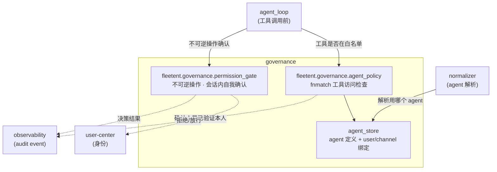
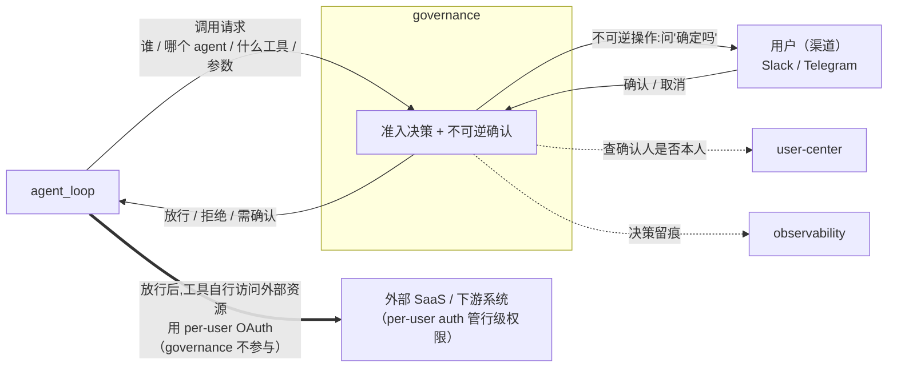
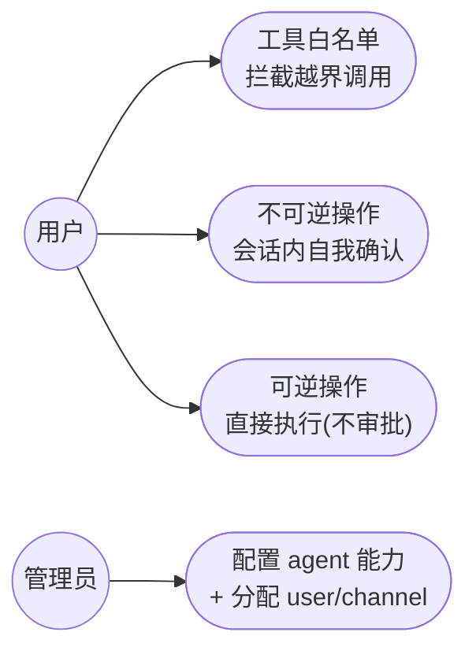

# governance

> 写作提醒：功能描述只写可观察的行为，不写内部实现细节。验收标准只写端到端可验证的行为。

## 概述

agent 工具执行前的治理层：在 agent 即将调用某个工具的那一刻，决定 **(1) 这个 agent 被允许用哪些工具、(2) 这次调用准不准、(3) 不可逆操作要不要发起人本人在会话里确认**。它是工具执行前的决策闸门，配合 user-center（身份）和 per-user auth（资源行级权限）共同构成完整的访问控制。

边界（明确不做）：
- 不判断"操作的人是不是本人" → **user-center**（已验证身份是前提）
- 不判断"外部资源的行级权限"（如某文档该不该给看）→ **per-user auth / 下游系统**
- 不存储审计日志 → **observability / platform audit**（governance 只产生决策事件，落盘与查询是 observability 的事）

**调用关系**：
- 依赖：agent_store、`fleetent.governance.agent_policy`、`fleetent.governance.permission_gate`、user-center（确认人身份）
- 被依赖：agent_loop（工具访问检查、审批门）、normalizer（agent 解析）
- 产出：决策结果作为 audit / security event 交 observability 留痕

## 现状

- ✅ **Agent 能力边界**：每个 agent 有 name、system_prompt、allowed_tools 白名单（fnmatch 通配符，如 `read_*`、`github__*`）。这是 agent 的**能力面**，per-user auth 管不到
- ✅ **工具访问控制**：dispatch 时检查 tool_name 是否在该 agent 的 allowed_tools 内，不在则直接拒绝、原因回给 LLM
- ✅ **Agent 定义与分配**：user→agent、channel→agent 绑定 + 全局默认 agent
- 🔄 **不可逆操作的会话内自我审批**：当前已有 medium/high 风险审批门，**目标态收敛为**"仅不可逆操作 + 发起人本人在会话内确认"（详见"审批机制定位"）

> "工具能不能用"（能力边界，governance）和"工具访问到的资源该不该给看"（行级权限，per-user auth / 下游系统）是两层。governance 只管前者。

## 审批机制定位

审批**不是授权机制**（授权由 per-user auth 解决），而是**用户对自己 AI 的意图确认**：

> 防的威胁是 —— AI 被 prompt injection / 幻觉操纵后，用用户**自己的合法权限**做了用户**没打算做**的不可逆操作。per-user auth 把爆炸半径限定在"用户能做的事"以内，但拦不住"在这个半径内做出用户没意图的破坏"。审批就是补这个洞。

由此确定的设计（v1）：

| 维度 | 定位 |
|---|---|
| **性质** | 不可逆操作的自我意图确认（防注入，非授权） |
| **范围** | 极小：删除 / 外发邮件消息 / 转账 / 对外发布等不可逆高影响动作。读操作、可逆操作**一律不审批** |
| **确认人** | 由 agent 的 `ApprovalRouting` 决定（R1）：可路由给**发起人本人**（`REQUESTER_SENTINEL`）或**指定审批人**（team/tenant approver）。审批人经 `im_gateway` **外呼 DM** 触达；无可达审批人 → default-closed 立即 reject |
| **归属** | **agent 全权**：审批请求与门状态的唯一真相源是 agent 侧 `approval_store`（`approvals`/`approval_allowlist`），actor 存不透明标签；platform 只读下游投影（R1）|
| **时序** | 请求阻塞到 resolve 或超时；审批人经 DM 异步触达，进程内用 `asyncio.Event` 唤醒（跨节点唤醒属多机部署 open question）|
| **作用域** | 当前限定在 owning node 的进程内门控；状态已落 `approval_store` 可被 platform 只读投影 |
| **超时** | fail-closed：超时未确认按"未批准"处理，中止该工具 |
| **留痕** | 确认 / 取消结果交 observability audit event；审批请求/状态持久化在 `approval_store` |

明确不做（留口，v1 之外）：
- ❌ **双人审批（dual-control）/ 跨会话挂起-恢复**：需要任务注册中心，太重；仅组织级影响 / 强合规场景才需要
- ❌ **跨节点审批信令**：单机内 `asyncio.Event` 唤醒已够；多机部署需 Redis pub/sub 或 owning-node 路由（见 platform 多机集群 open question）

## Action Gate：风险 → 处置 mode

工具调用前，action gate 按工具的**服务端风险等级**（来自 registry，绝不取 LLM 传入的参数）映射到一个处置 mode：

| 配置 | 含义 |
|---|---|
| `direct` | 不打扰审批人直接执行 |
| `sandbox` | 在沙箱容器内直跑、不打扰审批人；**仅在运行时封闭成立时生效**，否则 fail-closed 自动升 `approval` |
| `approval` | 外呼审批人确认（默认） |

按风险等级：`none`/`low` → 直跑；`medium` → 取 `action_gate_medium_mode`；`high` → 取 `action_gate_high_mode`；`critical` → 永远 reject（任何配置、任何 LLM 参数都改不了）。无法证明安全的一律 fail-closed 升 `approval`（未知风险串、对非沙箱工具配 `sandbox`）。

### 封闭即免审批（medium → sandbox）

部署可把某 agent 的 `action_gate_medium_mode` 配为 `sandbox`，对**运行时封闭**的 medium 风险操作免审批——容器在 namespace 内封闭执行（`sandbox_capable` 为真）时，medium 操作经 action gate 解析为 `SANDBOX` 在容器内直跑，不逐次打扰审批人。

- **正当性绑定运行时封闭性，而非工具的静态分类**：免审批只在封闭成立时生效。封闭不成立时——无 docker / 全局 sandbox mode 降级为 `off`（`effective_mode == OFF`）/ 操作并非容器内执行——同一 medium 操作复用既有 **fail-closed** 行为升级为 `approval` 走审批，绝不以 sandbox 名义静默直跑。
- **高危不随 medium 放松**：兑现 medium 免审批（`medium_mode: sandbox`）不波及 high 面。`action_gate_high_mode` 推荐默认保持 `approval`。
- **机制零改动**：免审批完全复用既有 `resolve_action_mode` 契约 + 地基 `sandbox-containment-gating` 提供的 `sandbox_capable`；`is_sandbox_backed` / `SANDBOX_BACKED_TOOLS` / registry risk 常量均不变。代码默认仍是 `action_gate_medium_mode: approval`——免审批是部署的**显式选择**，存量配置行为不变。

### sandbox mode 选型指引

全局沙箱三态 `mode`（`platform.yaml` 的 `sandbox.mode`，详见 sandbox-enablement-control）按部署形态推荐选型，与免审批配套。该指引为**选型建议**，不改变三态语义、默认值（`all`）与后端不可用时降级为 `off` 的行为：

| 部署形态 | 推荐 mode | 配套 |
|---|---|---|
| 封闭可信内网，希望容器内 medium 操作免审批自动化 | `all` | agent 配 `action_gate_medium_mode: sandbox`；免审批仅在 `sandbox_capable` 为真时生效 |
| 最小暴露代码执行面，仅特定授权 agent 可用 `run_code` | `selective` | 仅 `features.code_execution: true` 的 agent 暴露 `run_code` |
| 完全禁用代码执行 | `off` | 不存在容器封闭，medium 操作不会因 `sandbox` 配置免审批，仍走审批 |

### bash_exec 默认 opt-in（宿主直跑高危工具）

`bash_exec` 在宿主机直跑任意 Shell（risk=high，非沙箱），是运维专属高危能力。它被划为 **opt-in 工具**：

- **默认不暴露**：`allowed_tools` 为空（allow-all，运行时归一为 `None`）或仅含裸 `*` 通配的普通 agent **看不到也调用不了** `bash_exec`。空 allow-all 对其余非 opt-in 工具的语义不变。
- **运维 agent 显式获得**：只有在 `allowed_tools` 中**显式具名命中**（字面 `bash_exec`，或能覆盖它的显式非裸 `*` 模式，如 `bash_*`）的 agent 才暴露 `bash_exec`。
- **存量迁移**：原先依赖空 allow-all 隐式获得 `bash_exec` 的 agent，需在其 `allowed_tools` 显式补 `bash_exec`——属一次性配置动作。显式列出者不受影响。
- `bash_exec` 自身的执行 / 审批 / 超时 / 工作目录契约不变（owned by builtin-shell-tool）；本能力只改它**是否默认出现在普通 agent 的工具面**。

## 模块图



## 对外系统交互图

governance 只做"决策"，本身**不直接访问任何外部系统**。工具放行后，真正去外部 SaaS / 下游取数据的是工具自己（用 per-user auth），governance 不参与那一步。



**关键边界**：图中粗箭头（工具 → 外部 SaaS）**绕过 governance** —— governance 决定"能不能调这个工具"，至于工具调用时怎么用用户的 OAuth token 访问外部资源、外部返回哪些数据，是 per-user auth 和下游系统的事。

## 数据模型

```sql
-- Agent 定义
agents (
  id            INTEGER PRIMARY KEY,
  name          TEXT UNIQUE,
  system_prompt TEXT,
  allowed_tools TEXT,    -- JSON 数组,fnmatch 通配符,如 ["read_*", "github__*"]
  created_at    DATETIME
)

-- 用户 → Agent 分配
user_agents (
  user_id   TEXT,        -- → users.id
  agent_id  INTEGER,     -- → agents.id
  PRIMARY KEY (user_id, agent_id)
)

-- Channel → Agent 绑定
channel_agents (
  platform    TEXT,      -- "slack" | "telegram" | ...
  channel_id  TEXT,
  agent_id    INTEGER,   -- → agents.id
  PRIMARY KEY (platform, channel_id)
)

-- 不可逆操作审批记录（会话内自我确认 + audit event 留痕）
approvals (
  id                TEXT PRIMARY KEY,
  session_id        TEXT,       -- 审批限定在此 session 内
  requester_user_id TEXT,       -- → users.id；自我确认时确认人 = 发起人
  tool_name         TEXT,
  tool_args         TEXT,       -- JSON,确认时以可读意图呈现给用户
  status            TEXT,       -- "pending" | "approved" | "rejected" | "timeout"
  created_at        DATETIME,
  resolved_at       DATETIME
)
```

> 说明：`approvals` 记录用于审计追溯；状态机限定在单 session 生命周期内。原 `risk_level` / `approver_user_id` 字段在"会话内自我确认"模型下退化（确认人恒为发起人、范围恒为不可逆操作），如何精简到实现时定。

## 验收标准（E2E test case）

**场景 1：工具不在白名单被拦截**
- Given：agent 的 allowed_tools = ["read_*"]
- When：LLM 尝试调用 write_file
- Then：governance 拒绝调用，返回"工具不可用"给 LLM，工具不执行

**场景 2：不可逆操作触发会话内自我确认**
- Given：agent 将调用 delete_file（标注为不可逆）
- When：agent_loop 准备执行
- Then：在当前会话向发起人本人发出"确认删除 X?"；本人回"确认"→ 执行；回"取消"→ 中止并回 LLM

**场景 3：可逆操作不触发审批**
- Given：agent 调用 read_file（可逆 / 只读）
- When：agent_loop 准备执行
- Then：直接执行，**不弹任何确认**（审批只针对不可逆操作）

**场景 4：自我确认超时 fail-closed**
- Given：一个不可逆操作正等待会话内确认
- When：发起人在超时窗口内未回应
- Then：按"未批准"中止该工具，原因回给 LLM；不会默认放行

**场景 5：Agent 解析优先级**
- Given：channel 有绑定 agent，用户也有绑定 agent
- When：IM 消息到达
- Then：使用 channel 绑定的 agent（channel 优先于 user，再到 default）

**场景 6：审批决策留痕**
- Given：一次不可逆操作的自我确认（无论确认 / 取消 / 超时）
- When：决策产生
- Then：结果以 audit / security event 形式交给 observability，可按 user_id / session_id 追溯"谁在何时确认/取消了什么操作"

**场景 7（边界）：governance 不管行级权限**
- Given：agent 的 allowed_tools 包含 drive.search，用户已绑定 Drive
- When：用户让 agent 查 Drive
- Then：governance 只判"drive.search 在不在白名单"并放行；**返回哪些文件由 per-user auth + Drive 自身权限决定，governance 不介入**

## Smoke Test 用例图



冒烟测试覆盖这 4 条主路径即可判断治理层基本可用：白名单拦截、不可逆确认、可逆放行、agent 配置分配。

## 测试边界

**需要单元测试的行为**：
- 工具访问控制：allowed_tools fnmatch 匹配，白名单外的工具被拒绝且原因回给 LLM
- Agent 解析优先级：channel binding → user binding → default agent 的查找顺序
- `fleetent.governance.permission_gate` 超时 fail-closed：超时时状态变为 timeout，不放行工具
- 审批状态机：pending → approved / rejected / timeout 的转换正确，不可跨状态跳转

**需要 mock 的依赖**：
- `agent_store`：注入可控的 agent 定义与 user/channel 绑定数据
- `fleetent.governance.permission_gate`：使用短超时（`PermissionGate(medium_timeout=0.1)`）
- SQLite DB 路径：`monkeypatch` 到 `tmp_path`

## 待决问题

- [ ] "不可逆操作"的判定方式：工具上静态标注 `irreversible` vs 一份动作清单（删除/外发/转账/发布）（负责人：待认领）
- [ ] 会话内确认的并发实现：暂停的 agent_loop 如何收到同会话的确认消息（与 session 锁的关系）（负责人：待认领）
- [ ] `approvals` 表在自我确认模型下的字段精简（去掉 risk_level / approver_user_id?）（负责人：待认领）
- [ ] dual-control（组织级影响 / 合规双人复核）的触发条件与实现时机 —— 留口，v1 不做（负责人：待认领）
- [ ] 工具访问控制从 fnmatch 升级到 Cerbos 的阈值（规则复杂度 / 参数级 ABAC 需求出现时）（负责人：待认领）
