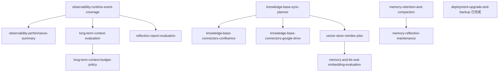

# intelligence-roadmap

> 这份文档是常乐负责能力域的总控板，用来决定后续 OpenSpec 的优先级、依赖顺序和验收边界。

## 目标

把 intelligence / observability / deployment 中由常乐负责或强依赖的模块放到同一张路线图里管理，避免按
spec 零散推进后失去全貌。

本路线图回答三个问题：

- 当前每个能力域做到什么程度。
- MVP 前还必须补哪些缺口。
- 后续 specs 应该按什么依赖顺序和批次推进。

## 范围

纳入本路线图的能力域：

| 能力域 | 文档 | 负责范围 |
| --- | --- | --- |
| Observability | [observability.md](observability.md) | logs、agent traces、source attribution、usage / performance summary |
| Memory | [memory.md](memory.md) | semantic memory、extraction、merge/update/delete、retention / compaction |
| Long-term Context | [long-term-ctx.md](long-term-ctx.md) | memory / KB context selection、token budget、prompt injection |
| Reflection | [reflection.md](reflection.md) | 从 trace / memory / KB 中发现改进建议 |
| Vector Store | [vector-store.md](vector-store.md) | vector backend、embedding / rerank provider、reindex |
| Knowledge Base | [knowledge-base.md](knowledge-base.md) | document ingest、local sync、hybrid retrieval、connectors |
| Deployment / Config | [deployment.md](deployment.md) | on-prem config、backup / upgrade、module runtime prerequisites |

不纳入本路线图直接管理，但会作为依赖引用：

- agent-runtime：产生 runtime events，是 observability 的主要数据源。
- platform / governance：后续展示 trace、审批、用户和 agent 绑定。
- connectors：知识库外部数据源接入的实现归属。

## 状态定义

后续能力状态固定使用以下 5 种，避免状态描述漂移：

| 状态 | 含义 |
| --- | --- |
| 已实现 | 关键用户路径已经完成，默认测试覆盖，短期只需维护 |
| 基础完成 | public API / store / 配置边界已建立，但效果验证、运维或生产化仍有缺口 |
| 部分完成 | 已有可用能力，但关键链路或边界仍明显缺失 |
| 仅设计 | 文档和 spec 已有方向，但没有可依赖实现 |
| 未开始 | 尚未进入设计或实现 |

## 当前能力地图

| 能力 | 当前状态 | 已有基础 | MVP 必补缺口 | 非 MVP 增强 |
| --- | --- | --- | --- | --- |
| Observability foundation | 基础完成 | structured logs、SQLite traces、usage summary、performance summary、source attribution、runtime event coverage、contract tests | 形成面向运维排障的查询入口 | OTel / Prometheus、dashboard UI、告警 |
| Memory semantic store | 基础完成 | SQLite `memory_items`、create/update/delete/ignore、vector index、mock evaluation | retention / compaction；真实 embedding 检索评估 | 自动反思维护、长期质量趋势 |
| Long-term context | 基础完成 | memory / knowledge provider 接入、context source attribution | evaluation 基线；budget policy | 个性化 budget、agent-specific policy |
| Reflection | 基础完成 | 读取 trace / memory 生成建议报告 | report evaluation；maintenance actions 的边界设计 | 自动 skill proposal、自动 memory maintenance |
| Vector store | 基础完成 | public API、namespace、in-memory backend、SQLite backend、embedding / rerank provider abstraction、同步 reindex API | 真实 embedding / rerank evaluation；rerank 接入 KB search | 后台 reindex job runtime、sqlite-vec、Qdrant、OpenSearch adapter |
| Knowledge base | 基础完成 | local ingest、parser、chunking、vector + BM25 + hybrid retrieval、sync planner、evaluation fixture、reindex source iterator | KB scope/binding；KB retrieval 真实 embedding / rerank evaluation；connector MVP 范围决策 | Confluence / Google Drive connectors、graph retrieval |
| Deployment / config | 基础完成 | `settings.yaml`、MCP dedicated server file、legacy config fail-fast、本地 SQLite upgrade / backup 脚本 | config docs 对 intelligence runtime prerequisites 的收敛 | config center、Admin UI、hot reload |

## 依赖顺序

关键约束：

- `observability-runtime-event-coverage` 是 long-term context evaluation、reflection evaluation 和 performance summary 的前置。
- `knowledge-base-sync-planner` 是 Confluence / Google Drive connector 和 vector reindex jobs 的前置。
- `vector-store-reindex-jobs` 已提供同步 rebuild API，是真实 embedding / rerank evaluation 的前置。
- `long-term-context-evaluation` 先于 `long-term-context-budget-policy`。
- `memory-retention-and-compaction` 先于 `memory-reflection-maintenance`。
- Confluence / Google Drive connector 涉及企业数据源认证、权限、同步删除语义和数据边界，进入真实实现前需要人工确认。

## 推荐实施批次

### M1：可观测、可排查

目标：每次 agent 运行的关键行为都有可查询证据，工程师能定位问题。

建议 specs：

1. `observability-runtime-event-coverage`
2. `observability-performance-summary`

完成标准：

- LLM call、tool call、fallback、permission、context compression、final reply 都有 trace event。
- 可以按 run / user / agent / session 查询关键耗时、token、错误、fallback 和工具调用摘要。

已完成的 M1 spec：

- `observability-runtime-event-coverage`：补齐事件源，不做聚合 API。
- `observability-performance-summary`：基于 runtime events 提供 Python 聚合查询 API，不做 UI / rollup。

### M2：可同步、可重建

目标：KB 与 vector store 从“能导入”升级为“能维护和运维”。

建议 specs：

1. `knowledge-base-sync-planner`
2. `vector-store-reindex-jobs`（同步 public API；不含后台 job platform）
3. `deployment-upgrade-and-backup`（已完成：本地 SQLite backup / dry-run / backup-only / Alembic upgrade）

完成标准：

- KB sync 有 plan/execute separation、幂等状态和失败隔离。
- embedding / backend 切换后可通过同步 public API 重建 memory / KB index。
- 本地 SQLite / config / data 目录有最小备份与升级流程；migration 失败保留 backup，恢复由 operator 手动执行。

### M3：可评估

目标：核心 intelligence 能力的效果不只靠人工感觉判断。

建议 specs：

1. `long-term-context-evaluation`
2. `reflection-report-evaluation`
3. `memory-and-kb-real-embedding-evaluation`

完成标准：

- `tests/evaluation/` 能评估 memory extraction、KB retrieval、long-term context injection 和 reflection findings。
- 默认 evaluation 不依赖真实 LLM / embedding；真实模型评估通过显式环境变量手动开启。
- 每个 evaluation fixture 有 expected / forbidden 输出，能回归质量变化。
- `memory-and-kb-real-embedding-evaluation` 同时覆盖 memory semantic retrieval 和 KB retrieval，不默认连接外部模型。

### M4：可维护、可演进

目标：长期运行后不会因为记忆、知识库和反思数据增长而失控。

建议 specs：

1. `memory-retention-and-compaction`
2. `long-term-context-budget-policy`
3. `memory-reflection-maintenance`

完成标准：

- memory 有 retention、compaction 和容量边界。
- long-term context 有可解释的 token budget 策略。
- reflection 的建议能进入受控 maintenance 流程，而不是自动无约束改写。

### M4b：企业知识源接入

目标：把 KB 从 local directory baseline 扩展到客户真实企业知识源，同时不绕过 sync planner 和数据边界。

建议 specs：

1. `knowledge-base-connectors-confluence`
2. `knowledge-base-connectors-google-drive`

完成标准：

- 外部 connector 基于 sync planner 接入，不绕过 KB public API。
- connector 明确认证方式、权限边界、source metadata、删除语义和失败恢复行为。
- 默认测试不连接真实 SaaS；真实 connector smoke 通过显式环境变量手动开启。

是否将 Confluence / Google Drive connector 纳入 MVP，需要在 connector spec 前单独确认。当前 KB MVP baseline 是
local directory + sync planner + hybrid retrieval + reindex。

## Goal 自动推进边界

适合在 goal 中按依赖顺序自动设计、review、执行、合并归档的 specs：

1. `long-term-context-evaluation`
2. `memory-retention-and-compaction`
3. `reflection-report-evaluation`
4. `memory-and-kb-real-embedding-evaluation`

这些 specs 的默认范围应保持为 evaluation / lifecycle / 运维地基，不改变 runtime 默认行为，不默认调用真实外部模型，
不自动删除或改写用户数据。

需要人工确认后再推进真实实现的 specs：

1. `long-term-context-budget-policy`：会改变 memory / KB / recent conversation 的注入策略和 token 分配。
2. `memory-reflection-maintenance`：涉及 reflection 对 memory 的合并、压缩、删除或写回权限。
3. `knowledge-base-connectors-confluence`：涉及企业数据源认证、权限、删除语义和数据边界。
4. `knowledge-base-connectors-google-drive`：涉及企业数据源认证、权限、删除语义和数据边界。

如果 connector spec 只定义 connector contract / fake connector / fixture，而不接真实 Confluence 或 Google Drive，
可以先自动推进；一旦进入真实 SaaS API、OAuth / service account、ACL 或客户数据同步行为，必须人工确认。

## 并行策略

可以并行：

- `observability-runtime-event-coverage` 和 `knowledge-base-sync-planner`
- `memory-retention-and-compaction` 和 `knowledge-base-sync-planner`
- 已完成的 `deployment-upgrade-and-backup` 不阻塞 intelligence specs
- `long-term-context-evaluation` 和 `reflection-report-evaluation`
- `memory-retention-and-compaction` 和 `long-term-context-evaluation`
- connector contract / fake connector 设计可以和 evaluation specs 并行，但真实 connector 实现前需要人工确认

不建议提前做：

- Confluence / Google Drive connector 早于 `knowledge-base-sync-planner`
- `long-term-context-budget-policy` 早于 `long-term-context-evaluation`
- `memory-reflection-maintenance` 早于 `memory-retention-and-compaction`
- reflection 自动化写回早于 `reflection-report-evaluation`
- `rerank-kb-search-integration` 早于 `memory-and-kb-real-embedding-evaluation`

## MVP-ready 判定

常乐负责的模块可以认为 MVP-ready，当且仅当：

- Observability 能解释一次 agent run 的主要行为、成本、耗时和错误。
- Memory 能跨 session 提取、更新、检索，并有 retention 边界。
- Knowledge base 能导入本地企业文档、混合检索，并能计划/执行同步；vector store 能重建索引。
  Confluence / Google Drive 是否属于 MVP-ready 条件，需要在 connector specs 前单独确认。
- Long-term context 能从 memory / KB 中选择上下文，并有 evaluation 证明注入效果。
- Reflection 能生成可评估的报告，但自动写回保持关闭或受控。
- Vector store 能持久化索引，并支持 embedding / backend 变更后的 reindex。
- 默认测试不依赖外部 LLM / embedding / SaaS；真实模型效果验证有手动开关和 fixture。

## 后续维护规则

- 新增 intelligence 相关 spec 前，必须在本 roadmap 中标明所属批次和解锁关系。
- capability 文档状态变化时，同步更新本 roadmap 的“当前能力地图”。
- 每完成一个批次，重新评估下一批是否仍然是最高优先级。
- 不把探索性想法直接推进为实现 spec；先确认它解决哪个 MVP 缺口。
