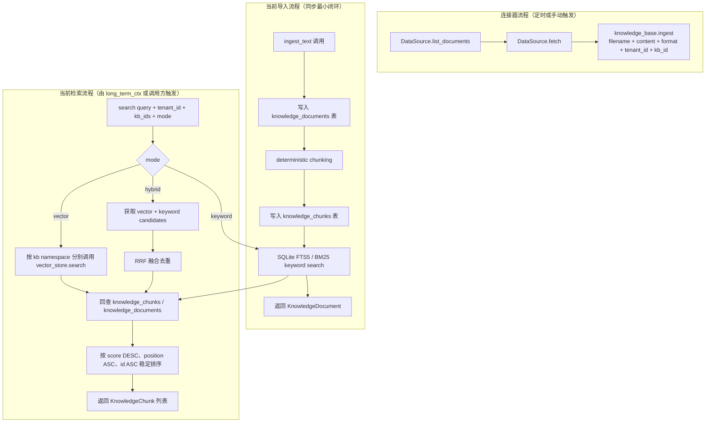

# knowledge-base

> 写作提醒：功能描述只写可观察的行为，不写内部实现细节。验收标准只写端到端可验证的行为。

## 概述

企业文档知识的导入、索引与检索，让 agent 能够基于企业内部文档回答问题。

**当前负责**：手动 text / markdown 内容导入、deterministic chunking、向量索引构建、SQLite FTS5/BM25 关键词索引、vector / keyword / hybrid 检索模式、按 tenant + knowledge base 隔离召回相关文档片段。

**后续负责**：数据源接入与文档获取、文档解析、实体与关系提取、图谱存储、同步规划。

**不负责**：注入 system prompt 的协调与 token 预算（→ long_term_ctx）、用户个人记忆（→ memory）。

**调用关系**：
- 依赖：vector_store（向量索引）、config
- 被依赖：long_term_ctx（检索注入内容）、reflection（只读，观察召回质量）

**模块归属**：
- owning package：`intelligence.knowledge_base`
- public API：`ingest_text(filename, content, tenant_id, kb_id, source, source_url)`、`search(query, tenant_id, kb_ids, limit, mode)`、`delete(document_id)`
- owned tables：`knowledge_bases`、`knowledge_documents`、`knowledge_chunks`、`knowledge_chunks_fts`
- config namespace：`knowledge_base.*`

## 关键流程



## 数据模型

```sql
-- 文档元数据
knowledge_documents (
  id          TEXT PRIMARY KEY,  -- UUID
  filename    TEXT,
  tenant_id   TEXT,              -- 租户标识；私有化单企业部署默认 "default"
  kb_id       TEXT,              -- 租户内知识库标识，如 "global" / "sales" / "support"
  source      TEXT,              -- 来源标识（当前默认 "manual"）
  source_url  TEXT,              -- 原始文档 URL 或路径（可选，供溯源用）
  created_at  DATETIME
)

-- 分块内容
knowledge_chunks (
  id          TEXT PRIMARY KEY,  -- document_id:chunk:{position}，同时作为 vector_store 的 key
  document_id TEXT,              -- → knowledge_documents.id
  tenant_id   TEXT,
  kb_id       TEXT,
  content     TEXT,              -- chunk 文本
  position    INTEGER,           -- chunk 在文档中的顺序
  created_at  DATETIME
)

-- 关键词索引，由 knowledge-base 模块通过 Alembic 管理
knowledge_chunks_fts USING fts5 (
  chunk_id    UNINDEXED,
  tenant_id   UNINDEXED,
  kb_id       UNINDEXED,
  content,
  tokenize='unicode61'
)
```

向量 embedding 存储在 vector_store，namespace 格式为 `kb:{tenant_id}:{kb_id}`：
- chunk 向量：以 `chunk.id` 为 key

知识库身份由 `tenant_id + kb_id` 共同决定。当前默认 `tenant_id="default"`、`kb_id="global"`；检索时在指定 namespace 内分别查询后合并排序。

## 接口定义

```python
@dataclass
class KnowledgeDocument:
    id: str
    tenant_id: str
    kb_id: str
    filename: str
    source: str
    source_url: str | None


@dataclass
class KnowledgeChunk:
    id: str
    document_id: str
    tenant_id: str
    kb_id: str
    filename: str
    content: str
    position: int
    score: float  # vector_store 返回的相似度分数


async def ingest_text(
    filename: str,
    content: str,
    tenant_id: str | None = None,
    kb_id: str | None = None,
    source: str = "manual",
    source_url: str | None = None,
) -> KnowledgeDocument:
    """导入 plain text / markdown 内容，同步完成分块与向量索引。"""


async def search(
    query: str,
    tenant_id: str,
    kb_ids: list[str],
    limit: int = 10,
    mode: Literal["vector", "keyword", "hybrid"] = "vector",
) -> list[KnowledgeChunk]:
    """按指定模式检索文档片段，默认保持 vector-only 兼容行为。"""


async def delete(document_id: str) -> None:
    """删除文档及其所有 chunk 和对应向量。"""
```

`mode` 取值：
- `vector`：仅调用 `vector_store.search`，适合语义相似度召回。
- `keyword`：仅使用 SQLite FTS5 / BM25，适合产品编号、错误码、专有名词等精确词召回。
- `hybrid`：同时取 vector 与 keyword candidates，用 RRF 融合去重后返回。

hybrid search 当前不调用 rerank provider，不包含 query planner、graph search，也不依赖 OpenSearch / Elasticsearch / LanceDB。

## 现状

**已完成 core + hybrid 闭环**：`knowledge-base-core` 实现了 `intelligence.knowledge_base` runtime package、基础 Alembic 表、手动 text/markdown ingest、deterministic chunking、vector-only search、delete，以及 long-term-ctx built-in provider 接入；`knowledge-base-hybrid-search` 增加了 knowledge-base-owned SQLite FTS5 keyword index、keyword mode、hybrid mode 和 RRF 融合。

团队已有独立的 [knowledge-bridge](../../../knowledge-bridge) 项目，覆盖了大部分核心功能，但技术栈与 fleetent 约束不兼容，不能直接作为依赖引入。实施策略：**有选择地迁移设计资产和小块算法**，而非从零重写或整体搬运。

迁移评估见 [knowledge-bridge 迁移计划](../knowledge-bridge-migration-plan.md)。knowledge-base 将按拆分 specs 渐进实现：已先完成 `knowledge-base-core` 的手动导入、分块、向量索引和基础 search 闭环，并完成 `knowledge-base-hybrid-search` 的 SQLite FTS5 / BM25 与 RRF 融合；后续再依次推进 parser、local connector、sync planner、Confluence / Google Drive connector、graph search 和 retrieval audit。

当前未实现内容：
- 无 parser framework，仅接受调用方传入的 plain text / markdown string
- 无 local directory、Confluence、Google Drive connector
- 无 sync planner、后台 job、admin UI、REST upload API
- 无 rerank / query planner
- 无 graph_search、entities、relations 或 `kb_extraction`

**后续可迁移参考（knowledge-bridge 已实现，但需按 fleetent specs 分批适配）**：
- ✅ 文档解析思路：text / Markdown / HTML / section-first 归并优先；PDF / DOCX / PPTX / Google Docs / Google Sheets 后续逐项评估依赖；图片 / VLM 暂缓
- ✅ Confluence 连接器算法：分页、增量 token、限速和 429 backoff；接口必须重写为 fleetent `DataSource`
- ✅ Google Drive 连接器算法：OAuth 2.0、Service Account、change token、删除确认；Webhook 暂缓
- ✅ 本地目录连接器：遍历、后缀映射、mtime/hash 变更检测；去掉 LlamaIndex `BaseReader`
- ✅ 中文 BM25 分词思路：jieba + CJK bigram（`retrieval/lexical.py`），在 SQLite FTS5 下重新验证
- ✅ 同步规划器动作模型：SKIP / UPSERT_METADATA_ONLY / REEMBED / RECHUNK_LOCAL / REFETCH_AND_REINDEX / DELETE_LOCAL

**需要重写（深度耦合 LlamaIndex 或违反 fleetent 约束）**：
- 向量存储：LanceDB → fleetent `vector_store` public API（当前可用普通 SQLite persistent backend；sqlite-vec / Qdrant 后置）
- Embedding：OpenAI Embeddings API（云托管，禁止默认）→ fleetent HTTP embedding provider，生产配置指向自托管 bge-m3 / multilingual-e5 等模型服务
- 分块器：逻辑参考 knowledge-bridge，但 `TextNode` 类型替换为 fleetent 自定义 dataclass
- 检索引擎：逻辑参考，接口对齐 `search()` / `graph_search()`

**全新实现（knowledge-bridge 没有）**：
- 实体与关系提取（`kb_extraction` task）
- 图谱存储（entities / relations 表）与 `graph_search()`

## 当前缺口

- parser / connector / sync 能力尚未开始：当前只接受调用方传入的 text / markdown string。
- 检索已支持 SQLite FTS5/BM25 keyword mode 与 RRF hybrid mode；尚未实现 rerank、query planner、graph 或 benchmark fixture。
- 外部数据源暂未接入：local directory、Confluence、Google Drive 均未实现。
- long-term-ctx 只支持内置默认 KB provider；还没有 agent 到多 KB 的绑定策略。

## 下一批候选 specs

- `knowledge-base-parsers-basic`
- `knowledge-base-connectors-local`
- `knowledge-base-hybrid-search`
- `knowledge-base-retrieval-evaluation`

## 自动化效果验证缺口

- 构造小型企业文档 fixture，覆盖中文、英文、标题层级、表格文本和重复内容。
- 验证 chunking 后 query 能命中 expected chunk。
- 对比 vector-only、BM25-only、hybrid RRF 的召回质量。
- 验证 tenant + kb namespace 隔离。

## 服务化 / 目录边界判断

knowledge-base 是未来最有独立服务潜力的模块，因为它会包含连接器、同步任务、解析、索引和检索。
但当前应先在 modular monolith 内建立 `intelligence.knowledge_base` 目录和 public API，等 ingest/search/sync
边界稳定后再考虑独立进程或服务。

## 规划中（v1.0）

- [ ] **数据源连接器**：通过统一 `DataSource` 接口接入不同来源的文档
  - **文件直传**：管理员通过 API 直接上传文件（Markdown / 纯文本 / PDF）
  - **Confluence Server/DC**：通过 Confluence REST API 拉取页面，使用 `atlassian-python-api`
  - **本地目录**：扫描指定目录，监听文件变更，适合 NFS / 共享盘场景
  - **Google Drive**：通过 Drive API v3 拉取文件，使用 `google-api-python-client`；Google Docs 通过 Export API 导出为 HTML 再解析；需要 per-tenant OAuth 2.0 token 存储与刷新
  - 新增数据源只需实现 `DataSource` 接口，不改核心导入逻辑

- [ ] **文档解析**：将原始文件内容转换为干净文本，再进入分块流程
  - Markdown / 纯文本：直接处理，无需额外依赖
  - PDF：使用 `pymupdf`（轻量，仅处理 PDF）
  - HTML（来自 Confluence 等）：使用 `beautifulsoup4` 清洗标签
  - 解析结果统一为纯文本，再交给分块逻辑

- [ ] **文档导入**：解析后的文本写入知识库
  - 导入后异步处理（分块 + embedding + 图提取），不阻塞调用方

- [ ] **分块与向量索引**：文档内容分块后写入 vector_store
  - 每个 chunk 保留来源文档信息（filename、position）
  - 分块策略见待决问题

- [ ] **实体与关系提取**：分块完成后，用 LLM 从文档提取实体和关系写入图谱
  - 使用 model_router 的 `kb_extraction` task，默认路由到轻量模型
  - entity 描述同时写入 vector_store，用于图检索的入口定位
  - 提取在后台执行，与分块并行触发

- [ ] **混合检索（Hybrid Search）**：BM25 关键词检索与向量语义检索并行，RRF 融合排序后返回
  - 对外接口兼容扩展：`search(query: str, tenant_id: str, kb_ids: list[str], mode="hybrid") → list[KnowledgeChunk]`
  - BM25 擅长精确词匹配（产品编号、人名、专有名词），当前实现使用 SQLite FTS5（内置，无需额外服务）
  - 向量检索负责语义相似度和同义词
  - RRF（Reciprocal Rank Fusion）合并两路排序结果，无需调权重参数

- [ ] **图增强检索**：从相关实体出发，按关系图谱展开，收集关联 chunk
  - 对外接口：`graph_search(query: str, tenant_id: str, kb_ids: list[str], depth: int) → KnowledgeGraphResult`
  - 适合关系型查询（"X 和 Y 是什么关系？"、"谁负责 Z？"）
  - depth 控制关系展开层数，默认 2 层，防止结果爆炸
  - 图数据存储在 SQLite（entities + relations 表），不需要独立图数据库

- [ ] **作用域隔离**：通过多 KB + agent 绑定实现访问控制
  - 按内容敏感度或部门建立多个 KB（如 Company-Wide / Engineering / HR / Finance）
  - agent 绑定到一个或多个 KB，检索时只访问绑定的 KB
  - 公共内容放 Company-Wide KB，多个 agent 同时绑定；部门内容放部门 KB，只有对应 agent 可见
  - 真正高度敏感的数据（个人薪资、绩效记录等）不进知识库，由结构化系统管理

## 验收标准

**场景 1：文档导入后可被检索**
- Given：管理员导入一份 Markdown 文档
- When：用户提问与文档内容相关
- Then：long_term_ctx 通过 knowledge_base.search() 召回相关片段，agent 回答中体现文档内容

**场景 2：导入生成稳定 chunks**
- Given：调用方导入一段 text / markdown 内容
- When：chunk_size 和 chunk_overlap 固定
- Then：生成的 chunk 内容和 position 保持 deterministic

**场景 3：作用域隔离**
- Given：不同 tenant 或不同 `kb_id` 中存在相似内容
- When：调用 search(query, tenant_id, kb_ids)
- Then：只召回指定 tenant 和 kb 范围内的文档片段

**场景 4：文档删除**
- Given：已导入并可检索的文档
- When：调用 delete(document_id)
- Then：该文档的所有 chunk 不再出现在检索结果中，对应 vector entries 被删除

## 测试边界

**需要单元测试的行为**：
- public API 可导入：`KnowledgeDocument`、`KnowledgeChunk`、`ingest_text()`、`search()`、`delete()`
- 配置默认值：`knowledge_base.enabled=false`，默认 tenant/kb 与 chunk 参数稳定

**需要集成测试的行为**：
- Alembic fresh upgrade 创建 `knowledge_bases`、`knowledge_documents`、`knowledge_chunks`
- ingest_text 保存 document、生成 deterministic chunks，并逐 chunk 调用 vector_store.upsert
- 空内容 fail fast
- search 按 `kb:{tenant_id}:{kb_id}` namespace 调用 vector_store，支持多 kb 合并与稳定排序
- keyword search 可命中产品编号、错误码等精确词，并保持 tenant/kb 隔离
- hybrid search 合并 vector 与 keyword candidates，同一 chunk 去重并通过 RRF 提升双命中结果
- knowledge base 隔离：不同 `tenant_id + kb_id` 的检索结果互不干扰
- delete 级联：删除文档后对应 chunk 和 vector entries 均被清理
- long-term-ctx 在 `knowledge_base.enabled=true` 时调用内置 provider；disabled 或无结果时降级

**需要 mock / monkeypatch 的依赖**：
- `vector_store`：隔离向量索引读写
- SQLite DB 路径：`monkeypatch` 到 `tmp_path`，绝不触碰 data/

## 待决问题

- [ ] 分块策略：固定 token 大小（如 512 tokens，overlap 50）vs 语义分块（按段落/标题）？（负责人：待认领）
- [ ] 文档更新机制：重新导入同名文档时覆盖旧 chunk 和图数据，还是版本化保留？（负责人：待认领）
- [ ] 默认作用域粒度：per-tenant 还是 per-agent？（负责人：待认领）
- [ ] 实体类型预定义：实体类型（person / org / concept 等）由 LLM 自由生成，还是预定义枚举？自由生成灵活但类型不一致，预定义可控但覆盖不全。（负责人：待认领）
- [ ] graph_search 与 search 的调用决策：由 long_term_ctx 根据 query 类型选择，还是总是并行调用两者再合并？（负责人：待认领）
- [ ] 图提取时机：与分块同批次触发，还是分块后单独排队？大文档图提取耗时较长，影响何时可检索。（负责人：待认领）
- [ ] PDF 解析库选型：`pymupdf`（轻量，仅 PDF）还是 `unstructured`（重但覆盖更多格式）？如需支持 DOCX/PPTX 等格式，`unstructured` 更合适。（负责人：待认领）
- [ ] Confluence 连接器认证方式：API Token（Confluence Cloud）vs Basic Auth（Server/DC）？优先支持哪种？（负责人：待认领）
- [ ] Google Drive OAuth token 存储：token 存在哪里（SQLite per-tenant）？刷新失败时如何通知管理员重新授权？（负责人：待认领）
- [ ] 数据源同步策略：连接器是全量重新导入，还是增量同步（只处理变更文档）？（负责人：待认领）
- [ ] 文档级 ACL（v2.0）：当前用多 KB + agent 绑定控制访问。如需更细粒度（同一 KB 内不同文档对不同用户可见），需引入文档级权限字段和检索时过滤逻辑。（负责人：待认领）
