# knowledge-base

> 写作提醒：功能描述只写可观察的行为，不写内部实现细节。验收标准只写端到端可验证的行为。

## 概述

企业文档知识的导入、索引与检索，让 agent 能够基于企业内部文档回答问题。

**负责**：数据源接入与文档获取、文档解析与分块、向量索引构建、实体与关系提取、图谱存储、按 tenant + knowledge base 隔离召回相关文档片段（支持混合检索和图增强检索）。

**不负责**：注入 system prompt 的协调与 token 预算（→ long_term_ctx）、用户个人记忆（→ memory）。

**调用关系**：
- 依赖：vector_store（向量索引）、model_router（`kb_extraction` task，实体提取）、config
- 被依赖：long_term_ctx（检索注入内容）、reflection（只读，观察召回质量）

**模块归属**：
- owning package：`intelligence.knowledge_base`
- public API：`ingest(filename, content, format, tenant_id, kb_id)`、`search(query, tenant_id, kb_ids, limit)`、`graph_search(query, tenant_id, kb_ids, depth)`、`delete(document_id)`、`DataSource`
- owned tables：`documents`、`chunks`、`chunks_fts`、`entities`、`relations`
- config namespace：`knowledge_base.*`

## 关键流程

```mermaid
flowchart TD
    subgraph connector["连接器流程（定时或手动触发）"]
        C1[DataSource.list_documents] --> C2[DataSource.fetch]
        C2 --> C3[knowledge_base.ingest\nfilename + content + format + tenant_id + kb_id]
    end

    subgraph ingest["导入流程（异步，导入请求立即返回）"]
        A[ingest 调用] --> B[写入 documents 表]
        B --> C[立即返回 document_id]
        B --> D[后台：分块]
        D --> E[写入 chunks 表]
        E --> E2[同步写入 chunks_fts\nBM25 索引]
        E --> F[vector_store.upsert\nchunk_id + content + namespace]
        D --> G[LLM 提取实体与关系]
        G --> H[写入 entities 表]
        G --> I[写入 relations 表]
        H --> J[vector_store.upsert\nentity_id + description + namespace]
    end

    subgraph hybrid_search["混合检索（由 long_term_ctx 触发）"]
        K[search query + tenant_id + kb_ids] --> L[并行]
        L --> L1[vector_store.search\n语义检索]
        L --> L2[BM25 检索\n关键词精确匹配\n实现：SQLite FTS5]
        L1 --> M[RRF 融合排序]
        L2 --> M
        M --> N[返回 KnowledgeChunk 列表]
    end

    subgraph graph_search["图增强检索（关系型查询）"]
        O[graph_search query + tenant_id + kb_ids] --> P[vector_store.search entities]
        P --> Q[匹配相关实体]
        Q --> R[遍历 relations 表\n按 depth 展开]
        R --> S[收集关联 chunk]
        S --> T[返回 KnowledgeGraphResult]
    end
```



## 数据模型

```sql
-- 文档元数据
documents (
  id          TEXT PRIMARY KEY,  -- UUID
  filename    TEXT,
  tenant_id   TEXT,              -- 租户标识；私有化单企业部署默认 "default"
  kb_id       TEXT,              -- 租户内知识库标识，如 "global" / "sales" / "support"
  format      TEXT,              -- "markdown" | "text" | "pdf"
  source      TEXT,              -- 来源标识（"upload" | "confluence" | "local_dir" | ...）
  source_url  TEXT,              -- 原始文档 URL 或路径（可选，供溯源用）
  created_at  DATETIME,
  updated_at  DATETIME
)

-- 分块内容
chunks (
  id          TEXT PRIMARY KEY,  -- UUID，同时作为 vector_store 的 key
  document_id TEXT,              -- → documents.id
  content     TEXT,              -- chunk 文本
  position    INTEGER,           -- chunk 在文档中的顺序
  created_at  DATETIME
)

-- 全文索引（SQLite FTS5 虚拟表，与 chunks 表同步写入）
chunks_fts USING fts5 (
  content,                       -- 索引 chunks.content
  content="chunks",              -- 关联原表，content rowid 对应 chunks rowid
  tokenize="unicode61"           -- 支持中英文混合
)

-- 实体（从文档中 LLM 提取）
entities (
  id          TEXT PRIMARY KEY,  -- UUID，同时作为 vector_store 的 key
  document_id TEXT,              -- → documents.id，来源文档
  name        TEXT,              -- 实体名称
  type        TEXT,              -- 实体类型（person / org / concept / product / ...）
  description TEXT,              -- 实体描述，作为 embedding 文本
  tenant_id   TEXT,              -- 与 documents.tenant_id 一致，用于隔离
  kb_id       TEXT,              -- 与 documents.kb_id 一致，用于隔离
  created_at  DATETIME
)

-- 关系（实体间关系，从文档中 LLM 提取）
relations (
  id          TEXT PRIMARY KEY,  -- UUID
  source_id   TEXT,              -- → entities.id
  target_id   TEXT,              -- → entities.id
  relation    TEXT,              -- 关系描述（如 "负责" / "属于" / "依赖"）
  document_id TEXT,              -- → documents.id，关系来源文档
  created_at  DATETIME
)
```

向量 embedding 存储在 vector_store，namespace 格式为 `kb:{tenant_id}:{kb_id}`：
- chunk 向量：以 `chunk.id` 为 key
- entity 向量：以 `entity.id` 为 key（用于图检索入口定位）

知识库身份由 `tenant_id + kb_id` 共同决定。v1.0 即使主要面向私有化单企业部署，也保留 `tenant_id` 字段，默认值为 `"default"`；同一企业内可同时存在公司全局知识库和多个部门知识库。Agent 通过配置绑定一个或多个 `kb_id`，检索时在这些 namespace 内分别查询后合并排序。

## 接口定义

```python
@dataclass
class DocumentRef:
    id: str        # 数据源内的唯一标识（如 Confluence page_id）
    filename: str  # 文件名或标题
    format: str    # "markdown" | "text" | "pdf" | "html"
    url: str       # 原始文档 URL 或路径（供溯源）


class DataSource:
    """数据源连接器基类，每种数据源实现此接口。"""

    async def list_documents(self) -> list[DocumentRef]:
        """列举数据源中所有可导入的文档。"""

    async def fetch(self, ref: DocumentRef) -> bytes:
        """获取文档原始内容。"""


@dataclass
class KnowledgeChunk:
    id: str
    document_id: str
    filename: str
    content: str
    score: float  # vector_store 返回的相似度分数


@dataclass
class KnowledgeGraphResult:
    chunks: list[KnowledgeChunk]   # 关联的文档片段
    entities: list[str]            # 匹配到的实体名称（展示用）
    relations: list[str]           # 关系描述列表（如 "A 负责 B"，展示用）


async def ingest(
    filename: str,
    content: bytes,
    format: str,
    tenant_id: str,
    kb_id: str,
) -> str:
    """导入文档，异步执行分块、embedding 和图提取。立即返回 document_id，后台处理不阻塞。"""


async def search(
    query: str,
    tenant_id: str,
    kb_ids: list[str],
    limit: int = 10,
) -> list[KnowledgeChunk]:
    """向量相似度检索，返回最相关的文档片段。适合事实型问答。由 long_term_ctx 调用。"""


async def graph_search(
    query: str,
    tenant_id: str,
    kb_ids: list[str],
    depth: int = 2,
) -> KnowledgeGraphResult:
    """图增强检索：定位相关实体后按关系展开，返回关联片段与关系链。适合关系型查询。由 long_term_ctx 调用。"""


async def delete(document_id: str) -> None:
    """删除文档及其所有 chunk、实体、关系和对应向量。"""
```

## 现状

团队已有独立的 [knowledge-bridge](../../../knowledge-bridge) 项目，覆盖了大部分核心功能，但技术栈与 fleetent 约束不兼容，不能直接作为依赖引入。实施策略：**有选择地迁移代码**，而非从零重写。

**可直接迁移（knowledge-bridge 已实现，无 LlamaIndex 依赖）**：
- ✅ 文档解析器：HTML / Markdown / PDF / DOCX / PPTX / Google Docs / Google Sheets / 图片（换输出类型即可）
- ✅ Confluence 连接器：分页、增量同步、限速逻辑
- ✅ Google Drive 连接器：OAuth 2.0 认证、Service Account、变更 token 增量同步、Webhook
- ✅ 本地目录连接器
- ✅ 中文 BM25 分词：jieba + RagFlow 方式（`retrieval/lexical.py`）
- ✅ 同步规划器：6 种动作模型（SKIP / UPSERT_METADATA_ONLY / REEMBED / RECHUNK_LOCAL / REFETCH_AND_REINDEX / DELETE_LOCAL）

**需要重写（深度耦合 LlamaIndex 或违反 fleetent 约束）**：
- 向量存储：LanceDB → fleetent `vector_store`（sqlite-vec / Qdrant）
- Embedding：OpenAI Embeddings API（云托管，禁止）→ 自托管 bge-m3 / multilingual-e5
- 分块器：逻辑参考 knowledge-bridge，但 `TextNode` 类型替换为 fleetent 自定义 dataclass
- 检索引擎：逻辑参考，接口对齐 `search()` / `graph_search()`

**全新实现（knowledge-bridge 没有）**：
- 实体与关系提取（`kb_extraction` task）
- 图谱存储（entities / relations 表）与 `graph_search()`

## 规划中（v1.0）

- [ ] **数据源连接器**：通过统一 `DataSource` 接口接入不同来源的文档
  - **文件直传**：管理员通过 API 直接上传文件（Markdown / 纯文本 / PDF）
  - **Confluence Server/DC**：通过 Confluence REST API 拉取页面，使用 `atlassian-python-api`
  - **本地目录**：扫描指定目录，监听文件变更，适合 NFS / 共享盘场景
  - **Google Drive**：通过 Drive API v3 拉取文件，使用 `google-api-python-client`；Google Docs 通过 Export API 导出为 HTML 再解析；需要 per-tenant OAuth 2.0 token 存储与刷新
  - 新增数据源只需实现 `DataSource` 接口，不改核心导入逻辑

- [ ] **文档解析**：将原始文件内容转换为干净文本，再进入分块流程
  - Markdown / 纯文本：直接处理，无需额外依赖
  - PDF：使用 `pymupdf`（轻量，仅处理 PDF）
  - HTML（来自 Confluence 等）：使用 `beautifulsoup4` 清洗标签
  - 解析结果统一为纯文本，再交给分块逻辑

- [ ] **文档导入**：解析后的文本写入知识库
  - 导入后异步处理（分块 + embedding + 图提取），不阻塞调用方

- [ ] **分块与向量索引**：文档内容分块后写入 vector_store
  - 每个 chunk 保留来源文档信息（filename、position）
  - 分块策略见待决问题

- [ ] **实体与关系提取**：分块完成后，用 LLM 从文档提取实体和关系写入图谱
  - 使用 model_router 的 `kb_extraction` task，默认路由到轻量模型
  - entity 描述同时写入 vector_store，用于图检索的入口定位
  - 提取在后台执行，与分块并行触发

- [ ] **混合检索（Hybrid Search）**：BM25 关键词检索与向量语义检索并行，RRF 融合排序后返回
  - 对外接口不变：`search(query: str, tenant_id: str, kb_ids: list[str]) → list[KnowledgeChunk]`
  - BM25 擅长精确词匹配（产品编号、人名、专有名词），当前实现使用 SQLite FTS5（内置，无需额外服务）
  - 向量检索负责语义相似度和同义词
  - RRF（Reciprocal Rank Fusion）合并两路排序结果，无需调权重参数

- [ ] **图增强检索**：从相关实体出发，按关系图谱展开，收集关联 chunk
  - 对外接口：`graph_search(query: str, tenant_id: str, kb_ids: list[str], depth: int) → KnowledgeGraphResult`
  - 适合关系型查询（"X 和 Y 是什么关系？"、"谁负责 Z？"）
  - depth 控制关系展开层数，默认 2 层，防止结果爆炸
  - 图数据存储在 SQLite（entities + relations 表），不需要独立图数据库

- [ ] **作用域隔离**：通过多 KB + agent 绑定实现访问控制
  - 按内容敏感度或部门建立多个 KB（如 Company-Wide / Engineering / HR / Finance）
  - agent 绑定到一个或多个 KB，检索时只访问绑定的 KB
  - 公共内容放 Company-Wide KB，多个 agent 同时绑定；部门内容放部门 KB，只有对应 agent 可见
  - 真正高度敏感的数据（个人薪资、绩效记录等）不进知识库，由结构化系统管理

## 验收标准

**场景 1：文档导入后可被检索**
- Given：管理员导入一份 Markdown 文档
- When：用户提问与文档内容相关
- Then：long_term_ctx 通过 knowledge_base.search() 召回相关片段，agent 回答中体现文档内容

**场景 2：导入不阻塞**
- Given：管理员上传一份较大的 PDF
- When：导入请求返回
- Then：API 立即返回 document_id，分块与 embedding 在后台执行

**场景 3：作用域隔离**
- Given：agent A 和 agent B 分别绑定同一 tenant 下不同 `kb_id` 的知识库
- When：两个 agent 分别检索相同 query
- Then：各自只召回自己绑定知识库内的文档片段，互不干扰

**场景 4：文档删除**
- Given：已导入并可检索的文档
- When：管理员调用 delete(document_id)
- Then：该文档的所有 chunk 及其实体、关系不再出现在任何检索结果中

**场景 5：图增强检索返回关系链**
- Given：知识库中有文档描述 "Alice 负责项目 Orion，Bob 是 Alice 的上级"
- When：用户提问 "谁可以审批 Orion 项目？"
- Then：graph_search 通过实体 "Orion" → 关系 "负责" → "Alice" → 关系 "上级" → "Bob" 展开，返回包含 Bob 和审批信息的相关 chunk

## 测试边界

**需要单元测试的行为**：
- 导入异步性：ingest() 立即返回，分块、embedding 和图提取均在后台执行
- knowledge base 隔离：不同 `tenant_id + kb_id` 的检索结果（向量和图）互不干扰
- delete 级联：删除文档后对应 chunk、entity、relation 均不出现在检索结果中
- chunk 来源关联：KnowledgeChunk 返回正确的 filename 和 position
- BM25 精确匹配：含精确关键词的 chunk 在 search() 结果中排名靠前
- RRF 融合：向量和 BM25 各自命中的 chunk 都出现在合并结果中，不互相覆盖
- 图遍历 depth：graph_search(depth=1) 只返回直接关联实体，不展开二级
- graph_search 隔离：不同 `tenant_id + kb_id` 的实体和关系不互通

**需要 mock 的依赖**：
- `vector_store`：隔离向量索引读写
- `model_router.get_async_client_and_config`：隔离实体提取 LLM 调用
- SQLite DB 路径：`monkeypatch` 到 `tmp_path`，绝不触碰 data/

## 待决问题

- [ ] 分块策略：固定 token 大小（如 512 tokens，overlap 50）vs 语义分块（按段落/标题）？（负责人：待认领）
- [ ] 文档更新机制：重新导入同名文档时覆盖旧 chunk 和图数据，还是版本化保留？（负责人：待认领）
- [ ] 默认作用域粒度：per-tenant 还是 per-agent？（负责人：待认领）
- [ ] 实体类型预定义：实体类型（person / org / concept 等）由 LLM 自由生成，还是预定义枚举？自由生成灵活但类型不一致，预定义可控但覆盖不全。（负责人：待认领）
- [ ] graph_search 与 search 的调用决策：由 long_term_ctx 根据 query 类型选择，还是总是并行调用两者再合并？（负责人：待认领）
- [ ] 图提取时机：与分块同批次触发，还是分块后单独排队？大文档图提取耗时较长，影响何时可检索。（负责人：待认领）
- [ ] PDF 解析库选型：`pymupdf`（轻量，仅 PDF）还是 `unstructured`（重但覆盖更多格式）？如需支持 DOCX/PPTX 等格式，`unstructured` 更合适。（负责人：待认领）
- [ ] Confluence 连接器认证方式：API Token（Confluence Cloud）vs Basic Auth（Server/DC）？优先支持哪种？（负责人：待认领）
- [ ] Google Drive OAuth token 存储：token 存在哪里（SQLite per-tenant）？刷新失败时如何通知管理员重新授权？（负责人：待认领）
- [ ] 数据源同步策略：连接器是全量重新导入，还是增量同步（只处理变更文档）？（负责人：待认领）
- [ ] 文档级 ACL（v2.0）：当前用多 KB + agent 绑定控制访问。如需更细粒度（同一 KB 内不同文档对不同用户可见），需引入文档级权限字段和检索时过滤逻辑。（负责人：待认领）
