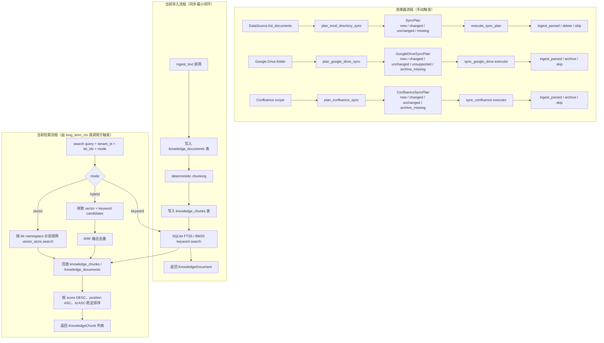

# knowledge-base

> 写作提醒：功能描述只写可观察的行为，不写内部实现细节。验收标准只写端到端可验证的行为。

## 概述

企业文档知识的导入、索引与检索，让 agent 能够基于企业内部文档回答问题。

**当前负责**：手动 text / markdown 内容导入，plain text / Markdown / lightweight HTML / PDF / DOCX / PPTX / XLSX 解析，local directory、Google Drive folder 与 Confluence Cloud 手动同步、Google Sheets / Google Slides export 后接入 parser registry、connector list/check/status/sync 操作入口、sync planner、deterministic chunking、手动同身份文档 re-ingest overwrite（`tenant_id + kb_id + source + filename` 只保留最新一份）、向量索引构建、SQLite FTS5/BM25 关键词索引、vector / keyword / hybrid 检索模式、KB 级 opt-in 的自动 entity extraction 入队与 graph evidence、独立于 search 的 `graph_search` depth 0/1 graph evidence 检索、规则型 `plan_knowledge_search` / `execute_knowledge_search_plan` 检索策略 API、供 reflection 生成 `run_kb_reflection_report` 只读报告的 public signals、按 tenant + knowledge base 隔离召回相关文档片段，向 vector_store reindex 暴露当前可索引 chunks，以及手动运行的 deterministic retrieval evaluation / combined memory+KB embedding evaluation。

**后续负责**：第三方数据源接入与文档获取、更丰富的文档解析、实体/关系质量提升、图谱增强检索产品化。

**不负责**：注入 system prompt 的协调与 token 预算（→ long_term_ctx）、用户个人记忆（→ memory）。

## Worker 运行语义

- `fleetent kb-worker` 是 `kb_ingest_jobs` 队列的唯一消费者；admin 导入、目录同步、connector sync 和 KB opt-in 的 extraction job 都只负责入队并轮询结果，不会在控制面进程内同步执行 ingest / extraction。
- 部署时必须把 `kb-worker` 作为独立常驻服务运行；Docker Compose 推荐路径下它与 `platform`、`node` 并列启动。
- admin 导入或同步在轮询超时后：
  - 返回 `in_progress`：最近仍有 job claim 推进，表示 worker 存活、队列在处理。
  - 返回 `degraded`：当前无可观察到的活跃 worker，job 不会自行推进，operator 需要恢复 `kb-worker`。

**调用关系**：
- 依赖：vector_store（向量索引）、platform `kb_connectors` 投影出的 connector settings snapshot；agent 可用 KB 范围由 `agent_kbs`（管理库唯一真相源）materialize 进 `agent.yaml`，运行时读配置不查表
- 被依赖：long_term_ctx（检索注入内容）、reflection（只读，观察召回质量）

**模块归属**：
- owning package：`fleetent.knowledge_base`
- public API：`parse_text(filename, content)`、`parse_markdown(filename, content)`、`parse_html(filename, content)`、`parse_pdf(filename, content)`、`parse_docx(filename, content)`、`parse_pptx(filename, content)`、`parse_xlsx(filename, content)`、`parse_document(filename, content, mime_type)`、`ingest_text(filename, content, tenant_id, kb_id, source, source_url)`、`ingest_parsed(parsed, tenant_id, kb_id, source, source_url)`、`search(query, tenant_id, kb_ids, limit, mode)`、`KnowledgeSearchOptions`、`KnowledgeSearchPlan`、`KnowledgeSearchStep`、`plan_knowledge_search(query, options)`、`execute_knowledge_search_plan(plan)`、`delete(document_id)`、`archive(document_id)`、`iter_indexable_knowledge_chunks(tenant_id, kb_id)`、`ConnectorSummary`、`ConnectorCheckResult`、`ConnectorSyncResult`、`ConnectorStatus`、`list_configured_connectors(settings)`、`check_connector(connector_id, settings)`、`run_connector_sync(connector_id, dry_run, settings)`、`get_connector_status(connector_id, settings)`、`DocumentRef`、`DataSource`、`LocalDirectoryDataSource`、`LocalDirectorySourceConfig`、`GoogleDriveConnectorConfig`、`ConfluenceConnectorConfig`、`SyncAction`、`SyncPlan`、`SyncPlanItem`、`SyncPlanSummary`、`SyncExecutionSummary`、`plan_local_directory_sync(config, tenant_id, kb_id)`、`execute_sync_plan(plan)`、`sync_local_directory(config, tenant_id, kb_id)`、`plan_google_drive_sync(config, client)`、`sync_google_drive(config, client)`、`plan_confluence_sync(config, client)`、`sync_confluence(config, client)`（注：`bind_agent_to_kb()` / `unbind_agent_from_kb()` / `list_agent_kb_bindings()` / `resolve_agent_kb_ids()` 已由 `drop-dead-kb-binding-path` 删除；agent KB 范围通过 agent.yaml 的 `knowledge.bindings` 在运行时获取，不经过 KB 模块绑定函数）
- owned tables（per-tenant KB 关系库，嵌入式 Y 迁移）：`knowledge_bases`（含 `extraction_enabled`，默认关）、`knowledge_documents`、`knowledge_chunks`、`knowledge_chunks_fts`、`knowledge_source_states`、`knowledge_connector_status`、`kb_entities`、`kb_entity_mentions`、`kb_relations`（agent↔KB 绑定不在此——唯一真相源是管理库的 `agent_kbs`，Alembic；`kb_extraction_runs` 已删除，extraction run 摘要同步返回，不持久化）
- config namespace：Platform `knowledge.*` / Agent `knowledge_base.*` binding and retrieval policy

## 关键流程



## 数据模型

```sql
-- 文档元数据
knowledge_documents (
  id          TEXT PRIMARY KEY,  -- UUID
  filename    TEXT,
  tenant_id   TEXT,              -- 租户标识；私有化单企业部署默认 "default"
  kb_id       TEXT,              -- 租户内知识库标识，如 "global" / "sales" / "support"
  source      TEXT,              -- 来源标识（当前默认 "manual"）
  source_url  TEXT,              -- 原始文档 URL 或路径（可选，供溯源用）
  archived_at DATETIME,          -- remote connector missing 时归档；NULL 表示可检索
  created_at  DATETIME
)

knowledge_bases (
  tenant_id TEXT,
  kb_id TEXT,
  description TEXT,
  extraction_enabled INTEGER NOT NULL DEFAULT 0,  -- 仅开启的 KB 在 ingest 后自动入队 extraction
  archived_at DATETIME,
  created_at DATETIME
)

-- 分块内容
knowledge_chunks (
  id          TEXT PRIMARY KEY,  -- document_id:chunk:{position}，同时作为 vector_store 的 key
  document_id TEXT,              -- → knowledge_documents.id
  tenant_id   TEXT,
  kb_id       TEXT,
  content     TEXT,              -- chunk 文本
  position    INTEGER,           -- chunk 在文档中的顺序
  metadata_json TEXT,             -- JSON section context，如 title/path/level
  created_at  DATETIME
)

-- 关键词索引，由 knowledge-base 模块通过嵌入式 Y 迁移（core/migrations.py）管理
knowledge_chunks_fts USING fts5 (
  chunk_id    UNINDEXED,
  tenant_id   UNINDEXED,
  kb_id       UNINDEXED,
  content,
  tokenize='unicode61'
)

-- local directory source state
knowledge_source_states (
  source_id    TEXT,
  tenant_id    TEXT,
  kb_id        TEXT,
  source_path  TEXT,
  mtime_ns     INTEGER,
  content_hash TEXT,
  document_id  TEXT,
  updated_at   DATETIME,
  PRIMARY KEY (source_id, tenant_id, kb_id, source_path)
)

-- agent↔KB 绑定不在 KB 库：唯一真相源是管理库（Alembic）的 agent_kbs 表，
-- 部署时由 platform materialize 进 agent.yaml 的 knowledge_base_ids，retrieval 读配置不查表。

-- connector 最近一次运行状态；只保存摘要，不保存完整历史或 credential payload
knowledge_connector_status (
  connector_id       TEXT PRIMARY KEY,
  connector_type     TEXT NOT NULL,
  tenant_id          TEXT NOT NULL,
  kb_id              TEXT NOT NULL,
  last_status        TEXT NOT NULL,
  last_started_at    DATETIME,
  last_finished_at   DATETIME,
  last_summary_json  TEXT NOT NULL,
  last_error         TEXT,
  updated_at         DATETIME NOT NULL
)

-- tenant + KB scoped canonical entities
kb_entities (
  id TEXT PRIMARY KEY,
  tenant_id TEXT,
  kb_id TEXT,
  entity_type TEXT,
  name TEXT,
  normalized_name TEXT,
  UNIQUE (tenant_id, kb_id, entity_type, normalized_name)
)

kb_entity_mentions / kb_relations 保存 mention 与 relation 的 chunk evidence。

entity extraction 的 run 摘要不再持久化到 KB 表；调用方同步拿到 summary，如需审计走 observability trace event。
```

向量 embedding 存储在 per-tenant `kb_vectors.db`，namespace 格式为 `kb:{tenant_id}:{kb_id}`：
- chunk 向量：以 `chunk.id` 为 key

知识库身份由 `tenant_id + kb_id` 共同决定。当前默认 `tenant_id="default"`、`kb_id="global"`；platform ingest/sync 写入本 tenant 的 `kb.db` / `kb_vectors.db`，agent retrieval / `graph_search` 只读本 tenant 的同名文件。

## 接口定义

```python
@dataclass
class KnowledgeDocument:
    id: str
    tenant_id: str
    kb_id: str
    filename: str
    source: str
    source_url: str | None


@dataclass
class KnowledgeChunk:
    id: str
    document_id: str
    tenant_id: str
    kb_id: str
    filename: str
    content: str
    position: int
    score: float  # vector_store 返回的相似度分数
    metadata: dict[str, str]  # section context，旧 chunk 默认为 {}


@dataclass
class ParsedSection:
    title: str
    text: str
    level: int
    metadata: dict[str, str]


@dataclass
class ParsedDocument:
    filename: str
    format: str
    sections: list[ParsedSection]
    metadata: dict[str, str]


def parse_text(filename: str, content: str) -> ParsedDocument:
    """解析 plain text，过滤空白内容并生成 body section。"""


def parse_markdown(filename: str, content: str) -> ParsedDocument:
    """解析 Markdown heading hierarchy，保留 fenced code block。"""


def parse_html(filename: str, content: str) -> ParsedDocument:
    """解析 lightweight HTML，移除 script/style 并把简单 table 转为文本。"""


async def ingest_text(
    filename: str,
    content: str,
    tenant_id: str | None = None,
    kb_id: str | None = None,
    source: str = "manual",
    source_url: str | None = None,
) -> KnowledgeDocument:
    """导入 plain text / markdown 内容，同步完成分块与向量索引。"""


async def ingest_parsed(
    parsed: ParsedDocument,
    tenant_id: str | None = None,
    kb_id: str | None = None,
    source: str = "manual",
    source_url: str | None = None,
) -> KnowledgeDocument:
    """导入 parser 输出的 sections；同身份文档再次导入时覆盖旧版本。"""


async def search(
    query: str,
    tenant_id: str,
    kb_ids: list[str],
    limit: int = 10,
    mode: Literal["vector", "keyword", "hybrid"] = "vector",
) -> list[KnowledgeChunk]:
    """按指定模式检索文档片段，默认保持 vector-only 兼容行为。"""


async def delete(document_id: str) -> None:
    """硬删除文档及其 chunk、向量和该文档产生的 graph evidence。"""


def iter_indexable_knowledge_chunks(tenant_id: str, kb_id: str) -> Iterator[IndexableItem]:
    """枚举指定 tenant/kb 当前应存在于 vector_store 的 chunks，namespace 为 kb:{tenant_id}:{kb_id}。"""


@dataclass
class DocumentRef:
    id: str
    filename: str
    format: str
    path: str | None
    url: str | None
    metadata: dict[str, str]


@dataclass
class LocalDirectorySourceConfig:
    source_id: str
    root_path: str | Path
    allowed_roots: list[str | Path]


class SyncAction(str, Enum):
    INGEST_NEW = "ingest_new"
    REINGEST_CHANGED = "reingest_changed"
    SKIP_UNCHANGED = "skip_unchanged"
    DELETE_MISSING = "delete_missing"
    ARCHIVE_MISSING = "archive_missing"
    SKIP_UNSUPPORTED = "skip_unsupported"
    AUTH_FAILED = "auth_failed"


@dataclass
class SyncPlanItem:
    action: SyncAction
    source_id: str
    tenant_id: str
    kb_id: str
    source_path: str
    filename: str
    document_format: str
    mtime_ns: int | None
    content_hash: str | None
    document_id: str | None


async def plan_local_directory_sync(
    config: LocalDirectorySourceConfig,
    tenant_id: str,
    kb_id: str,
) -> SyncPlan:
    """扫描 local source 并生成确定性计划；允许读取和 hash source 文档，但不写 KB 或 source state。"""


async def execute_sync_plan(plan: SyncPlan) -> SyncExecutionSummary:
    """按计划执行 ingest / reingest / delete / skip；单 item 失败只计入 failed 并继续后续 item。"""


async def sync_local_directory(
    config: LocalDirectorySourceConfig,
    tenant_id: str,
    kb_id: str,
) -> LocalSyncSummary:
    """从显式 allowlist root 下递归扫描 .txt/.md/.html/.htm 文件并导入指定 KB。"""


@dataclass
class GoogleDriveConnectorConfig:
    connector_id: str
    tenant_id: str
    kb_id: str
    folder_id: str
    credential_ref: str
    recursive: bool = True


async def plan_google_drive_sync(config: GoogleDriveConnectorConfig, *, client: GoogleDriveClient) -> GoogleDriveSyncPlan:
    """只列举指定 Google Drive folder 并生成确定性计划；不边扫描边写 KB。"""


async def sync_google_drive(config: GoogleDriveConnectorConfig, *, client: GoogleDriveClient) -> GoogleDriveSyncSummary:
    """通过 planner + executor 手动同步 Google Drive folder。"""


@dataclass
class ConfluenceConnectorConfig:
    connector_id: str
    tenant_id: str
    kb_id: str
    base_url: str
    username: str
    credential_ref: str
    scope_type: Literal["space", "page"]
    space_key: str | None = None
    page_id: str | None = None
    include_children: bool = False


async def plan_confluence_sync(config: ConfluenceConnectorConfig, *, client: ConfluenceClient) -> ConfluenceSyncPlan:
    """按 space / page scope 生成确定性计划；不边扫描边写 KB。"""


async def sync_confluence(config: ConfluenceConnectorConfig, *, client: ConfluenceClient) -> ConfluenceSyncSummary:
    """通过 planner + executor 手动同步 Confluence Cloud pages。"""


@dataclass
class AgentKnowledgeBaseBinding:
    tenant_id: str
    agent_id: str
    kb_id: str
    created_at: datetime


def list_configured_connectors(settings: ConnectorSettings) -> list[ConnectorSummary]:
    """列出显式注入 connector settings 中配置的 Google Drive / Confluence connector 安全摘要。"""


async def check_connector(connector_id: str, *, settings: ConnectorSettings) -> ConnectorCheckResult:
    """检查 connector credential_ref 和 remote scope，失败详情脱敏。"""


async def run_connector_sync(
    connector_id: str,
    *,
    settings: ConnectorSettings,
    dry_run: bool = False,
) -> ConnectorSyncResult:
    """手动执行 connector dry-run 或真实 sync，并写入最近一次 status。"""


def get_connector_status(connector_id: str, *, settings: ConnectorSettings) -> ConnectorStatus:
    """读取 connector 最近一次 check / dry-run / sync 状态；未运行返回 never_run。"""
```

`mode` 取值：
- `vector`：仅调用 `vector_store.search`，适合语义相似度召回。
- `keyword`：仅使用 SQLite FTS5 / BM25，适合产品编号、错误码、专有名词等精确词召回。
- `hybrid`：同时取 vector 与 keyword candidates，用 RRF 融合去重后返回。

`search()` 保持显式底层模式，不改 `search()` 为 auto，也不要求调用方使用 planner。`plan_knowledge_search()` 是独立的规则型 API：普通 query 默认选择 hybrid；entity / relation-like query 先 graph search、不足时 hybrid fill；`rerank=True` 只标记 hybrid step。planner 不接 LLM planner、不做 query rewrite，不改变 vector / keyword / hybrid / graph / rerank 底层契约。

Agent 被动检索默认仍走 `search(mode=...)`。只有当 agent.yaml 的 `knowledge.retrieval_policy.use_planner=true` 时，long-term-ctx 才会对被动 KB 检索走 `plan_knowledge_search()` / `execute_knowledge_search_plan()`；关系型 query 可升级到 graph evidence，无图谱数据时安全回落 hybrid，不改变既有预算/选择管线。

`run_kb_reflection_report()` 由 reflection 拥有，用 knowledge-base public API 与 observability 信号生成 KB 质量只读报告，finding 类型包括 `missing_knowledge`、`stale_document`、`low_retrieval_quality`、`connector_sync_issue` 和 `entity_graph_gap`。报告持久化到 agent 侧 `reflection_reports(domain=knowledge_base)`，不自动写 KB、不触发 sync，也不创建 KB mutation proposal。

## 现状

**已完成 core + parser + hybrid + local connector + sync planner + Google Drive / Confluence connector + agent KB binding + standalone ingest 闭环**：`knowledge-base-core` 实现了 `fleetent.knowledge_base` runtime package、基础表、手动 text/markdown ingest、deterministic chunking、vector-only search、delete，以及 long-term-ctx built-in provider 接入；`knowledge-base-parsers-basic` 增加了无 AI 框架依赖的 plain text / Markdown / lightweight HTML parser，并提供 parsed ingest adapter；`knowledge-base-hybrid-search` 增加了 knowledge-base-owned SQLite FTS5 keyword index、keyword mode、hybrid mode 和 RRF 融合；`knowledge-base-connectors-local` 增加了 DataSource / DocumentRef 边界、显式 root allowlist 的 local directory source、`.txt` / `.md` / `.html` / `.htm` 格式映射、source path / mtime / content hash 状态记录，以及手动 `sync_local_directory`；`knowledge-base-sync-planner` 增加了 plan / execute 分离、`ingest_new` / `reingest_changed` / `skip_unchanged` / `delete_missing` 动作模型；`knowledge-base-connectors-google-drive` 增加指定 folder scope、OAuth `credential_ref`、fake-client default path、Google Docs HTML export、text / Markdown / HTML parser dispatch、`archive_missing` 和 opt-in smoke scaffold；`knowledge-base-connectors-confluence` 增加 Cloud API token `credential_ref`、space / page / page+children scope、storage HTML parser dispatch、bounded 429 retry、`archive_missing` 和 opt-in smoke scaffold；`knowledge-base-agent-kb-binding` 曾在 KB 库内建 agent↔KB 绑定表，**已被 `drop-dead-kb-binding-path` 移除**——唯一真相源改为管理库的 `agent_kbs`（Alembic），部署时 materialize 进 `agent.yaml`，retrieval 读配置不查表；`kb-retire-platform-ingest` 已退役 platform 托管 KB ingest：`/admin/kb/connectors*`、platform import/sync/extract 端点和 `management.db` 中的 `kb_connectors`/`kb_ingest_jobs`/`kb_connector_schedule_state` 不再是运行时入口；唯一受支持的 KB ingest 模型是 standalone `kb-service.yaml` + 本地 `kb_ingest_queue.db` + `kb-worker --config ...`；升级前需要把存量 platform connector 配置誊到 `kb-service.yaml`；`knowledge-base-query-planner` 增加规则型 `plan_knowledge_search` / `execute_knowledge_search_plan`，在 hybrid、graph fill 和 hybrid rerank 之间给出可解释 reason。

团队已有独立的 [knowledge-bridge](../../../knowledge-bridge) 项目，覆盖了大部分核心功能，但技术栈与 fleetent 约束不兼容，不能直接作为依赖引入。实施策略：**有选择地迁移设计资产和小块算法**，而非从零重写或整体搬运。

历史迁移评估见 [knowledge-bridge 迁移计划](../archive/knowledge-bridge-migration-plan.md)。knowledge-base 按拆分 specs 渐进实现：已完成 `knowledge-base-core` 的手动导入、分块、向量索引和基础 search 闭环，并完成 `knowledge-base-parsers-basic` 的基础解析器、`knowledge-base-hybrid-search` 的 SQLite FTS5 / BM25 与 RRF 融合、`knowledge-base-connectors-local` 的 local directory 手动同步、sync planner、Google Drive connector、Confluence connector、advanced parsers、entity extraction、graph search、hybrid rerank 和规则型 query planner。后续重点转向真实 SaaS smoke、生产凭据管理、scheduler / full sync history、ACL 和更重的解析能力。

当前未实现内容：
- 无 admin UI、REST upload API；vector rebuild 目前通过 vector_store 同步 public API 触发
- 无 LLM planner / query rewrite / `search(mode="auto")`
- 已有 entity extraction schema、`kb_entities`、mentions / relations evidence、explicit run，以及 KB 级 opt-in 的 ingest 后自动 extraction 入队；extraction run 摘要同步返回调用方，不持久化到 kb.db。
- 已有 `graph_search` 第一版：独立于 search，支持 depth 0/1、direct entity mention、relation evidence、related entity mention 和 graph evidence；该 API 本身不接 query planner / rerank，不改变 `search()` / hybrid ranking。
- 无 production ranking dashboard
- Google Drive 不做 service account / domain-wide delegation，不做最终提问用户到 Drive document ACL 的实时映射；OAuth token 通过 connector 的 `credential_ref` 引用，MVP 可指向本地 token 文件，生产部署需保护文件权限和备份策略，后续可迁移到 credential store / secret manager。
- Google Drive missing / 不可见默认归档 KB document 并移除 chunks / vector entries，不物理删除 `knowledge_documents` 行。
- Google Docs 通过 export HTML 后走 HTML parser；Google Sheets / Google Slides 分别导出为 `.xlsx` / `.pptx` 后通过 parser registry 解析。
- OCR、VLM、扫描 PDF、图片语义理解、speaker notes、公式求值和结构化 table QA 不支持；扫描 PDF 或无可抽取文本的 PDF 会按安全失败处理。
- Confluence 只支持 Cloud API token + `credential_ref`，不做 Server / Data Center、多认证模式或最终用户 Confluence page ACL 映射；missing / 不可见默认 archive，不物理删除 `knowledge_documents` 行。

**后续可迁移参考（knowledge-bridge 已实现，但需按 fleetent specs 分批适配）**：
- ✅ 文档解析思路：text / Markdown / HTML / PDF / DOCX / PPTX / XLSX / section-first 归并优先；Google Docs / Google Sheets / Google Slides 通过 export 后进入 parser registry；图片 / OCR / VLM 暂缓
- ✅ Confluence 连接器算法：分页、增量 token、限速和 429 backoff；接口必须重写为 fleetent `DataSource`
- ✅ Google Drive 连接器算法：OAuth 2.0 用户授权、folder listing、Docs HTML export；service account / domain-wide delegation、change token、Webhook 暂缓
- ✅ 本地目录连接器：遍历、后缀映射、mtime/hash 变更检测；去掉 LlamaIndex `BaseReader`
- ✅ 中文 BM25 分词思路：jieba + CJK bigram（`retrieval/lexical.py`），在 SQLite FTS5 下重新验证
- ✅ 同步规划器动作模型：已在 fleetent 内落地 local source 的 new / changed / unchanged / missing 基础动作；更细粒度 metadata-only / rechunk / reembed / refetch 动作后续按 reindex specs 评估

**需要重写（深度耦合 LlamaIndex 或违反 fleetent 约束）**：
- 向量存储：LanceDB → fleetent `vector_store` public API（当前可用普通 SQLite persistent backend；sqlite-vec / Qdrant 后置）
- Embedding：OpenAI Embeddings API（云托管，禁止默认）→ Agent model policy 的 HTTP embedding provider，生产配置指向自托管 bge-m3 / multilingual-e5 等模型服务
- 分块器：逻辑参考 knowledge-bridge，但 `TextNode` 类型替换为 fleetent 自定义 dataclass
- 检索引擎：逻辑参考，接口对齐 `search()` / `graph_search()`

**全新实现（knowledge-bridge 没有）**：
- 实体与关系提取（`kb_extraction` task）
- 图谱存储（entities / relations 表）与 `graph_search()`

## 当前缺口

- parser 已支持 text / Markdown / lightweight HTML / PDF / DOCX / PPTX / XLSX；local directory 和 Google Drive uploaded Office/PDF 通过 parser registry 解析，Google Sheets / Google Slides 通过 export 后解析。
- OCR、VLM、扫描 PDF、图片语义理解和结构化 table QA 不支持。
- local directory、Google Drive 与 Confluence 已支持 plan + execute 手动 sync，并可通过 admin CLI 列出、检查、dry-run、同步和查看最近一次 status；后台消费统一走既有 `kb-worker`，不引入第二个 extraction consumer。
- 检索已支持 SQLite FTS5/BM25 keyword mode、RRF hybrid mode、显式 hybrid rerank、
  独立 `graph_search()` 和规则型 `plan_knowledge_search()` / `execute_knowledge_search_plan()`；不提供
  `search(mode="auto")`，不接 LLM planner / query rewrite。
- Agent 被动检索是 opt-in planner：`knowledge.retrieval_policy.use_planner` 默认 `false`，默认行为仍是 `search(mode=...)`；显式开启后，关系型 query 才会优先尝试 graph evidence，并在无图数据时回落 hybrid。
- 外部 SaaS 数据源已有 fake-client 默认路径和手动 opt-in smoke scaffold；真实 Google Drive / Confluence API client 不进入默认测试路径。
- long-term-ctx 通过 agent.yaml 的 `knowledge.bindings` 获取 agent 有效 KB 范围；bind/unbind 改的是管理库 `agent_kbs`，需经 platform→node reconcile 重 materialize 回 agent.yaml，运行时不直接查询管理库；更新在 agent 的下一个 session 边界生效，不中途热改进行中的对话。
- `knowledge.bindings` 是单租户快照：同一 agent 的所有 binding 必须共享该 agent 的 `tenant_id`，materialize 与加载都会显式校验；尚未实现 document-level ACL。
- 后台 vector index rebuild job runtime 尚未实现；当前只提供同步 vector_store reindex public API。

## 下一批候选 specs

- 后续 connector / retrieval 增强 specs：真实 Google Drive / Confluence smoke 和生产凭据管理、
  document-level ACL 映射、scheduler / full sync history、附件解析、OCR / VLM / 扫描 PDF 评估、
  graph / rerank 在 agent 默认检索链路中的产品化策略

## 自动化效果验证

已提供 `tests/evaluation/knowledge_base_retrieval_eval.py` 和 `tests/evaluation/fixtures/knowledge_base_retrieval/*.json`：

- fixture schema 固定为 `name`、`documents`、`queries`、`expected_chunks`、`forbidden_chunks`。
- 默认 runner 使用 deterministic embedding、tmp SQLite DB 和 tmp SQLite vector backend，不调用外部服务，不触碰 `data/`。
- runner 会 ingest fixture documents，执行 query，并断言 expected chunk/snippet 出现在 top-k，forbidden chunk/snippet 不出现在结果中。
- 真实 embedding evaluation 默认 skip；只有设置 `FLEETENT_EVAL_REAL_EMBEDDING=1` 且提供 endpoint、model、API key 和 dimensions 时才手动运行。
- combined memory+KB embedding evaluation 使用 tmp SQLite / tmp vector DB，并通过 `vector_store.reindex()` 重建 KB index 后验证 expected / forbidden snippets。

## 自动化效果验证缺口

- 扩展小型企业文档 fixture，覆盖更多中文、标题层级、表格文本和重复内容。
- 对比 vector-only、BM25-only、hybrid RRF 的召回质量。
- 验证 tenant + kb namespace 隔离。

## 服务化 / 目录边界判断

knowledge-base 是未来最有独立服务潜力的模块，因为它会包含连接器、同步任务、解析、索引和检索。
但当前应先在 modular monolith 内建立 `fleetent.knowledge_base` 目录和 public API，等 ingest/search/sync
边界稳定后再考虑独立进程或服务。

## 规划中（v1.0）

- [x] **数据源连接器 baseline**：通过统一 source / sync planner 边界接入不同来源的文档
  - ✅ **本地目录**：已支持显式 allowlist root 下 `.txt` / `.md` / `.html` / `.htm` / `.pdf` / `.docx` / `.pptx` / `.xlsx` 的手动 sync；文件监听和后台调度后置
  - ✅ **Google Drive**：已支持指定 folder scope、OAuth `credential_ref`、Google Docs HTML export、Google Sheets `.xlsx` export、Google Slides `.pptx` export、uploaded PDF / Office download、parser registry dispatch、fake-client 默认测试和手动 opt-in smoke；不做 service account / domain-wide delegation、最终用户 Drive ACL
  - ✅ **Confluence Cloud**：已支持 Cloud API token `credential_ref`、space / page / page+children scope、storage HTML parser dispatch、bounded 429 retry、fake-client 默认测试和手动 opt-in smoke；不做 Server / Data Center、最终用户 page ACL、attachments / comments
  - remote source missing / 不可见默认 archive KB document，不物理删除 `knowledge_documents` 行
  - **文件直传 / REST upload**、后台调度、sync history、文档级 ACL 和更多格式解析后置

- [x] **基础与高级文档解析**：将原始 text / Markdown / lightweight HTML / PDF / DOCX / PPTX / XLSX 转换为 parsed sections，再进入分块流程
  - Markdown / 纯文本：直接处理，无需额外依赖
  - HTML：使用标准库 lightweight parser，移除 script/style，提取 heading/body/table 文本
  - PDF：支持文本型 PDF page extraction，保留 `page_number`；加密、扫描 PDF 或无可抽取文本时安全失败
  - DOCX / PPTX / XLSX：保留 heading path、`slide_number`、`sheet_name` 等 section metadata；table / cell 只转为可检索文本
  - OCR / VLM / 图片语义理解 / 结构化 table QA 不支持，后续单独评估依赖、成本和数据主权影响
  - parsed section metadata 会随 chunk 保留 section title/path/level/page/slide/sheet 等定位信息

- [x] **文档导入**：解析后的文本写入知识库
  - 当前已支持 `ingest_text()` / `ingest_parsed()` 同步导入、保存 document/chunk，并进入 vector / keyword 索引
  - 当 `knowledge_bases.extraction_enabled=1` 时，ingest 完成后会异步入队 per-document `extraction` job；默认关闭，不阻塞 ingest

- [x] **分块与向量索引**：文档内容分块后写入 vector_store
  - 每个 chunk 保留来源文档信息（filename、position）和 parser section metadata
  - 分块策略见待决问题

- [x] **实体与关系提取**：分块完成后，用 LLM 从文档提取实体和关系写入图谱
  - 使用 model policy 的 `kb_extraction` route，经 HTTP 访问；默认指向可自托管本地模型，不硬编码云默认
  - 仅在 KB 显式开启 `extraction_enabled` 时，由 ingest 事件异步入队 per-document extraction job
  - extraction 失败只影响该文档图谱证据，不影响 chunk search / hybrid search

- [x] **混合检索（Hybrid Search）**：BM25 关键词检索与向量语义检索并行，RRF 融合排序后返回
  - 对外接口兼容扩展：`search(query: str, tenant_id: str, kb_ids: list[str], mode="hybrid") → list[KnowledgeChunk]`
  - BM25 擅长精确词匹配（产品编号、人名、专有名词），当前实现使用 SQLite FTS5（内置，无需额外服务）
  - 向量检索负责语义相似度和同义词
  - RRF（Reciprocal Rank Fusion）合并两路排序结果，无需调权重参数

- [x] **图增强检索**：从相关实体出发，按关系图谱展开，收集关联 chunk
  - 对外接口：`graph_search(query: str, tenant_id: str, kb_ids: list[str], depth: int) → KnowledgeGraphResult`
  - 适合关系型查询（"X 和 Y 是什么关系？"、"谁负责 Z？"）
  - depth 控制关系展开层数，当前支持 depth 0/1，防止结果爆炸
  - 图数据存储在 SQLite（entities + relations 表），不需要独立图数据库

- [x] **作用域隔离**：通过多 KB + agent 绑定实现访问控制
  - 按内容敏感度或部门建立多个 KB（如 Company-Wide / Engineering / HR / Finance）
  - agent 绑定到一个或多个 KB，检索时只访问绑定的 KB；未配置显式绑定时只访问默认 KB
  - 公共内容放 Company-Wide KB，多个 agent 同时绑定；部门内容放部门 KB，只有对应 agent 可见
  - 真正高度敏感的数据（个人薪资、绩效记录等）不进知识库，由结构化系统管理

## 验收标准

**场景 1：文档导入后可被检索**
- Given：管理员导入一份 Markdown 文档
- When：用户提问与文档内容相关
- Then：long_term_ctx 通过 knowledge_base.search() 召回相关片段，agent 回答中体现文档内容

**场景 2：导入生成稳定 chunks**
- Given：调用方导入一段 text / markdown 内容
- When：chunk_size 和 chunk_overlap 固定
- Then：生成的 chunk 内容和 position 保持 deterministic

**场景 3：作用域隔离**
- Given：不同 tenant 或不同 `kb_id` 中存在相似内容
- When：调用 search(query, tenant_id, kb_ids)
- Then：只召回指定 tenant 和 kb 范围内的文档片段

**场景 4：文档删除**
- Given：已导入并可检索的文档
- When：调用 delete(document_id)
- Then：该文档的所有 chunk 不再出现在检索结果中，对应 vector entries 被删除，且该文档产生的 entity mention / relation evidence 不再出现在 `graph_search` 结果中

**场景 5：同身份文档重新导入**
- Given：同一 `tenant_id + kb_id + source + filename` 的文档已存在
- When：调用 `ingest_text()` 或 `ingest_parsed()` 再次导入
- Then：知识库中只保留最新版本的一份 document / chunk / graph evidence，旧版本内容不再被 `search()` 或 `graph_search()` 返回

## 测试边界

**需要单元测试的行为**：
- public API 可导入：`KnowledgeDocument`、`KnowledgeChunk`、`ingest_text()`、`search()`、`KnowledgeSearchOptions`、`KnowledgeSearchPlan`、`KnowledgeSearchStep`、`plan_knowledge_search()`、`execute_knowledge_search_plan()`、`delete()`、`iter_indexable_knowledge_chunks()`、`DocumentRef`、`DataSource`、sync planner dataclasses、`plan_local_directory_sync()`、`execute_sync_plan()`、`sync_local_directory()`（注：agent KB 范围通过 agent.yaml 的 `knowledge.bindings` 在运行时获取，不经过 KB 模块绑定函数）
- 配置默认值：`knowledge_base.enabled=false`，默认 tenant/kb 与 chunk 参数稳定

**需要集成测试的行为**：
- Alembic fresh upgrade 创建 `knowledge_bases`、`knowledge_documents`、`knowledge_chunks`
- ingest_text 保存 document、生成 deterministic chunks，并逐 chunk 调用 vector_store.upsert
- 空内容 fail fast
- search 按 `kb:{tenant_id}:{kb_id}` namespace 调用 vector_store，支持多 kb 合并与稳定排序
- keyword search 可命中产品编号、错误码等精确词，并保持 tenant/kb 隔离
- hybrid search 合并 vector 与 keyword candidates，同一 chunk 去重并通过 RRF 提升双命中结果
- knowledge base 隔离：不同 `tenant_id + kb_id` 的检索结果互不干扰
- delete 级联：删除文档后对应 chunk、vector entries 和该文档的 graph evidence 均被清理；孤儿 entity 会被回收，共享 entity 保留
- re-ingest overwrite：同身份文档重复导入时只保留最新一份 document / chunk，旧版本 chunks、vectors 和 graph evidence 不再可见
- long-term-ctx 在 Agent knowledge binding / policy 启用时，先解析 `knowledge.bindings` 为 `kb_ids` 和单一 `tenant_id`，再以 `(Principal, query, kb_ids, limit, audit_context)` 契约调用当前 knowledge provider；默认 `LocalKnowledgeProvider` 读取本地 KB。若 agent.yaml 显式配置 `knowledge.provider.type=http`，boot 时注入 `HttpKnowledgeProvider`，经 `POST {url}` + Bearer service key + `X-Fleetent-Principal` 调远端 `{principal,query,kb_ids,limit} -> {chunks:[KnowledgeChunk JSON]}` wire 协议；override provider 只在传入范围内检索；disabled、空范围、超时或 provider 抛错时都降级为空结果
- 远程读路径现在有对应 server：`fleetent kb-serve` 仍支持旧的 `--tenant --service-key` 启动方式；standalone 部署新增 `--config <kb-service.yaml>`，从同目录 `.env` + `kb-service.yaml` 读取 service/data/retrieval/embedding/extraction/chunking/connectors 配置。推荐布局是每租户自包含 home：`$FLEETENT_HOME/kb-service/<tenant>/`，其中 `data.home`(默认 `./data`) 纯平放置 `kb.db` / `kb_vectors.db` / `kb_ingest_queue.db`。服务要求 `Authorization: Bearer <service-key>` 与 `X-Fleetent-Principal` 同时存在，且 header/body 的 principal 必须落在该服务绑定的 tenant；检索调用显式走 `knowledge_base.search(..., mode=<service-default>, kb_ids, limit)`，默认 `mode=hybrid`，不依赖 active agent 决定 mode。
- standalone KB 服务现在自包含 ingest：`kb-service.yaml` 中的 connector 配置经注入 settings 提供给 `operations`，连接器 secret 在 KB 主机本地按 `credential_ref`(`env:`/`file://`)或粒度 `*_env` 字段解析；`kb-serve --config` 自带本地 sweep 调度器，按 `sync_interval_seconds` 入本地 SQLite 队列；`kb-worker --config` 抽取同一队列并写同一 tenant home 的 `data/{kb.db,kb_vectors.db,kb_ingest_queue.db}`。该路径在无 platform、无 `management.db` 环境下可完成 connector sync / ingest / 检索。旧 `FLEETENT_KB_WORKER_EMBEDDING_*` 已退役，embedding / extraction 统一改从 `kb-service.yaml` 的 `api_key_env` 引用读取。
- 仓库提供 standalone 模板：根目录 `kb-service.yaml.example` 与 `kb-service.env.example`。
  `fleetent kb-service init-config` 会把它们脚手架到 `$FLEETENT_HOME/kb-service/<tenant>/`（默认 `default`）；
  根目录 `.env.example` 仍只保留 platform control-plane 模板，不混入 standalone secret。
- 平台托管路径暂时保留：`kb_connectors` 表、platform cron sweep、`management.db` 中的 `kb_ingest_jobs` 队列和平台侧入队 API 都不变。本次 change 是加法；退役 platform ingest 属于后续 `kb-retire-platform-ingest`。
- local sync planner 为 new / changed / unchanged / missing source 生成确定性动作
- execute_sync_plan 只在 item 成功后更新 source state，单 item 失败不阻断后续 item
- sync_local_directory 通过 planner + executor 执行；本地文件删除后对应 KB document 和 chunks 被删除
- Google Drive connector 通过 OAuth `credential_ref` 绑定 connector 授权，只扫描指定 folder，不做 service account / domain-wide delegation 或最终用户 Drive ACL 映射
- Google Drive sync 通过 planner + executor 执行；missing / 不可见 source 默认 archive KB document，不物理删除 document row
- Google Drive 默认测试使用 fake client；真实 smoke 只有 `FLEETENT_GOOGLE_DRIVE_SMOKE=1` 且 credential_ref / folder id 齐全时才运行，否则 skip
- Confluence connector 只支持 Cloud API token + `credential_ref`，按 space / page scope 同步 storage HTML；默认测试使用 fake client，真实 smoke 只有 `FLEETENT_CONFLUENCE_SMOKE=1` 且 base URL / username / credential_ref / scope 齐全时才运行，否则 skip
- iter_indexable_knowledge_chunks 按 tenant/kb 隔离返回当前 chunks，namespace 为 `kb:{tenant_id}:{kb_id}`

**需要 evaluation 测试的行为**：
- fixture loader 对 `name`、`documents`、`queries`、`expected_chunks`、`forbidden_chunks` 缺失 fail fast
- deterministic runner 使用 tmp SQLite DB 和 tmp vector backend ingest fixture documents
- vector-only query top-k 包含 expected chunk/snippet，且不包含 forbidden chunk/snippet
- real embedding evaluation 默认 skip，缺少 provider credentials / Agent model config 时也 skip

**需要 mock / monkeypatch 的依赖**：
- `vector_store`：隔离向量索引读写
- SQLite DB 路径：`monkeypatch` 到 `tmp_path`，绝不触碰 data/

## 待决问题

- [ ] 分块策略：固定 token 大小（如 512 tokens，overlap 50）vs 语义分块（按段落/标题）？（负责人：待认领）
- [x] 文档更新机制：manual ingest 对同一 `tenant_id + kb_id + source + filename` 采用 overwrite；旧 chunk、向量和图数据被替换，不做版本化保留。
- [ ] 默认作用域粒度：per-tenant 还是 per-agent？（负责人：待认领）
- [ ] 实体类型预定义：实体类型（person / org / concept 等）由 LLM 自由生成，还是预定义枚举？自由生成灵活但类型不一致，预定义可控但覆盖不全。（负责人：待认领）
- [x] graph_search 与 search 的调用决策：已提供独立规则型 planner API；默认不改变 `search()`，由调用方显式使用 `plan_knowledge_search()` / `execute_knowledge_search_plan()`。
- [ ] 图提取时机：与分块同批次触发，还是分块后单独排队？大文档图提取耗时较长，影响何时可检索。（负责人：待认领）
- [x] PDF / Office 基础解析库选型：已采用 `pypdf`、`python-docx`、`python-pptx`、`openpyxl`，不引入 `unstructured`、OCR engine、VLM 或外部解析服务。
- [x] Confluence 连接器认证方式：已定 MVP 只支持 Confluence Cloud API token + `credential_ref`；Server / Data Center 后置。
- [x] Google Drive OAuth token 存储：已定 MVP 使用 connector-level `credential_ref`，可指向本地 token 文件；后续再迁移 credential store / secret manager。
- [x] 数据源同步策略：已定所有 connector 通过 planner + executor 执行；remote missing 默认 archive，不物理删除。
- [ ] 文档级 ACL（v2.0）：当前用多 KB + agent 绑定控制访问。如需更细粒度（同一 KB 内不同文档对不同用户可见），需引入文档级权限字段和检索时过滤逻辑。（负责人：待认领）
