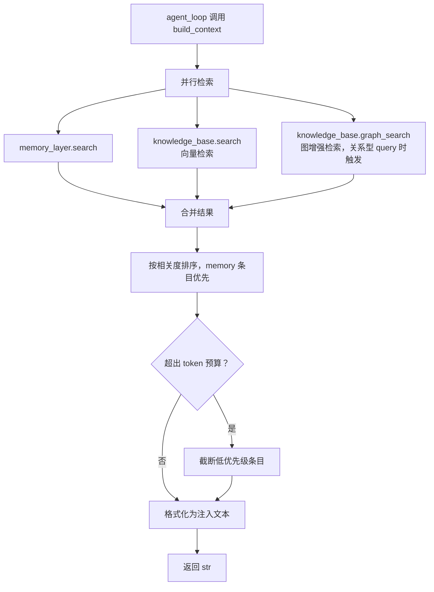

# long-term-ctx

> 写作提醒：功能描述只写可观察的行为，不写内部实现细节。验收标准只写端到端可验证的行为。
> 内部协调模块，非用户可感知能力。

## 概述

统一协调长期上下文的检索与注入，是 memory 和 knowledge_base 与 agent_loop 之间的胶水层。

**负责**：并行查询 memory 和 knowledge_base、合并结果、控制注入的 token 预算、格式化为 system prompt 可用的文本。

**不负责**：存储任何数据、记忆提取（→ memory）、文档索引（→ knowledge_base）、in-session 上下文压缩（→ context_mgr）。

**调用关系**：
- 依赖：memory_layer（search）、knowledge_base（search）、config（token 预算上限）
- 被依赖：agent_loop（每次对话开始前调用）

**模块归属**：
- owning package：`intelligence.long_term_ctx`
- public API：`build_context(user_id, query, agent_id, available_tokens)`
- owned tables：无
- config namespace：`long_term_ctx.*`

## 关键流程



## 接口定义

```python
async def build_context(
    user_id: str,
    query: str,
    agent_id: str,
    available_tokens: int,
) -> str:
    """并行检索 memory 和 knowledge_base，合并后返回注入 system prompt 的文本。

    available_tokens: 调用方（agent_loop）传入的当前可用 token 数，
        build_context 的输出不超过此值与 config 预算上限中的较小值。
        为 0 时直接返回空字符串，不发起检索。
    任意一侧检索无结果时正常降级，不报错。
    """
```

## 现状

尚未实现。

## 规划中（v1.0）

- [ ] **并行检索**：asyncio.gather 同时调用 memory_layer.search()、knowledge_base.search() 和（按需）knowledge_base.graph_search()，不串行等待
  - graph_search 触发条件见待决问题

- [ ] **优先级合并**：memory 条目优先于 knowledge 条目
  - 同等相关度时，用户个人记忆排在通用文档前

- [ ] **token 预算控制**：注入文本总量不超过 config 配置的上限
  - 超出时从低优先级截断，保证高相关内容优先注入

- [ ] **格式化输出**：将两类结果分区段格式化
  - memory 区段：用户相关事实
  - knowledge 区段：相关文档片段
  - 任意一侧无结果时省略对应区段，不输出空占位

## 验收标准

**场景 1：两侧均有结果**
- Given：用户有相关记忆，知识库有相关文档
- When：agent_loop 调用 build_context
- Then：返回文本同时包含记忆区段和文档区段

**场景 2：token 预算截断**
- Given：memory 和 knowledge_base 检索结果合计超出 token 预算上限
- When：build_context 合并结果
- Then：返回文本不超过预算上限，memory 条目优先保留，knowledge 条目被截断

**场景 3：单侧无结果**
- Given：knowledge_base 无与当前 query 相关的内容
- When：build_context 调用
- Then：正常返回 memory 内容，不因 knowledge_base 无结果而报错或返回空

**场景 4：两侧均无结果**
- Given：用户无历史记忆，知识库为空
- When：build_context 调用
- Then：返回空字符串，agent_loop 正常继续

**场景 5：可用 token 预算为零**
- Given：agent_loop 当前 context 已接近上限，传入 `available_tokens=0`
- When：build_context 调用
- Then：不发起任何检索，直接返回空字符串；agent_loop 正常继续，不因注入失败报错

## 测试边界

**需要单元测试的行为**：
- 并行调用：memory 和 knowledge_base 的 search 通过 asyncio.gather 并发，非串行
- token 预算截断：超出上限时正确截断，且 memory 条目先于 knowledge 条目保留
- 单侧空结果：任意一侧返回空列表时不报错，正常合并另一侧结果
- 格式化输出：memory 区段和 knowledge 区段分区正确，无结果的区段不出现在输出中

**需要 mock 的依赖**：
- `memory_layer.search`：隔离 memory 模块，控制返回内容和数量
- `knowledge_base.search`：隔离 knowledge_base 模块
- `config`：注入测试用 token 预算上限

## 待决问题

- [ ] token 预算默认值：config 中配置的 token 上限设多少？与 `available_tokens` 取 min 时，两者的典型比例是多少？（负责人：待认领）
- [ ] memory 与 knowledge 的 token 分配：各自固定比例，还是完全按相关度动态分配？（负责人：待认领）
- [ ] 格式化模板：memory 和 knowledge 区段的具体格式由谁定义，是否需要可配置？（负责人：待认领）
- [ ] graph_search 触发决策：由调用方传入 query_type 标记，还是 long_term_ctx 内部判断（如关键词检测）？（与 knowledge-base 待决问题对齐，负责人：待认领）
