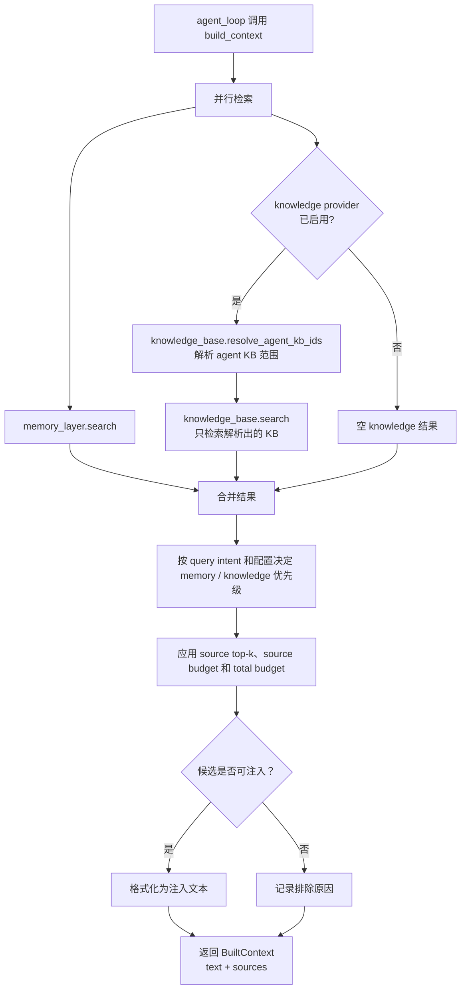

# long-term-ctx

> 写作提醒：功能描述只写可观察的行为，不写内部实现细节。验收标准只写端到端可验证的行为。
> 内部协调模块，非用户可感知能力。

## 概述

统一协调长期上下文的检索与注入，是 memory 和 knowledge_base 与 agent_loop 之间的胶水层。
当前推进策略是让 knowledge_base 作为可选 provider 接入：KB 未启用、未配置或无结果时，
long-term-ctx 仍可基于 memory 正常工作。

**负责**：查询 memory 和可选 knowledge_base、合并结果、控制注入的 token 预算、格式化为 system prompt 可用的文本，并返回来源摘要供 observability 记录。

**不负责**：存储任何数据、记忆提取（→ memory）、文档索引（→ knowledge_base）、in-session 上下文压缩（→ context_mgr）、trace 持久化（→ observability）。

**调用关系**：
- 依赖：memory_layer（search）、knowledge_base optional provider（resolve_agent_kb_ids / search）、config（token 预算上限和来源分配策略）
- 被依赖：agent_loop（每次对话开始前调用）

**模块归属**：
- owning package：`intelligence.long_term_ctx`
- public API：`build_context(user_id, query, agent_id, available_tokens)`
- owned tables：无
- config namespace：`long_term_ctx.*`

## 关键流程



## 接口定义

```python
@dataclass
class ContextSource:
    source_type: str  # "memory" | "knowledge"
    source_id: str
    score: float
    metadata: dict[str, str]
    token_estimate: int = 0


@dataclass
class BudgetDecision:
    source_type: str
    source_id: str
    token_estimate: int
    reason: str  # included | below_relevance_threshold | source_top_k_exceeded | source_budget_exceeded | total_budget_exceeded | zero_available_tokens
    included: bool


@dataclass
class BudgetMetadata:
    effective_budget: int
    memory_used_tokens: int
    knowledge_used_tokens: int
    decisions: list[BudgetDecision]


@dataclass
class BuiltContext:
    text: str
    sources: list[ContextSource]
    budget_metadata: BudgetMetadata


async def build_context(
    user_id: str,
    query: str,
    agent_id: str,
    available_tokens: int,
) -> BuiltContext:
    """检索 memory 和可选 knowledge_base，合并后返回注入文本和来源摘要。

    available_tokens: 调用方（agent_loop）传入的当前可用 token 数，
        build_context.text 不超过此值与 config 预算上限中的较小值。
        为 0 时直接返回空 text 和空 sources，不发起检索。
    任意一侧检索无结果时正常降级，不报错；knowledge_base 未实现或未启用时
    视为空 knowledge 结果。
    """
```

## 现状

**foundation 已完成**：`2026-05-31-long-term-context-foundation` 已归档。

已实现内容：
- `BuiltContext`、`ContextSource`、`build_context(user_id, query, agent_id, available_tokens)` public API
- memory-layer semantic search 接入
- knowledge-base provider 接入；KB 未启用、未配置或无结果时不阻塞 memory 注入
- knowledge-base provider 通过 `resolve_agent_kb_ids()` 获取 agent 有效 KB 范围；没有显式绑定时只回退默认 KB，空范围时不调用 search
- token budget 基础截断
- 可解释 budget policy：effective budget、memory / KB source budget、source top-k、query intent / explicit conflict preference
- agent-runtime 在 `run()` / `run_stream()` / `run_sync()` 构造 prompt 前调用 long-term-ctx
- `BuiltContext.sources` 供 observability source attribution 记录；`BudgetMetadata.decisions` 记录 included / excluded 的来源、token estimate 和原因
- deterministic evaluation fixture / runner 覆盖 memory-only、KB-only、mixed injection 和低预算 omission
- real-provider smoke 仅在 `FLEETENT_EVAL_REAL_LONG_TERM_CONTEXT=1` 且凭据完整时手动运行；默认 skip

当前定位：已恢复长期上下文注入链路，并有基础 evaluation 回归；budget policy 已具备 deterministic contract，后续重点是 agent / tenant 级策略和真实 token estimator。

## 规划中（v1.0）

- [x] **可选检索**：调用 memory_layer.search()；knowledge_base 仅在 provider 已启用时调用
  - knowledge_base 未启用、未配置或返回空结果时不影响 memory 注入
  - graph_search 暂不接入，等 knowledge-base graph search spec 再定义

- [x] **优先级合并**：默认根据 query intent 在 memory / knowledge 间选择优先级
  - 个人偏好 / 历史类 query 优先 memory
  - 事实 / 参考类 query 优先 knowledge
  - `long_term_ctx.conflict_preference` 可显式指定 `auto` / `memory` / `knowledge`

- [x] **token 预算控制**：注入文本总量不超过 config 配置的上限
  - 支持 `memory_max_tokens`、`knowledge_max_tokens`、`memory_top_k`、`knowledge_top_k`
  - 排除来源记录 `below_relevance_threshold`、`source_top_k_exceeded`、`source_budget_exceeded` 或 `total_budget_exceeded`

- [x] **格式化输出**：将两类结果分区段格式化
  - memory 区段：用户相关事实
  - knowledge 区段：相关文档片段
  - 任意一侧无结果时省略对应区段，不输出空占位

- [x] **evaluation 基线**：`tests/evaluation/test_long_term_context_eval.py` 使用 fake provider 验证注入行为
  - 默认不调用真实 LLM、embedding、KB connector 或 SaaS
  - fixture 使用 expected / forbidden text 和 source assertions 回归质量变化

## 当前缺口

- KB provider 已接入 agent 到多个 KB 的绑定策略；尚未支持 agent / tenant 级 memory 与 KB budget 策略。
- token 估算仍使用 deterministic 近似值，尚未接入真实 tokenizer。
- memory / knowledge 的默认比例已可配置，但尚未做 agent / tenant 级策略。
- 格式模板未产品化，缺少不同 agent / tenant 的可配置策略。
- graph_search 未接入。

## 下一批候选 specs

- `long-term-context-template-config`
- `long-term-context-agent-tenant-policy`
- `knowledge-provider-contract`
- `long-term-context-real-tokenizer`

## 自动化效果验证

- 已有 deterministic fixture 验证 memory-only、KB-only、memory + KB 混合注入和低预算 omission。
- 默认 evaluation 使用 fake provider，不依赖真实外部服务，不触碰 `data/`。
- 真实 provider smoke 保持手动 opt-in；缺凭据或未设置 `FLEETENT_EVAL_REAL_LONG_TERM_CONTEXT=1` 时 skip。
- 尚未做 LLM-graded answer-quality evaluation；如需要，必须单独 spec 并显式 opt-in。

## 服务化 / 目录边界判断

long-term-ctx 更适合作为 agent-runtime 内部协调模块，不建议早期拆服务。它的价值在于稳定调用
memory / knowledge / observability 的接口，未来可以独立成 package，但不应成为独立进程的第一候选。

## 验收标准

**场景 1：两侧均有结果**
- Given：用户有相关记忆，知识库有相关文档
- When：agent_loop 调用 build_context
- Then：返回的 BuiltContext.text 同时包含记忆区段和文档区段，BuiltContext.sources 包含对应来源摘要

**场景 2：token 预算截断**
- Given：memory 和 knowledge_base 检索结果合计超出 token 预算上限
- When：build_context 合并结果
- Then：BuiltContext.text 不超过预算上限，按 query intent / config 选择优先来源，未注入来源在 BudgetMetadata 中记录排除原因

**场景 3：单侧无结果**
- Given：knowledge_base 无与当前 query 相关的内容
- When：build_context 调用
- Then：正常返回包含 memory 内容的 BuiltContext，不因 knowledge_base 无结果而报错或返回空

**场景 4：两侧均无结果**
- Given：用户无历史记忆，知识库为空
- When：build_context 调用
- Then：返回空 text 和空 sources，agent_loop 正常继续

**场景 5：可用 token 预算为零**
- Given：agent_loop 当前 context 已接近上限，传入 `available_tokens=0`
- When：build_context 调用
- Then：不发起任何检索，直接返回空 text 和空 sources，并记录 `zero_available_tokens`；agent_loop 正常继续，不因注入失败报错

## 测试边界

**需要单元测试的行为**：
- 可选调用：available_tokens 为 0 时不调用 provider；knowledge provider disabled 时不调用 KB
- provider 调用：memory search 被调用；knowledge provider 启用时才调用 knowledge search
- token 预算截断：超出上限时正确截断，且 memory 条目先于 knowledge 条目保留
- 单侧空结果：任意一侧返回空列表时不报错，正常合并另一侧结果
- 格式化输出：memory 区段和 knowledge 区段分区正确，无结果或 disabled provider 的区段不出现在输出中
- 来源摘要：返回 sources 仅包含被实际注入的结果，供 agent-runtime 交给 observability 记录

**需要 evaluation 测试的行为**：
- fixture schema：缺少必需字段或 source assertion 格式非法时失败
- deterministic runner：fake memory / knowledge provider 输入能产生 expected text 和 expected sources
- forbidden assertions：不应注入的 text/source 不出现在 BuiltContext 中
- smoke guard：真实 provider smoke 默认 skip，只有显式环境变量和凭据完整时运行

**需要 mock 的依赖**：
- `memory_layer.search`：隔离 memory 模块，控制返回内容和数量
- `knowledge_base.resolve_agent_kb_ids` / `knowledge_base.search` 或 null provider：隔离 knowledge_base 模块
- `config`：注入测试用 token 预算上限

## 待决问题

- [ ] token 预算默认值：config 中配置的 token 上限设多少？与 `available_tokens` 取 min 时，两者的典型比例是多少？（负责人：待认领）
- [ ] memory 与 knowledge 的 token 分配：各自固定比例，还是完全按相关度动态分配？（负责人：待认领）
- [ ] 格式化模板：memory 和 knowledge 区段的具体格式由谁定义，是否需要可配置？（负责人：待认领）
- [ ] knowledge provider 注入方式：通过 config 开关、依赖注入参数，还是模块级 provider registry？（负责人：待认领）
- [ ] graph_search 触发决策：等 knowledge-base graph search 进入实现前再定；本阶段不接入 graph_search。（负责人：待认领）
