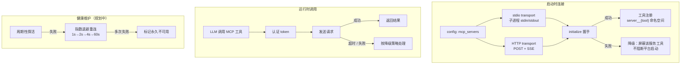

# mcp

> 写作提醒：功能描述只写可观察的行为，不写内部实现细节。验收标准只写端到端可验证的行为。

## 概述

外部工具集成层，通过 MCP（Model Context Protocol）协议将企业已有系统和第三方服务的能力接入平台，注册为 agent 可调用的工具。

**负责**：MCP 服务连接与维护、工具自动注册、认证管理、故障降级。

**不负责**：工具的业务逻辑（→ tool_registry 执行层）、LLM 决策调用哪个工具（→ agent_loop）、工具访问控制（→ agent_policy）。

**调用关系**：
- 依赖：config（服务地址与认证配置）
- 被依赖：tool_registry（注册 MCP 工具供 agent_loop 调用）

## 关键流程

## 现状

- ✅ **stdio 传输**：通过子进程 stdin/stdout 接入本机 MCP 服务（文件系统、本地脚本等）
  - 子进程标准输出只能写协议消息，混入 `print()` 调试输出会破坏协议

- ✅ **服务注册与启动配置**：`config/mcp.yaml` 声明服务列表，启动时自动连接并注册工具
  - 某个服务连接失败 → 该服务工具不可用，不影响其他服务和平台正常启动

- ✅ **工具命名空间隔离**：来自不同服务的工具自动加 `{server_id}__{tool_name}` 前缀
  - 双下划线是命名空间分隔符，单下划线是工具名本身的合法字符

- ⚡ **HTTP 传输**：支持 JSON-RPC over HTTP，可接入远程 MCP 服务
  - 尚未支持标准 MCP Streamable HTTP 规范（SSE、`Mcp-Session-Id` 会话管理、流恢复）

- ⚡ **API Key 认证**：从环境变量读取 key，自动附加到请求 header
  - 尚未支持 OAuth2、Token 自动刷新

- ⚡ **启动失败降级**：连接失败时打印警告，该服务工具不可用
  - 运行时故障的完整降级策略尚未实现

## 规划中（v1.0）

- [ ] **HTTP Streamable 标准支持**：完整实现 MCP Streamable HTTP 规范
  - SSE 流式响应
  - `Mcp-Session-Id` 会话标识管理
  - 断线重连时流恢复（`Last-Event-ID`）

- [ ] **会话管理**：与远程服务维护会话连续性
  - initialize 时保存服务端分配的 Session ID，后续请求 header 携带
  - 服务端返回 404（会话过期）→ 自动重新 initialize，对调用方透明

- [ ] **健康检查与重连**：持续监测服务可用状态
  - 定期探活（stdio 检查子进程存活；HTTP 发送 ping）
  - 异常时按指数退避重连（1s → 2s → 4s → ... 最长 60s）
  - 多次失败后标记永久不可用，需手动触发重连
  - 重连期间该服务工具返回「服务暂时不可用」，不静默卡住

- [ ] **完整降级策略**：单服务故障时按配置控制影响范围
  - `degrade`（默认）：从 AI 工具列表临时移除该服务所有工具，其他功能正常
  - `strict`：服务不可用时停止整个 agent
  - `silent`：仅记录日志，不做外部通知
  - 服务恢复后自动重新启用

- [ ] **OAuth2 认证**：支持需要 OAuth 授权的服务
  - Token 过期时自动刷新；认证失败时标记服务不可用并提示重新授权

## 验收标准

**场景 1：外部服务工具正常注册并可调用**
- Given：config 中声明了一个外部 MCP 服务（如 GitHub 工具服务）
- When：平台启动完成
- Then：该服务的工具对 agent 可见；用户请求触发后，agent 可成功调用并获得结果

**场景 2：单个服务连接失败不影响平台启动**
- Given：配置了两个 MCP 服务，其中一个在启动时无法连接
- When：平台启动
- Then：平台正常启动；连接失败的服务工具不可用；另一服务正常；告警日志记录失败服务信息

**场景 3：外部服务断开后自动恢复（v1.0）**
- Given：正常运行的外部服务中途断开连接
- When：断开发生后用户触发相关工具调用
- Then：该工具返回「服务暂时不可用」；后台自动尝试重连；重连成功后工具恢复正常

**场景 4：会话过期自动重建（v1.0）**
- Given：与远程 HTTP 服务建立的会话已过期
- When：下一次工具调用发出
- Then：服务端返回 404，平台自动重新 initialize 获取新 Session ID，工具调用重试成功，调用方无感知

**场景 5：降级策略生效（v1.0）**
- Given：某 MCP 服务配置 `mode=degrade`，该服务运行时故障
- When：agent 尝试调用该服务的工具
- Then：工具从 AI 可见列表中临时移除；agent 收到「工具不可用」提示；其他服务工具不受影响

## 测试边界

**需要单元测试的行为**：
- stdio 连接：子进程启动失败时降级，平台正常启动
- HTTP 连接：服务地址不可达时降级，不抛异常
- 工具命名：注册时 `{server_id}__{tool_name}` 格式正确，双下划线不混淆
- API Key 认证：环境变量存在时自动附加 header；不存在时跳过，不报错

**需要 mock 的依赖**：
- MCP 服务端（stdio/HTTP）：用 mock server 模拟正常响应和故障场景
- `config/mcp.yaml` 路径：`monkeypatch` 到临时文件
- 子进程启动（stdio）：mock `subprocess.Popen`，隔离真实子进程

## 待决问题

- [ ] 健康检查间隔：stdio 服务（子进程存活检测）和 HTTP 服务（ping）是否使用相同频率？（负责人：待认领）
- [ ] 永久不可用判定阈值：连续失败几次后标记，如何重置？（负责人：待认领）
