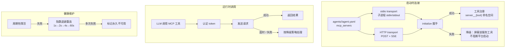

# mcp

> 写作提醒：功能描述只写可观察的行为，不写内部实现细节。验收标准只写端到端可验证的行为。

## 概述

外部工具集成层，通过 MCP（Model Context Protocol）协议将企业已有系统和第三方服务的能力接入平台，注册为 agent 可调用的工具。

**负责**：MCP 服务连接与维护、工具自动注册、认证管理、故障降级。

**不负责**：工具的业务逻辑（→ tool_registry 执行层）、LLM 决策调用哪个工具（→ agent_loop）、工具访问控制（→ `fleetent.governance.agent_policy`）。

**调用关系**：
- 依赖：config（全局 MCP 策略、服务地址与认证配置）
- 被依赖：tool_registry（注册 MCP 工具供 agent_loop 调用）

**模块归属**：
- owning package：`fleetent.integrations.mcp`

## 关键流程

## 现状

- ✅ **stdio 传输**：通过子进程 stdin/stdout 接入本机 MCP 服务（文件系统、本地脚本等）
  - 子进程标准输出只能写协议消息，混入 `print()` 调试输出会破坏协议

- ✅ **Streamable HTTP 传输**：标准 MCP Streamable HTTP——`initialize` 握手、`Accept: application/json, text/event-stream` 协商、JSON 与 SSE 两种响应解析、单调递增 request id 按服务隔离
  - 尚未实现 server→client 的 GET 流与 `Last-Event-ID` 断线流恢复（见规划中）

- ✅ **会话连续性**：保存服务端经 `Mcp-Session-Id` 分配的会话标识并在后续请求回携；服务端 404 / 会话失效标记时自动重新 `initialize` 并重试一次，对调用方透明；关闭时 best-effort `DELETE` 释放会话

- ✅ **健康检查与重连**：per-server 健康状态机（healthy / degraded / unavailable）；后台周期探活（默认 30s）；断连按指数退避重连（1s→2s→4s→…→60s 封顶）；连续失败达阈值（默认 5 次）标记 unavailable，需手动 `reconnect`；重连期间该服务工具返回「暂时不可用」而非静默卡住

- ✅ **降级策略**：per-server `degrade`（默认，临时移除该服务工具）/ `strict`（绑定该服务的 agent 停机）/ `silent`（仅静默日志）；经工具 schema 可见性过滤实现，服务恢复后无需重新注册即自动重新暴露

- ✅ **认证**：API Key（从环境变量读取，附加 `Authorization: Bearer`）、自定义 HTTP headers、OAuth2（`client_credentials` 流，token 缓存与到期前刷新、刷新串行化；凭据错误时 sticky 标记 auth 不可用并提示重新授权，瞬时错误可重试）

- ✅ **工具命名空间隔离**：来自不同服务的工具自动加 `{server_id}__{tool_name}` 前缀
  - 双下划线是命名空间分隔符，单下划线是工具名本身的合法字符

- ✅ **Agent-scoped 注册**：注册表 / 会话按 `(agent_scope, server_id)` 键控，同一 server id 可在不同 agent 下携带各自凭据与会话，互不泄漏

- ✅ **服务注册与启动配置**：Platform DB 负责 MCP authoring；Agent 绑定 MCP 后 materialize 到
  `agents/<agent-id>/agent.yaml` 的 `mcp_servers`，Agent 启动时自动连接并注册工具；服务凭据只保存环境变量名引用
  - 某个服务连接失败 → 该服务工具不可用，不影响其他服务和平台正常启动
  - 不再读取默认 MCP YAML 文件；MCP 定义来自 Platform DB / materialized Agent config

- ✅ **工具结果处理**：`CallToolResult` 经统一规范化为返回文本——聚合全部 content block（不止首块）；image/audio/embedded-resource 等非文本块以简洁文本标记表示（不把 base64 灌入上下文，stdio 返回图片不再崩溃）；`isError` 标记的工具错误以教学式错误文本回传给模型；无内容块但有 `structuredContent` 时序列化为 JSON

- ✅ **协议合规与发现完整性**：`tools/list` 按 `nextCursor` 游标分页取尽（注册与 probe，双传输，带页数上限）；注册前对服务端输入 schema 做保守净化（保证 `type:object`+`properties`，`definitions`→`$defs` 并重写 `#/definitions/` 引用）；`initialize` 捕获服务端 `protocolVersion` 与 `capabilities`（per-server），HTTP 在握手后回发 `MCP-Protocol-Version` header

- ✅ **stdio 子进程环境隔离**：stdio MCP 子进程仅继承经审定的安全宿主白名单（`PATH`/`HOME`/locale/临时目录等）+ server 显式声明的 `env`，**不再继承整个平台环境**（`DATABASE_URL`/API key/token 不外泄）；register 与 probe 一致；需把宿主值传入子进程时在 server `env` 显式声明

- ✅ **per-server 超时**：HTTP 操作超时 per-server 可配——连接/发现/探活/OAuth 用 `connect_timeout`（默认 10s），工具调用用 `call_timeout`（默认 30s）；可在 agent.yaml 的 `mcp_servers` 条目声明，缺省用默认（DB/admin 持久化为未来跟进）

- ✅ **动态工具刷新（stdio）**：stdio 服务发 `notifications/tools/list_changed` 时，经持久会话的 message handler 调度独立后台任务重新发现并原地重注册其工具（identity guard + 去重，规避 stdio 流 wedge），无需重启；HTTP 无持久 server→client 通道，其 list_changed 待未来流恢复一并做

- ✅ **resources / prompts 合成工具**：对 advertised `resources`/`prompts` 的服务，注册 `{server}__list_resources`/`__read_resource`、`__list_prompts`/`__get_prompt` 合成工具（capability 门控），调用分派到对应 MCP 方法（http JSON-RPC / stdio SDK）、结果 JSON 文本化；走 `{server}__*` 命名空间故自动受降级隐藏、stdio 刷新后保留

## 未来增强（本轮 6 变更程序已全部完成）

> 依据见 `docs/records/mcp-enhancement-2026-06/`（四参考项目差距分析 + 决策记录）。本轮范围 B 的 6 个变更——工具结果处理、协议合规与发现完整性、stdio 子进程环境隔离、per-server 超时、动态工具刷新(stdio)、resources/prompts 合成工具——已全部落地。以下为延后 / 待评估项：

- [ ] **schema 净化进阶（待评估）**：nullable `anyOf` union 折叠等 provider 专项适配（当前已做等价安全变换：`type:object` 保证、`definitions`→`$defs`、引用重写）
- [ ] **进度重置超时（待评估）**：收到 `notifications/progress` 时重置调用超时；当前 HTTP 为非流式请求/响应，需流式读改造，宜与「Streamable HTTP 流恢复」一并做
- [ ] **Streamable HTTP 流恢复**：server→client 的 GET 流与 `Last-Event-ID` 断线恢复
- [ ] **OAuth 富流程（待评估）**：DCR / PKCE / authorization_code / RFC 9728 discovery（自托管场景下 `client_credentials` 往往已足够，需产品决策）

## 验收标准

**场景 1：外部服务工具正常注册并可调用**
- Given：`agents/<agent-id>/agent.yaml` 的 `mcp_servers` 中声明了一个外部 MCP 服务（如 GitHub 工具服务）
- When：平台启动完成
- Then：该服务的工具对 agent 可见；用户请求触发后，agent 可成功调用并获得结果

**场景 2：单个服务连接失败不影响平台启动**
- Given：配置了两个 MCP 服务，其中一个在启动时无法连接
- When：平台启动
- Then：平台正常启动；连接失败的服务工具不可用；另一服务正常；告警日志记录失败服务信息

**场景 3：外部服务断开后自动恢复（v1.0）**
- Given：正常运行的外部服务中途断开连接
- When：断开发生后用户触发相关工具调用
- Then：该工具返回「服务暂时不可用」；后台自动尝试重连；重连成功后工具恢复正常

**场景 4：会话过期自动重建（v1.0）**
- Given：与远程 HTTP 服务建立的会话已过期
- When：下一次工具调用发出
- Then：服务端返回 404，平台自动重新 initialize 获取新 Session ID，工具调用重试成功，调用方无感知

**场景 5：降级策略生效（v1.0）**
- Given：某 MCP 服务配置 `mode=degrade`，该服务运行时故障
- When：agent 尝试调用该服务的工具
- Then：工具从 AI 可见列表中临时移除；agent 收到「工具不可用」提示；其他服务工具不受影响

## 测试边界

**需要单元测试的行为**：
- stdio 连接：子进程启动失败时降级，平台正常启动
- HTTP 连接：服务地址不可达时降级，不抛异常
- 工具命名：注册时 `{server_id}__{tool_name}` 格式正确，双下划线不混淆
- API Key 认证：环境变量存在时自动附加 header；不存在时跳过，不报错

**需要 mock 的依赖**：
- MCP 服务端（stdio/HTTP）：用 mock server 模拟正常响应和故障场景
- `agents/<agent-id>/agent.yaml` 路径：在临时 Agent home 下写入 server definitions，隔离本机 operator 配置
- 子进程启动（stdio）：mock `subprocess.Popen`，隔离真实子进程

## 待决问题

- [x] 健康检查间隔：统一 30s 后台探活（`_PROBE_INTERVAL`；stdio 检查子进程会话存活，HTTP 发轻量 `tools/list`）
- [x] 永久不可用判定阈值：连续失败 5 次（`_RECONNECT_MAX_ATTEMPTS`）标记 unavailable；手动 `reconnect()` 清零计数重试
