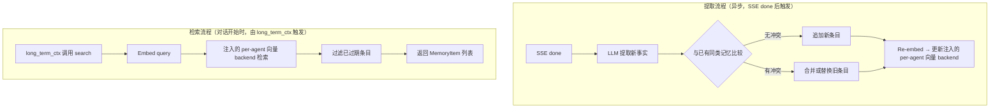

# memory

> 写作提醒：功能描述只写可观察的行为，不写内部实现细节。验收标准只写端到端可验证的行为。

## 概述

User Memory 的提取、存储与检索，让 agent 在多次对话中积累单个用户授权范围内的长期事实。

**负责**：从对话中提取用户相关事实，按类型结构化存储，支持向量相似度检索，并向 vector_store reindex 暴露当前可索引记忆。当前 `fleetent.memory` 已实现 User Memory，并提供 Agent Memory 数据层；Agent Memory 保存已确认的 agent 级上下文、偏好和流程，以 per-agent 物理库（`agent_state.db`）隔离，无 scope 列。User Memory 的向量写入与检索经 agent boot 注入的 per-agent backend（`agent_vectors.db`），embedding 仍走全局 `vector_store` provider。

**不负责**：企业文档知识（→ knowledge_base）、注入 system prompt 的协调与 token 预算（→ long_term_ctx）、未经 owner 确认的 reflection 写回。Agent Memory 的 prompt 注入由 long_term_ctx 按 context policy 协调，memory 只提供 `search_agent_memory` 检索 API。注：Agent Memory 经 long_term_ctx 的注入路径当前 descope，`build_context()` 尚未调用 `search_agent_memory()`；此功能待 Pilot 后评估启用。

### 记忆系统全局架构

fleetent 的记忆系统借鉴认知科学的四类记忆划分，每类由不同模块负责：

| 类型 | 内容 | 存储位置 | 负责模块 |
|------|------|---------|---------|
| **语义记忆** | 用户身份、偏好、临时状态等跨 session 事实 | SQLite `memory_items` + per-agent `agent_vectors.db` | `fleetent.memory`（本模块）|
| **情节记忆** | 对话与工具执行的完整历史轨迹 | SQLite `traces` 表 | `observability` |
| **程序记忆** | agent 完成特定任务的技能与方法 | `skills/` 目录 | `skill_registry` |
| **工作记忆** | 当前 session 的对话上下文（session 结束即释放） | 内存 | `context_mgr` |

本模块（`fleetent.memory`）负责两类语义记忆：User Memory 按 `identity` / `preferences` / `context`
三类结构化存储用户事实，owner 是 `user_id`，vector namespace 是 `mem:{user_id}`；Agent Memory 保存
agent 级已确认上下文、偏好与流程（`context` / `preference` / `procedure`），表为 `agent_memory_items`，
住在 `agent_state.db`，vector namespace 是 `agentmem:`（隔离通过 per-agent 物理库实现，无 scope 列）。
其余三类由各自模块独立管理，`reflection` 跨模块读取情节记忆（traces）与 User Memory 来生成维护建议；
真正改写、合并、标记 stale 或删除 User Memory 必须通过 owner-approved maintenance proposal 或用户显式
开启的低风险自动策略。

**调用关系**：
- 依赖：model_router（`memory_extraction` task，默认轻量模型，可通过 config 覆盖）、vector_store（向量索引）、config
- 被依赖：long_term_ctx（检索注入内容）、reflection（读取现有记忆、通过受控 public API 应用已批准维护 proposal）

**模块归属**：
- owning package：`fleetent.memory`
- public API：`search(user_id, query, limit)`、`extract_and_update(user_id, conversation)`、`iter_indexable_memories(user_id)`、`update_user_memory_content()`、`mark_user_memory_stale()`、`delete_user_memory()`、`merge_user_memories()`、`MemoryItem`、`AgentMemoryItem`、`create_agent_memory()`、`update_agent_memory()`、`archive_agent_memory()`、`search_agent_memory()`、`iter_indexable_agent_memories()`、`MemoryQualityTrendQuery`、`MemoryQualityTrendBucket`、`MemoryQualityTrendSummary`、`get_memory_quality_trend_summary()`
- owned tables：`memory_items`、`agent_memory_items`（住在 `agent_state.db`）
- config namespace：`memory.*`

## 关键流程

两条独立流程，分别在对话结束后和对话开始前触发。



## 数据模型

```sql
memory_items (
  id          TEXT PRIMARY KEY,  -- UUID
  user_id     TEXT,              -- → users.id
  type        TEXT,              -- "identity" | "preferences" | "context"
  content     TEXT,              -- 事实内容
  created_at  DATETIME,
  updated_at  DATETIME,
  expires_at  DATETIME           -- 仅 context 类有值；identity / preferences 为 NULL
)

agent_memory_items (
  id          TEXT PRIMARY KEY,
  type        TEXT,              -- "context" | "preference" | "procedure"
  content     TEXT,
  status      TEXT,              -- "active" | "stale" | "archived"
  source      TEXT,              -- "manual" | "reflection_proposal"
  source_ref  TEXT,
  created_by  TEXT,
  created_at  DATETIME,
  updated_at  DATETIME
  -- 无 scope_type / scope_id：隔离通过 per-agent 物理库（agent_state.db）实现
)
```

向量 embedding 结果写入当前 agent 的 `agent_vectors.db`，以 `memory_item.id` 为 key、`mem:{user_id}` 为 namespace，不写入此表。
Agent Memory 使用固定 namespace `agentmem:`（物理隔离已由 per-agent DB 保证）；active / stale 可检索，archived 从向量索引移除。

## 接口定义

```python
@dataclass
class MemoryItem:
    id: str
    user_id: str
    type: Literal["identity", "preferences", "context"]
    content: str
    created_at: datetime
    updated_at: datetime
    expires_at: datetime | None


async def search(user_id: str, query: str, limit: int = 10) -> list[MemoryItem]:
    """按语义相似度返回最相关的记忆条目，自动过滤已过期条目。由 long_term_ctx 调用。"""


async def extract_and_update(user_id: str, conversation: list[dict]) -> None:
    """从对话中提取事实，冲突检测后写入。SSE done 后异步调用，不阻塞响应。"""


def iter_indexable_memories(user_id: str) -> Iterator[IndexableItem]:
    """枚举当前应存在于 vector_store 的用户记忆。返回 namespace 为 mem:{user_id}，并排除过期记忆。"""


async def update_user_memory_content(user_id: str, memory_id: str, content: str) -> None:
    """通过 User Memory public API 改写单条 owner-scoped memory。"""


async def mark_user_memory_stale(user_id: str, memory_id: str) -> None:
    """通过 User Memory public API 将单条 memory 标记为 stale，并从 vector_store 移除。"""


async def create_agent_memory(type: AgentMemoryType, content: str, source: str, created_by: str) -> AgentMemoryItem:
    """创建 Agent Memory 并写入 agentmem: 向量 namespace（隔离通过 per-agent 物理库保证）。"""


async def search_agent_memory(query: str, limit: int = 10) -> list[AgentMemoryItem]:
    """检索当前 agent 的 active 或 stale Agent Memory；由 long_term_ctx 按 context policy 注入。"""


def get_memory_quality_trend_summary(query: MemoryQualityTrendQuery) -> MemoryQualityTrendSummary:
    """只读聚合 User Memory、Shared Memory 和维护 proposal 质量趋势；不触发提取或清理。"""
```

## 现状

**foundation 已完成**：`2026-05-31-memory-sqlite-semantic-store` 已归档。

已实现内容：
- `memory_items` SQLite 表，存储 `identity` / `preferences` / `context` 三类语义记忆
- `MemoryItem`、`extract_and_update(user_id, conversation)`、`search(user_id, query, limit)` public API
- `extract_and_update()` 调用 `memory_extraction` task，处理 `create` / `update` / `delete` / `ignore`
- memory extraction 输入包含有限 existing memory snapshot：identity 20、preferences 30、context 20
- `update` / `delete` 仅允许作用于当前用户 snapshot 内的合法 `target_id`
- context update 刷新 30 天 TTL，identity / preferences update 后不过期
- context 记忆默认 30 天 TTL，identity / preferences 默认不过期
- 写入 memory 后同步写入注入的 per-agent 向量 backend，namespace 为 `mem:{user_id}`
- `search()` 先用全局 `vector_store.embed_text()` 生成 query vector，再通过注入 backend 查相关 memory ids，回查 SQLite 并过滤过期 context
- `iter_indexable_memories(user_id)` public API 返回当前未过期 memory source records，供 vector_store 同步 reindex 使用
- reflection maintenance apply 只通过 `fleetent.memory` public mutation API，不直接写 `memory_items`
- Agent Memory 数据层已完成：`agent_memory_items` 表（住在 `agent_state.db`）、`AgentMemoryItem` public API、`agentmem:` vector namespace（per-agent 物理隔离）、reflection proposal apply 入口和最小 admin CLI；prompt 注入由 long_term_ctx 按 context policy 协调（默认关闭）
- Memory Quality Trend summary 已完成：按 day / week 只读聚合 User Memory type counts、expired context、exact duplicate candidates、Agent Memory type counts，以及 reflection maintenance proposal 的 status / action / risk counts
- 删除旧 JSONL memory 兼容和 `load_memories()` 直接注入路径

当前定位：已完成结构化语义记忆地基、基础维护动作、第一批 memory extraction evaluation 基线、与 KB
共用 embedding / vector-store 路径的 deterministic retrieval evaluation，以及显式 per-user retention / compaction 维护 API。

## 规划中（v1.0）

- [x] **结构化记忆类型**：按类型区分存储，取代 free-text JSONL 平铺
  - `identity`：身份事实（姓名、职位、技能）— 永久有效
  - `preferences`：工作偏好（风格、输出格式偏好）— 长期有效
  - `context`：临时状态（当前项目、进行中任务）— TTL 30 天，过期自动失效

- [x] **冲突检测与合并**：新提取的事实与已有同类记忆比较，按类型规则决定处理方式
  - `identity` / `context`：新覆盖旧（身份和状态以最新为准）
  - `preferences`：区分**明确陈述**（"我以后都想要..."）和**一次性请求**（"这次帮我..."）
    - 明确陈述 → 更新记忆
    - 一次性请求 → 不更新记忆，当前 session 上下文处理即可
  - 判断在提取 prompt 内完成，LLM 输出 `update` 或 `ignore`，不额外调用

- [x] **向量相似度检索**：通过注入的 per-agent 向量 backend 对记忆条目建立向量索引
  - 对外接口：`search(user_id: str, query: str) → list[MemoryItem]`
  - 由 long_term_ctx 在对话开始时调用

- [x] **memory extraction evaluation 基线**：使用 JSON fixtures、mock actions 和最终 memory 状态断言，覆盖 create / update / delete / ignore 关键场景

- [x] **embedding 检索效果验证入口**：通过 combined memory/KB fixture 验证 memory semantic retrieval
  - 默认使用 deterministic provider 和 tmp SQLite / tmp vector DB
  - 真实 HTTP embedding 仅在 `FLEETENT_EVAL_REAL_EMBEDDING=1` 且 endpoint / model / API key / dimensions 完整时手动运行

- [x] **retention / compaction 维护 API**：按 user_id 显式运行，不自动调度
  - dry-run 报告 expired context、per-type over-limit rows 和 duplicate compaction candidates
  - apply 删除 eligible memory rows，并调用注入 backend 的 `delete(id, mem:{user_id})`
  - duplicate compaction 只处理同 user / 同 type 的 normalized exact duplicates，不做 LLM summary / rewrite

- [x] **reflection maintenance owner boundary**：reflection 可生成 User Memory maintenance proposal
  - proposal 绑定 `user_id`，默认只有 owner 可以 approve / reject / apply
  - low-risk 自动 apply 必须显式开启，且不允许 delete / merge / rewrite / compact
  - 疑似团队共识、项目惯例、客户背景或组织经验只生成 `suggest_shared_memory_or_kb`，不写入 User Memory

## 当前缺口

- 提取质量已有 mock evaluation 基线，但还缺少真实 LLM 回归样本和长期趋势统计。
- 真实 embedding provider 边界已定义且有手动 evaluation 入口；尚未选择或部署自托管模型 endpoint。
- memory 条数已有显式维护 API；reflection proposal lifecycle 已建立，并已提供只读质量趋势 summary；尚未接入 scheduler、admin UI 或告警。
- reindex 入口由 vector_store 提供；memory 只暴露 source iterator，不承担 job history / worker / scheduler。

## 下一批候选 specs

- `memory-extraction-real-llm-regression`
- `memory-maintenance-scheduler-or-review-ui`

## 自动化效果验证缺口

- `tests/evaluation/` 已建立 memory extraction evaluation 基线。
- fixture 使用 JSON 格式，显式声明 `name`、`initial_memories`、`conversation`、`mock_actions`、
  `expected_memories` 和 `forbidden_memories`。
- 默认 evaluation 使用 mock LLM：`mock_actions` 驱动 `extract_and_update()`，runner 断言最终
  `memory_items` 状态包含 `expected_memories` 且不包含 `forbidden_memories`。SQLite 使用
  `tmp_path`，model_router 与 vector_store 均隔离，不触碰 `data/`。
- 默认命令：`uv run pytest tests/evaluation -x -q`。该命令只运行 deterministic mock
  evaluation，真实 LLM fixture case 默认 skip。
- Memory Quality Trend evaluation 使用 deterministic fixture 覆盖 exact duplicate candidate、expired
  context bucket 和 Shared Memory 与 User Memory 分离；runner 写入 tmp SQLite 并调用
  `get_memory_quality_trend_summary()`，不运行真实 LLM、不触发自动维护。
- 手动真实 LLM evaluation：设置 `FLEETENT_EVAL_REAL_LLM=1` 并提供 provider API key 后运行
  `uv run pytest tests/evaluation/test_memory_extraction_eval.py -q`。runner 会使用真实
  `memory_extraction` 路由，但仍使用 tmp SQLite 与 mock vector_store；缺少 provider API key
  时 skip。该模式用于 prompt 或模型变更后的人工质量检查，不进入默认 PR gate。

已覆盖的第一批提取场景：
- identity create
- identity update
- context update + TTL refresh
- preferences create
- one-off preference request ignore
- explicit forget / delete
- noisy or invalid conversation ignore

仍未覆盖：
- 长期 precision / recall 趋势和真实生产语料评估。

## 服务化 / 目录边界判断

User Memory 应继续作为模块化单体内的 `fleetent.memory` 边界。未来如果要独立服务化，
更可能拆出的是“memory evaluation / maintenance job”，而不是最早拆运行时读写路径。

## 验收标准

**场景 1：记忆跨 session 持久化**
- Given：用户在第一次对话中告知"我是后端工程师"
- When：用户开始第二次对话（新 session）
- Then：agent 在新 session 中能体现对用户身份的了解，无需用户重复说明

**场景 2：提取不阻塞响应**
- Given：一次正常对话
- When：agent_loop.run_stream() 发送 SSE done
- Then：记忆提取在后台执行，不延迟 done 事件

**场景 3：冲突检测（v1.0）**
- Given：用户记忆中已有 identity 条目"用户是后端工程师"
- When：用户在新对话中说"我现在转做产品了"
- Then：旧条目被替换，不出现两条矛盾的身份记忆

**场景 4：向量检索（v1.0）**
- Given：用户有 50 条历史记忆，当前话题是"Python 调试"
- When：long_term_ctx 调用 `fleetent.memory.search()`
- Then：返回与"Python 调试"相关的记忆条目，而非固定最近 20 条

**场景 5：context 类记忆过期（v1.0）**
- Given：用户 35 天前提到"正在做支付系统项目"（context 类，TTL 30 天）
- When：该记忆被检索
- Then：不出现在返回结果中

## 测试边界

测试分两层，职责不同。

**第一层：结构正确性（CI 自动运行，LLM 全部 mock）**

需要单元测试的行为：
- 冲突检测：identity 类新事实导致旧条目被替换，不产生重复
- preferences 信号强度：mock LLM 返回 `update` 时更新记忆，返回 `ignore` 时不更新
- TTL 过期过滤：search() 不返回 expires_at < now 的条目
- 类型分类：LLM 提取结果被正确归类到 identity / preferences / context
- 提取异步性：extract_and_update 不阻塞调用方（fire-and-forget）

需要 mock 的依赖：
- `model_router.get_async_client_and_config`：隔离所有 LLM 调用（提取和冲突判断）
- `vector_store`：隔离向量索引读写
- SQLite DB 路径：`monkeypatch` 到 `tmp_path`，绝不触碰 data/

**第二层：提取质量（定期手动触发，使用真实 LLM）**

用合成对话 fixture 验证端到端提取质量：
- 准备若干包含已知事实的多轮对话（如"用户告知职位、偏好、当前项目"）
- 跑完整提取流程，断言关键事实出现在记忆中且无幻觉条目
- 适合在升级 LLM 模型或修改提取 prompt 后触发，不纳入日常 CI

## 待决问题

- [ ] 冲突判断粒度：同 type 下全量比较，还是只对语义相似度超过阈值的条目做冲突检测？（负责人：待认领）
- [ ] context TTL 起算点：首次提及时间，还是最后一次提及时间？（负责人：待认领）
- [x] 记忆条数上限：v1.0 先设软监控阈值（超出记告警日志），还是直接按 type 设硬上限？如设硬上限，identity / preferences 各多少合适？超出时由 reflection 批量合并，还是 memory 模块内联驱逐？（负责人：待认领）
  - 已实现：每类设软上限（identity/context=20，preferences=30），通过显式 retention API 处理 over-limit rows（`maybe_run_maintenance()`），不自动驱逐；重复合并通过 exact duplicate compaction 处理。
