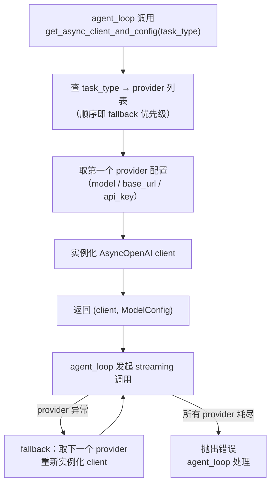

# model-router

> 写作提醒：功能描述只写可观察的行为，不写内部实现细节。验收标准只写端到端可验证的行为。

## 概述

按 `task_type` 将 LLM 调用路由到合适的 provider，并在主 provider 不可用时自动切换 fallback 链。是 agent_loop 与底层 LLM provider 之间的唯一中间层。

**负责**：task_type → provider config 映射、OpenAI-compatible client 实例化、fallback 链遍历与切换。

**不负责**：实际的 streaming / 调用（→ agent_loop）、工具调用执行（→ tool_registry）、成本追踪（→ observability）。

**调用关系**：
- 依赖：config（`config/agent.yaml` 中的 model provider / override 定义，legacy settings 路径仍保留兼容）
- 被依赖：agent_loop（每次 LLM 调用前取 client 和 config）、reflection（LLM 分析调用）

## 关键流程



> **client 无状态**：每次调用 `get_async_client_and_config` 均新建 client 实例，故意为之——client 无状态且廉价，避免跨请求状态泄漏。

## 接口定义

```python
def get_async_client_and_config(task_type: str = "default") -> tuple[AsyncOpenAI, ModelConfig]:
    """按 task_type 返回 (AsyncOpenAI client, ModelConfig)。
    每次调用新建 client，不复用。
    task_type 不存在时 fallback 到 "default"。
    """

class ModelConfig(TypedDict):
    model: str           # 模型 ID，如 "claude-opus-4-7"
    max_tokens: int
    temperature: float
    extra_params: dict   # provider 特有参数透传
```

## 现状

- ✅ **task_type 路由**：task_type → provider config 列表查找
- ✅ **OpenAI-compatible client**：复用 `AsyncOpenAI` SDK，base_url 可指向任意兼容端点（Anthropic / OpenRouter / 本地 Ollama 等）
- ✅ **Fallback 链**：provider 列表顺序即优先级，前一个失败自动切到下一个
- ✅ **config 驱动**：provider / model override 定义来自配置，不硬编码；当前部署入口使用 `config/agent.yaml`

## 规划中（v1.0）

- [ ] **请求级路由覆盖**：agent_loop 可在单次调用时传入 override 参数（如 `force_model="claude-haiku-4-5"`），跳过 task_type 映射
- [ ] **成本感知路由**：当月成本已接近预算上限时，自动降级到 cheap task_type
- [ ] **健康探针缓存**：provider 连续失败后标记为暂时不可用，fallback 时跳过，避免每次都等超时

## 验收标准

**场景 1：task_type 路由**
- Given：config 中 task_type "code" 映射到 provider A（首选）+ B（fallback）
- When：`get_async_client_and_config("code")` 调用
- Then：返回 provider A 的 client 和 ModelConfig

**场景 2：fallback 切换**
- Given：task_type "default" 映射到 provider A（不可用）+ B（可用）
- When：agent_loop 用 A 的 client 发起调用，A 返回连接错误
- Then：自动用 B 的 client 重试，最终 LLM 调用成功返回

**场景 3：所有 provider 耗尽**
- Given：task_type "default" 的所有 provider 均不可用
- When：fallback 链全部失败
- Then：抛出异常，agent_loop 捕获后向用户报错，不静默丢失

**场景 4：未知 task_type fallback**
- Given：config 中无 "rare_task" 的定义
- When：`get_async_client_and_config("rare_task")` 调用
- Then：自动使用 "default" task_type 的 provider 配置

## 测试边界

**需要单元测试的行为**：
- task_type 路由：正确 task_type 返回对应 provider 的 ModelConfig（model / max_tokens 等字段）
- fallback 切换：第一个 provider 抛出异常时，自动切到第二个 provider 重建 client
- client 无状态：两次调用返回不同的 client 实例对象（`assert client1 is not client2`）
- 未知 task_type：不存在的 task_type 不抛异常，使用 default

**需要 mock 的依赖**：
- `AsyncOpenAI`：mock 构造函数，验证 base_url / api_key 传参正确
- `config`：注入测试用 provider 配置（无需真实 API key）

## 待决问题

- [ ] task_type 的标准值集合：除 "default" / "cheap" 外，哪些 task_type 是平台约定的标准值？（负责人：待认领）
- [ ] 同一 task_type 同一 provider 的并发上限：单 provider 是否需要连接数限制？（负责人：待认领）
