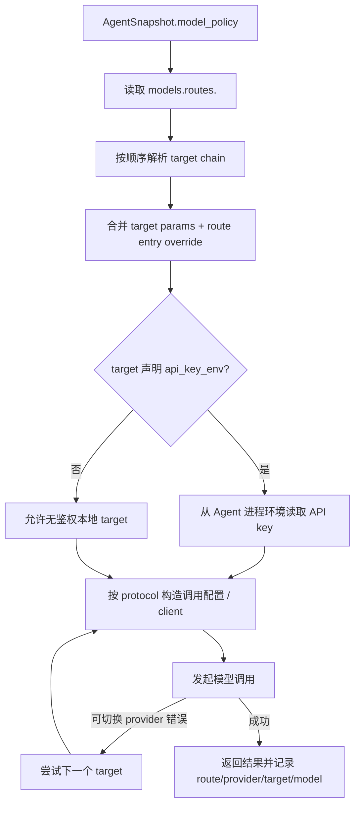

# model-router

> 写作提醒：功能描述只写可观察的行为，不写内部实现细节。验收标准只写端到端可验证的行为。

## 概述

按当前 Agent 的 `models` 配置解析模型调用目标，并在首选 target 不可用时按 route 顺序切换 fallback。它是
agent runtime、memory extraction、embedding / rerank、image generation 等调用模型能力时共享的模型策略层。

**负责**：Agent-scoped `models.targets` / `models.routes` 解析、OpenAI-compatible client 实例化、fallback 链遍历、API key env 引用校验、provider / target / route 元数据供审计和计费用。

**不负责**：实际 streaming / 调用（→ agent runtime）、工具调用执行（→ tool registry）、模型用量和成本聚合（→ observability / stats）、明文密钥存储（→ Agent `.env` / secret source）。

**调用关系**：
- 依赖：`agents/<agent-id>/agent.yaml` 中的 `models` section，以及 Agent 进程环境中的 `api_key_env`。
- 被依赖：agent runtime、memory / long-term context / reflection、embedding / rerank / image generation 相关 runtime。

## 关键流程



## 配置模型

`agent.yaml` 必须包含 `models.targets` 和 `models.routes`。

```yaml
models:
  targets:
    - id: primary
      provider: openrouter
      protocol: openai_chat
      base_url: https://openrouter.ai/api/v1
      model: anthropic/claude-3-5-sonnet
      api_key_env: FLEETENT_MODEL_PRIMARY_API_KEY
      max_tokens: 4096
      params:
        temperature: 0.2

    - id: fast
      provider: local
      protocol: openai_chat
      base_url: http://localhost:11434/v1
      model: qwen2.5

  routes:
    default:
      - target: primary
      - target: fast
        max_tokens: 2048
    memory_extraction:
      - target: fast
```

### targets

- `id`：Agent 内唯一 target id。
- `provider`：展示、审计、计费和 authoring 元数据；runtime 不按 provider 名写死分支。
- `protocol`：决定 runtime 调用方式。当前标准协议包括：
  - `openai_chat`
  - `http_embedding`
  - `http_rerank`
  - `openai_image_generation`
- `api_key_env`：可选。存在时 runtime 从 Agent 进程环境读取该变量；缺失时报配置错误，不静默 fallback。
- `params` / `max_tokens`：target 默认参数，可被 route entry 覆盖。

### routes

`models.routes` 是 route key 到 target entries 的映射。entry 顺序就是 fallback 优先级。

标准 route key：

- `default`
- `memory_extraction`
- `vision`
- `embedding`
- `rerank`
- `image_generation`
- `audio_transcription`
- `audio_generation`

补充约定：
- `embedding` route 对命名 Agent 属于**建议强配**而非强制 boot 前置条件。缺失时 vector-store runtime 会回落
  deterministic embedding 并记录 WARN，让 chat-only managed agent 仍可启动。
- 该回落只覆盖“route 完全缺失”。如果 `embedding` route 已声明但 target 协议不是
  `http_embedding`，或缺少 endpoint，则仍按配置错误处理并阻止启动。
- 生产环境应显式配置 `models.routes.embedding` 指向自托管 embedding provider，避免 KB / 向量检索质量退化。

## 现状

- ✅ **Agent-scoped model policy**：runtime 从 active Agent snapshot 的 `models` section 解析，不使用全局 route YAML。
- ✅ **OpenAI-compatible chat**：`protocol: openai_chat` 复用 `AsyncOpenAI` SDK，`base_url` 可指向 OpenAI-compatible endpoint。
- ✅ **Fallback 链**：route entry 顺序即 target fallback 顺序；可切换 provider 错误才尝试下一个 target。
- ✅ **Route override**：route entry 可覆盖 `max_tokens` 和 `params`。
- ✅ **API key env contract**：默认生成形如 `FLEETENT_MODEL_<TARGET_ID_UPPER>_API_KEY` 的变量名；不依赖 `ANTHROPIC_API_KEY` 等厂商固定变量名。
- ✅ **Service-readable snapshot**：`ModelPolicySnapshot` 可传递给未来拆分服务，包含 env var 名和 target 元数据，不包含明文 API key。
- ⚡ **Embedding / rerank / image routes**：schema 和 route key 已纳入 Agent `models`，具体调用适配按对应能力逐步接入。

## 规划中（v1.0）

- [ ] **真实 provider smoke 常态化**：把 OpenAI-compatible / embedding / rerank / image generation provider smoke 作为 Pilot 显式 opt-in 验证项维护。
- [ ] **成本感知路由**：当月成本接近预算上限时，自动选择更便宜的 route / target。
- [ ] **Provider dashboard**：按 agent / route / provider / target / model 展示健康、用量和成本。
- [ ] **Route policy UI**：在 Platform 侧管理 Agent model targets / routes，并 materialize 到 Agent home。

## 验收标准

**场景 1：Agent-specific route**
- Given：两个 Agent 的 `models.routes.default` 指向不同 target
- When：分别运行两个 Agent
- Then：每个 Agent 使用自己的 default route，不读取全局 route 配置

**场景 2：fallback 切换**
- Given：`default` route 中 target A 排在 target B 前，A 发生可切换 provider 错误，B 可用
- When：agent runtime 发起 LLM 调用
- Then：runtime 尝试 A 失败后切到 B，最终返回模型结果

**场景 3：route entry override**
- Given：target `primary` 默认 `temperature=0.5`，route entry 覆盖为 `temperature=0`
- When：runtime 解析该 route
- Then：实际调用配置使用 `temperature=0`

**场景 4：缺少 API key env**
- Given：target 声明 `api_key_env: FLEETENT_MODEL_PRIMARY_API_KEY`
- When：Agent 进程环境中没有该变量
- Then：调用失败并报告配置错误，不把明文 key 写入 `agent.yaml`

**场景 5：无鉴权本地 target**
- Given：本地模型 target 未声明 `api_key_env`
- When：runtime 调用该 target
- Then：允许无 API key 调用

## 测试边界

**需要单元测试的行为**：
- `models.targets` id 唯一性和 protocol 必填字段校验。
- `models.routes` 引用未知 target 时 fail fast。
- route chain 按顺序解析，route entry 覆盖 target 默认参数。
- `api_key_env` 缺失时报配置错误；未声明 `api_key_env` 的本地 target 可无鉴权。
- Agent A / Agent B 的 route 互不污染。

**需要 mock 的依赖**：
- `AsyncOpenAI` / HTTP provider client：验证 base_url、model、api_key、params 传参。
- 环境变量：隔离 Agent `.env` 中的 `api_key_env`。

## 待决问题

- [ ] image / audio route 的生产默认 provider 和 smoke 策略。
- [ ] 成本感知路由的默认阈值与回退策略。
- [ ] Provider dashboard 是否直接编辑 Agent `models`，还是只读观测、由 Agent authoring 流程负责写入。
