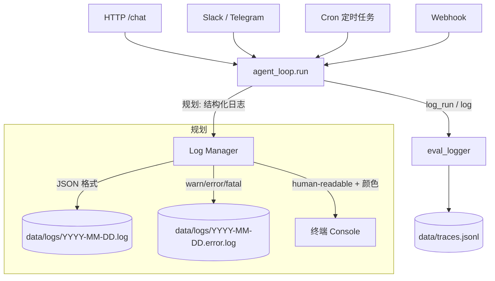
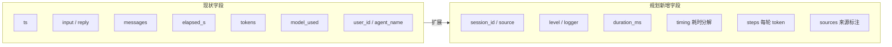

# observability

> 写作提醒：功能描述只写可观察的行为，不写内部实现细节。验收标准只写端到端可验证的行为。

## 概述

让每次 agent 运行可查、可分析、可排障。面向运维人员和管理员，不面向最终用户。

**调用关系**：
- 依赖：`eval_logger`、`config`
- 被依赖：`agent_loop`（写 trace）、`server.py`（未来的统计 API）

---

## 架构图

### 日志数据流



### 日志级别漏斗

```mermaid
flowchart LR
    ALL([所有日志事件]) --> S{当前级别}

    S -->|silent| DROP[全部丢弃]

    S -->|fatal| FA[fatal]
    S -->|error| FA & ER[error]
    S -->|warn|  FA & ER & WA[warn]
    S -->|info|  FA & ER & WA & IN[info]
    S -->|debug| FA & ER & WA & IN & DE[debug]
    S -->|trace| FA & ER & WA & IN & DE & TR[trace]

    FA --> OUT([写文件 / 输出终端])
    ER --> OUT
    WA --> OUT
    IN --> OUT
    DE --> OUT
    TR --> OUT
```

### Trace 字段结构（现状 → 规划）



---

## 现状

- ✅ **append-only trace 日志**：每次 run 写一条 JSONL 到 `data/traces.jsonl`
  - `log_run` 字段：`ts`、`input`、`reply`、`messages`、`elapsed_s`、`tokens`（`prompt` / `completion` / `total`）、`model_used`、`user_id`、`agent_name`
  - `log`（IM 感知）字段：`ts`、`user_id`、`messages`、`reply`、`platform`、`session_id`、`channel_id`、`thread_id`、`message_id`

- ✅ **流式 token 统计**：流式响应模式下正确记录完整的 input/output token 用量，trace 中 `tokens` 不为空

---

## 规划中

### 日志级别

- [ ] **七级日志**：`silent` / `fatal` / `error` / `warn` / `info` / `debug` / `trace`，运行时可配置
  - 低于当前级别的日志不写入文件也不输出终端
  - 各级含义：
    - `silent`：完全静默（测试 / 关闭日志场景）
    - `fatal`：进程无法继续（服务启动失败、配置损坏、关键依赖缺失）
    - `error`：操作失败但进程可继续（API 调用失败、tool 执行异常、session 崩溃）
    - `warn`：异常但已处理，功能可能降级（重试、rate limit 退避、字段截断、MCP server 不可达）
    - `info`：正常运行的关键事件（服务启动、session 创建/销毁、agent 触发）
    - `debug`：调试细节，生产默认不开（路由决策、工具调用入参/出参、记忆匹配）
    - `trace`：逐函数调用级（原始 Webhook payload、每次 LLM chunk、heartbeat）
  - `fatal` / `error` 额外附带 `file`（报错文件名）和 `line`（行号）

### 日志字段规范

- [ ] **结构化字段**：每条日志包含以下字段

  | 字段 | 说明 | 示例 |
  |------|------|------|
  | `timestamp` | 时间戳，精确到毫秒 | `2026-05-26T14:32:01.123+08:00` |
  | `level` | 日志级别 | `info` |
  | `logger` | 产生日志的模块 | `agent_loop` / `mcp_client` / `server` |
  | `session_id` | 会话 ID | `sess-abc123` |
  | `user_id` | 触发本次操作的用户 | `user-uuid-xxx` |
  | `agent_name` | 处理本次请求的 agent | `support-bot` |
  | `model` | 实际使用的模型 | `claude-sonnet-4-6` |
  | `source` | 触发来源 | `slack` / `webhook` / `cli` / `cron` |
  | `tokens` | 本次消耗 token | `{"prompt": 512, "completion": 128}` |
  | `duration_ms` | 操作耗时（毫秒） | `1340` |
  | `message` | 日志内容 | `tool calculate called` |

  - 非 agent 运行类日志（启动、配置加载等）中 `session_id` / `user_id` / `agent_name` / `model` / `tokens` / `duration_ms` 留空
  - `fatal` / `error` 额外附带 `file` 和 `line`

### 日志输出

- [ ] **按日期滚动**：日志按天写入 `data/logs/`，每天两份：
  - `data/logs/2026-05-25.log` — 全量日志，所有级别
  - `data/logs/2026-05-25.error.log` — 仅 `warn` / `error` / `fatal`，方便排错
  - 文件内时间戳精确到 HH:MM:SS

- [ ] **双通道输出**：日志同时写入文件和终端，两个通道独立配置
  - 终端：实时输出，human-readable 格式（带颜色、级别标识）
  - 文件：JSON 格式，便于日志系统采集
  - 两个通道可分别设置日志级别（如终端 `info`、文件 `debug`）
  - 任一通道写入失败不影响另一通道

### Trace 增强

- [ ] **性能耗时分解**：trace 中新增 `timing` 字段，记录各阶段毫秒级耗时
  - 字段：`memory_load_ms`、`llm_ms`（数组，每轮一条）、`tool_ms`（数组，每次调用一条）、`memory_extract_ms`

- [ ] **每步 token 分解**：多轮工具调用中每轮 LLM 用量单独记录
  - trace 中 `steps` 数组：每个元素含 `prompt_tokens`、`completion_tokens`，以及该轮触发的工具名（若有）

- [ ] **结果来源标注**：回复附带来源标签，标明内容出处
  - 标签范围：`[记忆]`（memory_layer 注入）、`[知识库]`（skill/RAG）、`[推理]`（模型直接生成）
  - SSE 流中新增 `source` 事件；`done` 事件携带 `sources` 字段

### Token 统计

- [ ] **per-user token 统计**
  - `uv run fleetent-admin token-stats --user <user_id> [--period 2026-05]`
  - 输出：总 `prompt_tokens`、总 `completion_tokens`、总 `turns`、时间范围

- [ ] **per-agent token 统计**
  - `uv run fleetent-admin token-stats --agent <agent_name> [--period 2026-05]`
  - 输出格式同上

### 安全

- [ ] **敏感信息脱敏**：日志和 trace 写入前自动脱敏
  - 脱敏范围：API key（`sk-*`、`ma-*` 等）、Bearer token、密码字段（`password` / `secret` / `token` 等 key 名）、手机号、邮箱
  - 脱敏规则：保留前 4 位 + `****`（如 `sk-an****`），不可逆
  - 脱敏仅发生在写入阶段，不影响运行时传递的原始值

### CLI 工具

- [ ] **`fleetent-admin log` 命令**：无需直接操作文件

  ```bash
  # 查看最新 N 行日志
  fleetent-admin log tail [--n 100]

  # 实时跟踪，持续输出新日志
  fleetent-admin log follow

  # 按条件过滤查询（可任意组合）
  fleetent-admin log query [--user <user_id>] [--agent <agent_name>] [--level warn] [--keyword <text>] [--n 200]

  # 动态调整运行中服务的日志级别（无需重启）
  fleetent-admin log set-level <level>
  fleetent-admin log set-level <level> --channel console
  fleetent-admin log set-level <level> --channel file
  ```

### 启动诊断

- [ ] **服务启动失败时输出结构化诊断信息**，覆盖场景：API key 缺失/无效、数据库不可写、MCP server 连接失败、配置文件解析错误
  - 每条诊断包含：组件名、失败原因、建议修复步骤

---

## 验收标准

### 现状

**场景 1：trace 记录完整**
- Given：一次正常的 `/chat` 请求
- When：请求完成
- Then：`traces.jsonl` 新增一条记录，包含 `user_id`、`model_used`、`tokens`、`elapsed_s`

**场景 2：流式响应下 tokens 不为空**
- Given：客户端发起流式 `/chat` 请求
- When：SSE 流结束
- Then：trace 中 `tokens.prompt` 和 `tokens.completion` 均有值

### 日志级别

**场景 3：日志级别过滤**
- Given：配置日志级别为 `warn`
- When：系统处理一次正常对话（产生 `info` 级别日志）
- Then：`info` / `debug` / `trace` 不出现在日志文件中；`warn` 及以上正常写入

**场景 3a：fatal / error 日志含文件行号**
- Given：配置级别为 `error`，某模块抛出未捕获异常
- When：异常被记录为 `error` 或 `fatal`
- Then：日志中包含报错文件名和行号（如 `agent_loop.py:185`）

**场景 3b：trace 级别可开启**
- Given：配置日志级别为 `trace`
- When：收到一条 Webhook 请求
- Then：原始 payload 和每次 LLM chunk 均出现在日志文件中

**场景 3c：silent 完全静默**
- Given：配置日志级别为 `silent`
- When：服务正常运行并处理请求
- Then：终端无任何输出，日志文件无任何写入

### 日志字段

**场景 4：日志字段完整性**
- Given：用户 alice 通过 Slack 向 support-bot 发送一条消息
- When：请求完成，写入日志
- Then：日志含 `timestamp`（毫秒精度）、`level=info`、`session_id`、`user_id=alice`、`agent_name=support-bot`、`model`、`source=slack`、`tokens.prompt`、`tokens.completion`、`duration_ms`、`message`

**场景 4a：非 agent 日志字段留空**
- Given：服务启动，写入一条 `info` 级别启动成功日志
- When：查看日志
- Then：含 `timestamp`、`level`、`message`；`session_id` / `user_id` / `tokens` / `duration_ms` 为空或不存在

### 双通道输出

**场景 5：双通道同时输出**
- Given：配置终端级别 `info`、文件级别 `debug`
- When：服务处理一次请求，产生 `debug`、`info`、`warn` 各一条
- Then：终端显示 `info` 和 `warn` 两条；日志文件写入全部三条

**场景 5a：两通道格式独立**
- Given：双通道均已启用
- When：写入同一条 `warn` 日志
- Then：终端输出带颜色的 human-readable 格式；文件中为同一条 JSON 记录

**场景 5b：文件通道故障不影响终端**
- Given：日志目录不可写（磁盘满）
- When：服务继续运行
- Then：终端日志正常输出，服务不崩溃，文件写入失败记录一条 `error` 到终端

### 日志文件滚动

**场景 6：按日期生成，每天两份**
- Given：服务在 2026-05-25 产生 `info`、`warn`、`error` 各若干条；2026-05-26 00:01 再处理一次请求
- When：查看 `data/logs/` 目录
- Then：存在 `2026-05-25.log`（含全部级别）和 `2026-05-25.error.log`（仅含 `warn`/`error`/`fatal`）；跨天后生成 `2026-05-26.log` 和 `2026-05-26.error.log`

**场景 6a：error.log 内容正确**
- Given：2026-05-25 产生 10 条 `info`、3 条 `warn`、2 条 `error`
- When：查看 `2026-05-25.error.log`
- Then：仅有 5 条记录（3 warn + 2 error）

### Trace 增强

**场景 7：性能耗时分解**
- Given：一次包含 2 次工具调用的 `/chat` 请求
- When：请求完成
- Then：trace 中 `timing` 含 `memory_load_ms`、`llm_ms`（数组）、`tool_ms`（数组）、`memory_extract_ms`

**场景 7a：每步 token 分解**
- Given：一次包含 2 轮工具调用的 `/chat`（共 3 次 LLM 调用）
- When：请求完成
- Then：trace 中 `steps` 数组长度为 3，每个元素含 `prompt_tokens`、`completion_tokens`，工具调用轮次含对应工具名

**场景 7b：结果来源标注**
- Given：回复内容一部分来自记忆注入，一部分来自模型推理
- When：SSE 流结束
- Then：`done` 事件的 `sources` 字段包含 `["记忆", "推理"]`，不包含 `"知识库"`

### Token 统计

**场景 8：per-user token 统计**
- Given：用户 alice 本月有 5 次对话，累计 10000 prompt tokens、3000 completion tokens
- When：`uv run fleetent-admin token-stats --user alice --period 2026-05`
- Then：输出 `prompt_tokens=10000`、`completion_tokens=3000`、`turns=5`

**场景 8a：per-agent token 统计**
- Given：agent `support-bot` 本月被调用 20 次，累计 50000 prompt tokens
- When：`uv run fleetent-admin token-stats --agent support-bot --period 2026-05`
- Then：输出 `agent_name=support-bot`、`prompt_tokens=50000`、`turns=20`

### 脱敏

**场景 9：API key 脱敏**
- Given：工具调用参数中包含 `api_key=sk-ant-abc123456`
- When：trace 写入 `traces.jsonl`
- Then：文件中该字段为 `sk-a****`，原始值不出现

**场景 9a：Bearer token 脱敏**
- Given：日志记录了含 `Authorization: Bearer ma-deadbeef...` 的请求头
- When：写入日志文件
- Then：日志显示 `ma-d****`，完整 token 不落盘

**场景 9b：运行时值不受影响**
- Given：agent 调用工具时传入含敏感字段的参数
- When：工具实际执行
- Then：工具收到的是原始未脱敏值

### CLI

**场景 10：log tail**
- Given：日志文件已积累数百条记录
- When：`fleetent-admin log tail --n 50`
- Then：输出最新 50 行日志，立即返回

**场景 10a：log follow**
- Given：服务正在处理请求
- When：`fleetent-admin log follow`
- Then：终端持续输出新产生的日志，Ctrl+C 退出

**场景 10b：log query 多条件组合**
- Given：agent `ops-bot` 有多条日志，其中部分含 `calculate`
- When：`fleetent-admin log query --agent ops-bot --keyword "calculate" --level warn`
- Then：返回同时满足三个条件的日志

**场景 10c：log set-level 动态生效**
- Given：服务运行中，当前终端级别为 `info`
- When：`fleetent-admin log set-level debug --channel console`
- Then：无需重启，后续终端立即输出 `debug` 日志；文件通道级别不变

### 启动诊断

**场景 11：API key 缺失**
- Given：未设置 `ANTHROPIC_API_KEY` 启动服务
- When：进程退出
- Then：stderr 包含组件名 `model_router`、原因 `ANTHROPIC_API_KEY not set`、建议 `export ANTHROPIC_API_KEY=...`

**场景 11a：MCP server 不可达**
- Given：`config/mcp.yaml` 配置了无法连接的 server URL
- When：服务启动完成（非致命，不退出）
- Then：启动日志输出 `warn` 级别诊断，包含 server id 和连接失败原因

---

## 待决问题

- [ ] 结果来源标注的粒度：整条回复打标签，还是按段落/句子标注？（负责人：待认领）
- [ ] 启动诊断中 MCP 不可达是 `warn` 还是 `fatal`？（负责人：待认领）
