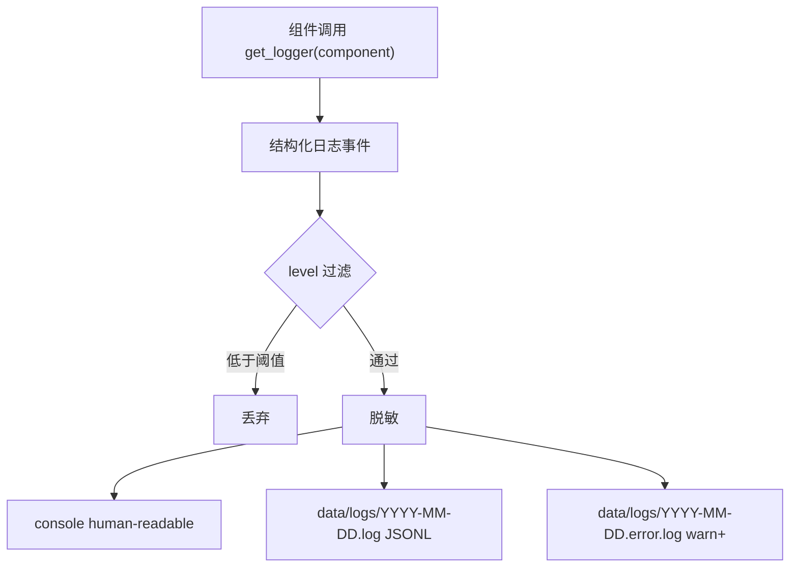
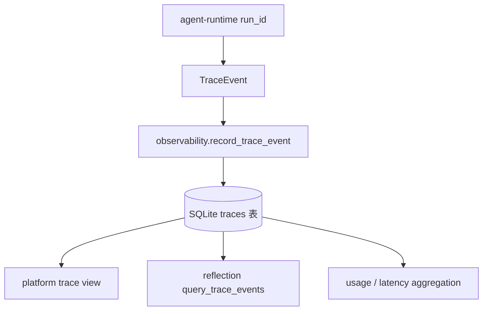
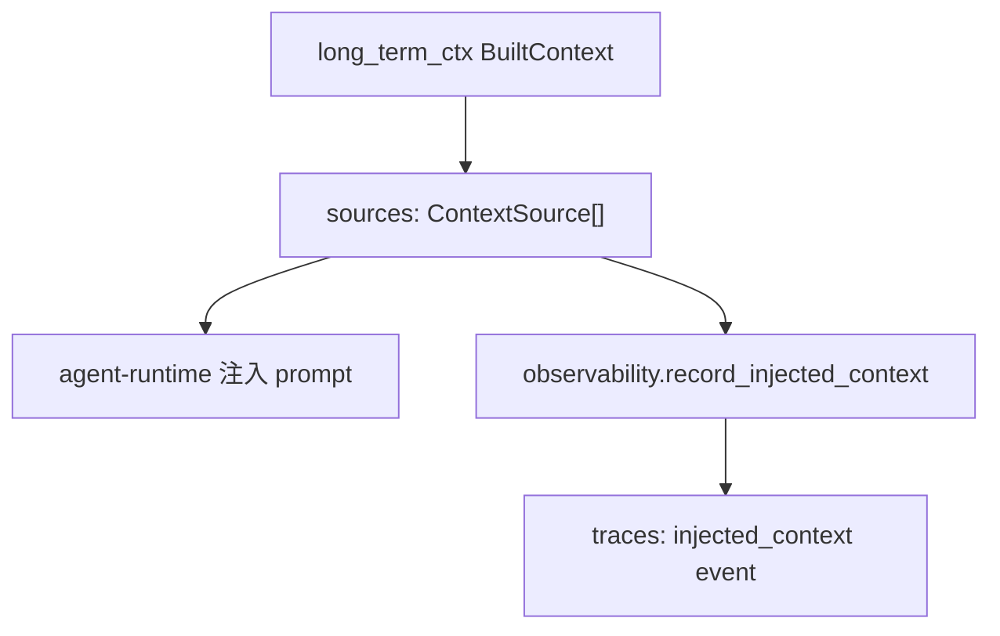

# observability

> 写作提醒：功能描述只写可观察的行为，不写内部实现细节。验收标准只写端到端可验证的行为。

## 概述

让 fleetent 的运行状态、agent 执行轨迹、成本与质量信号可查、可分析、可排障。面向工程师、运维人员、管理员和后续 reflection 系统，不面向最终用户。

**负责**：结构化程序日志、agent run traces、来源归因摘要、用量 / 性能统计查询、启动诊断与脱敏基线。
还包括 Pilot 运维使用的本地脱敏 diagnostics export，以及手动 diagnostics retention dry-run / apply。

**不负责**：业务逻辑正确性（→ agent-runtime / 各业务模块）、资源监控与告警通知 UI（→ platform）、基础设施采集器（→ deployment / platform）、外部 APM / OTel 集成（后续独立评估）。

**调用关系**：
- 依赖：config、database-runtime、agent-runtime 产出的运行事件
- 被依赖：agent-runtime（写 agent trace）、platform（trace / usage 查询）、reflection（读取 trace 发现模式）、governance（审计事件落点）

**模块归属**：
- owning package：`observability`
- public API：
  - logs：`get_logger(component)`
  - traces：`record_trace_event(event)`、`query_trace_events(query)`、`record_injected_context(run_id, sources)`
  - summaries：`get_usage_summary(query)`、`get_performance_summary(query)`
- owned tables：`traces`；后续 `audit_events` / `usage_rollups` 如落库也由 observability owns
- config namespace：`observability.*`

## 子域边界

observability 下分五个子域，统一归本 capability 管，但实施时拆成独立 OpenSpec changes。

| 子域 | 负责 | 不负责 | 优先级 |
| --- | --- | --- | :---: |
| Structured Logging | 程序日志、console/file 输出、日志级别、异常栈、启动诊断 | agent run 事件流、reflection 查询 | P0 |
| Agent Traces | agent 运行事件、工具调用、模型调用、审批、上下文注入、SQLite 查询接口 | console debug log、dashboard UI | P0 |
| Source Attribution | 记录最终注入 prompt 的 memory / KB source summary | 默认保存完整知识库 / 记忆内容、句子级引用 | P0 |
| Metrics / Usage | token、耗时、错误率、fallback、工具耗时的聚合查询 | 独立 metrics store、Prometheus / OTel | P1 |
| Diagnostics / Redaction | 配置 / DB / API key / MCP 启动诊断，日志与 trace 写入前脱敏 | 全量 DLP、内容安全审核 | P0 |

## 关键流程

### Structured Logging



### Agent Traces



### Source Attribution



## 数据模型

### Agent traces（v1.0）

`traces` 是 agent run 业务事件流的主存储，v1.0 直接使用 SQLite，不保留 `data/traces.jsonl` 兼容写入。

```sql
traces (
  id           TEXT PRIMARY KEY,
  run_id       TEXT NOT NULL,
  span_id      TEXT,
  parent_span_id TEXT,
  session_id   TEXT,
  user_id      TEXT,
  agent_id     TEXT,
  tenant_id    TEXT NOT NULL DEFAULT 'default',
  event_type   TEXT NOT NULL,
  ts           DATETIME NOT NULL,
  payload_json TEXT NOT NULL
)
```

建议索引：

```sql
idx_traces_run_id
idx_traces_user_ts
idx_traces_agent_ts
idx_traces_tenant_event_ts
```

### Structured logs（v1.0）

程序日志先写文件，不进入 `traces` 表，不作为 reflection 数据源。

```
data/logs/YYYY-MM-DD.log        -- 全量结构化程序日志，JSONL
data/logs/YYYY-MM-DD.error.log  -- warn / error / fatal
```

### Source attribution payload

默认 trace 只保存来源摘要，不保存完整 content。

```python
@dataclass(frozen=True)
class InjectedContextTrace:
    source_id: str
    source_type: Literal["memory", "knowledge"]
    title: str
    score: float
    token_estimate: int
    metadata: dict[str, str]
```

debug / trace 级别可记录被截断候选的短 preview，但必须脱敏并限制长度。

## 接口定义

```python
@dataclass(frozen=True)
class TraceEvent:
    id: str
    run_id: str
    event_type: str
    ts: datetime
    payload: dict[str, Any]
    span_id: str | None = None
    parent_span_id: str | None = None
    session_id: str | None = None
    user_id: str | None = None
    agent_id: str | None = None
    tenant_id: str = "default"


@dataclass(frozen=True)
class TraceQuery:
    run_id: str | None = None
    user_id: str | None = None
    agent_id: str | None = None
    tenant_id: str | None = None
    event_type: str | None = None
    start_ts: datetime | None = None
    end_ts: datetime | None = None
    limit: int = 100


def record_trace_event(event: TraceEvent) -> None:
    """写入一条 agent run trace event。"""


def query_trace_events(query: TraceQuery) -> Iterator[TraceEvent]:
    """按查询条件读取 trace events。reflection / platform 只通过此接口读取。"""


def record_injected_context(run_id: str, sources: list[InjectedContextTrace]) -> None:
    """记录最终注入 prompt 的长期上下文来源摘要。"""


def get_logger(component: str) -> Logger:
    """获取结构化程序 logger。"""
```

## 现状

**P0 foundation 已完成**：
- `2026-05-31-observability-structured-logging`
- `2026-05-31-observability-sqlite-agent-traces`
- `2026-05-31-observability-usage-summary`
- `2026-05-31-observability-source-attribution`

已实现内容：
- structured logger：七级日志、console/file 双通道、JSONL 文件、error 文件、脱敏和启动诊断
- SQLite traces：`TraceEvent`、`TraceQuery`、`record_trace_event()`、`query_trace_events()`
- 删除旧 JSONL trace API 和 `fleetent.eval_logger` shim，不保留向后兼容
- agent run completion trace：`agent_run_completed`
- usage summary：按 user / agent / tenant / session / time / model 聚合
- performance summary：按 user / agent / tenant / session / time 聚合 run、LLM、fallback、tool 和
  permission 等运行性能指标
- source attribution：`InjectedContextTrace`、`record_injected_context()`、`injected_context` event
- knowledge-base scope diagnostics：agent 没有显式 KB 绑定且默认 KB 为空时记录 `knowledge_base.agent_kb_scope_empty`
- admin query CLI：`fleetent-admin observability traces|usage|performance` 提供 run trace、用量和性能排障入口
- diagnostics export / retention：`export_diagnostics()` 生成本地脱敏诊断包，包含 logs、traces、usage / performance
  summary、connector 配置摘要和 latest status；`plan_diagnostics_retention()` /
  `apply_diagnostics_retention()` 只处理 logs、traces 和 diagnostics export 包，默认 disabled，不清理业务数据或备份
- observability contract tests：覆盖 agent run 的 `injected_context` / `agent_run_completed` 事件链路、
  source attribution payload safety、trace query、usage aggregation 和 performance aggregation contract

当前定位：具备基础日志、trace、usage 和来源归因能力，但还不是完整的 request trace / APM 系统。

## 规划中（v1.0）

### P0-A：observability-structured-logging

- [x] **七级日志**：`silent` / `fatal` / `error` / `warn` / `info` / `debug` / `trace`
  - console 和 file 可分别配置 level
  - `fatal` / `error` 额外记录异常文件、行号与 stack

- [x] **双通道输出**：console human-readable，文件 JSONL
  - `data/logs/YYYY-MM-DD.log`：全量结构化日志
  - `data/logs/YYYY-MM-DD.error.log`：warn / error / fatal
  - 任一通道写入失败不影响另一通道

- [x] **启动诊断**：服务启动失败或降级时输出具体组件、原因和建议
  - 覆盖 config 解析、database 不可写、API key 缺失、MCP server 不可达

- [x] **脱敏基线**：日志写入前脱敏 API key、Bearer token、password / secret / token 字段、手机号、邮箱

### P0-B：observability-sqlite-agent-traces

- [x] **SQLite traces 表**：agent run trace 主存储迁到 SQLite
  - `traces` 由 observability owns
  - 删除 `log_run()` / `log()` public API，不做兼容 wrapper
  - 删除 `fleetent.eval_logger` shim 和 `TRACE_PATH`
  - 删除 JSONL trace 写入路径，不做旧文件导入

- [x] **统一 TraceEvent API**：`record_trace_event()` / `query_trace_events()` / `TraceQuery`
  - reflection 和 platform 不直接读表或文件
  - 支持按 run / user / agent / session / tenant / event_type / time range 查询
  - `log` 命名只留给 structured logging，不再用于 agent trace

- [~] **轻量 span 关联**（部分实现）：记录 `run_id`、`span_id`、`parent_span_id`
  - `span_id`/`parent_span_id` 字段已加到 traces 表，span 树完整语义待补（见当前缺口）
  - 不引入 OpenTelemetry SDK
  - sub_agent 继承父 `run_id` 并生成子 span

- [x] **运行事件覆盖**（`observability-runtime-event-coverage`）：记录 run lifecycle、LLM 调用、工具调用、fallback、审批、上下文压缩、最终回复
  - 大 payload 可截断并写入截断标记
  - 工具参数 / 返回值写入前脱敏
  - 只定义 runtime event 覆盖，不在本阶段实现 performance rollup API

### P0-C：source attribution summary

- [x] **注入来源摘要**：记录最终注入 prompt 的 `InjectedContextTrace`
  - 默认不保存完整 memory / KB content
  - metadata 包含 `kb_id`、`document_id`、`chunk_id`、`memory_type` 等可追溯字段
  - 复用现有 `traces` 表，event_type 为 `injected_context`
  - 与同一次 `agent_run_completed` 事件复用同一个 `run_id`
  - `BuiltContext.sources` 为空时不写空事件

- [ ] **候选结果 debug preview（后续）**：debug / trace 级别可记录被截断候选的短 preview
  - preview 长度有限
  - 必须经过脱敏
  - 不包含在 `observability-source-attribution` 首个 implementation change 中

### P1：metrics / usage

- [x] **用量查询**：从 `traces` 聚合 per-user、per-agent、per-session、global token 用量
- [x] **性能统计**（`observability-performance-summary`）：从 trace events 聚合 LLM 耗时、工具耗时、错误率、fallback 次数和审批等待耗时
  - 先提供 Python public API，不新增 rollup 表
  - 通过 `query_trace_events()` 读取数据，session 过滤在 API 读取后按 trace event 执行
  - 后续 platform / dashboard 可通过该 API 或后续 HTTP endpoint 读取
- [x] **Admin 查询入口**（`observability-admin-query-api`）：`fleetent-admin observability traces|usage|performance`
  - trace 查询只输出事件元数据和 payload key summary，不输出 payload 原值
  - usage / performance 查询复用 observability public API，不直接访问 SQLite 表
- [ ] **预算查询接口**：供 agent-runtime 查询当前 run / session / 用户 / agent 用量

## 当前缺口

- runtime event coverage 已覆盖 run lifecycle、LLM call、tool call、permission、fallback、context compression 和 final reply；但 request_id / span 语义仍需强化，完整 trace tree 尚未完成。
- logs / traces / diagnostics export 已有手动 retention dry-run / apply；默认不设置保留天数，不自动清理。
- 备份保留策略仍由部署方管理；observability retention 不删除 SQLite backups。
- usage / performance summary 已有 Python public API 和 admin CLI；还没有 platform UI 或 HTTP 查询端点。
- 尚未接入 OpenTelemetry / Prometheus，也没有独立 metrics store 或 rollup 表。

## 下一批候选 specs

- `observability-request-trace-tree`
- `platform-trace-view`

## 自动化效果验证缺口

- 扩展完整 agent run fixture，验证事件流覆盖用户输入、模型、工具、上下文、完成事件。
- 验证脱敏 / 截断规则对大 payload 和敏感字段稳定生效。
- 验证 usage / performance 聚合在缺失字段、旧 trace、异常 run 下的容错。
- 验证知识库范围诊断事件不包含用户 query、文档正文或 credential 内容。
memory / reflection / long-term-ctx / knowledge-base 的效果评估应依赖已完成的 trace contract 证据。

## 服务化 / 目录边界判断

observability 当前应继续作为进程内基础设施模块。未来如果 trace 量变大，可把 trace storage / query
拆成独立服务或外部数据库，但现在更重要的是稳定事件 schema 和查询 API。

## 验收标准

**场景 1：结构化日志写入**
- Given：配置 console level 为 `info`、file level 为 `debug`
- When：组件写入 `info` 与 `debug` 日志
- Then：console 只显示 `info`，日志文件包含两条 JSONL 记录

**场景 2：启动诊断可读**
- Given：database 路径不可写
- When：服务启动
- Then：日志中包含组件名、失败原因和修复建议

**场景 3：trace 写入 SQLite**
- Given：一次正常 agent run
- When：请求完成
- Then：`traces` 表出现同一 `run_id` 下的事件，包含模型调用、token、耗时和最终回复摘要

**场景 4：不写 JSONL trace**
- Given：一次正常 agent run
- When：请求完成
- Then：系统不创建或追加 `data/traces.jsonl`

**场景 5：reflection 通过接口查询**
- Given：traces 表中有多个 agent 的历史事件
- When：reflection 调用 `query_trace_events(TraceQuery(agent_id="agent-1"))`
- Then：只返回该 agent 的事件，调用方不需要知道 SQLite schema

**场景 6：注入来源摘要可追溯**
- Given：long_term_ctx 注入了一个 memory 和一个 KB chunk
- When：agent run 写 trace
- Then：`injected_context` 事件包含两个 source summary，不包含完整 KB / memory content，并与本次 `agent_run_completed` 使用同一个 run_id

**场景 6a：无注入来源时不写空事件**
- Given：long_term_ctx 返回空 sources
- When：agent run 写 trace
- Then：系统不写入空的 `injected_context` 事件

**场景 7：脱敏生效**
- Given：工具参数中包含 Bearer token 和 password 字段
- When：trace 或日志写入
- Then：落盘内容中敏感值被不可逆脱敏

## 测试边界

**需要单元测试的行为**：
- 日志 level 过滤、双通道输出、文件写入失败隔离
- 脱敏规则覆盖 token / password / secret / email / phone
- `record_trace_event()` 写入 traces 表并序列化 payload
- `query_trace_events()` 按 run / user / agent / event_type / 时间过滤
- `record_injected_context()` 写入 `injected_context` trace event，且不写完整 content
- `record_injected_context()` 在 sources 为空时不写空事件
- `log_run()` / `log()` / `fleetent.eval_logger` 被删除，不再作为 public API

**需要 mock 的依赖**：
- SQLite database_url：使用 `tmp_path` 隔离
- 当前时间：注入固定时间，保证日志和 trace 可断言
- 文件写入错误：模拟单通道失败不影响另一通道

## 待决问题

- [x] `run_id` 使用 UUID 还是 ULID？已决定：ULID，在 agent-runtime 的 `run()/run_stream()/run_sync()` 入口生成。
- [ ] trace payload 的大字段截断阈值是多少？是否按 event_type 配置？（负责人：待认领）
- [ ] audit event 是独立 `audit_events` 表，还是 trace event 的一个 event_type？当前倾向独立表，避免污染 reflection 数据源。（负责人：待认领）
- [ ] logs 文件保留策略：按天数、大小，还是交给部署方 logrotate？（负责人：待认领）
