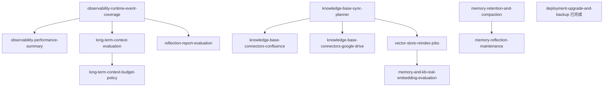
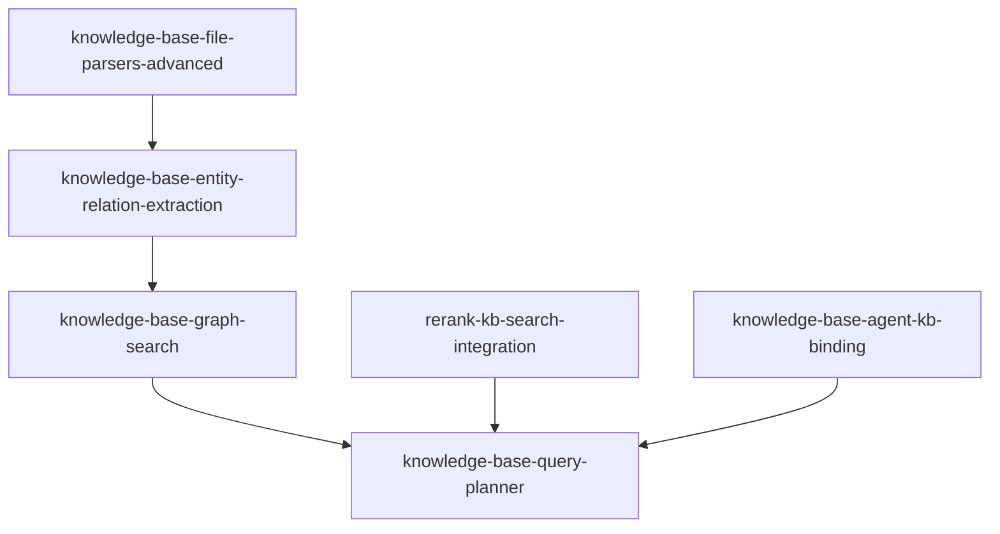
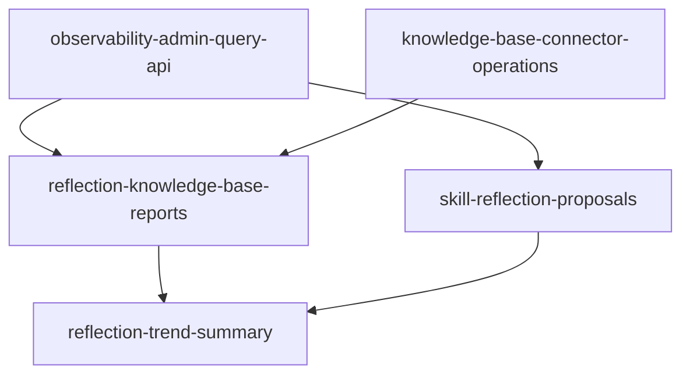
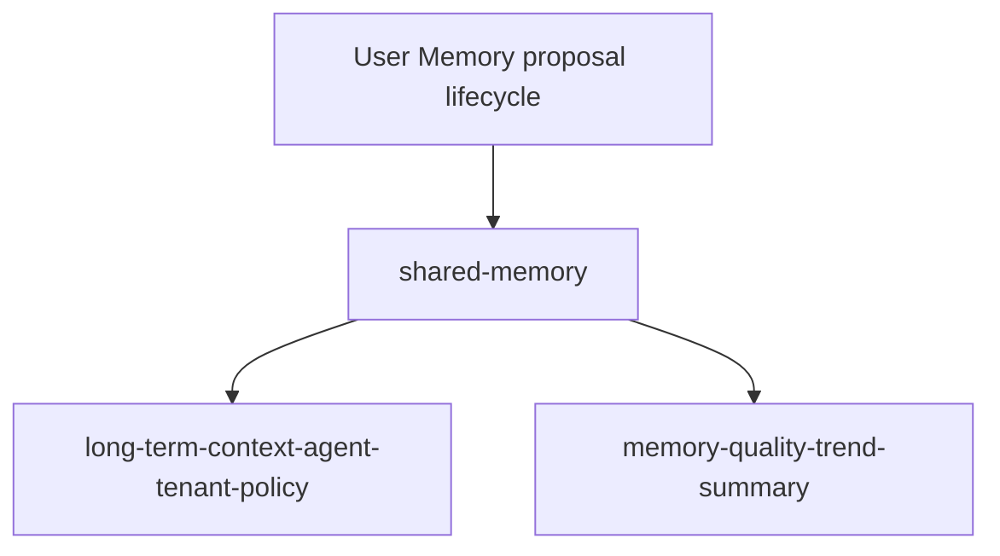

# owner-capability-roadmap

> 这份文档是常乐负责能力域的总控板，用来决定后续 OpenSpec 的优先级、依赖顺序和验收边界。

## 目标

把常乐负责或强依赖的能力模块放到同一张路线图里管理，避免按 spec 零散推进后失去全貌。

本路线图回答三个问题：

- 当前每个能力域做到什么程度。
- MVP 前还必须补哪些缺口。
- 后续 specs 应该按什么依赖顺序和批次推进。

## 范围

纳入本路线图的能力域：

| 能力域 | 文档 | 负责范围 |
| --- | --- | --- |
| Observability | [observability.md](observability.md) | logs、agent traces、source attribution、usage / performance summary |
| Memory | [memory.md](memory.md) | semantic memory、extraction、merge/update/delete、retention / compaction |
| Long-term Context | [long-term-ctx.md](long-term-ctx.md) | memory / KB context selection、token budget、prompt injection |
| Reflection | [reflection.md](reflection.md) | 从 trace / memory / KB 中发现改进建议 |
| Vector Store | [vector-store.md](vector-store.md) | vector backend、embedding / rerank provider、reindex |
| Knowledge Base | [knowledge-base.md](knowledge-base.md) | document ingest、local sync、hybrid retrieval、connectors |
| Deployment / Config | [deployment.md](deployment.md) | on-prem config、backup / upgrade、module runtime prerequisites |

不纳入本路线图直接管理，但会作为依赖引用：

- agent-runtime：产生 runtime events，是 observability 的主要数据源。
- platform / governance：后续展示 trace、审批、用户和 agent 绑定。
- connectors：用户级外部工具授权与凭证层；KB 数据源 connector 归 knowledge-base 能力域管理。

## 状态定义

后续能力状态固定使用以下 5 种，避免状态描述漂移：

| 状态 | 含义 |
| --- | --- |
| 已实现 | 关键用户路径已经完成，默认测试覆盖，短期只需维护 |
| 基础完成 | public API / store / 配置边界已建立，但效果验证、运维或生产化仍有缺口 |
| 部分完成 | 已有可用能力，但关键链路或边界仍明显缺失 |
| 仅设计 | 文档和 spec 已有方向，但没有可依赖实现 |
| 未开始 | 尚未进入设计或实现 |

## 当前能力地图

| 能力 | 当前状态 | 已有基础 | Pilot 后缺口 | 非 MVP 增强 |
| --- | --- | --- | --- | --- |
| Observability foundation | 基础完成 | structured logs、SQLite traces、usage summary、performance summary、source attribution、runtime event coverage、admin query CLI、diagnostics export / manual retention、contract tests | platform UI / HTTP 查询入口 | OTel / Prometheus、dashboard UI、告警 |
| Memory semantic store | 基础完成 | SQLite `memory_items`、create/update/delete/ignore、vector index、mock evaluation、combined embedding evaluation、retention / compaction API、owner-approved reflection maintenance apply API | scheduler / review UI 与趋势统计 | 长期质量趋势 |
| Long-term context | 基础完成 | memory / knowledge provider 接入、context source attribution、deterministic evaluation fixture、deterministic budget policy | agent / tenant 级 budget 策略 | 真实 tokenizer、个性化 budget、agent-specific policy |
| Reflection | 基础完成 | 读取 trace / memory 生成建议报告、deterministic report evaluation、User Memory maintenance proposal lifecycle | review UI / scheduler / trend summary | 自动 skill proposal、KB reflection reports |
| Vector store | 基础完成 | public API、namespace、in-memory backend、SQLite backend、embedding / rerank provider abstraction、同步 reindex API、combined embedding evaluation | rerank evaluation；rerank 接入 KB search | 后台 reindex job runtime、sqlite-vec、Qdrant、OpenSearch adapter |
| Knowledge base | 基础完成 | local ingest、parser registry、PDF / DOCX / PPTX / XLSX parser、chunking、vector + BM25 + hybrid retrieval、sync planner、evaluation fixture、reindex source iterator、combined embedding evaluation、Google Drive / Confluence connector baseline、Google Sheets / Slides export parsing、entity extraction schema + explicit run、`kb_extraction_runs`、`kb_entities`、agent 到多 KB 绑定、connector operations CLI / latest status | 真实 SaaS smoke 与生产凭据管理；graph search 仍未实现 | graph retrieval、document-level ACL、scheduler / full sync history、attachments / OCR / VLM |
| Deployment / config | 基础完成 | `settings.yaml`、MCP dedicated server file、legacy config fail-fast、本地 SQLite upgrade / backup 脚本、Pilot install checklist | config docs 对 intelligence runtime prerequisites 的收敛 | config center、Admin UI、hot reload |

## 依赖顺序

关键约束：

- `observability-runtime-event-coverage` 是 long-term context evaluation、reflection evaluation 和 performance summary 的前置。
- `knowledge-base-sync-planner` 是 Confluence / Google Drive connector 和 vector reindex jobs 的前置。
- `vector-store-reindex-jobs` 已提供同步 rebuild API，是真实 embedding / rerank evaluation 的前置。
- `long-term-context-evaluation` 先于 `long-term-context-budget-policy`。
- `memory-retention-and-compaction` 先于 `memory-reflection-maintenance`。
- Confluence / Google Drive connector 涉及企业数据源认证、权限、同步删除语义和数据边界，进入真实实现前需要人工确认。

## 推荐实施批次

### M1：可观测、可排查

目标：每次 agent 运行的关键行为都有可查询证据，工程师能定位问题。

建议 specs：

1. `observability-runtime-event-coverage`
2. `observability-performance-summary`

完成标准：

- LLM call、tool call、fallback、permission、context compression、final reply 都有 trace event。
- 可以按 run / user / agent / session 查询关键耗时、token、错误、fallback 和工具调用摘要。

已完成的 M1 spec：

- `observability-runtime-event-coverage`：补齐事件源，不做聚合 API。
- `observability-performance-summary`：基于 runtime events 提供 Python 聚合查询 API，不做 UI / rollup。

### M2：可同步、可重建

目标：KB 与 vector store 从“能导入”升级为“能维护和运维”。

建议 specs：

1. `knowledge-base-sync-planner`
2. `vector-store-reindex-jobs`（同步 public API；不含后台 job platform）
3. `deployment-upgrade-and-backup`（已完成：本地 SQLite backup / dry-run / backup-only / Alembic upgrade）

完成标准：

- KB sync 有 plan/execute separation、幂等状态和失败隔离。
- embedding / backend 切换后可通过同步 public API 重建 memory / KB index。
- 本地 SQLite / config / data 目录有最小备份与升级流程；migration 失败保留 backup，恢复由 operator 手动执行。

已完成的 M2 spec：

- `knowledge-base-sync-planner`：提供 sync action model、plan / execute separation、幂等 source state 更新、单 item 失败隔离，以及 local / remote connector 复用的同步执行边界。
- `vector-store-reindex-jobs`：提供 memory / knowledge-base 同步 reindex public API、dry-run、rebuild 清空目标 namespace 后重建索引，以及单条失败计数继续执行。
- `deployment-upgrade-and-backup`：提供本地 SQLite upgrade / backup 脚本、dry-run、backup-only、Alembic upgrade 前备份和 migration 失败保留 backup。

### M3：可评估

目标：核心 intelligence 能力的效果不只靠人工感觉判断。

建议 specs：

1. `long-term-context-evaluation`
2. `reflection-report-evaluation`
3. `memory-and-kb-real-embedding-evaluation`

完成标准：

- `tests/evaluation/` 能评估 memory extraction、KB retrieval、long-term context injection 和 reflection findings。
- 默认 evaluation 不依赖真实 LLM / embedding；真实模型评估通过显式环境变量手动开启。
- 每个 evaluation fixture 有 expected / forbidden 输出，能回归质量变化。
- `memory-and-kb-real-embedding-evaluation` 同时覆盖 memory semantic retrieval 和 KB retrieval，不默认连接外部模型。

已完成的 M3 spec：

- `long-term-context-evaluation`：基于 fake memory / knowledge provider 的 deterministic fixture，覆盖注入 text/source 的 expected / forbidden assertions；真实 provider smoke 默认 skip。
- `reflection-report-evaluation`：基于 fake observability / memory signals 的 deterministic fixture，覆盖 expected / forbidden findings 和 persisted transcript redaction；真实 route smoke 默认 skip。
- `memory-and-kb-real-embedding-evaluation`：基于 tmp SQLite / tmp vector DB 和 public reindex API 的 combined fixture，同时覆盖 memory semantic retrieval 和 KB retrieval；真实 HTTP embedding 默认 skip。

### M4：可维护、可演进

目标：长期运行后不会因为记忆、知识库和反思数据增长而失控。

建议 specs：

1. `memory-retention-and-compaction`
2. `long-term-context-budget-policy`
3. `memory-reflection-maintenance`

完成标准：

- memory 有 retention、compaction 和容量边界。
- long-term context 有可解释的 token budget 策略。
- reflection 的建议能进入受控 maintenance 流程，而不是自动无约束改写。

已完成的 M4 spec：

- `memory-retention-and-compaction`：提供 per-user dry-run/apply 维护 API，覆盖 expired context、per-type over-limit 和 exact duplicate compaction；不做 Shared Memory、scheduler 或 reflection 自动写回。
- `long-term-context-budget-policy`：提供 effective budget、memory / knowledge source budget、source top-k、query intent / explicit conflict preference 和 BudgetMetadata decision attribution；不做 LLM-driven selection、summarization、memory 写回或 connector ACL 策略。
- `memory-reflection-maintenance`：提供 reflection-owned User Memory maintenance proposals、owner approval / reject / apply lifecycle、低风险显式自动策略和 observability 事件；不做 Shared Memory、管理员默认代批、UI、skill proposal 或 KB 写回。

### M4b：企业知识源接入

目标：把 KB 从 local directory baseline 扩展到客户真实企业知识源，同时不绕过 sync planner 和数据边界。

建议 specs：

1. `knowledge-base-connectors-google-drive`
2. `knowledge-base-connectors-confluence`

完成标准：

- 外部 connector 基于 sync planner 接入，不绕过 KB public API。
- connector 明确认证方式、权限边界、source metadata、删除语义和失败恢复行为。
- 默认测试不连接真实 SaaS；真实 connector smoke 通过显式环境变量手动开启。

当前 KB MVP baseline 包含 local directory + Google Drive folder + Confluence Cloud scope 的手动 sync、sync planner、
hybrid retrieval 和 reindex；真实 SaaS smoke 仍需显式环境变量和凭据手动开启。

已完成的 M4b spec：

- `knowledge-base-connectors-google-drive`：提供 folder-scoped Google Drive connector config、OAuth `credential_ref`、fake client 默认测试路径、Google Docs HTML export、text / Markdown / HTML parser dispatch、planner / executor 分离、missing archive 语义和 opt-in smoke scaffold；不做 service account / domain-wide delegation、per-user Drive ACL、Sheets / Slides 结构化解析、scheduler 或真实 Google API 默认测试。
- `knowledge-base-connectors-confluence`：提供 Confluence Cloud API token `credential_ref`、space / page / page+children scope、fake client 默认测试路径、storage HTML parser dispatch、bounded 429 retry、planner / executor 分离、missing archive 语义和 opt-in smoke scaffold；不做 Server / Data Center、per-user page ACL、attachments / comments、scheduler 或真实 Confluence API 默认测试。

## Goal 推进结果与后续边界

本轮 M3 / M4 / M4b goal 已按依赖顺序完成并归档：

1. `long-term-context-evaluation`
2. `reflection-report-evaluation`
3. `memory-and-kb-real-embedding-evaluation`
4. `memory-retention-and-compaction`
5. `long-term-context-budget-policy`
6. `memory-reflection-maintenance`
7. `knowledge-base-connectors-google-drive`
8. `knowledge-base-connectors-confluence`

后续仍需要人工确认后再推进的方向：

1. Shared Memory：涉及 Memory 能力域扩展、scope ownership、确认主体和 long-term-ctx 第三类 provider。
2. agent / tenant 到多 KB 绑定策略：会改变用户查询可见范围和 KB 访问控制。
3. document-level ACL：会把 Google Drive / Confluence 权限映射到检索过滤，复杂度和安全风险都高。
4. 真实 SaaS connector 生产凭据管理：涉及 secret manager、token 轮换、授权失败恢复和审计。
5. 自动 scheduler / worker / sync history：会改变 connector 运行方式和运维面。

已完成的质量加固 spec：

- `intelligence-unit-test-hardening`：MVP foundation 后的测试质量加固，不改变 runtime 行为或 MVP 功能范围；
  常乐负责模块的 scoped unit coverage 已从约 64% 提升到 76%，相关全量 scoped coverage 为 94%。
  本轮补齐了 observability 聚合容错、vector provider payload / error parsing、reflection / memory
  决策边界和 connector fake-client failure branches。DB runtime、source-of-truth rebuild、connector sync
  和效果评估仍以 integration / evaluation tests 为权威验证层；不新增仓库级 CI coverage gate。

## 并行策略

已完成批次中的并行原则：

- `observability-runtime-event-coverage` 和 `knowledge-base-sync-planner`
- `memory-retention-and-compaction` 和 `knowledge-base-sync-planner`
- 已完成的 `deployment-upgrade-and-backup` 不阻塞 intelligence specs
- `long-term-context-evaluation` 和 `reflection-report-evaluation`
- `memory-retention-and-compaction` 和 `long-term-context-evaluation`
- connector contract / fake connector 设计可以和 evaluation specs 并行；真实 SaaS smoke 仍保持显式 opt-in

后续仍不建议提前做：

- Shared Memory 早于 User Memory ownership / proposal lifecycle 稳定。
- document-level ACL 早于 agent / KB 绑定策略。
- connector scheduler / worker 早于手动 sync observability 与失败恢复。
- reflection 自动化写回早于 owner-approved proposal review 入口。
- `rerank-kb-search-integration` 早于 rerank evaluation。

## MVP 标准分层

本 roadmap 中早期使用的 MVP-ready 更接近 **MVP Foundation**，表示常乐负责模块的核心能力、存储边界、
public API、测试基线和 OpenSpec 批次已经完成。它不等同于可以直接发布给真实客户小范围试用。

常乐对 MVP 的产品化目标应定义为 **Pilot MVP**：可以部署到生产或准生产环境，给少量真实用户试用，并且
具备基础配置、排障、回滚和验收闭环。

| 层级 | 含义 | 当前判断 |
| --- | --- | --- |
| MVP Foundation | 核心模块、API、存储、测试、评估、边界完成 | 常乐负责模块基本完成 |
| Pilot MVP | 可部署到真实环境，小范围用户可用，可配置、可排障、可恢复 | 常乐负责模块已基础完成，验收入口为 [Pilot acceptance guide](../deployment/pilot-acceptance-guide.md) |

### MVP Foundation 判定

常乐负责的模块可以认为 MVP Foundation ready，当且仅当：

- Observability 能解释一次 agent run 的主要行为、成本、耗时和错误。
- Memory 能跨 session 提取、更新、检索，并有 retention 边界。
- Knowledge base 能导入本地企业文档，能通过 Google Drive / Confluence connector 手动同步企业文档，支持混合检索，并能计划/执行同步；vector store 能重建索引。
- Long-term context 能从 memory / KB 中选择上下文，并有 evaluation 证明注入效果。
- Reflection 能生成可评估的报告，但自动写回保持关闭或受控。
- Vector store 能持久化索引，并支持 embedding / backend 变更后的 reindex。
- 默认测试不依赖外部 LLM / embedding / SaaS；真实模型效果验证有手动开关和 fixture。

### Pilot MVP 判定

Pilot MVP 的人工验收入口是 [Pilot acceptance guide](../deployment/pilot-acceptance-guide.md)。该指南用于真实测试环境验收，
不替代自动化测试；默认测试仍不连接真实 LLM、embedding、Google Drive 或 Confluence，真实外部 smoke 必须显式
opt-in，未配置时记录为 skipped。

常乐负责模块要达到生产小范围试用标准，还需要满足：

- 部署可用：有明确的安装 / 升级 / 备份 / 恢复流程，配置校验能在启动前暴露问题。
- 运维可排障：工程师或 operator 能通过 admin CLI、HTTP endpoint 或 platform UI 查询 run trace、usage、performance、错误和 connector sync 状态。
- 管理员可配置：能配置 agent 到 KB 的绑定、Google Drive / Confluence credential reference、同步范围和同步触发方式。
- 真实试用闭环：有 pilot acceptance checklist，覆盖用户入口、默认 agent、知识库同步、常见失败、回滚和问题上报路径。
- 数据治理可控：secret 不落库、不进日志；trace / logs retention、脱敏、备份范围和删除策略明确。
- 外部依赖可控：真实 LLM / embedding / SaaS connector 都有显式配置、smoke test 和失败降级说明，不依赖隐式默认云服务。

### Pilot MVP 已完成 specs

面向生产小范围试用的 production-readiness specs 已完成：

1. `observability-admin-query-api`：提供最小 run trace / usage / performance 查询入口，避免排障必须手写 SQL。（已完成 admin CLI）
2. `knowledge-base-agent-kb-binding`：定义 agent / tenant 到一个或多个 KB 的绑定策略和默认可见范围。（已完成）
3. `knowledge-base-connector-operations`：补 connector sync 手动触发、状态查询、失败摘要和真实 SaaS smoke 操作说明。（已完成基础 CLI / latest status）
4. `deployment-pilot-install-checklist`：沉淀 pilot 部署、升级、备份、恢复、健康检查和回滚清单。（已完成）
5. `data-retention-and-diagnostics-policy`：定义 logs / traces / connector state 的 retention、导出、脱敏和备份边界。（已完成）

Pilot MVP 后仍需真实环境验证：

- 使用真实 LLM / embedding provider 跑 smoke。
- 使用真实 Google Drive / Confluence credential_ref 跑 connector check / sync smoke。
- 按 `docs/deployment/pilot-install-checklist.md` 完成一次准生产安装、升级、备份、恢复和诊断包导出演练。
- 按 `docs/deployment/pilot-acceptance-guide.md` 完成 Go / Conditional Go / No-Go 判定，并把问题分类为
  Pilot blocker、docs gap、enhancement 或 out-of-scope。
- 根据试用反馈决定是否补 HTTP / UI 管理入口、credential store、scheduler / worker 或 full sync history。

### Pilot 后增强 / Knowledge Quality Track

Pilot 后增强可以与 Pilot 验收并行推进，但不默认阻塞第一次 Pilot 验收。只有验收报告中被分类为 Pilot
blocker 的问题才会阻塞 Go；docs gap、enhancement 和 out-of-scope 分别进入文档补齐、后续 spec 或外部 owner
跟进。

以下 specs 不是 Pilot MVP 的前置，但属于 capability 原规划中的重要知识库质量能力，需要进入 roadmap，
避免后续只做运维化而丢掉知识库增强方向：

1. `knowledge-base-entity-relation-extraction`：已完成 entity extraction schema、`kb_extraction_runs`、
   `kb_entities`、mentions / relations evidence、explicit run 和 deterministic extractor；graph search 仍未实现，
   不默认调用真实 LLM。
2. `knowledge-base-graph-search`：基于 entities / relations 做关系展开，返回关联 chunks，并提供 evaluation
   fixture 验证关系型问题的召回效果。
3. `knowledge-base-file-parsers-advanced`：已完成 PDF / DOCX / PPTX / XLSX、Google Sheets / Google Slides
   export parser registry 接入；OCR、扫描 PDF、image / VLM 解析仍需单独评估依赖、成本和数据主权影响。
4. `rerank-kb-search-integration`：把已有 rerank provider 接入 KB search，对 hybrid / graph candidates 做重排；
   默认 deterministic，真实 rerank provider 显式 opt-in。
5. `knowledge-base-query-planner`：在 vector / keyword / hybrid / graph / rerank 之间做查询策略选择；该 spec
   最容易引入 LLM 不稳定性，因此排在 entity extraction、graph search 和 rerank 接入之后。

建议依赖顺序：

### Pilot 后增强 / Reflection and Evolution Track

以下 specs 不直接阻塞 Pilot MVP，但会把 reflection 从“报告 / User Memory maintenance”扩展到知识库和
skill 演进，属于原 capability 里需要提高优先级的能力：

1. `reflection-knowledge-base-reports`：基于 retrieval traces、source attribution、KB sync 状态和用户问题，
   发现知识库缺口、过期文档、低命中主题和可能需要补充的来源；默认只生成报告，不自动写回 KB。
2. `skill-reflection-proposals`：基于 trace / tool usage / repeated tasks 发现可沉淀为 skill 的机会，生成
   owner-reviewed proposal；不自动创建或修改 skill。
3. `reflection-trend-summary`：对 reflection findings 做长期趋势统计，用于判断 memory / KB / skill 改进是否有效。

建议依赖顺序：

### Pilot 后增强 / Memory and Context Evolution Track

以下 specs 不直接阻塞 Pilot MVP，但属于 memory / long-term context 从个人记忆扩展到团队协作语境时必须
进入 roadmap 的能力：

1. `shared-memory`：定义 User Memory 之外的共享记忆实体、scope ownership、确认主体和写入 / 更新 / 删除
   lifecycle。默认不让管理员代批用户个人记忆，也不把企业共识直接混入 User Memory。
2. `long-term-context-agent-tenant-policy`：在 User Memory、Shared Memory 和 Knowledge Base 之间定义
   agent / tenant 级 provider 策略、budget 策略和冲突偏好。
3. `memory-quality-trend-summary`：跟踪 memory extraction、retention、proposal apply 后的质量趋势，判断记忆维护是否有效。

建议依赖顺序：

### Capability 完整度 / v1.1+

以下能力保留在完整 capability roadmap 中，但不建议进入 Pilot MVP 或 Knowledge Quality 首批：

- `knowledge-base-document-acl`：同一 KB 内文档级权限过滤，复杂度和安全风险高；Pilot 阶段先用多 KB + agent binding。
- image / VLM parsing：放在 advanced parser 之后单独评估，不默认进入首批文件解析。
- `vector-store-ann-backend`：sqlite-vec / Qdrant / OpenSearch adapter，等数据规模和性能瓶颈明确后再做。

## 后续维护规则

- 新增 intelligence 相关 spec 前，必须在本 roadmap 中标明所属批次和解锁关系。
- capability 文档状态变化时，同步更新本 roadmap 的“当前能力地图”。
- 每完成一个批次，重新评估下一批是否仍然是最高优先级。
- 不把探索性想法直接推进为实现 spec；先确认它解决哪个 MVP 缺口。
