# platform

> 写作提醒：功能描述只写可观察的行为，不写内部实现细节。验收标准只写端到端可验证的行为。

> **版本与范围（v1.0）**：本文档「现状」之外的全部内容——包括「架构总览」、「v1.0 规划」全部 bullet 与图、「验收标准」中标记 `(v1.0)` 的全部场景、「待决问题」全部条目——均纳入 fleetent **v1.0 设计与验收范围**，由 @Romanzhang 主导编写。v1.0 发布前所有 `(v1.0)` 场景须 100% 通过，「待决问题」须全部消化为明确决策或显式延期到 v1.1。

## 概述

多用户管理、API 认证和管理员操作，并向上扩展为统一的 Admin Web 后台——涵盖用户 / IM、Agent、Skill、聊天（试运行 + 会话管理）、知识库、connector、model_provider 管理，askit 编排与 fleetent 自管理，跨 agent 统计与单请求全链路追踪，以及资源监控与告警。是 fleetent 作为多租户平台的基础层与运维控制面。

**调用关系**：
- 依赖：user-center（用户创建、禁用、拉黑等写操作均通过 user-center 接口，不直接写 users 表）、user_store / im_user_store（只读，供 Bearer token 认证查询）、agent_store（Agent 定义与绑定的读写，供 Admin UI 的 Agent 管理页）、skill_registry（Skill 索引读取与热加载触发，供 Admin UI 的 Skill 管理页）、reflection（只读 `reflection_proposals(domain=skill)` 与 trend summary，供 Skill 提案 inbox / 投影展示；审批写路径仍归 agent-owned reflection / governance）、session_mgr（只读 / 接管，供 Admin UI 的聊天会话管理页）、agent_loop（admin 试运行聊天经统一 run 入口发起）、knowledge_base（知识库的导入 / 检索 / 删除，供 Admin UI 的知识库管理页）、connectors（per-user OAuth 授权状态与凭证生命周期，供 Admin UI 的 connector 管理页）、mcp（MCP server 连接状态与工具注册，供 connector 管理页的 MCP 子视图）、model_router（provider / 模型路由配置与单价表的读写，供 Admin UI 的 model_provider 管理页）、askit（外部 spec 编译 / 部署工具链，供 Admin UI 的 askit 编排控制台调用，详见「askit 编排控制台」）
- 被依赖：server.py（认证）、normalizer（用户查找）、admin CLI
- **职责边界**：platform 只提供 Agent / Skill / 聊天 / 知识库 / connector / model_provider / askit 操作的**管理面**（Admin UI 上的增删改查、启停、绑定 / 分配、按系列触发与观测）；它们的**运行语义**——Agent 的 allowed_tools 校验、审批、路由解析归 [governance](./governance.md) / [agent-runtime](./agent-runtime.md)；Skill 的扫描 / 匹配 / 注入 / 禁用 / 安全审计归 [skill](./skill.md)，AI 自动生成的 Skill 提案与审批流归 [reflection](./reflection.md)；聊天会话的并发锁 / 原子持久化 / 上下文压缩归 [session](./session.md) / agent-runtime；知识库的解析 / 分块 / 索引 / 检索归 [knowledge-base](./knowledge-base.md)；connector 的 OAuth consent / 凭证刷新 / 注入归 [connectors](./connectors.md)，MCP 服务连接 / 工具注册 / 降级归 [mcp](./mcp.md)；model_provider 的 Agent-scoped targets / routes、fallback 和 client 实例化归 [model-router](./model-router.md)；askit 的 spec 编译 / 校验 / 部署 / 覆盖回流等语义归 **ai-skills-toolkit 外部工具域**。本模块只交叉引用、不重复定义这些语义
- **不涉及**：config（属 deployment 域）

## 架构总览

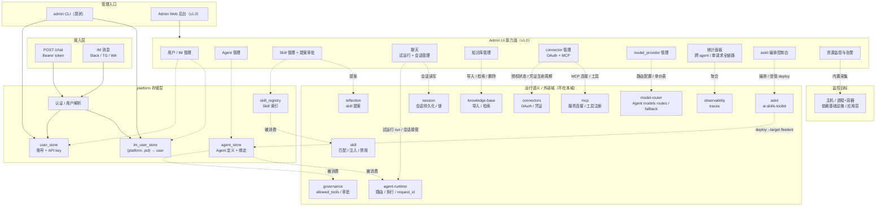

## 现状

- ✅ **Bearer token 认证**：`Authorization: Bearer ma-<64hex>`，`ma-` 前缀区分服务 key 与模型 API key
  - get_by_api_key() 查 SQLite，无外部 IdP

- ✅ **CLI 鉴权模型：OS-level、无登录**：所有 `fleetent-admin ...` 命令直接读写本地 SQLite，不经过 HTTP 鉴权也不要求 admin 登录；访问控制完全交给 OS 层（ssh key / sudo / 数据目录文件权限），遵循 **"能 ssh 到主机即视为受信"** 的企业内部工具惯例（Camunda、PostgreSQL psql、Kafka CLI 等皆是此模型）
  - 代价：审计日志只能记录 OS user（`root` / `ubuntu`），无法追溯到具体 fleetent admin 身份
  - 对策：v1.0 起 CLI 严格收窄到低危操作（建用户、加 IM allowlist），加黑 / 封禁 / 降级 / 改角色 等高危动作只能在 UI 中由 admin 角色完成（详见「规划中」权限矩阵 CLI 列）

- ✅ **用户管理 CLI**：create-user、list-users、rotate-key

- ✅ **IM 用户管理 CLI**：approve-user、block-user、list-pending（v1.0 起 IM 用户首次会话**默认放行**，`approve-user` / `list-pending` 仅作历史兼容；`block-user` 收回到 UI 由 admin 操作）

## 规划中（v1.0）

- [ ] **管理员后台（Admin UI）**：面向管理员的可视化后台，设计哲学「集中管控、admin 建账」——不开放公网自助注册，所有 web 用户由 admin 手动建或发邀请链接创建；**统一管理 web 用户和 IM 用户**，共享同一个内部 User UUID（1 套 web 身份：邮箱 + 密码 + 0~N 把 API key；0~N 个 IM 身份：每条 (platform, platform_user_id) 映射到该 User）

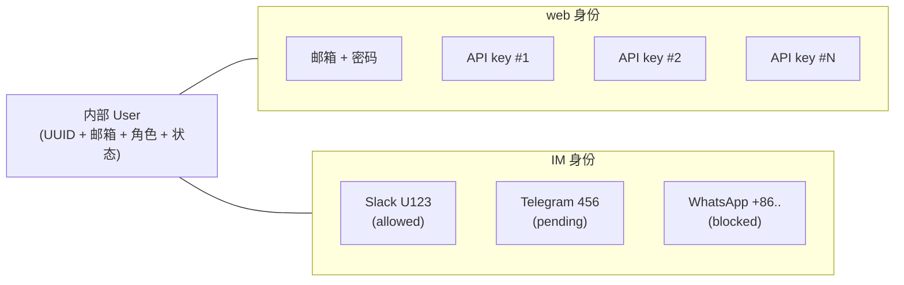

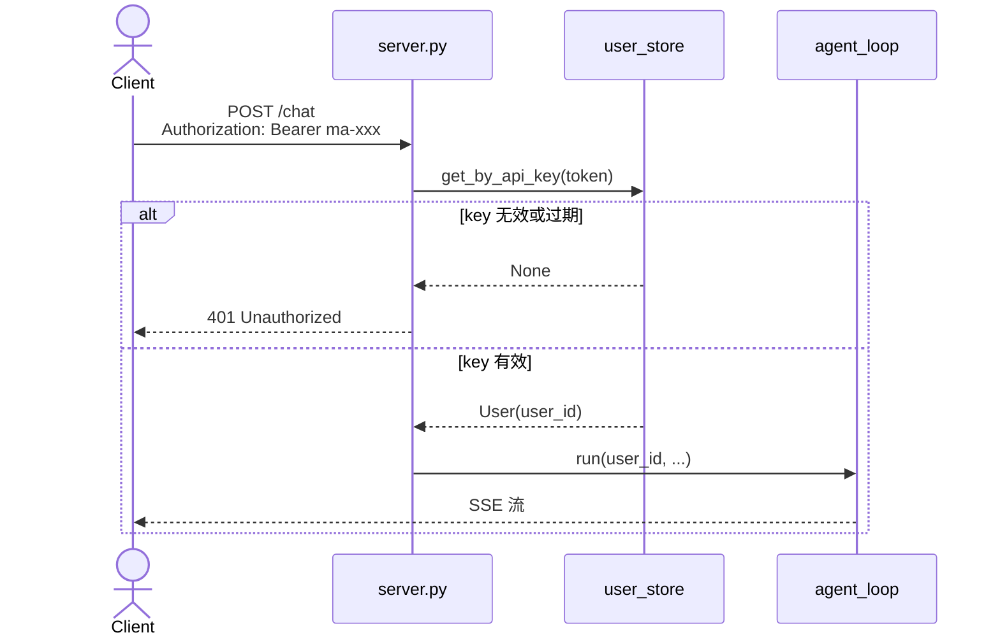

- [ ] **用户管理页 + IM 工作台双视图**：admin 后台两个互通入口；加黑 / 禁用可在 User 维度（级联失效所有 web + IM 身份）或单独 IM 身份维度（只封某个 Slack 账号，不影响该 User 其他身份）
  - 用户管理页（以内部 User 为主视角）：列表展示所有 User，详情页一屏可见 web 身份、API key 列表、所有 IM 账号、用量、历史会话
  - IM 用户管理工作台（以待办为主视角）：展示所有活跃 / 被加黑的 IM 身份，可批量加黑 / 恢复，点任意一条跳回对应 User 详情页

- [ ] **内置 admin 账户**：系统首次启动自动种子化一个用户名固定的内置管理员（如 `admin`），首次登录强制修改初始密码后才可进入后台；该账号不可删除、不可改用户名、不可被降级，永远拥有全部权限；只能由其本人在后台修改自己的密码

- [ ] **角色管理**：内置两级角色——admin（全权管理用户、API key、配额、IM 加黑 / 恢复）、viewer（只读浏览仪表盘 / 审计 / 会话）；内置 admin 与任意 admin 可将其他用户提升为 admin 或降级为 viewer，也可撤销角色；任何角色都不可降级或删除内置 admin

- [ ] **管理员登录**：邮箱 + 密码登录，登录后按角色自动区分可见菜单与可操作按钮，高敏感操作支持 2FA，登录会话空闲超时自动登出

| 操作 | 内置 admin | admin | viewer | CLI |
|------|:----------:|:-----:|:------:|:---:|
| 创建普通用户 | ✅ | ✅ | ❌ | ✅ |
| 删除普通用户 | ✅ | ✅ | ❌ | ❌ |
| 提升 / 降级其他用户角色 | ✅ | ✅ | ❌ | ❌ |
| 加黑 / 恢复 IM 用户 † | ✅ | ✅ | ❌ | ❌ |
| 一键拉黑用户（含 admin） † | ✅ | ✅* | ❌ | ❌ |
| 改全局 / 用户配额 | ✅ | ✅ | ❌ | 部分 |
| 浏览审计 / 会话 / 仪表盘 | ✅ | ✅ | ✅ | ❌ |
| 修改内置 admin 用户名 | ❌ | ❌ | ❌ | ❌ |
| 删除 / 降级内置 admin | ❌ | ❌ | ❌ | ❌ |
| 修改内置 admin 密码 | ✅（仅自己） | ❌ | ❌ | ❌ |

\* 普通 admin 不可拉黑内置 admin
† 加黑 / 封禁 / 拉黑类高危动作只能在后台 UI 由 admin 角色完成，CLI 不开放对应命令（v1.0 起 `block-user` 收回）

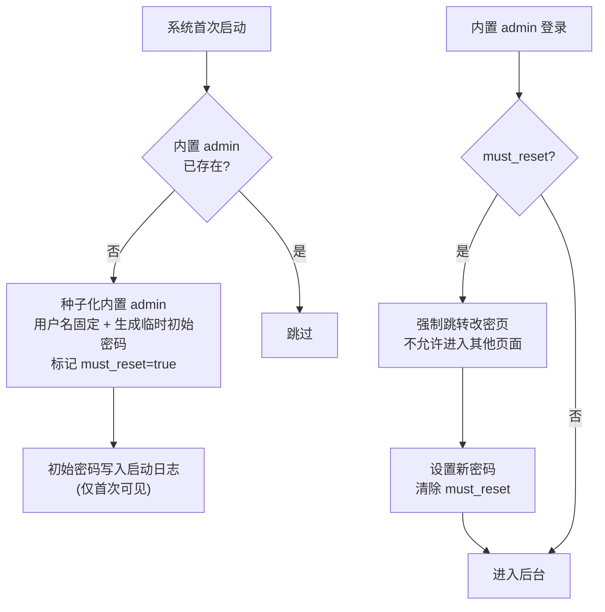

- [ ] **admin 手动建用户**：在用户管理页填写邮箱 / 姓名 / 初始密码（或勾选"用户首次登录自行设置密码"），账号即刻可用；支持 CSV 批量导入；**无任何面向公网的自助注册入口**

- [ ] **邀请链接发码**：admin 可对单个邮箱生成一次性邀请链接并发送邀请邮件，用户点击链接、设置密码后激活账号；邀请 token 有过期时间，使用后立即失效

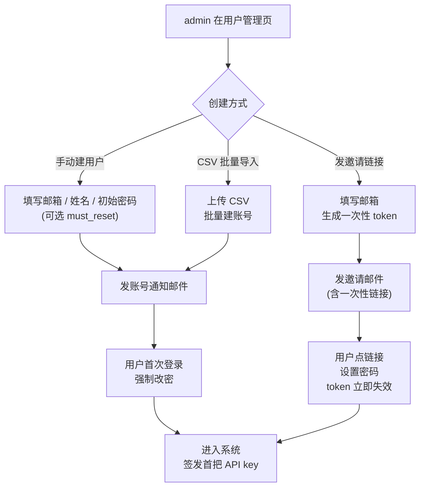

- [ ] **用户列表与生命周期**：列表按名称 / 邮箱 / 状态 / 创建时间 / 最近活跃 / **绑定 IM 平台数量**排序与筛选，可按"含 IM 身份 / 仅 web / 仅 IM"切换视图；用户详情页**一屏并列展示** web 身份（邮箱 / 角色 / 密码状态）、API key 列表（含使用情况）、所有平台的 IM 账号（含 allowed / blocked 状态，可对单个 IM 身份执行加黑 / 恢复）、用量曲线、历史会话；可编辑 / 禁用 / 删除整个 User

- [ ] **多 API key 管理**：一个用户可拥有多把 key，每把可设有效期、**scope（agent 级白名单）**、备注；支持**独立新增 / 轮换 / 撤销**任意一把，互不影响（典型场景：旧 key 在用、为 CI/CD 新签一把；或单独撤销疑似泄露的一把而不影响其余）
  - **scope 粒度 = agent 级**：每把 key 可绑定一个 agent 白名单（如 `[ops-bot, support-bot]` 或 `*` 表示全部），调用 `/chat` 时若路由到的目标 agent 不在白名单内，请求被拒
  - 设计意图：让 CI/CD 自动化 key 只能触达运维 agent，业务 key 只能触达业务 agent，单把 key 泄露时爆炸半径最小化到一个 agent 边界
  - 不做 endpoint 级 scope（如 readonly / readwrite）：fleetent 对外只有 `/chat` 一个有意义的写入端点，endpoint 粒度无实际意义

- [ ] **API key 使用情况展示**：每把 key 列表显示创建时间、最后一次使用时间、最近来源 IP / UA、累计调用次数，用于审计与泄露排查

- [ ] **API key 过期提醒**：设了 TTL 的 key 在到期前 N 天向账号邮箱发送续期提醒，UI 上标记"即将过期"；用户可在 UI 一键续期，过期当日自动失效并写审计

- [ ] **一键拉黑与解封**：拉黑后所有 key 立即失效、关联 IM 账号同步封禁、同邮箱 / OAuth subject 后续注册被拒；拉黑必须填写原因写入审计；解封后账号可登录但已失效的 key 不自动恢复

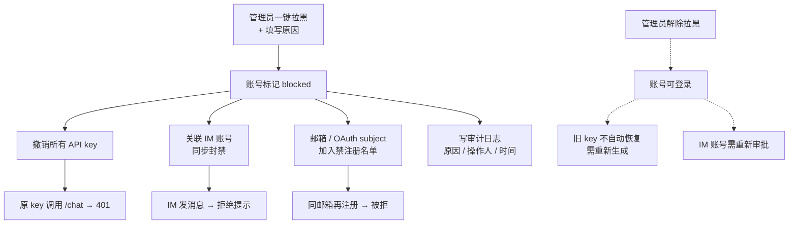

- [ ] **批量拉黑**：按邮箱域、IP、注册时间窗批量拉黑，用于应对滥注或撞库攻击

- [ ] **IM 用户管理工作台**：**v1.0 起 IM 用户默认放行（取消首次会话审批门槛）**——只要发消息所在的 channel / workspace 已被部署方在 channel 白名单中允许（白名单的具体配置载体由 im-gateway / deployment 域维护，不在本模块），新 IM 用户首条消息直接进入 agent_loop，**无审批等待**；工作台聚焦**加黑名单维护**：admin 在 UI 列表查看所有活跃 / 被加黑的 IM 用户，可单条或批量执行加黑 / 恢复并填写原因；**加黑与恢复均仅 admin 角色可操作**（viewer 仅可查看），CLI 不再开放加黑入口（`block-user` 收回）；同一内部用户的多 IM 账号（Slack + Telegram + WhatsApp）合并展示

- [ ] **用量与配额**：per-user、全局的 token 用量、调用次数、活跃 session 数仪表盘；可设单用户上限，超限自动拒绝并通知

- [ ] **审计日志**：所有平台管理操作（建删用户、轮换 / 撤销 key、审批 / 加黑 IM 用户、调整配额、改角色）记录"谁、何时、对什么资源、做了什么"，UI 内可检索与导出；删除用户 / 撤销 key / 批量封禁等高危动作要求二次确认

- [ ] **会话与 trace 浏览**：按用户 / channel / 时间 / 关键词检索历史对话，单会话展开完整 transcript 与逐轮工具调用、governance.permission_gate 决策、模型路由、memory 命中；通过 observability trace 查询 API 渲染为可筛选、可下钻的事件流

- [ ] **系统健康仪表盘**：首页一屏可见各 IM 平台连接状态、API 错误率与延迟、活跃 session 数、governance.permission_gate 待审批积压、定时任务执行情况；新申请、超限告警、平台断线等关键事件按时间倒序滚动

### Agent 管理（v1.0）

> 设计哲学借鉴市面成熟 agent 后台（Dify 的 App 管理、Coze 的 Bot 工作台、Bedrock 的 agent 版本/别名、LangSmith 的按项目观测）：**Agent 是后台里可被增删改查、可启停、可绑定的一等公民**，管理员无需改代码或重启服务即可上线一个新 Agent。本模块只写**管理面的可观察行为**；Agent 真正运行时的能力边界校验、审批与路由解析由 [governance](./governance.md) / [agent-runtime](./agent-runtime.md) 负责。
>
> **来源归属**：每个 Agent 标注「受管（spec-owned）」或「临管（DB-only）」徽章——临管在本页即时创建，受管由 askit `deploy --target fleetent` 从 spec 编译而来；对受管 Agent 的 UI 改动会被标 drift 并经 askit 覆盖回流转正或还原（详见「askit 编排控制台 / fleetent 自管理」）。本页所有即时操作默认产出临管对象。

- [ ] **Agent 列表与检索**：列表展示所有 Agent 的名称、状态（启用 / 禁用 / 已归档）、模型配置摘要、allowed_tools 数量、绑定的用户数 / channel 数、是否为默认 Agent、创建与最近更新时间；支持按名称 / 状态搜索与排序

- [ ] **动态创建 Agent**：管理员在 Agent 管理页填写名称、system_prompt、allowed_tools（fnmatch 通配符白名单，如 `read_*`、`github__*`）即可即时创建并启用，**无需改配置或重启服务**；名称全局唯一，重名拒绝并提示

- [ ] **编辑 Agent**：可在线修改 system_prompt、allowed_tools、模型配置与备注；保存后**对新会话立即生效**，对进行中的会话在下一轮 LLM 调用时生效（运行语义口径以 [agent-runtime](./agent-runtime.md) 为准）

- [ ] **启用 / 禁用（启停开关）**：禁用的 Agent 保留定义与全部绑定，但**不再接受新会话**——路由到被禁用 Agent 的 `/chat` 请求被拒并提示"该 Agent 已停用"；重新启用后立即恢复服务，启停动作写审计

- [ ] **删除与软删除 + 绑定保护**：删除走**软删除（归档）**——Agent 标记为 archived 后不再可被路由、从默认列表隐去，但定义与历史 trace 保留可追溯；删除前做**绑定保护**：若仍被任何 user / channel 绑定或被设为默认 Agent，则阻止删除并列出占用方，要求先解绑或迁移；归档后可在保留期内"恢复"，超过保留期由运维硬清理（高危，CLI 不开放）

- [ ] **克隆与模板库**：可对现有 Agent 一键"克隆"出一个新名称的副本（复制 system_prompt / allowed_tools / 模型配置，不复制绑定关系）；内置若干**模板**（如"只读问答 Agent""运维 Agent""客服 Agent"），从模板起一个新 Agent 时预填推荐的 allowed_tools 与提示词，降低从零配置的门槛

- [ ] **按 Agent 配置模型与运行参数**：每个 Agent 可绑定 [model-router](./model-router.md) 的 `models.targets` / `models.routes`、温度等 route 参数、以及该 Agent 维度的成本 / 步数预算上限（五层预算中的"单 agent"层，见 [agent-runtime](./agent-runtime.md)）；未显式配置时使用 Agent 模板默认值，配置仅声明意图，实际生效与回退由对应运行域解释

- [ ] **绑定管理（UI 化）**：在 Agent 详情页可视化管理 user→agent、channel→agent 绑定与"设为默认 Agent"，等价于现有 CLI 的 `assign-channel` / `unassign-channel` / `set-default-agent`，并展示该 Agent 当前被哪些用户 / channel 引用（与删除保护共用同一引用视图）

- [ ] **按 Agent 观测与用量**：Agent 详情页一屏可见该 Agent 的调用次数、token / 成本用量曲线、错误率、平均时延、governance.permission_gate 触发与审批通过率、最近会话列表，可下钻到单会话 trace（数据源为 observability 的 traces，本页只做按 agent_id 的聚合视图）

- [ ] **Agent 管理权限与审计**：Agent 的增删改、启停、绑定、改模型配置均**仅 admin 角色可操作**，viewer 仅可浏览列表与观测；删除（归档）等高危动作要求二次确认；所有动作写审计日志（谁、何时、对哪个 Agent、做了什么）

| 操作 | admin | viewer | CLI |
|------|:-----:|:------:|:---:|
| 浏览 Agent 列表 / 观测 | ✅ | ✅ | 部分（list 只读） |
| 创建 / 编辑 / 克隆 Agent | ✅ | ❌ | ❌ |
| 启用 / 禁用 Agent | ✅ | ❌ | ❌ |
| 归档（软删除）/ 恢复 Agent | ✅ | ❌ | ❌ |
| 改 Agent 模型 / 预算配置 | ✅ | ❌ | ❌ |
| 绑定 user / channel / 设默认 | ✅ | ❌ | ✅（channel / 默认） |

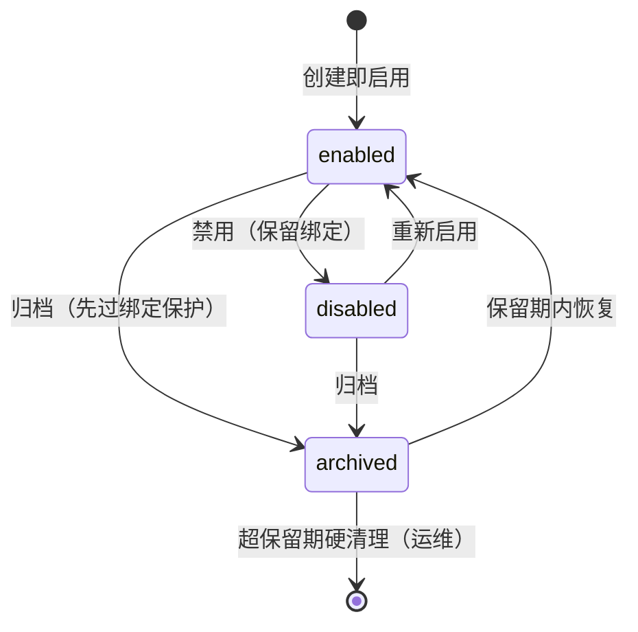

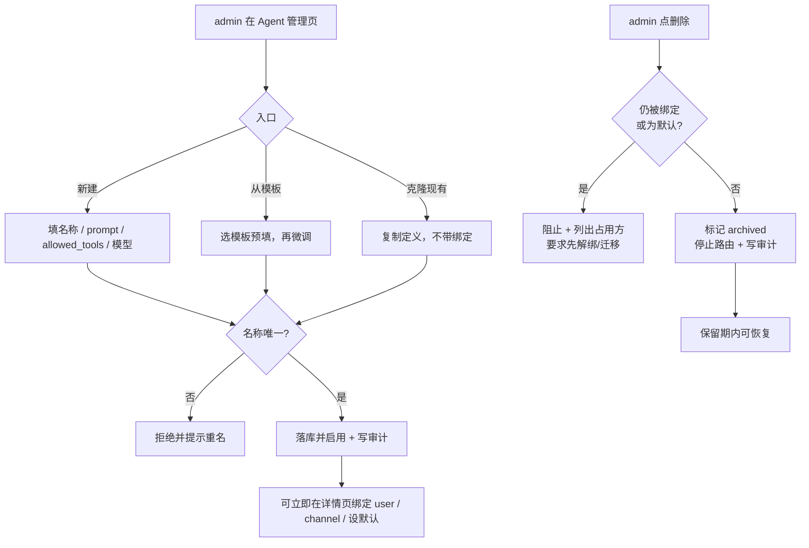

### Skill 管理（v1.0）

> 设计哲学借鉴市面成熟的「能力市场」形态（Anthropic Skills 的 SKILL.md 包、Dify / Coze 的插件市场与启停开关、OpenAI GPT Store 的上架与审核）：**Skill 是后台里可上传、可启停、可按 Agent 分配、可观测的一等公民**，领域专家无需登录服务器改文件即可上线一条行为指南。本模块只写**管理面的可观察行为**；Skill 真正的扫描 / 匹配 / 注入 / 安全审计 / 禁用语义由 [skill](./skill.md) 负责，AI 自动产出的 Skill 变更提案与审批流由 [reflection](./reflection.md) 负责，本节只提供这些能力的 UI 入口并交叉引用。
>
> **来源归属**：与 Agent 一致，每个 Skill 标注「受管 / 临管」徽章——UI 上传 / 新建产出临管 Skill，受管 Skill 由 askit `deploy --target fleetent` 从 spec 编译而来；对受管 Skill 的 UI 改动标 drift 并经覆盖回流处理（详见「askit 编排控制台 / fleetent 自管理」）。

- [ ] **Skill 列表与检索**：列表展示所有 Skill 的名称、一句话描述、tags / platforms、启用状态（全局启用 / 全局禁用 / 已归档）、安全审计结论（通过 / 可疑 / 拒绝加载）、累计命中注入次数、最近触发时间、被哪些 Agent 启用；支持按名称 / tag / 状态 / 审计结论搜索与排序

- [ ] **上传 / 新建 Skill**：管理员可在 UI 上传一个 Skill（`SKILL.md` 或含脚本 / 模板的目录包），或在线新建；保存前自动校验 YAML frontmatter 并触发 [skill](./skill.md) 的**安全审计**——审计「拒绝加载」级别时不予上线并提示命中的注入模式，「可疑」级别时允许上线但在列表打标；上线即触发热加载，无需重启服务

- [ ] **编辑 Skill**：可在线修改 frontmatter（name / description / tags / platforms / `exclusive` 等）与正文内容；保存后重新跑安全审计并触发热加载，**对后续请求生效、进行中的会话不受影响**（热加载语义以 [skill](./skill.md) 为准）

- [ ] **启用 / 禁用（全局 + 按 Agent）**：提供 [skill](./skill.md) 已规划的「禁用机制」的 UI 入口——可全局禁用某 Skill（对所有 Agent 不再匹配注入），或在 Agent 详情页按 Agent 维度启停该 Skill；禁用动作写审计，便于排查"为什么这个 Skill 没生效"

- [ ] **删除与归档 + 引用保护**：删除走**软删除（归档）**——归档后不再参与匹配注入、从列表隐去，但文件快照与历史命中 trace 保留可追溯；删除前做**引用保护**：若仍被任一 Agent 显式启用，则阻止删除并列出占用方，要求先在对应 Agent 上停用；归档后保留期内可恢复

- [ ] **按 Agent 分配（Skill ↔ Agent 矩阵）**：可视化管理"哪些 Skill 对哪个 Agent 可用"——在 Agent 详情页勾选可用 Skill，或在 Skill 详情页查看 / 调整启用它的 Agent 列表；与「按 Agent 启停」共用同一引用视图，也供删除引用保护复用

- [ ] **AI 提案审批入口（Skill Proposal Inbox）**：[reflection](./reflection.md) 在 prod 环境产出的 Skill 变更提案（create / update / delete，状态 pending）汇总到后台一个待办收件箱；admin 可逐条查看提案理由与**变更 diff（基于 reflection 的 snapshot 快照对比当前内容）**，approve 后由 reflection 应用生效、reject 后关闭，审批结果回写提案状态并写审计

- [ ] **安全审计结果展示与隔离**：列表与详情页展示每个 Skill 的最近一次审计结论与命中规则；被判为「拒绝加载」的 Skill 进入隔离区不参与注入，需 admin 显式复核后才可强制上线（强制上线写审计并二次确认）

- [ ] **热加载触发**：UI 提供"重新扫描 skills/ 目录"按钮，等价于 [skill](./skill.md) 规划的热加载；重扫描期间继续用旧索引、完成后原子切换，扫描失败保留旧索引并在 UI 告警

- [ ] **按 Skill 观测**：Skill 详情页一屏可见该 Skill 的命中 / 注入次数曲线、触发它的会话列表、最近 N 天是否被触发（长期零触发的会高亮，呼应 reflection 的 delete 提案依据），可下钻到单会话 trace（数据源为 observability，本页只做按 skill 的聚合视图）

- [ ] **Skill 管理权限与审计**：Skill 的上传 / 编辑 / 启停 / 归档 / 按 Agent 分配 / 提案审批 / 强制上线均**仅 admin 角色可操作**，viewer 仅可浏览列表、审计结论与观测；归档、强制上线疑似注入 Skill、approve 提案等高危动作要求二次确认；所有动作写审计日志（谁、何时、对哪个 Skill、做了什么）

| 操作 | admin | viewer | CLI |
|------|:-----:|:------:|:---:|
| 浏览 Skill 列表 / 观测 / 审计结论 | ✅ | ✅ | 部分（list 只读） |
| 上传 / 新建 / 编辑 Skill | ✅ | ❌ | ❌ |
| 全局 / 按 Agent 启停 Skill | ✅ | ❌ | ❌ |
| 归档（软删除）/ 恢复 Skill | ✅ | ❌ | ❌ |
| 触发热加载（重新扫描） | ✅ | ❌ | ✅ |
| 审批 AI 生成的 Skill 提案 | ✅ | ❌ | ❌ |
| 强制上线被判拒绝的 Skill | ✅ | ❌ | ❌ |

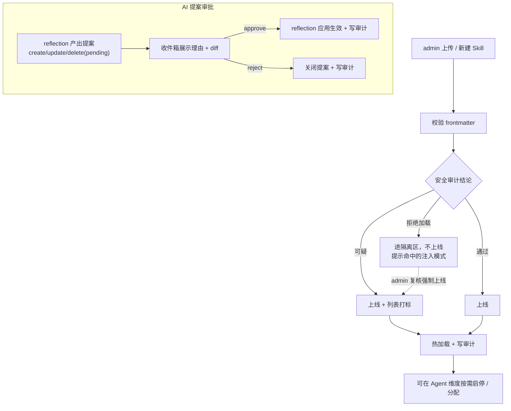

### 聊天（试运行 + 会话管理）（v1.0）

> 设计哲学借鉴市面成熟 agent 后台的「调试台 + 会话治理」双形态（Dify 的 Debug & Preview、Coze 的 Bot 调试对话、Bedrock 的 Test 窗口，以及客服 / 工单系统的会话接管面）：后台聊天有两个互补入口——**admin 试运行 playground**（admin 选定 Agent 直接对话，验证 prompt / 工具 / 知识库召回，不污染真实用户数据），和**用户会话管理面**（浏览、检索、接管、干预真实用户与 IM 用户产生的会话）。本模块只写**管理面与操作面的可观察行为**；聊天真正运行时的 while tool-use 循环、模型路由、审批由 [agent-runtime](./agent-runtime.md) / [governance](./governance.md) 负责，会话消息的并发锁 / 原子持久化 / TTL 由 [session](./session.md) 负责，单会话 transcript 的纯只读浏览复用上文「会话与 trace 浏览」，本节聚焦**可交互的试运行**与**可写的会话治理**。
>
> **与「会话与 trace 浏览」的边界**：「会话与 trace 浏览」是**事后只读**的逐轮回放（含 trace 节点）；本节的会话管理面允许**写操作**——接管、注入消息、强制结束、清空、导出，是运营干预入口而非纯审计入口。

#### 试运行 playground

- [ ] **选 Agent 起会话**：admin 在 playground 下拉选择任一启用中的 Agent（含临管 / 受管），即时开启一段**隔离的试运行会话**——该会话标记 `origin=playground`，不计入该 Agent 的对外用量统计、不与任何真实用户 / channel 绑定，可随时丢弃
- [ ] **流式对话与逐轮可观察**：发送消息后以 SSE 流式看到回复（语义同 `/chat`），同时右栏实时展开本轮的可观察细节——命中的 system prompt / 注入的 Skill / 知识库召回片段、每次工具调用的入参 / 出参、governance.permission_gate 决策、模型路由与 fallback、token 与耗时；便于 admin 验证"为什么这样回答"
- [ ] **试运行参数覆盖**：playground 内可临时覆盖该次会话的模型 / route 参数（对齐 [model-router](./model-router.md) 的请求级覆盖）、temperature、是否启用某些 Skill / 知识库，仅作用于当前试运行会话，不改 Agent 持久配置
- [ ] **审批旁路开关（受控）**：playground 会话默认仍走 governance.permission_gate；admin 可对自己的试运行会话开启"自动批准 medium 风险"以快速迭代（high 风险仍需显式确认），该旁路仅对 `origin=playground` 会话生效、写审计，绝不影响真实用户会话
- [ ] **试运行结果留存与分享**：可将一段满意 / 有问题的试运行会话"固定"保存并附备注，或导出为 JSON / Markdown 供回归对照；未固定的 playground 会话超过保留期自动清理

#### 用户会话管理面

- [ ] **会话列表与检索**：列出全部真实会话（web + IM），按用户 / Agent / channel / 平台 / 时间 / 关键词 / 状态（活跃 / 空闲 / 已结束）筛选与排序，每行显示发起用户、所属 Agent、来源 channel、轮数、最近活跃、token 用量、是否含未决审批
- [ ] **会话详情与逐轮回放**：打开单会话看到完整 transcript 与逐轮工具调用、governance.permission_gate 决策、模型路由、memory / 知识库命中（只读回放部分复用「会话与 trace 浏览」，本页在其上叠加写操作入口）
- [ ] **会话接管（人工干预）**：admin 可"接管"一段活跃会话，**暂停 agent 自动回复**并以人工身份向该会话注入一条消息（IM 会话经 im-gateway 投递回原平台），用于异常会话的人工兜底；接管与释放均写审计并对终端用户标注"已转人工 / 已恢复自动"（具体提示语载体由 im-gateway 域决定）
- [ ] **强制结束 / 清空 / 重置**：admin 可强制结束一段会话（不再接受新轮）、清空某会话上下文（等价于 im-gateway 的 `/new`，由 [session](./session.md) 执行实际清空）、或重置到某一轮之前；高危动作二次确认并写审计
- [ ] **批量与配额联动**：可按筛选结果批量结束 / 清空异常会话；展示各会话 token 用量并与「用量与配额」联动，便于定位异常激增会话
- [ ] **导出与留痕**：单会话或批量导出 transcript（JSON / Markdown），导出动作写审计；含个人数据的导出按部署方策略可要求二次确认 / 脱敏
- [ ] **聊天管理权限与审计**：试运行 playground、会话接管 / 注入 / 强制结束 / 清空 / 重置 / 导出均**仅 admin 角色可操作**，viewer 仅可只读浏览会话与回放；接管、清空、强制结束等高危动作要求二次确认；所有写操作记审计（谁、何时、对哪个会话、做了什么）

| 操作 | admin | viewer | CLI |
|------|:-----:|:------:|:---:|
| 浏览会话列表 / 回放 | ✅ | ✅ | ❌ |
| 试运行 playground 对话 | ✅ | ❌ | ❌ |
| 接管会话 / 人工注入消息 | ✅ | ❌ | ❌ |
| 强制结束 / 清空 / 重置会话 | ✅ | ❌ | ❌ |
| 导出会话 transcript | ✅ | 部分（按策略脱敏） | ❌ |

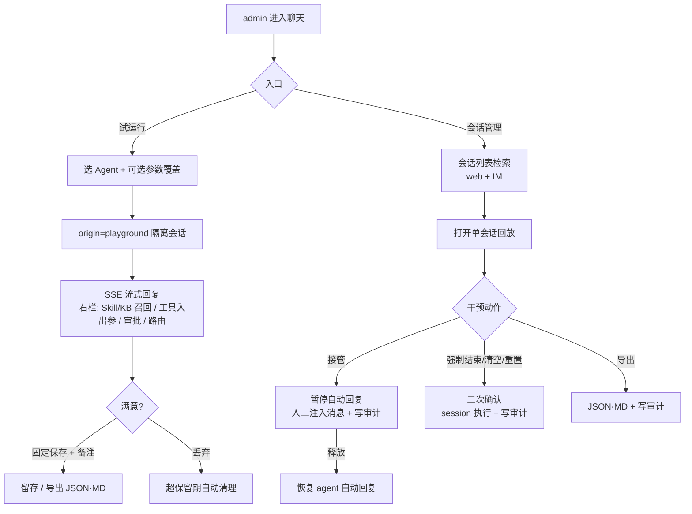

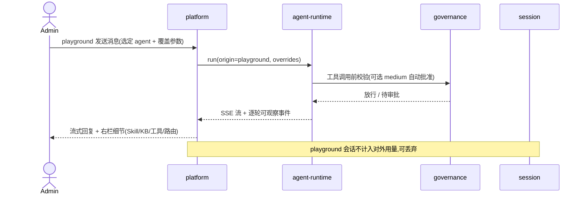

### 知识库管理（v1.0）

> 设计哲学借鉴市面成熟的「企业知识库后台」（Dify 的 Knowledge、Coze 的知识库、各 RAG 平台的文档集 + 检索测试台）：**知识库（KB）与文档是后台里可创建、可导入、可检索测试、可按 Agent 绑定的一等公民**，领域专家无需写代码即可把企业文档喂给 agent。本模块只写**管理面的可观察行为**；KB 真正的解析 / 分块 / 向量与关键词索引 / vector·keyword·hybrid 检索 / 租户隔离召回由 [knowledge-base](./knowledge-base.md) 负责，向量索引底座由 [vector-store](./vector-store.md) 负责，召回内容注入 system prompt 的协调与 token 预算由 [long-term-ctx](./long-term-ctx.md) 负责，本节只提供这些能力的 UI 入口并交叉引用。
>
> **多租户口径**：KB 按 `tenant_id + kb_id` 隔离（私有化单企业部署 `tenant_id` 默认 `default`）。本页的创建 / 检索 / 绑定均在当前租户下进行，跨租户可见性由部署方策略决定。

- [ ] **知识库列表与检索**：列出当前租户下所有 KB（如 `global` / `sales` / `support`）的 kb_id、描述、文档数 / 分块数、最近导入时间、被哪些 Agent 绑定、占用的向量命名空间概况；支持按 kb_id / 描述搜索与排序
- [ ] **创建 / 编辑 / 删除知识库**：admin 可在 UI 新建一个 kb_id（租户内唯一，重名拒绝）并填描述；删除走**软删除（归档）**——归档后不再参与召回、从绑定列表隐去，但文档与历史保留，删除前做**绑定保护**：若仍被任一 Agent 绑定则阻止并列出占用方，要求先解绑
- [ ] **文档导入（多入口）**：支持在 UI 直接粘贴 / 上传 text、Markdown、轻量 HTML 内容导入（对齐 knowledge-base 当前 `ingest_text` / `parse_*` 能力），以及配置 **local directory 数据源**并手动触发同步（对齐 `sync_local_directory`）；导入即触发 deterministic chunking 与索引构建，UI 展示每个文档的解析 / 分块 / 入库结果
- [ ] **文档列表与生命周期**：单 KB 内列出所有文档的 filename、source / source_url、分块数、创建时间；可查看某文档的分块预览（content + section context）、单独删除某文档（级联清理其 chunks 与向量，对齐 `delete(document_id)`）；删除写审计
- [ ] **检索测试台（Retrieval Playground）**：admin 输入查询、选 KB（可多选）、选检索模式（vector / keyword / hybrid）、设 top-k，即时看到召回的分块列表及其 score、所属文档、position、section context；用于验证"这个问题能不能召回到对的内容"，并与「聊天试运行」互补（一个测召回、一个测端到端回答）
- [ ] **召回质量评估入口**：提供手动运行 deterministic retrieval evaluation 的 UI 入口（对齐 knowledge-base 的手动评估能力），展示评估批次的命中 / 排序指标；评估为只读分析，不改索引
- [ ] **按 Agent 绑定（KB ↔ Agent）**：可视化管理"哪些 KB 对哪个 Agent 可见"——在 Agent 详情页勾选可用 KB，或在 KB 详情页查看 / 调整绑定它的 Agent 列表；绑定关系供 long-term-ctx 在召回注入时按 Agent 限定 kb 范围（实际注入语义以 long-term-ctx 为准），并供删除绑定保护复用
- [ ] **按 KB 观测**：KB 详情页展示该 KB 的召回命中次数 / 趋势、被哪些会话引用、长期零召回的文档高亮（呼应内容陈旧治理），可下钻到引用该 KB 的会话 trace（数据源为 observability，本页只做按 kb 的聚合视图）
- [ ] **知识库管理权限与审计**：KB / 文档的创建 / 导入 / 删除 / 归档 / 按 Agent 绑定均**仅 admin 角色可操作**，viewer 仅可浏览列表、文档与检索测试结果；删除 KB / 删除文档 / 触发目录全量重同步等高危动作要求二次确认；所有写操作写审计（谁、何时、对哪个 KB / 文档、做了什么）

| 操作 | admin | viewer | CLI |
|------|:-----:|:------:|:---:|
| 浏览 KB / 文档 / 检索测试 | ✅ | ✅ | 部分（list 只读） |
| 创建 / 编辑 / 归档 KB | ✅ | ❌ | ❌ |
| 导入 / 删除文档、触发同步 | ✅ | ❌ | ❌ |
| 运行召回质量评估 | ✅ | ✅（只读看结果） | ✅ |
| 按 Agent 绑定 KB | ✅ | ❌ | ❌ |

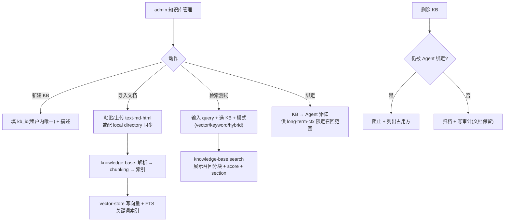

### connector 管理（v1.0）

> 设计哲学借鉴市面成熟的「集成中心 / 连接器后台」（Dify 的工具与凭证、Coze 的插件授权、Zapier / n8n 的 connections 管理）：**connector 是后台里可配置、可观测授权状态、可代用户解绑、可健康巡检的一等公民**，让 admin 一屏看清"哪些外部系统接入了、谁授权了、连得通吗"。本模块涵盖**两类接入**——(1) **per-user OAuth connector**（Google Drive / GitHub / Notion 等，凭证按用户隔离），(2) **MCP server**（把企业系统能力注册为工具）。本模块只写**管理面的可观察行为**；OAuth consent / 凭证加密存储 / 自动 refresh / 注入 / 离职联动由 [connectors](./connectors.md) 负责，MCP 服务连接 / 工具自动注册 / 故障降级由 [mcp](./mcp.md) 负责，工具的访问控制归 [governance](./governance.md)，本节只提供这些能力的 UI 入口并交叉引用。
>
> **接入硬约束（来自 connectors 域）**：OAuth connector 仅接受 OAuth 2.x，不支持 OAuth 的系统不在接入范围；本页不绕过该约束。

#### OAuth connector

- [ ] **connector 目录与配置**：列出已声明的所有 OAuth connector，每个展示其 id、authorize / token endpoint、scopes、client_id（client_secret 等敏感值脱敏）、已授权用户数、最近授权 / 刷新时间；admin 可新增 / 编辑一个 connector 配置（加新外部系统 = 加一个 connector，不改核心代码），保存即生效
- [ ] **per-user 授权状态总览**：以 (user, connector) 矩阵展示每个用户对每个 connector 的授权状态——未授权 / 已授权（scope 列表）/ 凭证失效需重新授权（refresh token 过期）/ 凭证错误（refresh 网络失败可重试），对齐 connectors 的 `NeedsConsent` / `CredentialError` 区分；支持按用户或按 connector 两个视角切换
- [ ] **代用户解绑（revoke）**：admin 可对某 (user, connector) 主动解绑——删除凭证并调用外部系统 revoke endpoint（语义由 connectors 执行）；用于离职 / 疑似泄露处置，解绑写审计；**admin 不能代用户完成首次 consent**（OAuth 同意必须本人浏览器跳转完成），UI 对此给出明确提示
- [ ] **离职 / 禁用联动可视**：展示 user-center 禁用某用户时由 connectors 自动撤销其全部 connector 凭证的结果（哪些被 revoke、是否成功），便于审计离职处置是否干净
- [ ] **凭证生命周期观测**：按 connector 展示 access token 自动刷新成功 / 失败率、refresh token 过期导致的重新授权次数，定位"为什么某 connector 老是要重新授权"

#### MCP server

- [ ] **MCP server 列表与连接状态**：列出所有已配置的 MCP server（stdio / HTTP transport）、其连接状态（已连接 / 启动时降级屏蔽 / 探活失败重连中 / 标记永久不可用，对齐 mcp 的降级与健康维护语义）、注册出的工具数与 `server__{tool}` 命名空间清单、最近一次握手 / 探活时间
- [ ] **工具注册可见**：展开某 MCP server 查看它注册的工具列表（名称 / 描述 / 入参 schema 概要），便于 admin 在配 Agent 的 allowed_tools 时知道有哪些 `server__*` 工具可白名单（白名单与访问控制本身归 `fleetent.governance.agent_policy`）
- [ ] **连接健康与手动重连**：UI 展示各 server 的探活与指数退避重连状态，提供"手动重连 / 重新握手"按钮；连接失败 / 降级不阻断平台启动（语义由 mcp 保证），本页只做状态呈现与手动触发
- [ ] **MCP 环境诊断入口**：提供触发 `mcp doctor`（经 askit 编排控制台「环境与连接器」系列）的快捷入口，把 MCP 健康检查结论渲染为红 / 黄 / 绿清单，敏感认证值脱敏
- [ ] **connector 管理权限与审计**：connector 配置增改、代用户解绑、MCP server 手动重连 / 配置变更均**仅 admin 角色可操作**，viewer 仅可浏览目录、授权状态总览与连接状态；代用户解绑、批量离职联动撤销等高危动作要求二次确认；所有写操作写审计（谁、何时、对哪个 connector / user / MCP server、做了什么）；任何视图均不明文展示 client_secret / token / refresh token

| 操作 | admin | viewer | CLI |
|------|:-----:|:------:|:---:|
| 浏览 connector / 授权状态 / MCP 状态 | ✅ | ✅ | 部分（list 只读） |
| 新增 / 编辑 connector 配置 | ✅ | ❌ | ❌ |
| 代用户解绑（revoke）凭证 | ✅ | ❌ | ❌ |
| 新增 / 编辑 MCP server 配置 | ✅ | ❌ | ❌ |
| 手动重连 MCP / 触发 mcp doctor | ✅ | ✅（只读看诊断） | ✅ |

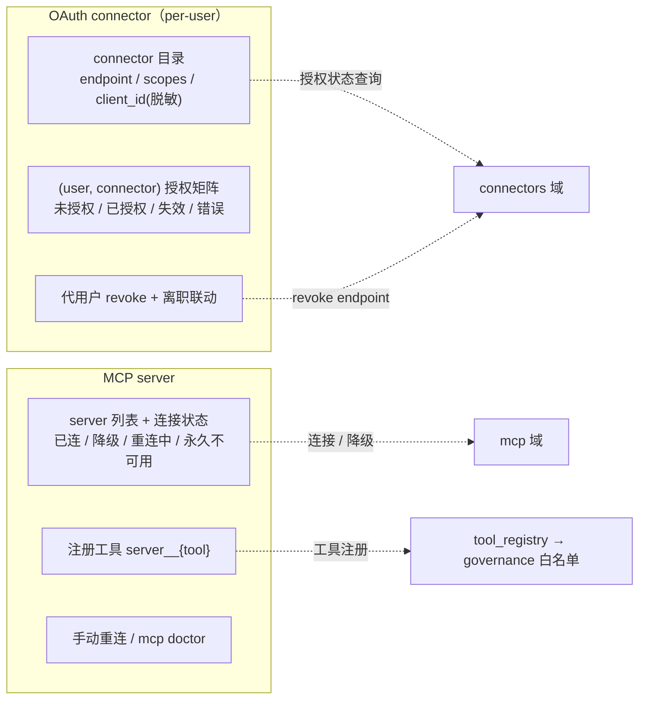

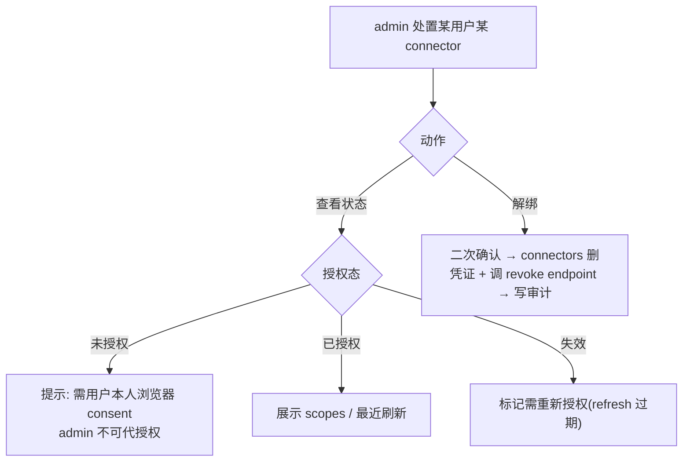

### model_provider 管理（v1.0）

> 设计哲学借鉴市面成熟的「模型供应商 / 模型接入后台」（Dify 的 Model Provider 设置、各网关的 provider + 路由配置、OpenRouter 式的多 provider 编排）：**provider target 与 Agent route 是后台里可配置、可测连通、可设 fallback 顺序、可维护单价表的一等公民**，让 admin 无需手改 `agents/<agent-id>/agent.yaml` 即可新增一个 OpenAI-compatible 端点并接入某个 Agent route。本模块只写**管理面的可观察行为**；Agent `models.targets` / `models.routes` 解析、AsyncOpenAI client 实例化、fallback 链遍历与切换的**运行语义**由 [model-router](./model-router.md) 负责，成本追踪由 [observability](./observability.md) 负责，本节只提供这些能力的 UI 入口并交叉引用。
>
> **自托管口径**：provider 的 base_url 可指向任意 OpenAI-compatible 端点（Anthropic / OpenRouter / 本地 Ollama / vLLM 等），符合"基础设施可自托管、数据不出内网"的部署原则；本页对自托管 / 自定义模型同样适用。

- [ ] **provider target 列表与配置**：按 Agent 列出已配置 target 的 id、provider、protocol、base_url / endpoint、模型 id、所属 route、fallback 优先级、最近连通状态；admin 可新增 / 编辑 / 删除 target——填 provider、protocol、base_url / endpoint、model、api_key_env（不保存明文 key）、max_tokens、params（provider 特有参数透传）；保存后经 Agent materialize 写入 `agents/<agent-id>/agent.yaml`
- [ ] **Agent route → target 路由编排**：可视化管理每个 Agent 的标准 route（如 `default` / `memory_extraction` / `embedding` / `rerank` / `image_generation`）的 target 列表，**列表顺序即 fallback 优先级**，admin 可拖拽调整顺序、增删某 route 下的 target；未定义 route 由 model-router 按配置错误处理，UI 对此明示
- [ ] **连通性测试**：对单个 provider 一键发起轻量探测调用，展示是否可达、握手延迟、返回的模型标识；用于"配完一个新端点先测通再挂到路由上"，测试不计入对外用量
- [ ] **fallback 链预演**：选定一个 Agent route 展示其完整 fallback 顺序，并可模拟"首选不可用"逐级回退的链路（对齐 model-router 的 fallback 遍历语义），帮助 admin 确认降级路径符合预期
- [ ] **模型单价表维护**：每个模型可维护 input / output 每 1k token 单价（对应「待决问题」已定的"单价表放 model_router 配置"）；单价供「统计面板」成本聚合按 `token × 单价` 计算；**未配置单价的模型在成本视图显示"未配置"而非 0**（自托管 / 自定义模型常无公开价），UI 对未配置项高亮提醒
- [ ] **健康探针状态可见**：展示 model-router 规划中的健康探针缓存结果——某 provider 连续失败被标记暂时不可用、fallback 时被跳过的状态与恢复时间，便于定位"为什么请求总走到了备选模型"
- [ ] **按 provider / 模型观测**：展示各 provider / 模型的调用次数、token 用量、成本（单价已配时）、错误率、平均时延、被哪些 route / Agent 使用（数据源为 observability，本页只做按 provider·model 的聚合视图，与「统计面板」的 agent 视角互补）
- [ ] **model_provider 管理权限与审计**：provider target 的增删改、Agent route 编排、单价表维护、连通性测试均**仅 admin 角色可操作**，viewer 仅可浏览配置（密钥脱敏）、路由顺序与观测；删除 target / 调整生产 Agent route / 改单价等动作写审计；api_key 等敏感值在任何视图均脱敏，绝不明文回显

| 操作 | admin | viewer | CLI |
|------|:-----:|:------:|:---:|
| 浏览 provider / 路由 / 观测 | ✅ | ✅（密钥脱敏） | 部分（list 只读） |
| 新增 / 编辑 / 删除 provider | ✅ | ❌ | ❌ |
| 编排 Agent route → target 顺序 | ✅ | ❌ | ❌ |
| 连通性测试 / fallback 预演 | ✅ | ✅（只读看结果） | ❌ |
| 维护模型单价表 | ✅ | ❌ | ❌ |

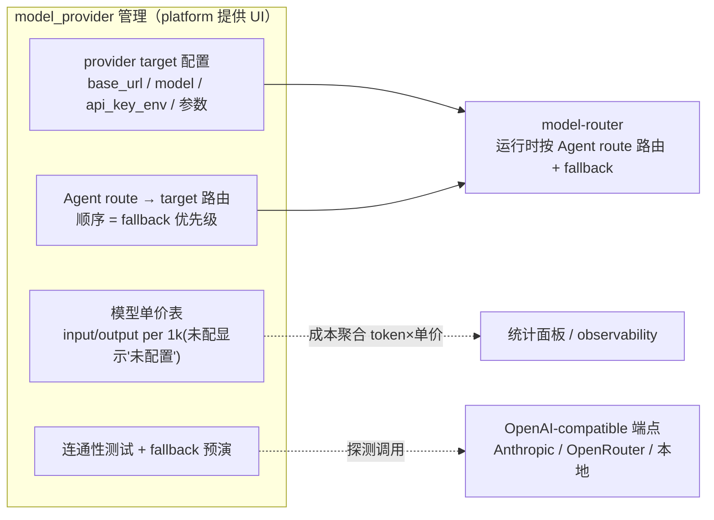

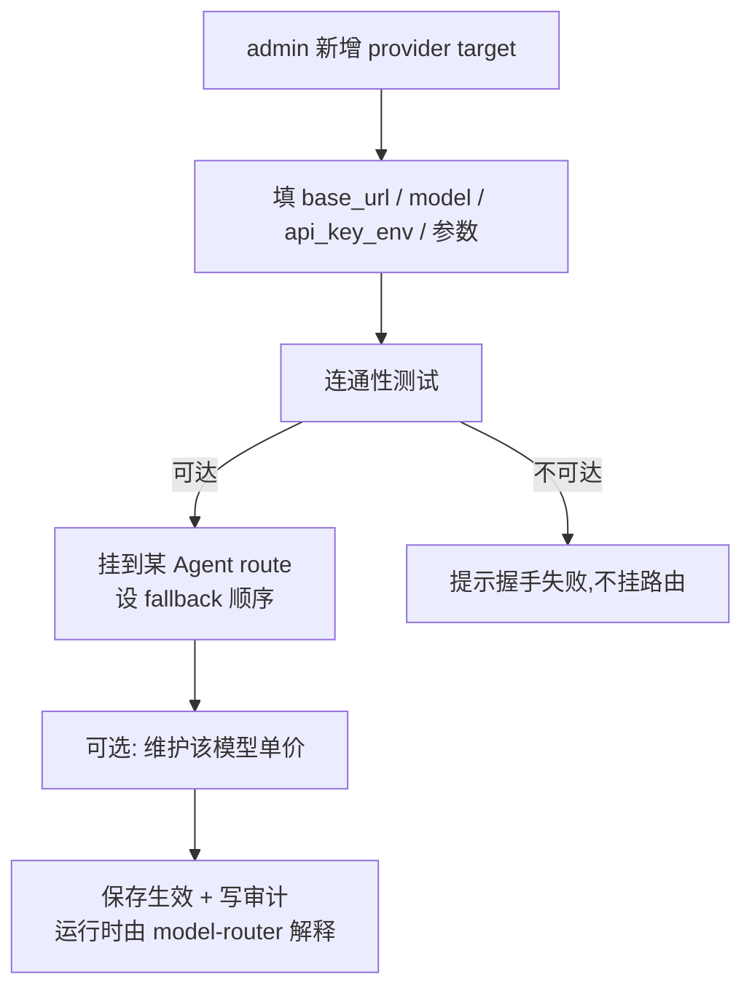

### 统计面板（Agent 维度）（v1.0）

> 一个以 **Agent 为主视角的统计分析面板**，回答"每个 agent 用得多不多、快不快、稳不稳、贵不贵、被谁用"。它是 platform 的**聚合视图**，原始 trace 数据归 [observability](./observability.md)（traces）、审批数据归 governance.permission_gate、绑定数据归 agent_store；本面板只做按 agent_id 的聚合与下钻，不重复定义采集语义。与「系统健康仪表盘」（平台级实时态）和 Agent 详情页「按 Agent 观测」（单 agent）互补——本面板是**跨 agent、可对比、可下钻**的分析层。
>
> 标注：✅ = 现有 trace 字段直接可出；🟡 = 需从 trace 的 messages 解析；⏳ = 依赖 v1.0 新字段（budget 成本、agent-runtime 终止码 / 错误分类、skill 命中日志），字段就绪前 UI 以"待数据接入"占位、就绪后自动点亮。

- [ ] **面板总览与筛选**：可选单个或多个 agent、时间范围（日 / 周 / 月 / 自定义）、环境；多 agent 并排**对比视图**（同一指标横向比），支持把任一指标卡片下钻成明细

- [ ] **① 用量与成本**：调用次数、活跃独立用户数 / channel 数 / 会话数、token 用量（prompt / completion / total 的总量与单次均值）、按天 / 周趋势曲线 ✅；成本（$，token × 模型单价）⏳

- [ ] **② 性能与可靠性**：响应时延（平均 / P50 / P95）、每会话平均轮数 ✅；错误率 / 失败率、**终止原因分布**（max_turns / budget_exceeded / cancelled / approval_rejected / loop_detected / consecutive_failures）、model fallback 触发率、上下文压缩触发次数 ⏳

- [ ] **③ 工具与治理**：Top 工具调用排行、每次运行平均工具数 🟡；工具失败率 / 超时率 ⏳；**allowed_tools 覆盖率**——列出该 agent 配了白名单却从未被调用的工具，驱动最小权限收窄 🟡；governance.permission_gate 触发数与审批**通过 / 拒绝 / 超时率** ✅（approvals）

- [ ] **④ 模型 · Skill · 绑定**：按模型的调用 / token / 成本分布、Agent route key 分布 ✅；该 agent 的 skill 命中 Top、memory 命中率、sub_agent 调用数与子任务成功率 ⏳；绑定用户数 / channel 数、是否默认 agent、受管 / 临管来源分布 ✅

- [ ] **⑤ 下钻维度（按用户 / channel / 模型 / 时间切片）**：任一 agent 指标都可沿这四个维度切片。重点支持 **per-user 视图**——在选定 agent 下，各用户的 **token 用量、调用频率（次数 / 活跃天数）、最近活跃**排行；并支持反向"按用户"看某用户在所有 agent 上的用量与频率汇总。用于识别重度用户、分配配额、定位异常激增 ✅（user_id 现有）

- [ ] **⑥ 请求级全链路追踪（Request Trace）**：从 per-user 排行可一路下钻——**用户 → 该用户的请求列表（按时间 / agent / channel 筛选）→ 单个请求的完整链路**。单请求链路按时间序展开一个**事件流**：用户输入 → 每轮 LLM 调用（模型、token、耗时、是否触发 fallback）→ 每次工具调用的入参 / 出参 / 耗时 / 成功失败 → governance.permission_gate 审批决策 → memory 命中 → 上下文压缩事件 → sub_agent 派生（经 `parent_session_id` 关联，可就地展开子 agent 的完整子链路）→ 最终回复；每个节点可展开 / 折叠、可复制原始 JSON。与「会话与 trace 浏览」（会话级 transcript）互补：本视图聚焦**单个请求**的纵深链路与跨 agent 调用链
  - 数据现状：单请求的对话与工具入出参已在 trace 的 `messages` 中 ✅；sub_agent 子链路经 `parent_session_id` 可关联 ✅
  - ⏳ **依赖：单请求关联 ID（request_id）**——需由 agent-runtime / observability 为每次运行生成稳定 request_id 并贯穿主循环与所有子事件（工具调用、审批、模型路由、memory、压缩、sub_agent），HTTP 路径还需补 session_id；platform 仅按 request_id 聚合渲染，不负责发射（见「待决问题」与 [observability](./observability.md) / [agent-runtime](./agent-runtime.md)）

- [ ] **导出与定时报告**：面板任意视图可导出 CSV / 图片；可配置按周 / 月把指定 agent 的统计摘要定时推送到管理员邮箱（复用 scheduling 域）

- [ ] **统计面板权限**：viewer 与 admin 均可浏览（纯只读分析）；不涉及写操作，但 per-user 明细等含个人用量数据按部署方策略可对 viewer 脱敏

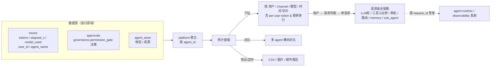

### 资源监控与告警（v1.0）

> 面向运维的**资源监控 + 阈值告警**：实时看各层资源水位、留历史曲线、配阈值规则、命中后多通道发告警。借鉴 Grafana / Netdata / Datadog 的"指标面板 + 告警规则 + 告警中心"三件套，但**全自托管、零云依赖、数据不出内网**（采集与存储均在内网，遵守数据主权原则）。
>
> **与 observability 的边界**：[observability](./observability.md) 负责 agent 运行的 trace / 日志 / 业务统计；本模块负责**基础设施与进程资源**的监控与告警。告警通知此前由 observability 划给外部系统，**v1.0 起平台内置轻量告警**（仍可经 Webhook 外发对接外部系统）。应用层指标（API 错误率 / 延迟 / 队列积压 / 活跃 session）复用「系统健康仪表盘」并接入同一套告警规则。

- [ ] **四层监控目标**：
  - **主机资源**：宿主机 CPU、内存、磁盘（用量 / inode）、负载、网络 IO
  - **fleetent 进程 + sandbox 容器**：进程级 CPU / 内存 / 文件句柄、活跃 sandbox 容器数、容器 OOM / 超时被杀次数
  - **依赖基础设施**：自托管 PostgreSQL / Redis / Qdrant / RabbitMQ 的存活、连接数、内存 / 磁盘占用、队列积压
  - **应用层指标**：API 错误率 / 延迟、governance.permission_gate 待审批积压、活跃 session、定时任务执行（复用「系统健康仪表盘」数据）

- [ ] **内置轻量采集**：平台自带轻量采集器周期性读取上述指标，**无外部依赖、全部在内网**；采集间隔与指标留存期可配置；采集器自身故障时在 UI 标"采集中断"并告警，不静默丢数

- [ ] **实时仪表盘与历史曲线**：每层目标一组指标卡片，实时水位 + 可选时间范围（小时 / 天 / 周）的历史曲线；支持多指标叠加对比、按宿主机 / 容器 / 服务实例筛选

- [ ] **告警规则管理**：admin 可对任一指标设规则——阈值（如 CPU > 85%）、**持续时间**（持续 N 分钟才触发，避免抖动）、级别（warning / critical）、生效时段；规则可启用 / 禁用 / 复制；支持静态阈值，可选同比 / 环比突增规则

- [ ] **多通道告警通知**：每条规则可选一个或多个通道——**邮件**、**IM 推送**（复用 im-gateway 向 Slack / Telegram / WhatsApp 的 admin 推送）、**Webhook**（POST 到外部告警 / 值班系统）、**站内告警中心 + 健康仪表盘顶部横幅**；通道发送失败有重试与失败记录

- [ ] **告警降噪**：同一规则连续命中**去重 / 聚合**为一条活跃告警（不刷屏）；告警风暴时按目标 / 级别**分组**；支持**抑制规则**（如主机宕机时抑制其上所有容器的次生告警）

- [ ] **告警生命周期**：每条告警有状态机——`触发(firing) → 通知 → 确认(ack) → 恢复(resolved)`；admin 可在告警中心**确认 / 静默 / 标注处理人**；指标回落到阈值内自动转 resolved 并通知；可选**升级（escalation）**：critical 告警在 N 分钟内未 ack 则升级到更高通道 / 更多接收人

- [ ] **维护窗静默**：admin 可设维护窗口（针对某目标或全局），窗口内命中的告警只记录不通知，避免计划内运维触发噪声

- [ ] **告警中心与历史**：检索全部历史告警，按目标 / 级别 / 状态 / 时间筛选；每条告警关联触发时的指标快照与处理记录；告警规则的增删改、ack / 静默动作写审计

- [ ] **资源监控权限**：viewer 可浏览监控仪表盘与告警历史（只读）；新建 / 改 / 删告警规则、ack / 静默告警、配置通道仅 admin

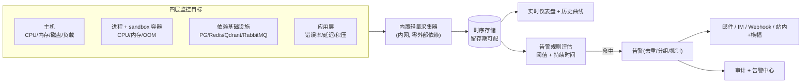

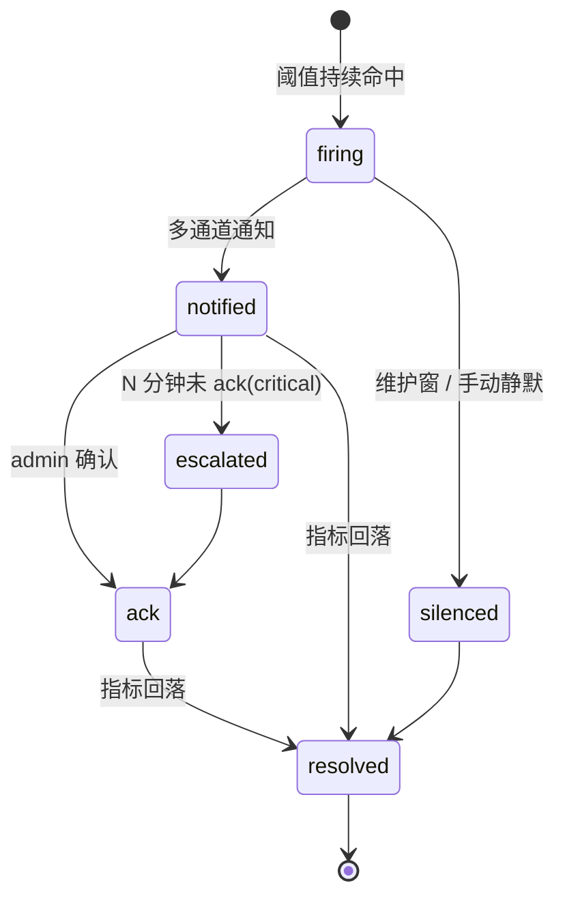

### askit 编排控制台（v1.0）

> **askit**（ai-skills-toolkit）是 spec 驱动的编译器：读 agent YAML spec 与 skill Markdown，编译成各运行平台的配置产物，并提供运行时配置回流、定时任务、依赖、环境诊断等一整套命令。本模块把 askit 的命令面收敛为后台一个**按系列分类的编排控制台**——admin 在 UI 里按系列触发操作、看实时日志与结果、走审批与审计，**无需登录服务器敲命令**。
>
> **定位（v1.0 集成模型 = 方案 a+b 混合，已定）**：fleetent 同时扮演两个角色——(1) **跨 runtime 舰队的中央控制面**：用 askit 编排 openclaw / claude / codex / hermes 等**外部平台项目**；(2) **askit 的受管 target**：fleetent **自身**的 agent / skill 也可以 spec-as-code 化，由 askit `deploy --target fleetent` 编译写入本平台的 agent_store / skills，享受版本化、跨环境晋升与覆盖回流。两个角色共用同一个控制台。
>
> **与 DB-first 管理的关系（关键）**：fleetent 的「Agent 管理」「Skill 管理」是 **DB-first 即时管理**，askit 是 **spec-first 编译管理**，二者通过下文「fleetent 自管理：双层来源 + 覆盖回流」模型调和，不构成双源冲突。
>
> **职责边界**：platform 只提供**控制面**（触发、参数表单、日志流、结果展示、权限与审计）；askit 的编译 / 校验 / 部署 / 覆盖回流 / 迁移等**实际语义与产物正确性归 ai-skills-toolkit 外部工具域**，本模块不重复定义，仅以系列为单位编排调用。控制台对每个系列只暴露该系列命令的可观察行为。

- [ ] **fleetent 自管理：双层来源 + 覆盖回流**：每个 fleetent agent / skill 有一个**来源归属**，解决 spec 与 DB 谁说了算：
  - **受管（spec-owned）**：源是 git 里的 YAML spec / SKILL.md，经 askit `deploy --target fleetent` 编译写入 agent_store / skills；用于生产、需版本化与跨环境晋升的对象。列表打「受管」徽章
  - **临管（ad-hoc / DB-only）**：直接在「Agent 管理」「Skill 管理」UI 即时创建，只活在 DB / 文件、git 不追踪；用于快速实验。列表打「临管」徽章
  - **受管对象被 UI 改动 → 视为运行时覆盖**：UI 仍可应急改受管对象，但改动经 `override sync` 捕获为 override，列表标 **drift**；admin 在「覆盖回流」系列以 diff 审阅后 `promote` 回流到 spec 开 PR（转正为正式来源）或 `discard`（下次 deploy 被 spec 覆盖还原）
  - **受管对象的不可变字段**：标为 immutable 的字段（对齐 askit 的 IMMUTABLE_FILES，如 identity）UI 改了也会在下次 deploy 被 spec 还原，UI 上给出明确提示
  - **临管转受管**：对临管对象执行 `decompile` 反编译为 spec、纳入 git，之后即变受管；`deploy` 命中同名临管对象时走 "adopt 收编"（沿用同 agent_id 翻转为受管）。两条路径都**保持 agent_id 不变**，历史 trace 与绑定天然续上（identity = 稳定的 agent_id，"受管/临管"只是同一行上的标志位）
  - 依赖前提：ai-skills-toolkit 需新增 **fleetent target**（renderer + deployer，把 spec 编译进 SQLite agent_store 与 skills/ 目录，而非纯文件），属外部工具域工作，见「待决问题」

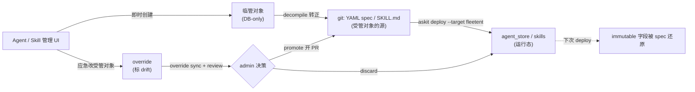

按系列分类管理（每个系列在 UI 中为一个分组卡片，列出该系列的可触发操作、上次执行状态与耗时）：

- [ ] **① 作者 / 脚手架系列（Authoring）**：`init-repo`（新建 agent/skill 项目）、`new-agent`（从模板建 agent spec）、`new-skill`（建 skill 骨架）、`init-from-excel`（从 Excel 批量初始化）；UI 以表单收集参数，生成的 spec 落到工作区供后续系列消费

- [ ] **② 构建与校验系列（Build & Validate）**：`build`（从 spec 编译所有 agent，可选 `--targets`）、`lint`（校验 spec / skill）、`check`（build 后比对产物有无 drift）、`audit`（skill 目录安全预检）、`catalog export`（导出 catalog.json）；作为发布前的 CI 闸门，UI 展示每次运行的通过 / 失败、drift 文件清单与 audit 命中项

- [ ] **③ 部署系列（Deploy）**：`deploy --target {fleetent|openclaw|claude|codex|hermes}`（部署到目标平台，含 **fleetent 自身**——把受管 spec 编译后经 fleetent **幂等 apply API**（按 agent_id / name upsert）写入 agent_store，skills 投递到共享目录并触发 hot reload；deploy 不覆盖运行态 bindings）、`provision`（为 MCP channel + agent account 跑 OAuth 等配置流程）；UI 提供目标平台选择、`--dry-run` 预演开关，部署前强制先过②的 check 绿灯（可配置为硬门槛）；`deploy --target fleetent` 不覆盖临管对象、对受管对象的未回流 drift 给出冲突提示

- [ ] **④ 依赖系列（Skill Deps）**：`install`（按 project.yaml 解析并安装 skill 依赖、写 skills.lock）；UI 展示已锁定版本与待更新依赖

- [ ] **⑤ 运行时覆盖回流系列（Override Flow）**：`override sync`（捕获运行时改动为 override 文件）、`override review`（逐条审阅 pending override，决定 Promote / Discard / Skip）、`override promote`（回流到 spec 并开 PR，支持跨环境 `--base`）、`override discard`（丢弃）、`override cleanup`（清理过期 override）、`decompile`（workspace 文件反编译回 spec）；UI 以 diff 视图呈现每条 override，P/D/S 决策与 promote 生成的 PR 链接一屏可见——这是与平台「Skill 提案审批」体验对齐的第二个审阅入口

- [ ] **⑥ 定时任务系列（Cron）**：`cron list`（离线列出声明的 cron）、`cron diff` / `cron diff-hermes`（声明态 vs 已安装态对比）、`cron install` / `cron install-hermes`（安装到 OpenClaw / Hermes）、`cron remove`（移除未声明任务）；UI 展示声明态与运行态的差异高亮，安装 / 移除走二次确认

- [ ] **⑦ 环境与连接器系列（Env & MCP）**：`doctor`（前置依赖检查）、`env doctor`（运行时 + host 环境诊断）、`env-sync`（同步 agent 的 .env 变量，支持 `--agent` / `--all` / 跨平台 `--from`）、`mcp doctor`（MCP 环境健康检查）、`sync allowlist`（把外部数据同步进 .env allowlist）；UI 把诊断结论渲染为红 / 黄 / 绿清单，敏感变量值脱敏展示

- [ ] **⑧ 迁移系列（Migrations）**：`migrate-openclaw-overrides`、`migrate-shared-identity`、`migrate-env`（重命名废弃 env 前缀）等一次性迁移；均为高危批量改写，UI 默认 `--dry-run` 预演、展示将变更的文件清单，确认后才落盘

- [ ] **运行模型、日志与审计**：每次系列操作作为一个**任务**异步执行，UI 实时流式输出 askit 的 stdout/stderr 并保留历史；操作的发起人、系列、命令、参数、退出码、产物 / PR 链接全部写审计；同一工作区的写操作（build/deploy/override promote/migrate）串行排队，避免并发踩踏

- [ ] **askit 控制台权限矩阵**：只读诊断与列表 viewer 可看；触发写操作仅 admin；部署 / 迁移 / promote 等高危系列要求二次确认

| 系列 | admin | viewer | 说明 |
|------|:-----:|:------:|------|
| ① 作者 / 脚手架 | ✅ | ❌ | 生成 spec 骨架 |
| ② 构建与校验 | ✅ | ✅（只读跑 lint/check） | 发布前闸门 |
| ③ 部署 | ✅ | ❌ | 需先过 check，二次确认 |
| ④ 依赖 | ✅ | ❌ | 写 skills.lock |
| ⑤ 覆盖回流 | ✅ | ✅（只读看 diff） | promote 开 PR，二次确认 |
| ⑥ 定时任务 | ✅ | ✅（只读 diff/list） | install/remove 二次确认 |
| ⑦ 环境与连接器 | ✅ | ✅（只读诊断） | 变量值脱敏 |
| ⑧ 迁移 | ✅ | ❌ | 默认 dry-run，高危二次确认 |

```mermaid
flowchart LR
    subgraph console["askit 编排控制台（platform 提供 UI）"]
        S1["① 作者/脚手架<br/>init-repo / new-agent / new-skill"]
        S2["② 构建与校验<br/>build / lint / check / audit / catalog"]
        S3["③ 部署<br/>deploy / provision"]
        S4["④ 依赖<br/>install"]
        S5["⑤ 覆盖回流<br/>sync / review / promote / discard / cleanup / decompile"]
        S6["⑥ 定时任务<br/>cron install / diff / remove / list"]
        S7["⑦ 环境与连接器<br/>doctor / env-sync / mcp doctor / sync allowlist"]
        S8["⑧ 迁移<br/>migrate-*"]
    end
    console -->|按系列触发| ASKIT["askit CLI<br/>(ai-skills-toolkit 外部工具域)"]
    ASKIT -->|stdout/stderr 流 + 退出码 + 产物| console
    ASKIT -.编译/部署产物.-> OUT["目标平台配置<br/>openclaw / claude / codex / hermes"]
    console -.写审计.-> AUD["审计日志"]
```

## 验收标准

**场景 1：API key 认证**
- Given：有效或无效的 Bearer token
- When：POST /chat
- Then：有效 token 正常处理，无效或过期 token 返回 401

**场景 2：CLI 创建用户**
- Given：管理员执行 `create-user --name "Alice"`
- When：命令执行成功
- Then：输出 API key，Alice 可立即用该 key 调用 /chat

**场景 3：内置 admin 种子化（v1.0）**
- Given：系统首次启动，数据库无任何管理员账户
- When：启动进程
- Then：自动创建用户名固定的内置 admin 账户，初始密码写入启动日志并标记 must_reset=true

**场景 4：内置 admin 首次登录强制改密（v1.0）**
- Given：内置 admin 用初始密码登录，must_reset=true
- When：登录成功
- Then：被强制跳转改密页，未完成改密前访问任何其他页面均被打回；改密后 must_reset 清除，正常进入后台

**场景 5：内置 admin 不可删除 / 不可改名（v1.0）**
- Given：任意角色（含其他 admin）已登录
- When：尝试在 UI 或 API 删除内置 admin、修改其用户名、或将其降级
- Then：操作被拒并提示"内置管理员不可修改"，请求不落库

**场景 6：内置 admin 提升普通用户为 admin（v1.0）**
- Given：内置 admin 已登录，普通用户 Alice 当前无管理员角色
- When：在用户详情页将 Alice 角色设为 admin
- Then：Alice 下次登录后可见管理后台并可执行 admin 权限内的操作，操作记入审计

**场景 7：普通 admin 不可禁用内置 admin（v1.0）**
- Given：普通 admin（非内置）已登录
- When：尝试禁用 / 拉黑 / 降级内置 admin
- Then：操作被拒，按钮不可见或返回 403，请求不落库

**场景 8：管理员角色分级（v1.0）**
- Given：viewer 角色管理员已登录
- When：访问"删除用户"等写操作入口
- Then：相关按钮 / 菜单不可见或返回无权限，请求不落库

**场景 9：高危操作二次验证（v1.0）**
- Given：admin 已登录但未通过 2FA
- When：尝试删除一个用户
- Then：UI 弹出二次验证；通过后才执行，否则操作被拒并记入审计

**场景 10：admin 在 UI 手动建用户（v1.0）**
- Given：admin 已登录
- When：在用户管理页填写邮箱 / 姓名 / 初始密码并保存
- Then：账号即刻可用，系统向该邮箱发账号通知邮件；用户首次登录被强制改密

**场景 11：admin 发邀请链接（v1.0）**
- Given：admin 已登录
- When：在用户管理页点"邀请用户"，填写邮箱并生成一次性邀请链接
- Then：系统向该邮箱发送含一次性 token 的邀请邮件，token 在使用或过期后立即失效

**场景 12：用户通过邀请激活账号（v1.0）**
- Given：用户收到邀请邮件并在 token 有效期内点击链接
- When：在激活页设置密码并提交
- Then：账号激活，首把 API key 自动签发，邀请 token 立即失效，再次访问链接返回"邀请已失效"

**场景 13：无自助注册入口（v1.0）**
- Given：v1.0 部署后的系统
- When：访客直接访问 `/register` 或类似公网注册路径
- Then：返回 404 或显式提示"本系统不开放自助注册，请联系管理员"，无法绕过 admin 自行建账

**场景 14：用户详情统一展示 web 与 IM 身份（v1.0）**
- Given：Alice 持有 2 把 API key，且绑定了 Slack U123（allowed）+ Telegram 456（blocked）
- When：admin 在用户管理页点击 Alice 进入详情
- Then：一屏并列看到 Alice 的 web 身份（邮箱 / 角色）、2 把 API key 及其使用情况、2 个 IM 账号及各自状态；可直接在该页面对单个 IM 身份执行加黑 / 恢复，无需跳转

**场景 15：IM 工作台跳回 User 详情（v1.0）**
- Given：admin 在 IM 用户管理工作台筛选"被加黑"列表，看到一条 Telegram 456 对应 Alice
- When：点击该条记录的"查看用户"
- Then：跳转到 Alice 的统一详情页，可看到她的全部 web + IM 信息上下文，再决定恢复该 IM 身份或升级到一键拉黑账号

**场景 16：多 API key 独立轮换（v1.0）**
- Given：Alice 拥有两把 key A、B
- When：在 UI 内仅轮换 A
- Then：A 旧值立即失效，B 仍可正常调用 /chat

**场景 17：API key scope 限制为单 agent（v1.0）**
- Given：Alice 的 key A 的 scope 设为 `[ops-bot]`（仅允许访问 agent "ops-bot"）
- When：用 key A POST /chat 且请求路由到 agent "support-bot"
- Then：返回 403，提示"scope 不允许访问该 agent"
- And：同一把 key A 调用路由到 "ops-bot" 的请求正常通过；scope = `*` 的 key 调用任意 agent 都通过

**场景 18：admin 主动签发新 key（v1.0）**
- Given：Alice 持有 1 把活跃 key A
- When：admin 在 UI 点"新增 key"，备注 "ci-runner"，可选设有效期与 scope
- Then：签发新 key B 并展示一次明文；A 不受影响，A 与 B 可同时使用

**场景 19：撤销单把 key 不影响账号（v1.0）**
- Given：Alice 持有 key A、B，其中 A 怀疑泄露
- When：admin 点 A 的"撤销"并填写原因
- Then：A 立即失效（调用返回 401），B 不受影响；Alice 账号本身仍可正常登录与使用；撤销动作写审计

**场景 20：API key 使用情况展示（v1.0）**
- Given：Alice 的 key A 在过去 24 小时被多次调用
- When：admin 打开 Alice 用户详情的 key 列表
- Then：A 显示创建时间、最后一次使用时间、最近来源 IP / UA、累计调用次数

**场景 21：API key 过期前提醒（v1.0）**
- Given：Alice 的 key A 设了 30 天有效期、距过期仅剩 N 天（达提醒阈值）
- When：到达每日定时检查
- Then：系统向 Alice 账号邮箱发送续期提醒，UI 该 key 标记"即将过期"；Alice 一键续期后到期日推迟，续期动作写审计；如未续期，过期当日自动失效

**场景 22：一键拉黑级联生效（v1.0）**
- Given：Alice 持有 2 把 API key、绑定 Slack 与 Telegram 两个 IM 账号
- When：管理员一键拉黑 Alice 并填写原因
- Then：两把 key 立即失效；两个 IM 账号同步封禁；同邮箱再次注册被拒；操作进入审计日志

**场景 23：解封后 key 不复活（v1.0）**
- Given：Alice 已被拉黑
- When：管理员在后台解除拉黑
- Then：账号本身恢复可登录，已失效的 key 不自动恢复；IM 账号需重新审批

**场景 24：批量拉黑（v1.0）**
- Given：检测到来自同一邮箱域的 N 个滥注账号
- When：管理员按"邮箱域=evil.com"批量拉黑
- Then：所有匹配账号被拉黑，操作以一条聚合审计记录入库

**场景 25：IM 用户首次会话默认放行（v1.0）**
- Given：新 Slack 用户 U999 之前从未发过消息，发消息所在的 channel #ops 已被部署方配置允许
- When：U999 在 #ops 第一次发 "hi"
- Then：系统自动建 im_users 记录并 allowed=1，消息直接进入 agent_loop 并返回回复；**无任何审批等待**

**场景 26：admin 加黑 IM 用户后被拒（v1.0）**
- Given：Slack 用户 U999 当前 allowed=1
- When：admin 在 IM 用户管理工作台对 U999 执行"加黑"并填写原因
- Then：U999 状态变为 blocked，下次发消息收到拒绝提示，消息不进入 agent_loop；加黑动作进入审计日志

**场景 27：admin 恢复被加黑的 IM 用户（v1.0）**
- Given：Slack 用户 U999 当前为 blocked
- When：admin 在 IM 用户管理工作台对 U999 执行"恢复"并填写原因
- Then：U999 状态变为 allowed，下次发消息正常进入 agent_loop；恢复动作进入审计日志

**场景 28：IM 用户批量加黑 / 恢复（v1.0）**
- Given：admin 在工作台筛选出多个 IM 用户
- When：全选并点"批量加黑"或"批量恢复"并填写原因
- Then：所选 IM 用户状态批量变更，每条操作单独写入审计日志并关联批次 ID

**场景 29：配额超限被拒（v1.0）**
- Given：Alice 设置了 10k token 配额且已用满
- When：Alice 再次调用 /chat
- Then：返回 429，告知超限；UI 收到超限事件

**场景 30：审计日志可检索（v1.0）**
- Given：管理员 admin1 刚轮换了 Alice 的 key
- When：在审计日志按"操作=轮换 key"筛选
- Then：找到该条记录，含 admin1、时间戳、目标用户、操作类型

**场景 31：单会话 trace 可见（v1.0）**
- Given：一段含工具调用与审批的会话
- When：打开该会话的 trace 视图
- Then：按时间序展示模型输出、工具入参 / 出参、governance.permission_gate 决策、memory 命中

**场景 32：仪表盘总览（v1.0）**
- Given：多平台运行中，其中一个平台已断线
- When：打开后台首页
- Then：一屏看到各平台连接状态（含断线项）、API 错误率、活跃 session 数、待审批积压数

**场景 33：CLI 加黑入口收回（v1.0）**
- Given：v1.0 部署后的系统
- When：操作者执行 `block-user --im-user-id {id}`
- Then：命令返回 deprecated 提示，要求改用后台 UI；该 IM 账号状态保持不变

**场景 34：viewer 不可加黑 / 恢复 IM 用户（v1.0）**
- Given：viewer 角色管理员在 UI 打开 IM 用户管理工作台
- When：选中一条 allowed 或 blocked 记录
- Then：仅可查看，"加黑"和"恢复"按钮均不可见或返回 403；这两个动作仅 admin 可执行

**场景 35：admin 在 UI 可加黑 IM 用户（v1.0）**
- Given：admin 角色已登录，目标 IM 用户当前 allowed=1
- When：在 UI 点击该用户的"加黑"并填写原因
- Then：该 IM 账号被封禁，下次发消息收到拒绝提示；操作进入审计日志

**场景 36：admin 动态创建 Agent（v1.0）**
- Given：admin 已登录，系统当前无名为 "ops-bot" 的 Agent
- When：在 Agent 管理页填写名称 "ops-bot"、system_prompt、allowed_tools（如 `read_*`）并保存
- Then：Agent 即时创建并处于启用状态，无需重启服务即出现在列表中；随后将其绑定到某 channel 后，该 channel 的消息可路由到 "ops-bot"

**场景 37：创建重名 Agent 被拒（v1.0）**
- Given：已存在名为 "ops-bot" 的 Agent
- When：admin 再次创建名为 "ops-bot" 的 Agent
- Then：操作被拒并提示名称已存在，请求不落库

**场景 38：编辑 Agent 对新会话生效（v1.0）**
- Given：Agent "ops-bot" 的 allowed_tools 原为 `[read_*]`
- When：admin 在详情页改为 `[read_*, write_file]` 并保存
- Then：保存后新发起的会话中 "ops-bot" 可调用 write_file；编辑动作写审计

**场景 39：禁用的 Agent 拒绝新会话（v1.0）**
- Given：Agent "ops-bot" 已被 admin 禁用
- When：一条消息路由到 "ops-bot"
- Then：请求被拒并提示"该 Agent 已停用"，不进入 agent_loop；重新启用后同样的请求恢复正常

**场景 40：删除仍被绑定的 Agent 受阻（v1.0）**
- Given：Agent "ops-bot" 仍被某 channel 绑定（或被设为默认 Agent）
- When：admin 点击删除
- Then：删除被阻止，UI 列出占用该 Agent 的用户 / channel / 默认绑定，提示先解绑或迁移；请求不落库

**场景 41：归档（软删除）后停止路由且可恢复（v1.0）**
- Given：Agent "ops-bot" 已无任何绑定且非默认
- When：admin 删除并二次确认
- Then：Agent 标记为 archived、从可路由列表移除、历史 trace 仍可查；在保留期内点击"恢复"可重新启用；删除与恢复均写审计

**场景 42：克隆 Agent 不带绑定（v1.0）**
- Given：Agent "ops-bot" 已绑定若干 channel
- When：admin 对其执行"克隆"并命名 "ops-bot-staging"
- Then：新 Agent 复制了 system_prompt / allowed_tools / 模型配置，但不继承任何 user / channel 绑定，且默认处于启用状态

**场景 43：从模板创建 Agent（v1.0）**
- Given：admin 选择内置"只读问答"模板新建 Agent
- When：进入创建表单
- Then：allowed_tools 与 system_prompt 已按模板预填，admin 微调名称后即可保存创建

**场景 44：按 Agent 配置模型生效（v1.0）**
- Given：admin 为 Agent "ops-bot" 配置了 `models.routes.default` 与单 agent 成本上限
- When：通过 "ops-bot" 发起会话
- Then：该会话按该 Agent 的 default route 路由模型；达到该 Agent 成本上限时按 agent-runtime 的预算策略停止（运行语义以 agent-runtime 为准）

**场景 45：按 Agent 观测视图（v1.0）**
- Given：Agent "ops-bot" 过去 24 小时有多次调用
- When：admin 打开 "ops-bot" 详情的观测页
- Then：一屏看到该 Agent 的调用次数、token / 成本用量、错误率、平均时延与最近会话列表，可点击下钻到单会话 trace

**场景 46：viewer 不可管理 Agent（v1.0）**
- Given：viewer 角色已登录并打开 Agent 管理页
- When：尝试创建 / 编辑 / 启停 / 删除 Agent
- Then：相关按钮不可见或返回 403，请求不落库；viewer 仅能浏览列表与观测视图

**场景 47：admin 上传 Skill 即时生效（v1.0）**
- Given：admin 已登录，上传一个 frontmatter 合法、安全审计通过的 Skill
- When：保存上传
- Then：Skill 通过校验与审计后上线并触发热加载，出现在列表中且对后续请求可匹配，无需重启服务

**场景 48：上传被判注入的 Skill 进隔离不上线（v1.0）**
- Given：admin 上传的 Skill 内容命中安全审计「拒绝加载」级规则
- When：保存上传
- Then：Skill 不上线、进入隔离区，UI 提示命中的注入模式；该 Skill 不参与任何匹配注入，事件写审计

**场景 49：可疑 Skill 上线但被打标（v1.0）**
- Given：admin 上传的 Skill 命中「可疑」级规则
- When：保存上传
- Then：Skill 上线并可匹配，但在列表标注"可疑"，详情页展示命中的规则供复核

**场景 50：全局禁用 Skill 后不再注入（v1.0）**
- Given：Skill "crm-ops" 当前全局启用
- When：admin 在 Skill 管理页将其全局禁用
- Then：后续任何请求都不再匹配注入该 Skill；禁用动作写审计；重新启用后恢复匹配

**场景 51：按 Agent 启停 Skill（v1.0）**
- Given：Skill "crm-ops" 全局启用，Agent "support-bot" 已对其停用
- When：通过 "support-bot" 发起会触发该 Skill 的请求
- Then："support-bot" 不注入 "crm-ops"，而其他启用了该 Skill 的 Agent 仍正常注入

**场景 52：删除仍被 Agent 启用的 Skill 受阻（v1.0）**
- Given：Skill "crm-ops" 仍被至少一个 Agent 显式启用
- When：admin 点击删除
- Then：删除被阻止，UI 列出启用它的 Agent，提示先停用；请求不落库

**场景 53：归档 Skill 后停止注入且可恢复（v1.0）**
- Given：Skill "crm-ops" 已无任何 Agent 启用
- When：admin 删除并二次确认
- Then：Skill 标记归档、不再参与匹配注入、文件快照与历史 trace 保留；保留期内可恢复

**场景 54：审批 AI 生成的 Skill 提案（v1.0）**
- Given：prod 环境，reflection 产出一条 update 提案（状态 pending）汇总到提案收件箱
- When：admin 打开该提案，查看理由与变更 diff 后点击 approve
- Then：reflection 应用该变更使 Skill 更新生效，提案状态置为已批准；审批动作写审计

**场景 55：驳回 Skill 提案不改动 Skill（v1.0）**
- Given：提案收件箱有一条 pending 的 delete 提案
- When：admin 点击 reject
- Then：提案关闭、对应 Skill 不被删除、维持原状；驳回动作写审计

**场景 56：触发热加载（v1.0）**
- Given：admin 已在 skills/ 目录新增 / 修改了文件
- When：在 Skill 管理页点击"重新扫描"
- Then：索引重建后新 / 改 Skill 对后续请求生效；重扫描期间旧索引继续服务，扫描失败时保留旧索引并在 UI 告警

**场景 57：viewer 不可管理 Skill（v1.0）**
- Given：viewer 角色已登录并打开 Skill 管理页
- When：尝试上传 / 编辑 / 启停 / 归档 Skill 或审批提案
- Then：相关按钮不可见或返回 403，请求不落库；viewer 仅能浏览列表、审计结论与观测视图

**场景 58：askit 控制台按系列分组展示（v1.0）**
- Given：admin 打开 askit 编排控制台
- When：页面加载
- Then：八个系列各为一张分组卡片（作者 / 构建校验 / 部署 / 依赖 / 覆盖回流 / 定时任务 / 环境连接器 / 迁移），每张卡片列出该系列可触发的操作、上次执行状态与耗时

**场景 59：触发 build 并看实时日志（v1.0）**
- Given：admin 在「构建与校验」系列点击 `build`
- When：任务异步执行
- Then：UI 实时流式输出 askit 的 stdout/stderr，结束时展示退出码与（若失败）错误摘要；该次执行写入审计与历史

**场景 60：check 不绿时阻止部署（v1.0）**
- Given：硬门槛已开启，最近一次 `check` 检出 drift（未通过）
- When：admin 在「部署」系列点击 `deploy`
- Then：部署被阻止并提示先通过 check；通过 check 后再次部署可正常发起

**场景 61：部署支持 dry-run 预演（v1.0）**
- Given：admin 在「部署」系列选目标平台并勾选 `--dry-run`
- When：执行
- Then：仅输出将写入的文件计划、不落盘任何产物；取消勾选后实际部署需二次确认

**场景 62：覆盖回流 diff 审阅与 P/D/S（v1.0）**
- Given：运行时产生了若干 override，admin 在「覆盖回流」系列点 `review`
- When：逐条查看
- Then：每条 override 以 diff 视图呈现，admin 可选 Promote / Discard / Skip；选择 Promote 的项经 `promote` 生成 PR，PR 链接在 UI 可见，决策写审计

**场景 63：cron 声明态与运行态差异（v1.0）**
- Given：声明的 cron 与已安装的不一致
- When：admin 在「定时任务」系列点 `diff`
- Then：UI 高亮新增 / 缺失 / 变更的任务；执行 `install` / `remove` 前要求二次确认

**场景 64：环境诊断脱敏展示（v1.0）**
- Given：admin 在「环境与连接器」系列点 `env doctor`
- When：诊断完成
- Then：结论渲染为红 / 黄 / 绿清单，涉及的敏感变量值被脱敏，不在 UI 或日志中明文显示

**场景 65：迁移默认 dry-run（v1.0）**
- Given：admin 在「迁移」系列点某迁移命令
- When：首次执行
- Then：默认以 dry-run 运行，展示将变更的文件清单且不落盘；admin 二次确认后才真正写入，写入动作记审计

**场景 66：viewer 在 askit 控制台只读（v1.0）**
- Given：viewer 已登录 askit 编排控制台
- When：查看各系列
- Then：可触发只读类操作（如 lint / check / diff / 各类 doctor）并查看日志与历史，但作者 / 部署 / 依赖 / 迁移等写操作按钮不可见或返回 403

**场景 67：同工作区写操作串行（v1.0）**
- Given：一个 `build` 任务正在运行
- When：admin 又触发同工作区的 `deploy`
- Then：后触发的写操作排队等待前者完成，不并发执行；UI 显示其排队状态

**场景 68：deploy --target fleetent 编译受管对象（v1.0）**
- Given：git spec 中定义了 agent "ops-bot"，fleetent 的 agent_store 中尚无该 Agent
- When：admin 在控制台执行 `deploy --target fleetent`
- Then："ops-bot" 被写入 agent_store 并在「Agent 管理」列表出现，标「受管」徽章；随后即可被路由调用

**场景 69：临管对象不被 deploy 覆盖（v1.0）**
- Given：admin 在「Agent 管理」UI 即时创建了临管 Agent "tmp-bot"
- When：执行 `deploy --target fleetent`
- Then："tmp-bot" 不受影响（spec 不含它，deploy 不删不改临管对象）；仅受管对象按 spec 同步

**场景 70：UI 改受管对象产生 drift 并可回流（v1.0）**
- Given：受管 Agent "ops-bot" 已部署
- When：admin 在 UI 改了它的 system_prompt
- Then：列表对 "ops-bot" 标 drift；admin 在「覆盖回流」系列经 `override sync` 看到该 diff，`promote` 后回流到 spec 并生成 PR，drift 标记清除

**场景 71：丢弃 drift 后被 spec 还原（v1.0）**
- Given：受管 Agent "ops-bot" 有一处未回流的 UI 改动（drift）
- When：admin 对该 override 选择 `discard`，随后执行 `deploy --target fleetent`
- Then：该 UI 改动被 spec 内容覆盖还原，drift 清除

**场景 72：临管 Agent 经 decompile 转正（v1.0）**
- Given：临管 Agent "tmp-bot" 验证可用，需纳入版本化
- When：admin 对其执行 `decompile`
- Then：生成对应 spec 并纳入 git，"tmp-bot" 徽章变为「受管」，此后由 spec 管理

**场景 73：受管对象 immutable 字段被还原（v1.0）**
- Given："ops-bot" 的某字段被标为 immutable（如 identity）
- When：admin 在 UI 改该字段并随后 `deploy --target fleetent`
- Then：该字段被 spec 值强制还原，UI 在改动时已提示"该字段受 spec 保护，将于部署时还原"

**场景 74：统计面板按 agent 出核心指标（v1.0）**
- Given："ops-bot" 在所选时间范围内有运行记录
- When：在统计面板选中 "ops-bot"
- Then：展示其调用次数、活跃用户 / channel / 会话数、token 用量、P50 / P95 时延、按天趋势等现有字段可出的指标

**场景 75：多 agent 横向对比（v1.0）**
- Given：选中 "ops-bot" 与 "support-bot"
- When：切到对比视图
- Then：同一指标（如 token 用量、P95 时延）两个 agent 并排展示，可一眼比较

**场景 76：per-user 用量与频率排行（v1.0）**
- Given："ops-bot" 被多个用户调用
- When：在 "ops-bot" 下打开 per-user 下钻
- Then：列出各用户的 token 用量、调用频率、最近活跃并可排序；切到"按用户"反向视图时，可看某用户在所有 agent 上的用量与频率汇总

**场景 77：指标按时间 / channel 下钻（v1.0）**
- Given："ops-bot" 的 token 用量卡片
- When：点击下钻并选"按 channel"
- Then：该指标按 channel 拆分展示；再叠加时间范围筛选时数据随之收敛

**场景 78：allowed_tools 覆盖率提示收窄（v1.0）**
- Given："ops-bot" 的 allowed_tools 含 `write_file`，但所选周期内从未调用过它
- When：查看「工具与治理」组
- Then：`write_file` 被标为"已授权未使用"，提示可考虑从白名单移除以收窄权限

**场景 79：依赖字段未接入时占位（v1.0）**
- Given：成本与终止原因字段尚未接入（budget / 终止码未上线）
- When：打开「① 用量与成本」「② 性能与可靠性」
- Then：成本、终止原因分布等 ⏳ 指标显示"待数据接入"占位而非报错；其余 ✅ 指标正常展示；相关字段上线后这些指标自动点亮

**场景 80：审批统计可见（v1.0）**
- Given："ops-bot" 在周期内触发过若干次 governance.permission_gate
- When：查看「工具与治理」组
- Then：展示该 agent 的审批触发数与通过 / 拒绝 / 超时率

**场景 81：导出与定时报告（v1.0）**
- Given：admin 打开某 agent 的统计视图
- When：点击导出并另配置每周邮件报告
- Then：当前视图导出为 CSV / 图片；按所配周期向管理员邮箱推送该 agent 的统计摘要

**场景 82：从用户下钻到其请求列表（v1.0）**
- Given：在 "ops-bot" 的 per-user 视图选中用户 Alice
- When：点击 Alice
- Then：展示 Alice 在该 agent（或全部 agent）的请求列表，可按时间 / channel 筛选，每条显示时间、入参摘要、token、耗时、结果状态

**场景 83：单请求全链路事件流（v1.0）**
- Given：选中 Alice 的某一条请求
- When：打开其请求级全链路视图
- Then：按时间序展开事件流——用户输入、各轮 LLM 调用（模型 / token / 耗时 / fallback）、每次工具调用入参与出参、governance.permission_gate 决策、memory 命中、压缩事件、最终回复；各节点可展开折叠并复制原始 JSON

**场景 84：sub_agent 子链路就地展开（v1.0）**
- Given：该请求过程中派生了 sub_agent
- When：在链路中点击 sub_agent 节点
- Then：经 `parent_session_id` 关联，就地展开该子 agent 的完整子链路，与父链路同构

**场景 85：缺 request_id 时按会话退化（v1.0）**
- Given：某次运行尚未带 request_id（如旧 HTTP trace）
- When：尝试做请求级链路
- Then：视图退化到可用的关联键（session_id / ts + user_id）尽力聚合，并提示"该请求缺少完整关联键，链路可能不完整"，不报错

**场景 86：主机资源实时与历史（v1.0）**
- Given：平台运行中，内置采集器正常工作
- When：admin 打开资源监控仪表盘
- Then：实时看到主机 CPU / 内存 / 磁盘 / 负载水位，并可切到小时 / 天 / 周的历史曲线

**场景 87：sandbox 容器 OOM 可见（v1.0）**
- Given：某次 sandbox 代码执行因内存超限被 OOM kill
- When：查看「进程 + sandbox 容器」层
- Then：活跃容器数与 OOM / 超时被杀计数更新，该事件可在监控中观察到

**场景 88：依赖基础设施存活监控（v1.0）**
- Given：自托管 Redis 实例停止响应
- When：采集器下一轮采集
- Then：监控标记 Redis 不可用，若已配存活告警规则则触发告警

**场景 89：设阈值 + 持续时间触发告警（v1.0）**
- Given：admin 配置规则"主机 CPU > 85% 持续 5 分钟，级别 warning，通道=邮件+站内"
- When：CPU 持续 6 分钟超过 85%
- Then：触发一条 warning 告警，邮件与站内告警中心各收到通知；CPU 仅瞬时尖峰不持续时不触发

**场景 90：critical 告警未确认自动升级（v1.0）**
- Given：一条 critical 告警已通知但 N 分钟内无人 ack，且配置了升级
- When：超过升级等待时间
- Then：按升级策略发到更高优先级通道 / 更多接收人；升级动作写审计

**场景 91：告警确认与恢复（v1.0）**
- Given：一条 firing 告警
- When：admin 在告警中心点击确认（ack）并标注处理人，随后指标回落到阈值内
- Then：告警状态转 ack → resolved，并发出恢复通知；全过程记入告警历史

**场景 92：告警降噪与抑制（v1.0）**
- Given：某主机宕机，其上 10 个容器同时不可达
- When：告警评估
- Then：同规则重复命中被去重为一条活跃告警；主机宕机告警抑制其上容器的次生告警，不刷屏

**场景 93：维护窗静默（v1.0）**
- Given：admin 为某主机设了今晚 22:00–23:00 维护窗
- When：窗口内该主机指标命中告警规则
- Then：告警只记录不发通知；窗口结束后恢复正常通知

**场景 94：Webhook 外发对接外部系统（v1.0）**
- Given：某规则配置了 Webhook 通道指向外部值班系统
- When：该规则触发
- Then：平台 POST 告警内容到该 Webhook；发送失败有重试与失败记录

**场景 95：viewer 不可改告警规则（v1.0）**
- Given：viewer 已登录资源监控页
- When：尝试新建 / 修改 / 删除告警规则或 ack 告警
- Then：相关按钮不可见或返回 403；viewer 仅可浏览仪表盘与告警历史

**场景 96：采集全程在内网（v1.0）**
- Given：v1.0 部署在隔离内网
- When：资源监控与告警运行
- Then：指标采集与存储均在内网完成，不依赖任何云托管服务；仅当 admin 显式配置 Webhook / 邮件外发时才产生出网流量

**场景 97：admin 试运行 playground 隔离会话（v1.0）**
- Given：admin 在聊天 playground 选定 Agent "ops-bot"
- When：发送一条试运行消息
- Then：以 SSE 流式返回回复，右栏展开本轮注入的 Skill / 知识库召回、工具入参出参、审批决策、模型路由；该会话标记 origin=playground，不计入 "ops-bot" 的对外用量统计

**场景 98：playground 参数覆盖仅作用当前会话（v1.0）**
- Given：admin 在 playground 临时把模型覆盖为某 cheap 模型、并临时停用某 Skill
- When：在该试运行会话内对话
- Then：本次会话按覆盖后的模型与 Skill 集合运行；Agent 的持久配置不变，其他会话不受影响

**场景 99：playground 审批旁路不影响真实会话（v1.0）**
- Given：admin 对自己的 playground 会话开启"自动批准 medium 风险"
- When：该会话触发一个 medium 风险工具，且同时存在一个真实用户会话也触发 medium 风险工具
- Then：playground 会话自动放行并写审计；真实用户会话仍正常进入 governance.permission_gate 等待审批，旁路不波及

**场景 100：admin 接管活跃会话并人工注入（v1.0）**
- Given：用户 Alice 的一段 IM 会话正在进行
- When：admin 点击"接管"，暂停 agent 自动回复并人工注入一条消息
- Then：该消息经 im-gateway 投递回 Alice 所在平台，agent 在接管期间不自动回复；接管与释放均写审计，释放后恢复自动回复

**场景 101：强制清空会话上下文（v1.0）**
- Given：某会话上下文异常
- When：admin 点"清空"并二次确认
- Then：由 session 执行清空（等价 `/new`），该会话后续从空上下文开始；清空动作写审计

**场景 102：viewer 聊天只读（v1.0）**
- Given：viewer 角色打开聊天
- When：尝试发起 playground 对话或接管 / 清空会话
- Then：相关按钮不可见或返回 403，viewer 仅能浏览会话列表与逐轮回放

**场景 103：admin 创建知识库并导入文档（v1.0）**
- Given：admin 在知识库管理页，当前租户下无 kb_id "support"
- When：新建 "support" 并粘贴一段 Markdown 内容导入
- Then：KB 创建成功，文档完成解析 / 分块 / 索引并出现在文档列表，展示分块数与入库结果，无需重启服务

**场景 104：创建重名知识库被拒（v1.0）**
- Given：当前租户已存在 kb_id "support"
- When：admin 再次创建 "support"
- Then：操作被拒并提示 kb_id 已存在，请求不落库

**场景 105：检索测试台召回验证（v1.0）**
- Given："support" 已导入若干文档
- When：admin 在检索测试台输入查询、选该 KB、选 hybrid 模式、设 top-k=5
- Then：返回不超过 5 条召回分块，每条展示 score、所属文档、position 与 section context，按 score 稳定排序

**场景 106：删除仍被 Agent 绑定的知识库受阻（v1.0）**
- Given："support" 仍被 Agent "support-bot" 绑定
- When：admin 点击删除
- Then：删除被阻止，UI 列出绑定它的 Agent，提示先解绑；请求不落库

**场景 107：删除单个文档级联清理（v1.0）**
- Given："support" 内有文档 D
- When：admin 删除 D 并确认
- Then：D 及其 chunks 与向量被清理，后续检索不再召回 D 的内容；删除写审计

**场景 108：viewer 不可管理知识库（v1.0）**
- Given：viewer 打开知识库管理页
- When：尝试创建 KB / 导入文档 / 删除文档
- Then：相关按钮不可见或返回 403，viewer 仅可浏览 KB、文档与检索测试结果

**场景 109：OAuth connector 授权状态总览（v1.0）**
- Given：Alice 已授权 google-drive、未授权 github，且其 notion 的 refresh token 已过期
- When：admin 打开 (user, connector) 授权矩阵筛选 Alice
- Then：google-drive 显示已授权（含 scopes），github 显示未授权，notion 显示"需重新授权"

**场景 110：admin 不可代用户完成首次 consent（v1.0）**
- Given：Bob 从未授权 github
- When：admin 在 connector 管理页尝试为 Bob 授权 github
- Then：UI 不提供代授权入口，明确提示首次 consent 必须由用户本人浏览器跳转完成

**场景 111：admin 代用户解绑凭证（v1.0）**
- Given：Alice 已授权 google-drive
- When：admin 对 (Alice, google-drive) 点"解绑"并二次确认
- Then：connectors 删除该凭证并调用外部系统 revoke endpoint，Alice 下次用该工具需重新授权；解绑写审计

**场景 112：MCP server 连接状态与降级可见（v1.0）**
- Given：某 HTTP MCP server 启动握手失败被降级屏蔽
- When：admin 打开 MCP server 列表
- Then：该 server 显示"启动时降级屏蔽"、注册工具数为 0，平台其余功能不受影响；点"手动重连"可重新发起握手

**场景 113：MCP 工具命名空间可见（v1.0）**
- Given：某 MCP server "github" 已连接并注册了工具
- When：admin 展开该 server
- Then：列出其工具，命名空间为 `github__{tool}`，供配置 Agent allowed_tools 时参考

**场景 114：connector 敏感值脱敏（v1.0）**
- Given：某 OAuth connector 配了 client_secret，某用户持有 refresh token
- When：admin 或 viewer 浏览 connector 配置与授权状态
- Then：client_secret、access / refresh token 均脱敏展示，任何视图与日志均不明文回显

**场景 115：admin 新增 provider target 并测连通（v1.0）**
- Given：admin 在 model_provider 管理页为某 Agent 新增一个指向本地 Ollama 的 OpenAI-compatible target
- When：填好 base_url / model 后点"连通性测试"
- Then：展示是否可达、握手延迟与返回的模型标识；测试不计入对外用量，可达后方可挂到某 Agent route

**场景 116：Agent route fallback 顺序编排生效（v1.0）**
- Given：Agent "ops-bot" 的 `models.routes.default` target 列表为 [A, B]
- When：admin 将顺序调整为 [B, A] 并保存
- Then：运行时 "default" 优先用 B，B 不可用时回退到 A（运行语义以 model-router 为准）；调整写审计

**场景 117：缺失 route 配置提示（v1.0）**
- Given：UI 中某 Agent 未配置 `memory_extraction` route
- When：admin 查看路由编排
- Then：UI 明示该 route 缺失时运行时会报配置错误，建议补齐 route 或确认该能力不启用

**场景 118：未配单价模型成本显示"未配置"（v1.0）**
- Given：某自托管模型未维护单价
- When：在统计面板查看含该模型的成本视图
- Then：该模型成本显示"未配置"而非 0，model_provider 管理页对该模型单价项高亮提醒

**场景 119：删除 provider target 写审计（v1.0）**
- Given：某 provider target 已不再使用
- When：admin 删除该 target 并确认
- Then：target 从 Agent 配置与相关 route 中移除，删除动作写审计

**场景 120：viewer 不可改 provider 配置（v1.0）**
- Given：viewer 打开 model_provider 管理页
- When：尝试新增 / 编辑 / 删除 provider 或调整路由顺序
- Then：相关按钮不可见或返回 403；viewer 仅可浏览配置（密钥脱敏）、路由顺序与观测

## 待决问题

- [x] **fleetent ↔ askit 集成模型（已定：方案 a+b 混合）**：fleetent 同时是 askit 的**舰队控制面**（编排 openclaw / claude / codex / hermes 等外部平台）**和受管 target**（自身 agent / skill 可 spec-as-code 化，由 `deploy --target fleetent` 编译进 agent_store / skills）。spec 与 DB 的双源问题用「双层来源 + 覆盖回流」模型解决：受管对象以 spec 为源、临管对象以 DB 为源，受管对象的 UI 改动经 askit override sync/promote/discard 回流，临管对象经 decompile 转正。放弃纯 (c)「内嵌 askit 子集」（重复造轮子、与上游分叉）；`lint` / `audit` / `check`(drift) 无状态校验器**不内联，v1.0 一律走控制台调 askit**，内联与否留 v1.1 评估。
- [x] **askit 新增 fleetent target（已定）**：(1) askit 的 fleetent deployer **不直接写 SQLite**，而是把编译结果经 fleetent 新增的**幂等 apply API**（POST，按 agent_id / name upsert）交给 fleetent 自己落库，skills 投递到共享 skills 目录后触发 hot reload——askit 不耦合 fleetent 表结构、跨机可用、fleetent 始终是自己 DB 的唯一写入者；(2) **spec 只拥有 agent 定义**（name / system_prompt / allowed_tools / model 配置），**bindings（user / channel / 默认）留运行态，deploy 不覆盖**；(3) 字段集：`name` = identity **immutable**（deploy 时还原），`system_prompt / allowed_tools / model` **mutable**（UI 改记 override），bindings 不进 spec。
  - 跨域 follow-up：fleetent 侧需新增 agents 批量 apply API（server / admin）；ai-skills-toolkit 侧实现 fleetent renderer + deployer。
- [x] **askit 调用形态（已定）**：控制台以**子进程调用 askit CLI + 镜像内固定 askit 版本**，不引库 API；编排外部平台直接子进程，fleetent 自管理的"落库"经上条 apply API 完成。
- [x] **工作区与多环境（已定）**：控制台持 **git-backed 的 spec 工作副本、按环境分（dev/test/pre/prod）**，对齐 askit 分支 env 检测；`deploy` 指向**某环境的 fleetent endpoint**（可远程，不要求与 spec 仓库同机）；**跨环境 promote 需 admin + 2FA**（复用高危二次确认）。spec 仓库（SoT）与运行 DB 解耦、经 endpoint 连接。
- [x] **来源切换的边界（已定）**：核心原则 **identity = 稳定的 agent_id，「受管/临管」只是同一行上的标志位，切换来源不重建对象**——decompile 转正 / adopt 后历史 trace（按 agent_id）与绑定（user_agents / channel_agents 外键引用 agent_id）天然续上；`deploy` 命中**同名临管 agent** 时走 "**adopt 收编**"（沿用同 agent_id、翻转为受管，UI 确认），不覆盖、不硬拒。
- [x] **请求级链路的关联 ID（已定）**：agent-runtime 在 `run() / run_stream() / run_sync()` **入口生成 ULID**（时间可排序），用 **contextvar** 贯穿主循环，所有子事件（工具 / 审批 / 路由 / memory / 压缩）携带；**sub_agent 继承父 request_id + 自带 span_id** 形成 trace 树（OTel-lite）；HTTP 路径补 session_id；**历史 trace 不回填**（退化见场景 85）。platform 仅按 request_id 渲染。
  - 跨域 follow-up：request_id / span 的生成与传播在 agent-runtime / observability 实现。
- [x] **成本统计的模型单价表（已定）**：单价表放 **model_router 配置**（与 provider / model 声明同处，operator 维护），每模型记 input / output 每 1k token 单价；聚合时 `token × 单价`；**未配置单价的模型成本显示"未配置"而非 0**（自托管 / 自定义模型常无公开价）。
  - 跨域 follow-up：model_router 配置 schema 增加单价字段。

### 多机集群部署（待评估，可能延期到 v1.1+）

> 以下为后台管理多机器实例集群时的待决问题。当前实现有多处单机假设，集群化的地基（状态外置）属 session / scheduling / deployment 域，platform 侧只承担"把整个 fleet 当一个逻辑系统来管"的控制面与节点维度。本组在 v1.0 范围未定，按需评估或延期。

- [ ] **集群状态外置（前置地基）**：SQLite（管理库 `management.db` + agent 侧各物理库）、JSON sessions + per-session `asyncio.Lock`、governance.permission_gate 的 `asyncio.Event`、APScheduler 进程内调度、observability traces 均为单机部署假设。多机共享同一份事实需迁到自托管基础设施：管理库 → PostgreSQL；sessions → PostgreSQL / Redis；per-session 锁 → 分布式锁（Redis / PG advisory lock）；traces → 集中表或共享数据库后端。无此步则多机只是各跑各的。（负责人：待认领）
- [ ] **跨节点审批信令**：一个在途请求只活在某一台节点，但审批动作可能落在另一台后台。governance.permission_gate 的 `asyncio.Event` 需改为跨节点唤醒（Redis pub/sub 或 PG LISTEN/NOTIFY），或把 approval / cancel 路由到持有该请求的 owning node（配合 request_id）。（负责人：待认领）
- [ ] **单例协调任务的 leader 选举**：cron_scheduler 与 reflection 定期任务必须全集群只跑一次，否则每台节点重复触发同一任务。需 leader 选举或共享 jobstore + 互斥锁。（负责人：待认领）
- [ ] **节点注册表与控制面**：后台是否演进为无状态控制面（任一节点提供同一 Admin UI，读写共享状态，管整个 fleet）？是否新增「节点 / 实例管理」面——实例注册（node_id / host / 版本 / 心跳 / 状态）、集群拓扑、drain / 滚动重启、版本偏移告警？（负责人：待认领）
- [ ] **监控告警的节点维度**：「资源监控与告警」需从单机扩为按节点上报 + 集群汇总；告警规则作用域扩到 单节点 / 节点组 / 集群聚合，区分"单节点挂"与"集群整体降级"；抑制规则上提到节点层级（节点宕机抑制其上容器 / 进程的次生告警）。（负责人：待认领）
- [ ] **配置一致性与 skill 分发**：`deploy --target fleetent` 写共享 store 后全节点自动收敛，但 skill 文件的跨节点分发载体（共享卷 / 对象存储 / deploy 时同步）与 per-node 配置 drift / 版本展示待定。（负责人：待认领）
