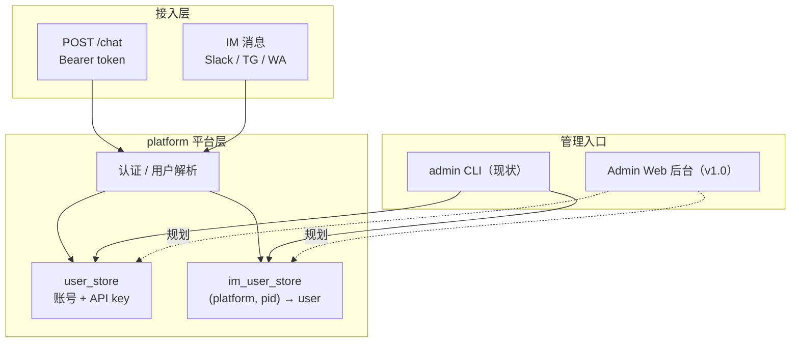
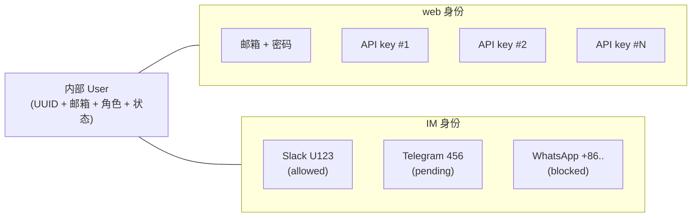
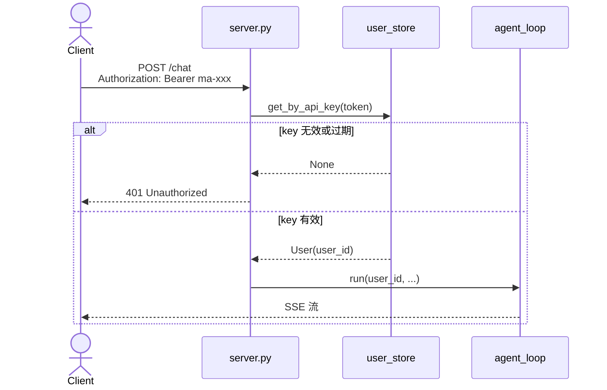
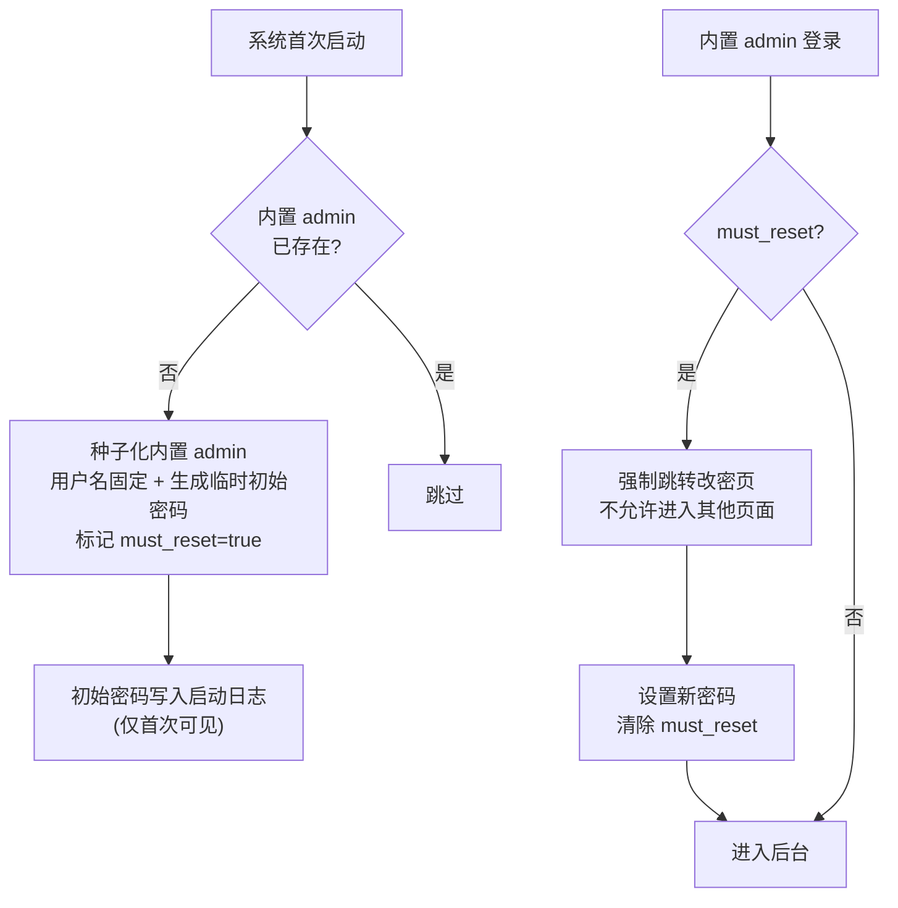
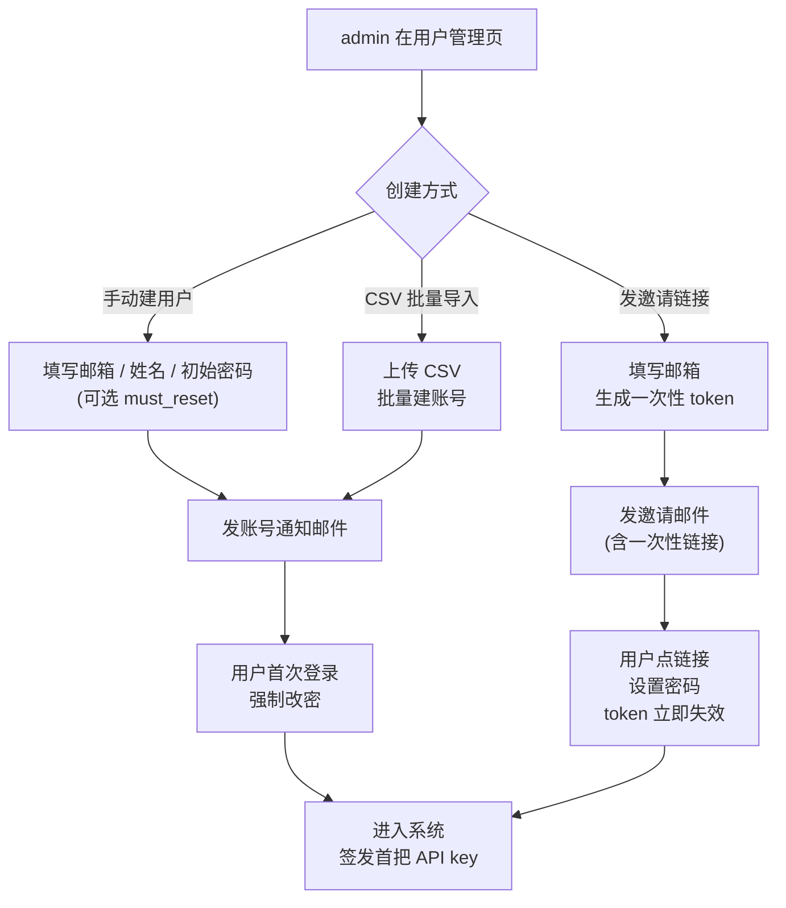
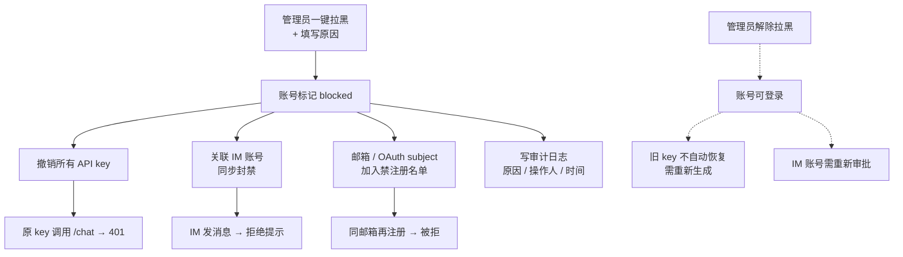

# platform

> 写作提醒：功能描述只写可观察的行为，不写内部实现细节。验收标准只写端到端可验证的行为。

> **版本与范围（v1.0）**：本文档「现状」之外的全部内容——包括「架构总览」、「v1.0 规划」全部 bullet 与图、「验收标准」中标记 `(v1.0)` 的全部场景、「待决问题」全部条目——均纳入 fleetent **v1.0 设计与验收范围**，由 @Romanzhang 主导编写。v1.0 发布前所有 `(v1.0)` 场景须 100% 通过，「待决问题」须全部消化为明确决策或显式延期到 v1.1。

## 概述

多用户管理、API 认证和管理员操作。是 fleetent 作为多租户平台的基础层。

**调用关系**：
- 依赖：user_store、im_user_store
- 被依赖：server.py（认证）、normalizer（用户查找）、admin CLI
- **不涉及**：agent_store（属 agent-runtime 域）、config（属 deployment 域）

## 架构总览

## 现状

- ✅ **Bearer token 认证**：`Authorization: Bearer ma-<64hex>`，`ma-` 前缀区分服务 key 与模型 API key
  - get_by_api_key() 查 SQLite，无外部 IdP

- ✅ **CLI 鉴权模型：OS-level、无登录**：所有 `fleetent-admin ...` 命令直接读写本地 SQLite，不经过 HTTP 鉴权也不要求 admin 登录；访问控制完全交给 OS 层（ssh key / sudo / 数据目录文件权限），遵循 **"能 ssh 到主机即视为受信"** 的企业内部工具惯例（Camunda、PostgreSQL psql、Kafka CLI 等皆是此模型）
  - 代价：审计日志只能记录 OS user（`root` / `ubuntu`），无法追溯到具体 fleetent admin 身份
  - 对策：v1.0 起 CLI 严格收窄到低危操作（建用户、加 IM allowlist），加黑 / 封禁 / 降级 / 改角色 等高危动作只能在 UI 中由 admin 角色完成（详见「规划中」权限矩阵 CLI 列）

- ✅ **用户管理 CLI**：create-user、list-users、rotate-key

- ✅ **IM 用户管理 CLI**：approve-user、block-user、list-pending（v1.0 起 IM 用户首次会话**默认放行**，`approve-user` / `list-pending` 仅作历史兼容；`block-user` 收回到 UI 由 admin 操作）

## 规划中（v1.0）

- [ ] **管理员后台（Admin UI）**：面向管理员的可视化后台，设计哲学「集中管控、admin 建账」——不开放公网自助注册，所有 web 用户由 admin 手动建或发邀请链接创建；**统一管理 web 用户和 IM 用户**，共享同一个内部 User UUID（1 套 web 身份：邮箱 + 密码 + 0~N 把 API key；0~N 个 IM 身份：每条 (platform, platform_user_id) 映射到该 User）

- [ ] **用户管理页 + IM 工作台双视图**：admin 后台两个互通入口；加黑 / 禁用可在 User 维度（级联失效所有 web + IM 身份）或单独 IM 身份维度（只封某个 Slack 账号，不影响该 User 其他身份）
  - 用户管理页（以内部 User 为主视角）：列表展示所有 User，详情页一屏可见 web 身份、API key 列表、所有 IM 账号、用量、历史会话
  - IM 用户管理工作台（以待办为主视角）：展示所有活跃 / 被加黑的 IM 身份，可批量加黑 / 恢复，点任意一条跳回对应 User 详情页

- [ ] **内置 admin 账户**：系统首次启动自动种子化一个用户名固定的内置管理员（如 `admin`），首次登录强制修改初始密码后才可进入后台；该账号不可删除、不可改用户名、不可被降级，永远拥有全部权限；只能由其本人在后台修改自己的密码

- [ ] **角色管理**：内置两级角色——admin（全权管理用户、API key、配额、IM 加黑 / 恢复）、viewer（只读浏览仪表盘 / 审计 / 会话）；内置 admin 与任意 admin 可将其他用户提升为 admin 或降级为 viewer，也可撤销角色；任何角色都不可降级或删除内置 admin

- [ ] **管理员登录**：邮箱 + 密码登录，登录后按角色自动区分可见菜单与可操作按钮，高敏感操作支持 2FA，登录会话空闲超时自动登出

| 操作 | 内置 admin | admin | viewer | CLI |
|------|:----------:|:-----:|:------:|:---:|
| 创建普通用户 | ✅ | ✅ | ❌ | ✅ |
| 删除普通用户 | ✅ | ✅ | ❌ | ❌ |
| 提升 / 降级其他用户角色 | ✅ | ✅ | ❌ | ❌ |
| 加黑 / 恢复 IM 用户 † | ✅ | ✅ | ❌ | ❌ |
| 一键拉黑用户（含 admin） † | ✅ | ✅* | ❌ | ❌ |
| 改全局 / 用户配额 | ✅ | ✅ | ❌ | 部分 |
| 浏览审计 / 会话 / 仪表盘 | ✅ | ✅ | ✅ | ❌ |
| 修改内置 admin 用户名 | ❌ | ❌ | ❌ | ❌ |
| 删除 / 降级内置 admin | ❌ | ❌ | ❌ | ❌ |
| 修改内置 admin 密码 | ✅（仅自己） | ❌ | ❌ | ❌ |

\* 普通 admin 不可拉黑内置 admin
† 加黑 / 封禁 / 拉黑类高危动作只能在后台 UI 由 admin 角色完成，CLI 不开放对应命令（v1.0 起 `block-user` 收回）

- [ ] **admin 手动建用户**：在用户管理页填写邮箱 / 姓名 / 初始密码（或勾选"用户首次登录自行设置密码"），账号即刻可用；支持 CSV 批量导入；**无任何面向公网的自助注册入口**

- [ ] **邀请链接发码**：admin 可对单个邮箱生成一次性邀请链接并发送邀请邮件，用户点击链接、设置密码后激活账号；邀请 token 有过期时间，使用后立即失效

- [ ] **用户列表与生命周期**：列表按名称 / 邮箱 / 状态 / 创建时间 / 最近活跃 / **绑定 IM 平台数量**排序与筛选，可按"含 IM 身份 / 仅 web / 仅 IM"切换视图；用户详情页**一屏并列展示** web 身份（邮箱 / 角色 / 密码状态）、API key 列表（含使用情况）、所有平台的 IM 账号（含 allowed / blocked 状态，可对单个 IM 身份执行加黑 / 恢复）、用量曲线、历史会话；可编辑 / 禁用 / 删除整个 User

- [ ] **多 API key 管理**：一个用户可拥有多把 key，每把可设有效期、**scope（agent 级白名单）**、备注；支持**独立新增 / 轮换 / 撤销**任意一把，互不影响（典型场景：旧 key 在用、为 CI/CD 新签一把；或单独撤销疑似泄露的一把而不影响其余）
  - **scope 粒度 = agent 级**：每把 key 可绑定一个 agent 白名单（如 `[ops-bot, support-bot]` 或 `*` 表示全部），调用 `/chat` 时若路由到的目标 agent 不在白名单内，请求被拒
  - 设计意图：让 CI/CD 自动化 key 只能触达运维 agent，业务 key 只能触达业务 agent，单把 key 泄露时爆炸半径最小化到一个 agent 边界
  - 不做 endpoint 级 scope（如 readonly / readwrite）：fleetent 对外只有 `/chat` 一个有意义的写入端点，endpoint 粒度无实际意义

- [ ] **API key 使用情况展示**：每把 key 列表显示创建时间、最后一次使用时间、最近来源 IP / UA、累计调用次数，用于审计与泄露排查

- [ ] **API key 过期提醒**：设了 TTL 的 key 在到期前 N 天向账号邮箱发送续期提醒，UI 上标记"即将过期"；用户可在 UI 一键续期，过期当日自动失效并写审计

- [ ] **一键拉黑与解封**：拉黑后所有 key 立即失效、关联 IM 账号同步封禁、同邮箱 / OAuth subject 后续注册被拒；拉黑必须填写原因写入审计；解封后账号可登录但已失效的 key 不自动恢复

- [ ] **批量拉黑**：按邮箱域、IP、注册时间窗批量拉黑，用于应对滥注或撞库攻击

- [ ] **IM 用户管理工作台**：**v1.0 起 IM 用户默认放行（取消首次会话审批门槛）**——只要发消息所在的 channel / workspace 已被部署方在 channel 白名单中允许（白名单的具体配置载体由 im-gateway / deployment 域维护，不在本模块），新 IM 用户首条消息直接进入 agent_loop，**无审批等待**；工作台聚焦**加黑名单维护**：admin 在 UI 列表查看所有活跃 / 被加黑的 IM 用户，可单条或批量执行加黑 / 恢复并填写原因；**加黑与恢复均仅 admin 角色可操作**（viewer 仅可查看），CLI 不再开放加黑入口（`block-user` 收回）；同一内部用户的多 IM 账号（Slack + Telegram + WhatsApp）合并展示

- [ ] **用量与配额**：per-user、全局的 token 用量、调用次数、活跃 session 数仪表盘；可设单用户上限，超限自动拒绝并通知

- [ ] **审计日志**：所有平台管理操作（建删用户、轮换 / 撤销 key、审批 / 加黑 IM 用户、调整配额、改角色）记录"谁、何时、对什么资源、做了什么"，UI 内可检索与导出；删除用户 / 撤销 key / 批量封禁等高危动作要求二次确认

- [ ] **会话与 trace 浏览**：按用户 / channel / 时间 / 关键词检索历史对话，单会话展开完整 transcript 与逐轮工具调用、permission_gate 决策、模型路由、memory 命中；traces.jsonl 渲染为可筛选、可下钻的事件流

- [ ] **系统健康仪表盘**：首页一屏可见各 IM 平台连接状态、API 错误率与延迟、活跃 session 数、permission_gate 待审批积压、定时任务执行情况；新申请、超限告警、平台断线等关键事件按时间倒序滚动

## 验收标准

**场景 1：API key 认证**
- Given：有效或无效的 Bearer token
- When：POST /chat
- Then：有效 token 正常处理，无效或过期 token 返回 401

**场景 2：CLI 创建用户**
- Given：管理员执行 `create-user --name "Alice"`
- When：命令执行成功
- Then：输出 API key，Alice 可立即用该 key 调用 /chat

**场景 3：内置 admin 种子化（v1.0）**
- Given：系统首次启动，数据库无任何管理员账户
- When：启动进程
- Then：自动创建用户名固定的内置 admin 账户，初始密码写入启动日志并标记 must_reset=true

**场景 4：内置 admin 首次登录强制改密（v1.0）**
- Given：内置 admin 用初始密码登录，must_reset=true
- When：登录成功
- Then：被强制跳转改密页，未完成改密前访问任何其他页面均被打回；改密后 must_reset 清除，正常进入后台

**场景 5：内置 admin 不可删除 / 不可改名（v1.0）**
- Given：任意角色（含其他 admin）已登录
- When：尝试在 UI 或 API 删除内置 admin、修改其用户名、或将其降级
- Then：操作被拒并提示"内置管理员不可修改"，请求不落库

**场景 6：内置 admin 提升普通用户为 admin（v1.0）**
- Given：内置 admin 已登录，普通用户 Alice 当前无管理员角色
- When：在用户详情页将 Alice 角色设为 admin
- Then：Alice 下次登录后可见管理后台并可执行 admin 权限内的操作，操作记入审计

**场景 7：普通 admin 不可禁用内置 admin（v1.0）**
- Given：普通 admin（非内置）已登录
- When：尝试禁用 / 拉黑 / 降级内置 admin
- Then：操作被拒，按钮不可见或返回 403，请求不落库

**场景 8：管理员角色分级（v1.0）**
- Given：viewer 角色管理员已登录
- When：访问"删除用户"等写操作入口
- Then：相关按钮 / 菜单不可见或返回无权限，请求不落库

**场景 9：高危操作二次验证（v1.0）**
- Given：admin 已登录但未通过 2FA
- When：尝试删除一个用户
- Then：UI 弹出二次验证；通过后才执行，否则操作被拒并记入审计

**场景 10：admin 在 UI 手动建用户（v1.0）**
- Given：admin 已登录
- When：在用户管理页填写邮箱 / 姓名 / 初始密码并保存
- Then：账号即刻可用，系统向该邮箱发账号通知邮件；用户首次登录被强制改密

**场景 11：admin 发邀请链接（v1.0）**
- Given：admin 已登录
- When：在用户管理页点"邀请用户"，填写邮箱并生成一次性邀请链接
- Then：系统向该邮箱发送含一次性 token 的邀请邮件，token 在使用或过期后立即失效

**场景 12：用户通过邀请激活账号（v1.0）**
- Given：用户收到邀请邮件并在 token 有效期内点击链接
- When：在激活页设置密码并提交
- Then：账号激活，首把 API key 自动签发，邀请 token 立即失效，再次访问链接返回"邀请已失效"

**场景 13：无自助注册入口（v1.0）**
- Given：v1.0 部署后的系统
- When：访客直接访问 `/register` 或类似公网注册路径
- Then：返回 404 或显式提示"本系统不开放自助注册，请联系管理员"，无法绕过 admin 自行建账

**场景 14：用户详情统一展示 web 与 IM 身份（v1.0）**
- Given：Alice 持有 2 把 API key，且绑定了 Slack U123（allowed）+ Telegram 456（blocked）
- When：admin 在用户管理页点击 Alice 进入详情
- Then：一屏并列看到 Alice 的 web 身份（邮箱 / 角色）、2 把 API key 及其使用情况、2 个 IM 账号及各自状态；可直接在该页面对单个 IM 身份执行加黑 / 恢复，无需跳转

**场景 15：IM 工作台跳回 User 详情（v1.0）**
- Given：admin 在 IM 用户管理工作台筛选"被加黑"列表，看到一条 Telegram 456 对应 Alice
- When：点击该条记录的"查看用户"
- Then：跳转到 Alice 的统一详情页，可看到她的全部 web + IM 信息上下文，再决定恢复该 IM 身份或升级到一键拉黑账号

**场景 16：多 API key 独立轮换（v1.0）**
- Given：Alice 拥有两把 key A、B
- When：在 UI 内仅轮换 A
- Then：A 旧值立即失效，B 仍可正常调用 /chat

**场景 17：API key scope 限制为单 agent（v1.0）**
- Given：Alice 的 key A 的 scope 设为 `[ops-bot]`（仅允许访问 agent "ops-bot"）
- When：用 key A POST /chat 且请求路由到 agent "support-bot"
- Then：返回 403，提示"scope 不允许访问该 agent"
- And：同一把 key A 调用路由到 "ops-bot" 的请求正常通过；scope = `*` 的 key 调用任意 agent 都通过

**场景 18：admin 主动签发新 key（v1.0）**
- Given：Alice 持有 1 把活跃 key A
- When：admin 在 UI 点"新增 key"，备注 "ci-runner"，可选设有效期与 scope
- Then：签发新 key B 并展示一次明文；A 不受影响，A 与 B 可同时使用

**场景 19：撤销单把 key 不影响账号（v1.0）**
- Given：Alice 持有 key A、B，其中 A 怀疑泄露
- When：admin 点 A 的"撤销"并填写原因
- Then：A 立即失效（调用返回 401），B 不受影响；Alice 账号本身仍可正常登录与使用；撤销动作写审计

**场景 20：API key 使用情况展示（v1.0）**
- Given：Alice 的 key A 在过去 24 小时被多次调用
- When：admin 打开 Alice 用户详情的 key 列表
- Then：A 显示创建时间、最后一次使用时间、最近来源 IP / UA、累计调用次数

**场景 21：API key 过期前提醒（v1.0）**
- Given：Alice 的 key A 设了 30 天有效期、距过期仅剩 N 天（达提醒阈值）
- When：到达每日定时检查
- Then：系统向 Alice 账号邮箱发送续期提醒，UI 该 key 标记"即将过期"；Alice 一键续期后到期日推迟，续期动作写审计；如未续期，过期当日自动失效

**场景 22：一键拉黑级联生效（v1.0）**
- Given：Alice 持有 2 把 API key、绑定 Slack 与 Telegram 两个 IM 账号
- When：管理员一键拉黑 Alice 并填写原因
- Then：两把 key 立即失效；两个 IM 账号同步封禁；同邮箱再次注册被拒；操作进入审计日志

**场景 23：解封后 key 不复活（v1.0）**
- Given：Alice 已被拉黑
- When：管理员在后台解除拉黑
- Then：账号本身恢复可登录，已失效的 key 不自动恢复；IM 账号需重新审批

**场景 24：批量拉黑（v1.0）**
- Given：检测到来自同一邮箱域的 N 个滥注账号
- When：管理员按"邮箱域=evil.com"批量拉黑
- Then：所有匹配账号被拉黑，操作以一条聚合审计记录入库

**场景 25：IM 用户首次会话默认放行（v1.0）**
- Given：新 Slack 用户 U999 之前从未发过消息，发消息所在的 channel #ops 已被部署方配置允许
- When：U999 在 #ops 第一次发 "hi"
- Then：系统自动建 im_users 记录并 allowed=1，消息直接进入 agent_loop 并返回回复；**无任何审批等待**

**场景 26：admin 加黑 IM 用户后被拒（v1.0）**
- Given：Slack 用户 U999 当前 allowed=1
- When：admin 在 IM 用户管理工作台对 U999 执行"加黑"并填写原因
- Then：U999 状态变为 blocked，下次发消息收到拒绝提示，消息不进入 agent_loop；加黑动作进入审计日志

**场景 27：admin 恢复被加黑的 IM 用户（v1.0）**
- Given：Slack 用户 U999 当前为 blocked
- When：admin 在 IM 用户管理工作台对 U999 执行"恢复"并填写原因
- Then：U999 状态变为 allowed，下次发消息正常进入 agent_loop；恢复动作进入审计日志

**场景 28：IM 用户批量加黑 / 恢复（v1.0）**
- Given：admin 在工作台筛选出多个 IM 用户
- When：全选并点"批量加黑"或"批量恢复"并填写原因
- Then：所选 IM 用户状态批量变更，每条操作单独写入审计日志并关联批次 ID

**场景 29：配额超限被拒（v1.0）**
- Given：Alice 设置了 10k token 配额且已用满
- When：Alice 再次调用 /chat
- Then：返回 429，告知超限；UI 收到超限事件

**场景 30：审计日志可检索（v1.0）**
- Given：管理员 admin1 刚轮换了 Alice 的 key
- When：在审计日志按"操作=轮换 key"筛选
- Then：找到该条记录，含 admin1、时间戳、目标用户、操作类型

**场景 31：单会话 trace 可见（v1.0）**
- Given：一段含工具调用与审批的会话
- When：打开该会话的 trace 视图
- Then：按时间序展示模型输出、工具入参 / 出参、permission_gate 决策、memory 命中

**场景 32：仪表盘总览（v1.0）**
- Given：多平台运行中，其中一个平台已断线
- When：打开后台首页
- Then：一屏看到各平台连接状态（含断线项）、API 错误率、活跃 session 数、待审批积压数

**场景 33：CLI 加黑入口收回（v1.0）**
- Given：v1.0 部署后的系统
- When：操作者执行 `block-user --im-user-id {id}`
- Then：命令返回 deprecated 提示，要求改用后台 UI；该 IM 账号状态保持不变

**场景 34：viewer 不可加黑 / 恢复 IM 用户（v1.0）**
- Given：viewer 角色管理员在 UI 打开 IM 用户管理工作台
- When：选中一条 allowed 或 blocked 记录
- Then：仅可查看，"加黑"和"恢复"按钮均不可见或返回 403；这两个动作仅 admin 可执行

**场景 35：admin 在 UI 可加黑 IM 用户（v1.0）**
- Given：admin 角色已登录，目标 IM 用户当前 allowed=1
- When：在 UI 点击该用户的"加黑"并填写原因
- Then：该 IM 账号被封禁，下次发消息收到拒绝提示；操作进入审计日志
