# reflection

> 写作提醒：功能描述只写可观察的行为，不写内部实现细节。验收标准只写端到端可验证的行为。

## 概述

系统自我改进机制，定期分析 agent 执行历史，优化记忆质量、改进 skill、并识别知识库缺口。

**负责**：读取 traces 发现规律、清理/合并低质量记忆、生成或改进 skill、上报知识库问题。

**不负责**：实时处理（异步定期触发，不在请求链路上）、skill 的运行时注入（→ agent-runtime）、修改知识库文档内容（只上报，不写回）。

**三个作用目标**：
- **memory reflection**：per-user，优化 memory_layer 中的记忆质量
- **skill reflection**：per-agent，基于 traces 生成或改进 skills/
- **knowledge base reflection**：per-tenant，观察知识库使用质量，上报缺口与问题，不自动写回

**调用关系**：
- 依赖：`traces` 表（情节记忆数据源，SQLite）、memory_layer（读取与写回）、skill_registry（读取现有 skill）、knowledge_base（只读，查询召回质量）、permission_gate（prod 环境 skill 变更审批）、config
- 被依赖：cron_scheduler（定期触发）

## 关键流程

三条反射流程相互独立，分别调度，可安全并发。

**并发安全说明**：三条流程的写入目标完全不重叠——memory reflection 写 `memory_items`，skill reflection 写 `skill_proposals`（prod）或 `skills/` 文件（dev），kb reflection 写 `kb_reflection_reports`。三者读取 `traces` 表时均为只读，不互相阻塞。memory reflection 写 `memory_items` 的同时，`long_term_ctx` 可能正在读取同一表；`memory_layer` 自身的并发控制负责保证读写安全，reflection 不额外加锁。

```mermaid
flowchart TD
    subgraph mem["memory reflection（per-user，定期触发）"]
        A[cron_scheduler] --> B[读取 memory_items]
        B --> C[LLM 分析：过期 / 重复 / 冲突]
        C --> D[写回清理后的记忆]
    end

    subgraph skill["skill reflection（per-agent，定期触发）"]
        E[cron_scheduler] --> F[读取 traces 表\n按 agent_id + 时间窗口过滤]
        F --> G[LLM 分析：高频 pattern / 低效 skill]
        G --> H{环境？}
        H -->|dev| I[直接更新 skills/ 文件]
        H -->|prod| J[写入 skill_proposals 表\n状态 pending]
        J --> K[permission_gate 审批]
        K -->|approve| I
    end

    subgraph kb["knowledge base reflection（per-tenant，定期触发）"]
        L[cron_scheduler] --> M[读取检索质量日志]
        M --> N[分析：低召回 / 未命中 / 陈旧 chunk]
        N --> O[写入 kb_reflection_reports 表]
        O --> P[管理员查看并决策\n知识库内容不自动修改]
    end
```



## 数据模型

```sql
-- skill 变更提案（dev 直接跳过，prod 需要审批）
skill_proposals (
  id           TEXT PRIMARY KEY,  -- UUID
  agent_id     TEXT,              -- 目标 agent
  skill_path   TEXT,              -- skill 目录相对路径，如 "summarizer" 或 "tools/code_runner"
  action       TEXT,              -- "create" | "update" | "delete"
  snapshot     TEXT,              -- JSON {files: {rel_path: content}}；delete 时为 NULL
  rationale    TEXT,              -- 变更理由（来自 LLM 分析）
  status       TEXT,              -- "pending" | "approved" | "rejected"
  created_at   DATETIME,
  resolved_at  DATETIME
)

-- knowledge base 反射上报
kb_reflection_reports (
  id           TEXT PRIMARY KEY,  -- UUID
  scope        TEXT,              -- tenant_id 或 agent_id
  report_type  TEXT,              -- "gap" | "stale" | "co_occurrence"
  description  TEXT,              -- 上报描述
  evidence     TEXT,              -- 证据 JSON（查询样本、低分 chunk ID 等）
  status       TEXT,              -- "pending" | "reviewed"
  created_at   DATETIME,
  reviewed_at  DATETIME
)
```

## 接口定义

```python
async def run_memory_reflection(user_id: str) -> None:
    """清理并合并指定用户的记忆：移除过期条目、合并重复、修正冲突。由 cron_scheduler 触发。"""


async def run_skill_reflection(agent_id: str) -> None:
    """分析 agent traces，生成 skill 变更提案（prod）或直接更新 skill 文件（dev）。"""


async def run_kb_reflection(scope: str) -> None:
    """分析知识库检索质量，将缺口 / 陈旧内容写入 kb_reflection_reports。不修改知识库内容。"""
```

## 现状

尚未实现。

## 规划中（v1.0）

- [ ] **memory reflection**：定期清理与合并 per-user 记忆
  - 清理过期 context 类记忆（超过 TTL 且未被再次提及）
  - 合并语义重复条目
  - 修正已知冲突（比较 identity / preferences 类条目间的矛盾）

- [ ] **skill reflection**：分析 per-agent traces，生成、改进或删除 skill
  - `create`：发现高频重复的 prompt pattern，提炼为新 skill
  - `update`：识别现有 skill 的低效用法，生成改进版本
  - `delete`：skill 长期未被触发、与其他 skill 高度重复、或持续产生负面效果时，提议删除
  - skill 可以是单文件，也可以是含脚本、模板的多级目录；`snapshot` 字段统一存储整个目录的文件快照（JSON），审批时展示完整新状态，应用时直接覆盖写入

- [ ] **knowledge base reflection**：观察知识库使用质量，只上报不写回
  - 知识空白检测：用户频繁提问但召回质量差 → 上报"该类内容可能缺失"
  - 陈旧内容检测：某些 chunk 长期未被召回，或与近期对话明显矛盾 → 标记待管理员审查
  - 高频共现提示：多个文档频繁被一起召回 → 建议管理员补充整合文档
  - 所有 knowledge base reflection 结果均以建议形式输出，执行由人决定

- [ ] **生效机制**：按作用目标和环境区分
  - memory reflection：直接写回（自动维护）
  - skill reflection：dev 直接写入，prod 走 permission_gate 审批
  - knowledge base reflection：仅上报，永远不自动写回

## 验收标准

**场景 1：过期记忆清理**
- Given：用户有一条 context 类记忆超过 TTL，且近期对话未再提及
- When：memory reflection 定期任务触发
- Then：该记忆从存储中移除，后续检索不再返回

**场景 2：冲突记忆合并**
- Given：用户记忆中存在两条语义矛盾的 identity 条目
- When：memory reflection 定期任务触发
- Then：两条合并为一条，保留更新的信息

**场景 3：skill 改进提案生成（prod）**
- Given：某 agent 的 traces 中反复出现同类任务模式
- When：skill reflection 定期任务触发
- Then：生成一条 skill 变更提案，状态为 pending；管理员 approve 后 skill 更新生效

**场景 4：skill 直接生效（dev）**
- Given：dev 环境，skill reflection 识别到可改进的 skill
- When：skill reflection 定期任务触发
- Then：skill 文件直接更新，无需审批

**场景 5：skill 删除提案（prod）**
- Given：某 agent 的某个 skill 在过去 N 天 traces 中从未被触发
- When：skill reflection 定期任务触发
- Then：生成一条 action 为 "delete" 的提案，snapshot 为 NULL，管理员 approve 后 skill 目录被删除

**场景 6：知识空白上报**
- Given：用户连续多次提问某类话题，knowledge_base.search() 返回的 chunk 相关度持续低于阈值
- When：knowledge base reflection 定期任务触发
- Then：生成一条上报记录，注明话题类型和问题频次，管理员可查看

**场景 7：陈旧内容标记**
- Given：某个 chunk 在过去 N 天内从未被召回
- When：knowledge base reflection 定期任务触发
- Then：该 chunk 被标记为"待审查"，管理员可决定保留或删除，知识库内容本身不被自动修改

## 测试边界

**需要单元测试的行为**：
- memory reflection 过期清理：TTL 超期条目被移除，未超期条目保留
- memory reflection 冲突合并：两条矛盾 identity 条目合并为一，不产生重复
- skill reflection prod create/update：生成 skill_proposals 记录（snapshot 含完整文件），状态 pending，不直接写文件
- skill reflection prod delete：生成 skill_proposals 记录（snapshot 为 NULL），状态 pending，不直接删文件
- skill reflection dev 路径：skill 文件直接写入或删除，不写 proposals 表
- snapshot 完整性：create/update 的 snapshot 包含 skill 目录下所有文件，不遗漏
- kb reflection 上报：低召回查询触发 gap 类型报告，写入 kb_reflection_reports
- reflection 不阻塞：三个 run_*() 函数均为 fire-and-forget，不阻塞调度器

**需要 mock 的依赖**：
- `model_router.get_async_client_and_config`：隔离所有 LLM 分析调用
- `memory_layer`：注入可控的记忆数据，隔离写回操作
- `skill_registry`：隔离 skill 文件读写
- SQLite DB 路径：`monkeypatch` 到 `tmp_path`

## 待决问题

- [x] 触发频率：已决定分开调度，频率各异（memory reflection 每日，skill / kb reflection 每周），由 cron_scheduler 独立配置
- [ ] skill reflection 触发条件：需要多少条 traces 样本才触发一次分析？（负责人：待认领）
- [ ] skill 变更提案存储：复用现有 permission_gate 表，还是单独的提案表？（负责人：待认领）
- [ ] knowledge base reflection 上报的输出形式：写入独立日志表，还是通过 IM 通知管理员？（负责人：待认领）
