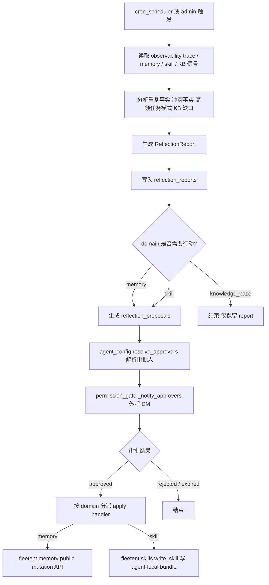

# reflection

> 写作提醒：功能描述只写可观察的行为，不写内部实现细节。验收标准只写端到端可验证的行为。

## 概述

系统自我改进机制，定期分析 agent 执行历史，先生成结构化观察报告，再通过受控 proposal lifecycle 推进 memory / skill 的维护。
reflection 默认不直接修改 User Memory、skills 或 knowledge base。

**负责**：通过 observability trace API 读取 agent 执行历史，生成统一 `reflection_reports`；为 User Memory 与 skills 生成统一 `reflection_proposals(domain=memory|skill)`；对 pending proposal 走 agent-owned 审批外呼；在 approved 后按 domain 调用对应 public boundary apply。

**不负责**：实时处理（异步定期触发，不在请求链路上）、platform console 审批、知识库文档内容修改（KB 只产 report，不写回）、Shared Memory 实现、管理员替用户确认 User Memory 修改。

**三个作用目标**：
- **memory reflection**：per-user，生成 `memory_candidate` / `memory_conflict` 建议，并可转成 owner-scoped maintenance proposal
- **skill reflection**：per-agent，生成 `skill_opportunity` 建议，并可转成 `SkillProposal` 形态的 agent-local skill bundle proposal；`kind` 包括 `create_skill`、`update_skill`、`deprecate_skill`；pending 前不自动改 skill
- **knowledge base reflection**：per-tenant，只观察知识库使用质量，输出只读报告；finding 包括 `missing_knowledge`、`stale_document`、`low_retrieval_quality`、`connector_sync_issue` 和 `entity_graph_gap`；不创建 proposal、不自动写 KB、不触发 sync、不在 agent 侧 apply

**调用关系**：
- 依赖：observability（`query_trace_events(query)`）、`fleetent.memory`（只读信号 + 已批准 proposal 的 public mutation API）、`fleetent.skills`（approved skill proposal 的 bundle 写入边界）、`agent_config`、`fleetent.governance.permission_gate`
- 被依赖：cron_scheduler（定期触发）、platform 只读投影

**模块归属**：
- owning package：`fleetent.reflection`
- public API：`run_reflection(scope)`、`run_kb_reflection_report(scope)`、`generate_memory_maintenance_proposals(...)`、`generate_skill_proposals(...)`、各域 wrapper 的 create / approve / reject / apply API、`get_reflection_trend_summary(...)`
- owned tables：`reflection_reports`、`reflection_proposals`
- config namespace：`reflection.*`

## 关键流程

当前有两条核心流程：统一 report 生成，以及统一 proposal lifecycle。

**并发安全说明**：reflection 只写自己拥有的 `reflection_reports` / `reflection_proposals`，只读 observability / memory / skill 信号；memory / skill apply 只通过各自 public boundary 执行，不直接写 `memory_items` 或技能目录内部实现细节。



## 数据模型

```sql
reflection_reports (
  id           TEXT PRIMARY KEY,
  scope        TEXT,              -- user_id / agent_id / tenant_id / global
  domain       TEXT,              -- memory | skill | knowledge_base | legacy
  time_window_start DATETIME,
  time_window_end   DATETIME,
  findings_json TEXT,             -- finding summary、evidence ids、metadata，不保存完整 transcript
  signal_summary_json TEXT,       -- KB 等聚合信号摘要；可为空
  created_at   DATETIME
)

reflection_proposals (
  id                TEXT PRIMARY KEY,
  domain            TEXT,         -- memory | skill
  kind              TEXT,
  report_id         TEXT,         -- nullable provenance link to reflection_reports.id
  subject_user_id   TEXT,
  target_ref        TEXT,
  payload_json      TEXT,
  reason            TEXT,
  evidence_json     TEXT,
  risk              TEXT,         -- low | medium | high
  status            TEXT,         -- pending | approved | rejected | applied | expired
  reviewer_user_id  TEXT,
  reviewed_at       DATETIME,
  rejection_reason  TEXT,
  actor_user_id     TEXT,
  applied_at        DATETIME,
  expires_at        DATETIME,
  created_at        DATETIME,
  updated_at        DATETIME
)
```

## 现状

已实现内容：
- `reflection_reports` 统一承载三域观察：
  - `domain=memory`
  - `domain=skill`
  - `domain=knowledge_base`
- `reflection_proposals(domain=skill)` 与 `reflection_proposals(domain=memory)` 统一承载两域行动：
  - `domain=memory`
  - `domain=skill`
- memory / skill proposal 在由 `run_reflection` 生成时通过可空 `report_id` 回链到源 `reflection_reports.id`
  - 历史行和非反思来源 proposal 允许 `report_id = NULL`
- memory / skill proposal lifecycle 共享同一套 create / list / approve / reject / apply 审计字段
- report 持久化不保存完整 transcript；KB report 也不保存完整 document body
- KB reflection 只生成 report，不创建 proposal，不在 agent 侧 apply；remediation 留给平台 / ingest 面后续独立 change
- pending proposal 审批触达走 agent-owned 外呼：
  - memory → owner
  - skill → team / tenant approver
  - requester 不能作为自己提案的 approver
  - 找不到 approver 时 default-closed，proposal 保持 pending
- skill apply 通过 `fleetent.skills.write_skill(...)` 原子写入 `<agent home>/skills/<name>/`
  - 支持整棵 bundle（`SKILL.md` + 脚本 / 模板）
  - `update_skill` 为全树覆盖
  - `deprecate_skill` 通过 frontmatter `enabled: false` 软禁用
- skill bundle 安全依赖三层：
  - 审批 review bundle 全量内容
  - `SKILL.md` 注入扫描拦截 severe 命中
  - bundle 内脚本仍受运行时 sandbox 约束
- trend summary 只聚合 report / proposal 的计数和状态，不暴露原始 transcript / draft 内容

当前定位：已具备统一三域观察、两域 proposal lifecycle、agent-owned 审批外呼、skill agent-local apply 和 KB 只读 report。

## 验收标准

**场景 1：memory report + proposal**
- Given：用户对话中重复出现可沉淀事实，且已有 memory signal
- When：`run_reflection(scope)` 触发
- Then：写入 `reflection_reports(domain=memory)`，并生成 `reflection_proposals(domain=memory)`；生成的 proposal 通过 `report_id` 回指本次 report；User Memory 本身不会在未批准前被修改

**场景 2：skill bundle apply**
- Given：某 agent 的 traces 中反复出现同类任务模式，skill proposal 已批准
- When：执行 skill proposal apply
- Then：完整 bundle 被原子写入该 agent 自己的 skills 目录，并立即参与后续 skill scan / match；其他 agent 的技能目录不受影响

**场景 3：KB 只读 report**
- Given：知识库检索命中率持续偏低，且存在明确缺口信号
- When：`run_kb_reflection_report(scope)` 触发
- Then：写入 `reflection_reports(domain=knowledge_base)`；不会创建 proposal，不会自动写 KB，也不会触发 sync

**场景 4：审批走 agent-owned 外呼**
- Given：一个 memory 或 skill proposal 进入 `pending`
- When：reflection 解析 approver
- Then：通过 `permission_gate` 外呼 DM 给非 requester 的 approver；platform console 不承担 approve / reject 写路径

## 测试边界

**需要 integration 测试的行为**：
- `run_reflection` / `run_kb_reflection_report` 持久化到统一 `reflection_reports`
- unified `reflection_proposals` 的 create / list / approve / reject / apply 生命周期
- skill apply 写 agent-local bundle、热加载、`enabled: false` 软禁用
- pending proposal 的 approver 解析与外呼通知

**需要 unit 测试的行为**：
- finding / proposal dataclass ser/de
- domain wrapper 到 unified store / handler 的路由
- trend summary 的纯聚合逻辑

## 待决问题

- [ ] KB remediation 的平台 / ingest 面执行模型单独设计，不在本模块展开
- [ ] skill proposal 的 reviewer inbox 展示粒度是否需要 bundle 文件级 diff，待后续 UI 设计确定
