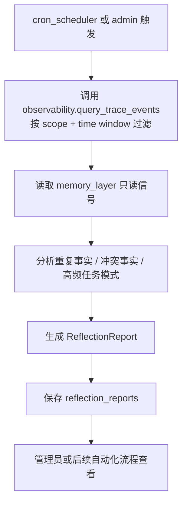

# reflection

> 写作提醒：功能描述只写可观察的行为，不写内部实现细节。验收标准只写端到端可验证的行为。

## 概述

系统自我改进机制，定期分析 agent 执行历史，先生成结构化改进建议，再逐步扩展到半自动或自动维护。
第一阶段只做只读分析与 report 输出，不自动修改 memory、skills 或 knowledge-base。

**负责**：通过 observability trace API 读取 agent 执行历史，发现规律并生成结构化 reflection report。

**不负责**：实时处理（异步定期触发，不在请求链路上）、skill 的运行时注入（→ agent-runtime）、修改知识库文档内容（只上报，不写回）。

**三个作用目标**：
- **memory reflection**：per-user，第一阶段只生成 memory_candidate / memory_conflict 建议
- **skill reflection**：per-agent，第一阶段只生成 skill_opportunity 建议
- **knowledge base reflection**：per-tenant，后续阶段观察知识库使用质量，上报缺口与问题，不自动写回

**调用关系**：
- 依赖：observability（`query_trace_events(query)` 读取情节记忆事件）、memory_layer（只读信号）、config
- 被依赖：cron_scheduler（定期触发）

**模块归属**：
- owning package：`intelligence.reflection`
- public API：`run_reflection(scope)`；后续扩展 `run_memory_reflection(user_id)`、`run_skill_reflection(agent_id)`、`run_kb_reflection(scope)`
- owned tables：`reflection_reports`；后续 `skill_proposals`、`kb_reflection_reports`
- config namespace：`reflection.*`

## 关键流程

第一阶段只有一条只读 report 流程。后续 memory、skill、knowledge base 三条反射流程再拆成独立 specs。

**并发安全说明**：第一阶段只写 reflection-owned `reflection_reports`，通过 observability public API
只读 trace events，通过 memory_layer public API 读取 memory 信号，不直接读取或修改 `traces` /
`memory_items` / `skills/`。因此 reflection 不影响请求链路，也不和 long_term_ctx 的 memory 读取竞争写锁。



## 数据模型

```sql
reflection_reports (
  id           TEXT PRIMARY KEY,  -- UUID
  scope        TEXT,              -- user_id / agent_id / tenant_id / global
  time_window_start DATETIME,
  time_window_end   DATETIME,
  findings_json TEXT,             -- finding summary、evidence ids、metadata，不保存完整 transcript
  created_at   DATETIME
)
```

## 接口定义

```python
@dataclass
class ReflectionFinding:
    type: Literal["memory_candidate", "memory_conflict", "skill_opportunity"]
    summary: str
    evidence_ids: list[str]
    metadata: dict[str, str]


@dataclass
class ReflectionReport:
    id: str
    scope: str
    time_window: tuple[datetime, datetime]
    findings: list[ReflectionFinding]
    created_at: datetime


async def run_reflection(scope: str) -> ReflectionReport:
    """读取 traces 和 memory 只读信号，生成结构化建议报告；不自动应用建议。"""
```

## 现状

尚未实现。

## 规划中（v1.0）

- [ ] **reflection foundation**：生成结构化建议报告，不自动应用
  - `memory_candidate`：可能应该进入 memory 的重复事实
  - `memory_conflict`：可能冲突的用户事实
  - `skill_opportunity`：可沉淀为 skill 的重复任务模式

- [ ] **memory reflection maintenance（后续）**：定期清理与合并 per-user 记忆
  - 清理过期 context 类记忆（超过 TTL 且未被再次提及）
  - 合并语义重复条目
  - 修正已知冲突（比较 identity / preferences 类条目间的矛盾）

- [ ] **skill reflection proposals（后续）**：分析 per-agent traces，生成、改进或删除 skill
  - `create`：发现高频重复的 prompt pattern，提炼为新 skill
  - `update`：识别现有 skill 的低效用法，生成改进版本
  - `delete`：skill 长期未被触发、与其他 skill 高度重复、或持续产生负面效果时，提议删除
  - skill 可以是单文件，也可以是含脚本、模板的多级目录；`snapshot` 字段统一存储整个目录的文件快照（JSON），审批时展示完整新状态，应用时直接覆盖写入

- [ ] **knowledge base reflection（后续）**：观察知识库使用质量，只上报不写回
  - 知识空白检测：用户频繁提问但召回质量差 → 上报"该类内容可能缺失"
  - 陈旧内容检测：某些 chunk 长期未被召回，或与近期对话明显矛盾 → 标记待管理员审查
  - 高频共现提示：多个文档频繁被一起召回 → 建议管理员补充整合文档
  - 所有 knowledge base reflection 结果均以建议形式输出，执行由人决定

- [ ] **生效机制（后续）**：按作用目标和环境区分
  - memory reflection：直接写回（自动维护）
  - skill reflection：dev 直接写入，prod 走 permission_gate 审批
  - knowledge base reflection：仅上报，永远不自动写回

## 验收标准

**场景 1：候选记忆建议**
- Given：用户有一条 context 类记忆超过 TTL，且近期对话未再提及
- When：run_reflection 定期任务触发
- Then：报告中出现 memory_conflict 或 memory_candidate 类型的建议，但不删除该记忆

**场景 2：冲突记忆建议**
- Given：用户记忆中存在两条语义矛盾的 identity 条目
- When：run_reflection 定期任务触发
- Then：报告中出现 memory_conflict finding，包含证据 id 和摘要；memory_items 不被修改

**场景 3：skill opportunity 识别**
- Given：某 agent 的 traces 中反复出现同类任务模式
- When：run_reflection 定期任务触发
- Then：报告中出现 skill_opportunity finding；系统不创建 skill proposal，也不写 skill 文件

**场景 4：无 trace 时返回空报告**
- Given：指定 scope 和时间窗口内没有 trace events
- When：run_reflection 执行
- Then：返回 findings 为空的 ReflectionReport，不抛出异常

**场景 5：报告持久化不保存完整 transcript**
- Given：trace events 中包含用户输入和 agent 回复
- When：reflection report 被保存
- Then：保存的 payload 包含 finding summary、evidence ids 和 metadata，不包含完整对话 transcript

**场景 6：knowledge-base 不可用时不阻塞**
- Given：knowledge-base 未实现或未启用
- When：run_reflection 执行
- Then：系统仍可基于 traces 和 memory 返回 report

## 测试边界

**需要单元测试的行为**：
- public API：ReflectionReport、ReflectionFinding、run_reflection 可导入
- trace 输入：run_reflection 通过 observability.query_trace_events 读取 traces
- 空输入：没有 trace events 时返回空 findings report
- memory 只读：生成 memory_candidate / memory_conflict 不修改 memory_items
- skill 只读：生成 skill_opportunity 不创建、更新或删除 skills/ 文件
- report 持久化：reflection_reports 表存在，payload 不保存完整 transcript
- knowledge-base 非依赖：KB 未实现或未启用时 run_reflection 正常返回

**需要 mock 的依赖**：
- `observability.query_trace_events`：注入可控的历史 trace events
- `memory_layer`：注入可控的记忆数据，确认不发生写回
- SQLite DB 路径：仅 reflection 自有表需要 `monkeypatch` 到 `tmp_path`

## 待决问题

- [ ] run_reflection 默认 time window：使用最近 7 天、最近 30 天，还是由调用方必传？（负责人：待认领）
- [ ] finding 生成策略：第一阶段完全 deterministic，还是允许调用轻量模型做摘要归纳？（负责人：待认领）
- [ ] report 查看入口：先只提供 admin CLI，还是直接接 platform 页面？（负责人：待认领）
- [ ] 后续 skill proposal 存储：复用 permission_gate 表，还是单独的提案表？（负责人：待认领）
