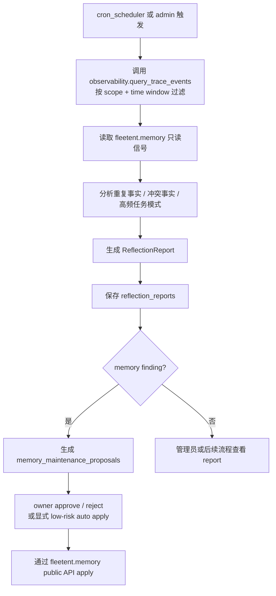

# reflection

> 写作提醒：功能描述只写可观察的行为，不写内部实现细节。验收标准只写端到端可验证的行为。

## 概述

系统自我改进机制，定期分析 agent 执行历史，先生成结构化改进建议，再通过受控 proposal lifecycle 进入维护流程。
reflection 默认不直接修改 User Memory、skills 或 knowledge-base。

**负责**：通过 observability trace API 读取 agent 执行历史，发现规律并生成结构化 reflection report；为 User Memory 生成 owner-approved maintenance proposals；通过 `run_kb_reflection_report()` 生成 Knowledge Base 质量只读报告。

**不负责**：实时处理（异步定期触发，不在请求链路上）、skill 的运行时注入（→ agent-runtime）、修改知识库文档内容（只上报，不写回）、Shared Memory 实现、管理员默认替用户确认 User Memory 修改。

**三个作用目标**：
- **memory reflection**：per-user，生成 memory_candidate / memory_conflict 建议，并可转成 owner-scoped maintenance proposal
- **skill reflection**：per-agent，第一阶段只生成 skill_opportunity 建议
- **knowledge base reflection**：per-tenant，观察知识库使用质量，上报缺口与问题；只读报告，不自动写 KB、不触发 sync

**调用关系**：
- 依赖：observability（`query_trace_events(query)` 读取情节记忆事件）、`fleetent.memory`（只读信号 + 已批准 proposal 的 public mutation API）、config
- 被依赖：cron_scheduler（定期触发）

**模块归属**：
- owning package：`fleetent.reflection`
- public API：`run_reflection(scope)`、`generate_memory_maintenance_proposals(user_id, findings)`、proposal create / approve / reject / apply API、`KnowledgeBaseReflectionReport`、`KnowledgeBaseReflectionFinding`、`run_kb_reflection_report(scope)`、`SkillProposal`、`generate_skill_proposals()`、`approve_skill_proposal()`、`reject_skill_proposal()`、`apply_skill_proposal()`；后续扩展 `run_skill_reflection(agent_id)`
- owned tables：`reflection_reports`、`memory_maintenance_proposals`、`kb_reflection_reports`、`skill_proposals`
- config namespace：`reflection.*`

## 关键流程

当前有两条流程：只读 report 生成，以及 User Memory maintenance proposal lifecycle。skill、knowledge base 三条反射应用流程后续再拆成独立 specs。

**并发安全说明**：reflection 只写 reflection-owned `reflection_reports` / `memory_maintenance_proposals`，通过 observability public API
只读 trace events，通过 `fleetent.memory` public API 读取 memory 信号。proposal 创建不修改 User Memory；apply 阶段只通过 `fleetent.memory` public mutation API 修改 owner-scoped User Memory，不直接写 `memory_items` / `skills/`。



## 数据模型

```sql
reflection_reports (
  id           TEXT PRIMARY KEY,  -- UUID
  scope        TEXT,              -- user_id / agent_id / tenant_id / global
  time_window_start DATETIME,
  time_window_end   DATETIME,
  findings_json TEXT,             -- finding summary、evidence ids、metadata，不保存完整 transcript
  created_at   DATETIME
)

memory_maintenance_proposals (
  id           TEXT PRIMARY KEY,
  user_id      TEXT,              -- User Memory owner
  action       TEXT,              -- mark_stale | merge | rewrite | compact | delete | suggest_shared_memory_or_kb
  target_memory_ids_json TEXT,
  proposed_content TEXT,
  metadata_patch_json TEXT,
  risk         TEXT,              -- low | medium | high
  reason       TEXT,
  evidence_ids_json TEXT,
  status       TEXT,              -- pending | approved | rejected | applied | expired
  created_at   DATETIME,
  updated_at   DATETIME,
  expires_at   DATETIME
)

kb_reflection_reports (
  id           TEXT PRIMARY KEY,
  scope        TEXT,              -- tenant / kb scope
  time_window_start DATETIME,
  time_window_end   DATETIME,
  findings_json TEXT,             -- finding summary、evidence ids、metadata，不保存完整 transcript / document body
  signal_summary_json TEXT,
  created_at   DATETIME
)

skill_proposals (
  id           TEXT PRIMARY KEY,
  type         TEXT,              -- create_skill | update_skill | deprecate_skill
  target_skill TEXT,
  reason       TEXT,
  evidence_refs_json TEXT,
  suggested_draft TEXT,
  suggested_diff TEXT,
  status       TEXT,              -- pending | approved | rejected | applied
  created_at   DATETIME,
  updated_at   DATETIME
)
```

## 接口定义

```python
@dataclass
class ReflectionFinding:
    type: Literal["memory_candidate", "memory_conflict", "skill_opportunity"]
    summary: str
    evidence_ids: list[str]
    metadata: dict[str, str]


@dataclass
class ReflectionReport:
    id: str
    scope: str
    time_window: tuple[datetime, datetime]
    findings: list[ReflectionFinding]
    created_at: datetime


async def run_reflection(scope: str) -> ReflectionReport:
    """读取 traces 和 memory 只读信号，生成结构化建议报告；不自动应用建议。"""


@dataclass
class KnowledgeBaseReflectionFinding:
    type: Literal[
        "missing_knowledge",
        "stale_document",
        "low_retrieval_quality",
        "connector_sync_issue",
        "entity_graph_gap",
        "insufficient_signal",
    ]
    severity: Literal["low", "medium", "high"]
    affected_resource: str
    evidence_refs: list[str]
    recommendation: str
    metadata: dict[str, str]


async def run_kb_reflection_report(scope: str) -> KnowledgeBaseReflectionReport:
    """读取 observability 与 knowledge-base public API，生成只读报告；不自动写 KB，不触发 sync。"""


@dataclass
class SkillProposal:
    type: Literal["create_skill", "update_skill", "deprecate_skill"]
    target_skill: str
    status: Literal["pending", "approved", "rejected", "applied"]
    evidence_refs: list[str]


def generate_skill_proposals(...) -> list[SkillProposal]:
    """从 skill_opportunity 和 tool/skill usage 信号生成 pending 提案；不自动改 skill。"""


def generate_memory_maintenance_proposals(
    user_id: str,
    findings: list[ReflectionFinding],
) -> list[MemoryMaintenanceProposal]:
    """将 memory finding 转成 pending User Memory maintenance proposals，不修改 memory。"""


@dataclass
class ReflectionTrendBucket:
    start_ts: datetime
    end_ts: datetime
    finding_counts: dict[str, int]
    proposal_status_counts: dict[str, int]
    applied_count: int
    rejected_count: int


def get_reflection_trend_summary(query: ReflectionTrendQuery) -> ReflectionTrendSummary:
    """按 UTC day/week 汇总 reflection-owned reports 和 proposal lifecycle；不读取 raw transcript。"""
```

## 现状

**foundation 已完成**：`2026-05-31-reflection-foundation` 已归档。

已实现内容：
- `ReflectionReport`、`ReflectionFinding`、`run_reflection(scope)` public API
- `reflection_reports` SQLite 表
- `memory_maintenance_proposals` SQLite 表和 proposal lifecycle API
- `kb_reflection_reports` SQLite 表和 `run_kb_reflection_report()` public API
- `skill_proposals` SQLite 表和 `SkillProposal` lifecycle API；支持 `create_skill`、`update_skill`、`deprecate_skill`
- `ReflectionTrendQuery` / `ReflectionTrendBucket` / `ReflectionTrendSummary` 和
  `get_reflection_trend_summary()` on-demand API
- 只通过 observability public API 读取 traces
- 只读 `fleetent.memory` 信号；proposal apply 只通过 memory public API
- 支持三类 finding：`memory_candidate`、`memory_conflict`、`skill_opportunity`
- 支持 `pending` / `approved` / `rejected` / `applied` / `expired` proposal 状态
- 支持 owner approval、low-risk explicit auto policy、high-risk delete approval gate
- 支持从 `reflection_reports`、`kb_reflection_reports`、`memory_maintenance_proposals`、
  `skill_proposals` 读取聚合趋势；只输出 finding type、proposal status/risk/type/action 计数和
  applied/rejected ratio，不暴露 summary、recommendation、evidence payload 或 transcript
- `skill_proposals` 当前没有 agent / tenant scope；trend summary 只在 `scope="global"` 或
  `scope="*"` 时聚合 Skill proposal，避免把全局 proposal 误计入某个租户或用户
- 支持 `suggest_shared_memory_or_kb`，用于团队共识 / 项目惯例 / 客户背景等不属于 User Memory 的内容
- 保存 report 时不保存完整 trace transcript
- deterministic evaluation fixture / runner 覆盖 expected / forbidden findings 和 persisted transcript redaction
- KB reflection 支持 `missing_knowledge`、`stale_document`、`low_retrieval_quality`、`connector_sync_issue`、`entity_graph_gap` findings；报告只读，不自动写 KB、不触发 sync，也不创建 KB mutation proposal
- Skill reflection proposals 默认生成 `pending` 提案，不自动改 skill；只有 approved proposal 才能通过 skill public boundary apply
- real-route smoke 仅在 `FLEETENT_EVAL_REAL_REFLECTION=1` 且显式本地 fixture/config 完整时手动运行；默认 skip

当前定位：已具备“生成建议报告”、User Memory 维护 proposal lifecycle、KB 质量只读报告和 Skill proposal lifecycle；UI / scheduler 尚未完成。

## 规划中（v1.0）

- [x] **reflection foundation**：生成结构化建议报告，不自动应用
  - `memory_candidate`：可能应该进入 memory 的重复事实
  - `memory_conflict`：可能冲突的用户事实
  - `skill_opportunity`：可沉淀为 skill 的重复任务模式

- [x] **report evaluation 基线**：`tests/evaluation/test_reflection_report_eval.py` 使用 fake trace / memory signals 验证 report
  - 覆盖 expected / forbidden findings
  - 验证 persisted report 不保存 raw transcript snippets
  - 默认不调用真实 LLM、embedding、KB connector 或 SaaS

- [x] **memory reflection maintenance**：将 memory_candidate / memory_conflict 转成 User Memory maintenance proposals
  - proposal 归属 `user_id`，默认需要 owner approval
  - rejected / expired proposal 不可 apply
  - high-risk `delete` 不能 low-risk auto apply
  - `suggest_shared_memory_or_kb` 不写 User Memory

- [x] **skill reflection proposals**：分析 per-agent traces，生成、改进或删除 skill
  - `create_skill`：发现高频重复的 prompt pattern，提炼为新 skill
  - `update_skill`：识别现有 skill 的低效用法，生成改进版本
  - `deprecate_skill`：skill 长期未被触发、与其他 skill 高度重复、或持续产生负面效果时，提议删除
  - 所有 proposal 初始为 `pending`；不自动改 skill，apply 只能通过 skill public boundary
  - skill 可以是单文件，也可以是含脚本、模板的多级目录；`snapshot` 字段统一存储整个目录的文件快照（JSON），审批时展示完整新状态，应用时直接覆盖写入

- [x] **knowledge base reflection**：观察知识库使用质量，只上报不写回
  - 知识空白检测：用户频繁提问但召回质量差 → 上报"该类内容可能缺失"
  - 陈旧内容检测：某些 chunk 长期未被召回，或与近期对话明显矛盾 → 标记待管理员审查
  - 高频共现提示：多个文档频繁被一起召回 → 建议管理员补充整合文档
  - 所有 knowledge base reflection 结果均以只读报告输出，执行由人决定

- [ ] **生效机制（后续）**：按作用目标和环境区分
  - memory reflection：owner-approved proposal lifecycle；低风险自动维护必须由用户显式开启
  - skill reflection：dev 直接写入，prod 走 `fleetent.governance.permission_gate` 审批
  - knowledge base reflection：仅上报，永远不自动写回

## 验收标准

**场景 1：候选记忆建议**
- Given：用户有一条 context 类记忆超过 TTL，且近期对话未再提及
- When：run_reflection 定期任务触发
- Then：报告中出现 memory_conflict 或 memory_candidate 类型的建议，但不删除该记忆

**场景 2：冲突记忆建议**
- Given：用户记忆中存在两条语义矛盾的 identity 条目
- When：run_reflection 定期任务触发
- Then：报告中出现 memory_conflict finding，包含证据 id 和摘要；memory_items 不被修改

**场景 3：skill opportunity 识别**
- Given：某 agent 的 traces 中反复出现同类任务模式
- When：run_reflection 定期任务触发
- Then：报告中出现 skill_opportunity finding；系统不创建 skill proposal，也不写 skill 文件

**场景 4：无 trace 时返回空报告**
- Given：指定 scope 和时间窗口内没有 trace events
- When：run_reflection 执行
- Then：返回 findings 为空的 ReflectionReport，不抛出异常

**场景 5：报告持久化不保存完整 transcript**
- Given：trace events 中包含用户输入和 agent 回复
- When：reflection report 被保存
- Then：保存的 payload 包含 finding summary、evidence ids 和 metadata，不包含完整对话 transcript

**场景 6：knowledge-base 不可用时不阻塞**
- Given：knowledge-base 未启用或不可用
- When：run_reflection 执行
- Then：系统仍可基于 traces 和 memory 返回 report

## 测试边界

**需要单元测试的行为**：
- public API：ReflectionReport、ReflectionFinding、run_reflection 可导入
- trace 输入：run_reflection 通过 observability.query_trace_events 读取 traces
- 空输入：没有 trace events 时返回空 findings report
- memory 只读：生成 memory_candidate / memory_conflict 不修改 memory_items
- skill 只读：生成 skill_opportunity 不创建、更新或删除 skills/ 文件
- report 持久化：reflection_reports 表存在，payload 不保存完整 transcript
- knowledge-base 非依赖：KB 未启用或不可用时 run_reflection 正常返回
- trend summary：按 UTC day/week 聚合 finding type 与 proposal lifecycle 计数，并保留未知 finding type

**需要 mock 的依赖**：
- `observability.query_trace_events`：注入可控的历史 trace events
- `fleetent.memory`：注入可控的记忆数据，确认不发生写回
- SQLite DB 路径：仅 reflection 自有表需要 `monkeypatch` 到 `tmp_path`

## 待决问题

- [ ] run_reflection 默认 time window：使用最近 7 天、最近 30 天，还是由调用方必传？（负责人：待认领）
- [ ] finding 生成策略：第一阶段完全 deterministic，还是允许调用轻量模型做摘要归纳？（负责人：待认领）
- [ ] report 查看入口：先只提供 admin CLI，还是直接接 platform 页面？（负责人：待认领）
- [ ] 后续 skill proposal 存储：复用 `fleetent.governance.permission_gate` 表，还是单独的提案表？（负责人：待认领）

## 当前缺口

- finding 规则仍然很初级，主要依赖 deterministic payload 字段和简单模式。
- report 到 User Memory maintenance proposal 的闭环已建立；管理员 / 用户 review UI、scheduler 还没有完成。
- 已有 deterministic report evaluation；尚未量化长期 precision / recall 趋势。
- 不会默认自动维护 memory，不会生成 skill proposal，不接 knowledge-base。

## 下一批候选 specs

- `reflection-report-consumption`
- `skill-reflection-proposals`
- `knowledge-base-reflection-reports`

## 自动化效果验证

- 已有 trace / memory fixture，标注 expected findings 和 forbidden findings。
- 已有负样本，避免单次普通任务被误判为 proposal。
- 已有 transcript redaction fixture，验证 persisted report 不泄露完整对话。
- 已有 trend summary fixture，验证趋势方向、proposal backlog 和 forbidden transcript redaction。
- 后续接入真实 LLM summary 前，需要扩展 golden dataset 和显式 opt-in smoke。

## 服务化 / 目录边界判断

reflection 更像离线 job / worker，未来可以独立调度甚至独立服务化。但当前应先保持在
`fleetent.reflection` 内，等 report schema、评估集和应用策略稳定后再拆 worker。
