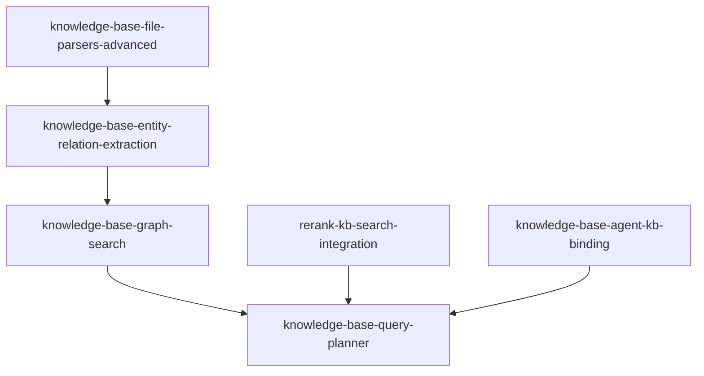
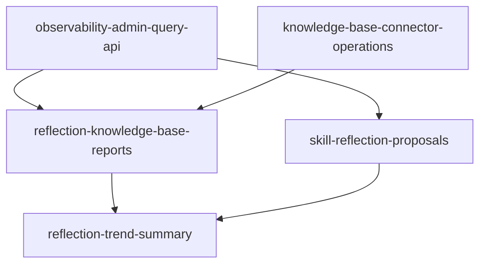
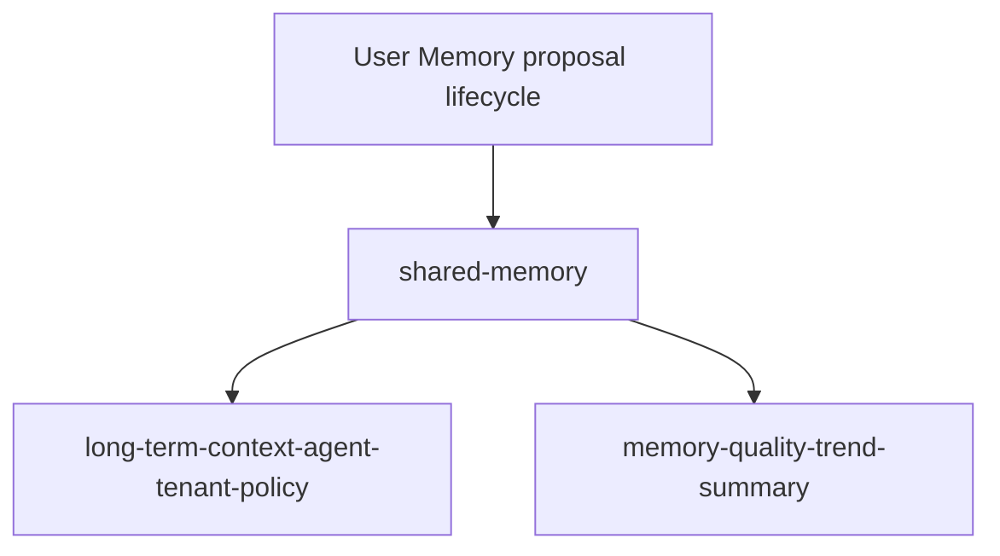

# Intelligence roadmap

这份文档跟踪 fleetent 的 intelligence 能力簇：Memory、Long-term Context、Reflection、Vector Store 和 Knowledge Base。它用于判断这些能力的当前完成度、Pilot 验证缺口和后续 OpenSpec 优先级。

## 当前结论

**MVP Foundation 已完成。** Memory、Long-term Context、Reflection、Vector Store 和 Knowledge Base 已具备核心 API、store、配置边界、默认测试和 OpenSpec 批次。

**Pilot 后增强首批已大体完成。** advanced parsers、entity extraction、graph_search、KB hybrid rerank、query planner、KB reflection reports、SkillProposal、reflection trend、Shared Memory、context policy、memory quality trend 已落地。

**Go 验证进行中，外部 KB 与 Vector provider smoke 已通过。** Google Drive / Confluence 已完成真实 API check、sync 和本地 KB 入库验证；Jina embedding / rerank provider 已完成真实 smoke、evaluation 和 228 chunk 全量 reindex 验证。当前 Go 判定剩余项集中在真实 LLM，以及生产化入口缺口是否被 Pilot owner 接受为非阻塞。

人工验收入口：[Intelligence Roadmap 人工测试手册](../../deployment/intelligence-roadmap-test-manual.md)。

## Go 验证状态

截至 2026-06-04，本机准生产验证状态如下：

| 验证项 | 状态 | 证据 / 说明 |
| --- | --- | --- |
| Google Drive real smoke | passed | 真实 API check 通过；真实 sync `scanned=5 planned=5 ingested=5`；本地 KB 写入 5 个 Google Drive 文档。 |
| Confluence real smoke | passed | 真实 API check 通过；page scope sync `scanned=1 planned=1 ingested=1`；本地 KB 写入 1 个 Confluence 文档。 |
| Real embedding smoke | passed | `jina-embeddings-v3`，`dimensions=1024`；memory + KB embedding evaluation `38 passed`。 |
| Real rerank smoke | passed | 真实 HTTP rerank 返回 3 个候选，score 存在且排序发生变化；provider adapter 已兼容 `relevance_score`。 |
| Config / secret boundary | passed | Google Drive、Confluence、embedding、rerank 均使用 env reference；真实 secret 保留在本地 `.env`，不进入 git。 |
| Real LLM smoke | pending | 仍需验证 memory extraction、long-term context 和 reflection 真实 LLM 路径。 |
| Real KB retrieval E2E | passed | 已用真实 Google / Confluence 入库文档验证 hybrid search、rerank、query planner 和 source attribution；全量 228 chunk 真实 reindex 经 provider retry / pacing 修复后通过，`scanned=228 reindexed=228 failed=0`。 |
| Production operations gaps | pending owner decision | policy admin API、review UI、scheduler / worker、full sync history、后台 reindex runtime 和告警尚未完成；需判定是否作为 Go blocker。 |

## 范围

| 能力域 | 文档 | 负责范围 |
| --- | --- | --- |
| Memory | [../memory.md](../memory.md) | User Memory、Shared Memory、extraction、merge/update/delete、retention / compaction、quality trend |
| Long-term Context | [../long-term-ctx.md](../long-term-ctx.md) | memory / KB / Shared Memory context selection、token budget、prompt injection、context policy |
| Reflection | [../reflection.md](../reflection.md) | trace / memory / KB 反思、User Memory maintenance proposal、SkillProposal、trend summary |
| Vector Store | [../vector-store.md](../vector-store.md) | vector backend、embedding / rerank provider、reindex |
| Knowledge Base | [../knowledge-base.md](../knowledge-base.md) | document ingest、local / Google Drive / Confluence sync、hybrid / graph / rerank / planner |

依赖但不直接管理：

- agent-runtime：产生 runtime events，是 observability 和 reflection 的主要数据源。
- platform / governance：后续展示 trace、审批、用户和 agent 绑定。
- connectors：用户级外部工具授权与凭证层；KB 数据源 connector 归 Knowledge Base 能力域管理。

## 完成度看板

| 层级 | 状态 | 已完成 | 当前缺口 | 暂缓 / 非 MVP |
| --- | --- | --- | --- | --- |
| MVP Foundation | 已实现 | 核心 API、store、配置边界、默认测试、evaluation baseline、OpenSpec 批次 | 无 foundation 级大缺口 | 无 |
| Pilot MVP 工程前置 | Go 验证中 | agent KB binding、connector operations、默认可见范围、local ingest、deterministic evaluation、Google Drive / Confluence 真实入库 smoke、真实 KB retrieval E2E、全量真实 embedding reindex | 准生产人工验收结论 | platform UI / HTTP 查询入口 |
| Pilot 后增强首批 | Go 验证中 | advanced parsers、entity extraction、graph_search、KB hybrid rerank、query planner、KB reflection reports、SkillProposal、reflection trend、Shared Memory、context policy、memory quality trend、真实 embedding / rerank smoke | 真实 LLM smoke、生产默认策略确认 | 自动知识库修复、自动 skill 发布 |
| 管理和运维入口 | 部分完成 | admin CLI 和 public API 可用 | policy admin API、review UI、scheduler / worker、full sync history、后台 reindex job runtime、告警 | dashboard / workflow UI |
| 高复杂增强 | 暂缓 | 已完成进入条件评估 | 无 | document-level ACL、OCR / VLM / 扫描 PDF、sqlite-vec / Qdrant / OpenSearch adapter、真实 tokenizer、LLM-driven selection |

## 当前能力地图

| 能力 | 当前状态 | 已有基础 | 当前缺口 | 后续增强 |
| --- | --- | --- | --- | --- |
| Memory semantic store | 基础完成 | SQLite `memory_items`、create/update/delete/ignore、vector index、mock evaluation、combined embedding evaluation、retention / compaction API、owner-approved reflection maintenance apply API、Shared Memory `shared_memory_items`、team / tenant scope、`shared:{scope_type}:{scope_id}` namespace、只读 memory quality trend summary | scheduler / review UI / 告警；Shared Memory 生产默认策略和编辑入口 | 真实 LLM 长期质量评估 |
| Long-term context | 基础完成 | memory / knowledge provider 接入、context source attribution、deterministic evaluation fixture、deterministic budget policy；agent / tenant context policy（tenant 默认 + agent 覆盖）按 agent 归属注入 Shared Memory（tenant / team），默认关闭、无跨 tenant/team 访问 | policy 编辑 UI 与 admin API | 真实 tokenizer、个性化 budget、LLM-driven selection |
| Reflection | 基础完成 | 读取 trace / memory 生成建议报告、deterministic report evaluation、User Memory maintenance proposal lifecycle、KB reflection reports、SkillProposal lifecycle、只读 reflection trend summary | review UI / scheduler / scope-aware SkillProposal 归属 | 自动知识库修复、自动 skill 发布 |
| Vector store | Go 验证中 | public API、namespace、in-memory backend、SQLite backend、embedding / rerank provider abstraction、同步 reindex API、provider retry / pacing、combined embedding evaluation、KB hybrid rerank 接入与 deterministic rerank evaluation、Jina embedding / rerank 真实 smoke、全量真实 provider reindex | 后台 reindex job runtime | sqlite-vec、Qdrant、OpenSearch adapter |
| Knowledge base | Go 验证中 | local ingest、parser registry、PDF / DOCX / PPTX / XLSX parser、chunking、vector + BM25 + hybrid retrieval、sync planner、evaluation fixture、reindex source iterator、combined embedding evaluation、Google Drive / Confluence connector baseline、Google Sheets / Slides export parsing、entity extraction schema + explicit run、`kb_extraction_runs`、`kb_entities`、独立于 search 的 `graph_search` depth 0/1 graph evidence、hybrid rerank、规则型 query planner、agent 到多 KB 绑定、connector operations CLI / latest status、Google Drive / Confluence 真实入库 smoke、真实 KB retrieval E2E、全量真实 embedding reindex | 生产凭据管理；graph / rerank 已通过 planner 串联但尚未成为 `search(mode="auto")` 默认路径 | document-level ACL、scheduler / full sync history、attachments / OCR / VLM |

## M2：可同步、可重建

目标：KB 与 vector store 从“能导入”升级为“能维护和运维”。

完成标准：

- KB sync 有 plan / execute separation、幂等状态和失败隔离。
- embedding / backend 切换后可通过同步 public API 重建 memory / KB index。
- 本地 SQLite / config / data 目录有最小备份与升级流程；migration 失败保留 backup，恢复由 operator 手动执行。

已完成 spec：

- `knowledge-base-sync-planner`：提供 sync action model、plan / execute separation、幂等 source state 更新、单 item 失败隔离，以及 local / remote connector 复用的同步执行边界。
- `vector-store-reindex-jobs`：提供 memory / knowledge-base 同步 reindex public API、dry-run、rebuild 清空目标 namespace 后重建索引，以及单条失败计数继续执行。
- `deployment-upgrade-and-backup`：提供本地 SQLite upgrade / backup 脚本、dry-run、backup-only、Alembic upgrade 前备份和 migration 失败保留 backup。

剩余缺口：

- 后台 reindex job runtime、full sync history 和 scheduler / worker 不属于 M2，进入后续管理和运维入口。

## M3：可评估

目标：核心 intelligence 能力的效果不只靠人工感觉判断。

完成标准：

- `tests/evaluation/` 能评估 memory extraction、KB retrieval、long-term context injection 和 reflection findings。
- 默认 evaluation 不依赖真实 LLM / embedding；真实模型评估通过显式环境变量手动开启。
- 每个 evaluation fixture 有 expected / forbidden 输出，能回归质量变化。
- `memory-and-kb-real-embedding-evaluation` 同时覆盖 memory semantic retrieval 和 KB retrieval，不默认连接外部模型。

已完成 spec：

- `long-term-context-evaluation`：基于 fake memory / knowledge provider 的 deterministic fixture，覆盖注入 text/source 的 expected / forbidden assertions；真实 provider smoke 默认 skip。
- `reflection-report-evaluation`：基于 fake observability / memory signals 的 deterministic fixture，覆盖 expected / forbidden findings 和 persisted transcript redaction；真实 route smoke 默认 skip。
- `memory-and-kb-real-embedding-evaluation`：基于 tmp SQLite / tmp vector DB 和 public reindex API 的 combined fixture，同时覆盖 memory semantic retrieval 和 KB retrieval；真实 HTTP embedding 默认 skip。

剩余缺口：

- 真实 embedding / rerank provider smoke 已在准生产环境显式 opt-in 通过；真实 LLM 路径仍需验证。
- 真实 provider 质量评估不进入默认 CI，仍需作为 Pilot 验收证据记录。

## M4：可维护、可演进

目标：长期运行后不会因为记忆、知识库和反思数据增长而失控。

完成标准：

- memory 有 retention、compaction 和容量边界。
- long-term context 有可解释的 token budget 策略。
- reflection 的建议能进入受控 maintenance 流程，而不是自动无约束改写。

已完成 spec：

- `memory-retention-and-compaction`：提供 per-user dry-run / apply 维护 API，覆盖 expired context、per-type over-limit 和 exact duplicate compaction；不做 Shared Memory、scheduler 或 reflection 自动写回。
- `long-term-context-budget-policy`：提供 effective budget、memory / knowledge source budget、source top-k、query intent / explicit conflict preference 和 BudgetMetadata decision attribution；不做 LLM-driven selection、summarization、memory 写回或 connector ACL 策略。
- `memory-reflection-maintenance`：提供 reflection-owned User Memory maintenance proposals、owner approval / reject / apply lifecycle、低风险显式自动策略和 observability 事件；不做 Shared Memory、管理员默认代批、UI、skill proposal 或 KB 写回。

剩余缺口：

- review UI、scheduler、告警和生产默认策略需要结合 Pilot 反馈继续做。

## M4b：企业知识源接入

目标：把 KB 从 local directory baseline 扩展到客户真实企业知识源，同时不绕过 sync planner 和数据边界。

完成标准：

- 外部 connector 基于 sync planner 接入，不绕过 KB public API。
- connector 明确认证方式、权限边界、source metadata、删除语义和失败恢复行为。
- 默认测试不连接真实 SaaS；真实 connector smoke 通过显式环境变量手动开启。

已完成 spec：

- `knowledge-base-connectors-google-drive`：提供 folder-scoped Google Drive connector config、OAuth `credential_ref`、fake client 默认测试路径、Google Docs HTML export、text / Markdown / HTML parser dispatch、planner / executor 分离、missing archive 语义和 opt-in smoke scaffold；不做 service account / domain-wide delegation、per-user Drive ACL、Sheets / Slides 结构化解析、scheduler 或真实 Google API 默认测试。
- `knowledge-base-connectors-confluence`：提供 Confluence Cloud API token `credential_ref`、space / page / page+children scope、fake client 默认测试路径、storage HTML parser dispatch、bounded 429 retry、planner / executor 分离、missing archive 语义和 opt-in smoke scaffold；不做 Server / Data Center、per-user page ACL、attachments / comments、scheduler 或真实 Confluence API 默认测试。

剩余缺口：

- 真实 SaaS smoke 已通过；生产凭据管理、scheduler / full sync history 和 document-level ACL 仍需后续决策。

## P1：知识库质量增强

目标：把 KB 从“能同步和混合检索”提升到“能解析更多企业文件、识别实体关系、支持图证据、显式 rerank 和可解释 search plan”。

完成标准：

- Office / PDF / Google export 文档能进入统一 parser registry；OCR、扫描 PDF、image / VLM 明确暂缓。
- KB 能显式运行 entity extraction，落库 `kb_extraction_runs`、`kb_entities`、mentions / relations evidence。
- KB 能通过独立 `graph_search` 返回 depth 0/1 graph evidence。
- KB hybrid search 能显式启用 rerank；默认不静默调用真实 rerank provider。
- 调用方可以通过规则型 planner 在 hybrid、graph first + hybrid fill、hybrid rerank 间做可解释选择。

已完成 spec：

- `knowledge-base-file-parsers-advanced`：已完成 PDF / DOCX / PPTX / XLSX、Google Sheets / Google Slides export parser registry 接入；OCR、扫描 PDF、image / VLM 解析仍需单独评估依赖、成本和数据主权影响。
- `knowledge-base-entity-relation-extraction`：已完成 entity extraction schema、`kb_extraction_runs`、`kb_entities`、mentions / relations evidence、explicit run 和 deterministic extractor；不默认调用真实 LLM。
- `knowledge-base-graph-search`：已完成独立于 search 的 `graph_search`，支持 depth 0/1、direct entity mention、relation evidence、related entity mention、graph evidence 和 deterministic evaluation；该 spec 本身不接 query planner / rerank。
- `rerank-kb-search-integration`：把已有 rerank provider 接入 KB search，对 hybrid candidates 做重排；默认 deterministic，真实 rerank provider 显式 opt-in。
- `knowledge-base-query-planner`：已完成规则型 `plan_knowledge_search` / `execute_knowledge_search_plan` 独立 API，在 hybrid、graph first + hybrid fill、hybrid rerank 之间做可解释策略选择；不改 `search()`，不接 LLM planner，也不做 query rewrite。

剩余缺口：

- 真实 rerank provider 质量评估、真实 SaaS smoke 和生产 credential 管理仍需 Pilot 环境验证。
- graph / rerank 尚未成为 `search(mode="auto")` 或 agent 默认检索策略；是否产品化取决于 Pilot 反馈。
- document-level ACL、OCR / VLM / 扫描 PDF、attachments 解析进入 v1.1+ 暂缓区。

依赖顺序：

## P2：反思与演进增强

目标：把 reflection 从“报告 / User Memory maintenance”扩展到 KB 质量报告、SkillProposal 生命周期和只读趋势聚合。

完成标准：

- reflection 能基于 observability、source attribution、KB sync 状态和 KB public signals 生成 KB 只读质量报告。
- skill opportunity 能进入 `SkillProposal` lifecycle，但默认不自动修改 skill。
- trend summary 只读聚合 reports 和 proposal lifecycle，不暴露 transcript / evidence payload，不自动写 Memory / KB / Skill。

已完成 spec：

- `reflection-knowledge-base-reports`：已完成 `run_kb_reflection_report` 只读报告和 reflection-owned `kb_reflection_reports` 持久化；基于 retrieval traces、source attribution、KB sync 状态和用户问题，发现 `missing_knowledge`、过期文档、低命中主题、`connector_sync_issue` 和 entity graph gap；不自动写 KB、不触发 sync。
- `skill-reflection-proposals`：基于 trace / tool usage / repeated tasks 发现可沉淀为 skill 的机会，生成 `SkillProposal` 并持久化到 `skill_proposals`；类型包括 `create_skill`、`update_skill`、`deprecate_skill`，初始状态为 `pending`，owner-reviewed 后才可 apply；不自动改 skill。
- `reflection-trend-summary`：已完成 `get_reflection_trend_summary` 只读趋势聚合；基于 reflection reports、KB reflection reports、User Memory maintenance proposals 和 `SkillProposal` lifecycle，按 UTC day / week bucket 统计 findings 与 proposal outcome；不自动写 Memory / KB / Skill。

剩余缺口：

- review UI / scheduler 尚未实现。
- `skill_proposals` 当前没有 agent / tenant scope；scope-aware SkillProposal 归属需要后续单独设计。
- 自动知识库修复和自动 skill 发布暂缓，不进入当前 Pilot 后增强首批。

依赖顺序：

## P3：共享记忆与上下文策略增强

目标：把 memory / long-term context 从个人记忆扩展到团队协作语境，同时保持 User Memory owner boundary 和 agent ownership 边界。

完成标准：

- Shared Memory 独立于 User Memory，支持 team / tenant scope、独立 vector namespace 和最小 admin CLI。
- long-term-ctx 按 agent `tenant_id` / `team_id` 解析 Shared Memory scope；policy 不能指定任意跨 tenant / team scope。
- memory quality trend summary 只读聚合 User Memory、Shared Memory 和 maintenance proposal outcome，不触发自动维护。

已完成 spec：

- `shared-memory`：已完成 User Memory 之外的共享记忆实体、`shared_memory_items` 表、team / tenant scope、`shared:{scope_type}:{scope_id}` vector namespace、写入 / 更新 / 删除 lifecycle、reflection proposal apply 和最小 admin CLI；shared-memory 本身不负责 prompt 注入，注入已由 long-term-ctx context policy 按 agent 归属处理；默认不让管理员代批用户个人记忆，也不把企业共识直接混入 User Memory。
- `long-term-context-agent-tenant-policy`：已实现并 archive，提交为 `dd8fbb5`。实现为 ownership-based context policy：tenant 默认 + agent 覆盖，Shared Memory scope 只从 agent `tenant_id` / `team_id` 派生，默认关闭，不表达任意 `scopes` 列表。
- `memory-quality-trend-summary`：已实现并 archive，提交为 `70b9773`。实现为只读质量趋势，不触发 extraction、不自动维护 memory。

剩余缺口：

- Shared Memory 生产默认策略、policy 编辑 UI / admin API、review UI 和告警尚未实现。
- Shared Memory 的默认启用范围仍需结合 Pilot 反馈确认。

依赖顺序：

## 后续 Backlog

### 真实环境验证

- 已通过 `real-embedding-smoke`：Jina embedding provider smoke 和 retrieval quality check。
- 已通过 `real-rerank-smoke`：Jina rerank provider smoke；adapter 兼容 `score` / `relevance_score`。
- 已通过 `google-drive-real-smoke`：真实 Google Drive connector check / sync / KB 入库 smoke。
- 已通过 `confluence-real-smoke`：真实 Confluence connector check / sync / KB 入库 smoke。
- 已通过 `real-kb-retrieval-e2e` 代表性验证：用真实入库文档验证 hybrid search、rerank、query planner default path、relation-like graph+hybrid_fill path 和 source attribution。
- 待执行 `real-llm-smoke`：Memory extraction、Long-term Context、Reflection 的真实 LLM 路径。
- 已通过 `real-embedding-full-reindex`：全量 228 chunk 真实 reindex 经 provider retry / pacing 修复后通过，`scanned=228 reindexed=228 failed=0`。

### 管理和运维入口

- `long-term-context-policy-admin-api`：context policy 管理入口。
- `memory-reflection-review-ui`：User Memory / Shared Memory / SkillProposal review 入口。
- `connector-scheduler-and-sync-history`：scheduler / worker / full sync history。
- `vector-store-reindex-job-runtime`：后台 reindex job runtime 和操作历史。

### 暂缓 / v1.1+

- `knowledge-base-document-acl`：同一 KB 内文档级权限过滤，复杂度和安全风险高；Pilot 阶段先用多 KB + agent binding。
- image / VLM parsing：放在 advanced parser 之后单独评估，不默认进入首批文件解析。
- `vector-store-ann-backend`：sqlite-vec / Qdrant / OpenSearch adapter，等数据规模和性能瓶颈明确后再做。
- `long-term-context-real-tokenizer`：真实 tokenizer 与更细粒度个性化 budget。
- `reflection-auto-kb-fix`：自动知识库修复。
- `skill-auto-publish`：自动 skill 发布。

## 暂缓项进入条件

| 暂缓项 | 进入条件 |
| --- | --- |
| `knowledge-base-document-acl` | 当前多 KB + agent binding 已不能表达 Pilot 级可见范围，且客户明确要求同一 KB 内按用户或群组过滤文档 |
| image / VLM parsing | 真实 Pilot 文档中出现高比例扫描件或图像知识，且能确定自托管 OCR / VLM 路线 |
| `vector-store-ann-backend` | 本地 SQLite backend 出现可复现的延迟或容量瓶颈，并有明确自托管运维方案 |
| `long-term-context-real-tokenizer` | deterministic token 估算在 Pilot 中造成可复现上下文截断或超预算问题 |
| 自动知识库修复 / 自动 skill 发布 | review UI、审批流程、审计和回滚路径稳定后，再讨论是否允许自动 apply |

## 维护规则

- 新增 intelligence 相关 spec 前，必须在本 roadmap 中标明所属批次和解锁关系。
- capability 文档状态变化时，同步更新本 roadmap 的“完成度看板”和“当前能力地图”。
- 每完成一个批次，重新评估下一批是否仍然是最高优先级。
- 不把探索性想法直接推进为实现 spec；先确认它解决哪个 MVP 缺口。
