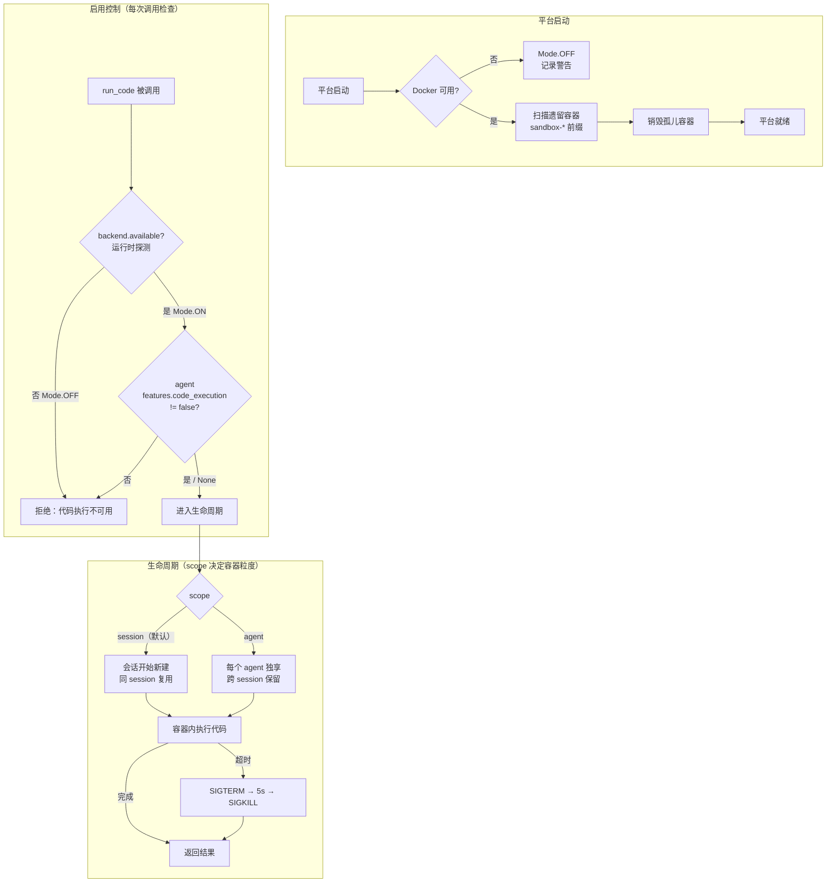

# sandbox

> 写作提醒：功能描述只写可观察的行为，不写内部实现细节。验收标准只写端到端可验证的行为。

## 概述

安全代码执行层，在隔离容器内运行 agent 触发的代码，保护主机系统不受恶意或失控代码影响。

**负责**：容器生命周期管理、启用控制、资源限制、环境变量过滤、输出截断、孤儿容器清理。

**不负责**：决定是否执行代码（→ agent_loop）、工具访问控制（→ agent_policy）、执行结果写入 trace（→ eval_logger）。

**调用关系**：
- 依赖：`agent.yaml`（per-agent sandbox 资源和启用配置）、`platform.yaml`（仅 `sandbox.backend` 平台级默认后端，可选）
- 被依赖：tool_registry（注册 `run_code` 工具供 agent_loop 调用）

## 关键流程



## 现状

- ⚡ **Docker 沙箱执行**：代码在 Docker 容器内隔离运行，返回 stdout / stderr / exit_code。`integrations/sandbox/client.py` 封装 Docker CLI；Docker 为既定沙箱后端，下述治理项均在此基础上演进
- ✅ **资源限制可配置**：`memory` / `cpus` / `network` / `exec_timeout` / `read_only` 等通过各 agent 的 `agent.yaml` `sandbox.resources` 声明，未配置回退安全默认（不再硬编码；见 `sandbox-resource-limits`）
- ✅ **容器安全加固**：`--pids-limit`、`/tmp` tmpfs 限大小+`nosuid`、`--cap-drop ALL`（agent 档补最小 cap）、`--security-opt no-new-privileges`、`--init`、session 档非 root（`--user`）；按 scope 分层、可配置（见 `sandbox-container-hardening`）
- ⚡ **文件系统隔离**：session 档 `--read-only`，`/tmp` 可写但限额 + `nosuid`
  - 当前缺失：无符号链接攻击防护（见待决问题）
- ✅ **执行过程可观测**：执行结果写入 trace（执行时长、退出码、输出字节、scope）

## 已实现（v1.0）

> **可插拔后端架构**：Docker（默认）和 microsandbox（本地 microVM，需宿主 KVM/HVF）并列可选（`pluggable-sandbox-backend`）。后端选型优先级：`agent.yaml` 的 `sandbox.backend` > `platform.yaml` 的 `sandbox.backend` > 默认 docker。microsandbox 在 `is_installed()` 探测失败时 `available()` 返回 False → 自动降级为 Mode.OFF，不阻塞平台启动。以下治理项除标注外均已落地。

- [x] **生命周期管理（scope）**：按配置决定沙箱存活粒度
  - `session`（默认）：会话开始创建，同一会话内复用，会话结束时销毁（已接线）
  - `agent`：每个 agent 定义独享一个沙箱，跨会话长期保留；已安装依赖通过 `docker commit` 固化为镜像层
  - 闲置超时自动销毁（`idle_hours`，默认 2 小时，适用于 `agent` scope）——**已由 agent 运行时周期性后台任务调度 `sweep_idle`（`sandbox-runtime-lifecycle-wiring`）**

- [x] **启用/关闭控制（二态模式）**：运行时后端探测 + agent 级别开关双层控制
  - `Mode.OFF`：后端 `available()` 返回 False（Docker 不可用 / microsandbox 未安装）→ `run_code` 工具不注册，AI 完全不知道代码执行能力存在；不读任何配置文件，fail-closed
  - `Mode.ON`：后端可用 → 进入 per-agent 决策：`features.code_execution: false` 时该 agent 不注册工具；`true` 或未声明（默认）时可用
  - 迁移指引：旧 `mode: off` → 所有 agent 设 `features.code_execution: false`；旧 `mode: selective` → 仅授权 agent 保留或显式设 `features.code_execution: true`；旧 `mode: all` → 无需任何声明（默认行为不变）

- [x] **资源限制可配置**：通过各 agent 的 `agent.yaml` `sandbox.resources` 声明，不再硬编码；`platform.yaml` 的 `sandbox.resources` 段已废弃
  ```yaml
  # agent.yaml（per-agent 配置）
  sandbox:
    backend: docker          # docker（默认）| microsandbox；None 继承 platform 级默认
    workspace_scope: session # session（默认）| agent
    idle_hours: 2            # agent scope 闲置超时（小时）
    resources:
      memory: 256            # MB
      cpus: 0.5
      network: "none"        # none / public_only / allow_all
      exec_timeout: 30       # 单次执行超时（秒）
      # 容器加固（sandbox-container-hardening，均可选、缺省即安全默认）
      pids_limit: 256
      tmpfs_size_mb: 64
      cap_drop_all: true
      no_new_privileges: true
      init: true
      run_as_user: "65534:65534"   # session 档非 root；null 即 root
  features:
    code_execution: true     # false 单独禁用该 agent 的沙箱
  ```
  未配置时使用安全默认值；`network: none` 为默认且推荐值（对应 Docker `--network none`）

- [x] **密钥过滤（入站环境变量过滤）**：敏感环境变量不传入容器
  - Docker 无原生 Secret 机制，改为在启动容器时按名称过滤：变量名含 `TOKEN` / `KEY` / `SECRET` 等（大小写不敏感）一律不传入容器
  - 三层：宿主机进程环境、agent 配置注入、运行时显式传入，经同一过滤规则
  - **出站输出脱敏已实现**（`sandbox-output-redaction`）：`run_code` 返回前对 stdout/stderr 按模式脱敏（PEM 私钥 / JWT / 厂商 key 前缀 / 连接串凭证 / `Authorization` 头 / 命名型 `KEY=VALUE`），先脱敏后截断；trace 仅记大小、无内容

- [x] **输出截断**：防止海量输出占满对话空间
  - stdout 上限 50KB，stderr 上限 10KB；超限保留头尾 + 截断说明；UTF-8 边界安全
  - **超限已改为落盘 + 引用**（`sandbox-large-output-spill`）：超预算时完整（脱敏后）输出写入 `data/sandbox_output/{uuid}.txt`，返回 head+tail 预览 + 引用（路径 / 字节数 / 可用 `read_file` 读取），替代中段直接丢弃；落盘目录按保留期（默认 7 天）机会式自清理

- [x] **执行超时与强制终止**：默认 30s（可配置，最长 600s）——已在 `run_code` 接线
  - 超时对容器 `docker kill`（先 SIGTERM，5s 后 SIGKILL）强制终止

- [x] **孤儿容器清理**：检测并销毁上次崩溃遗留的孤儿容器（`sandbox-*` 前缀）——**已在 agent 运行时启动（`_start_infra`，Docker 可用时）接线（`sandbox-runtime-lifecycle-wiring`）**

- [x] **执行结果写入 trace**：记录执行时长、退出码、输出大小、使用的沙箱 scope

- [x] **容器安全加固**：pids / tmpfs 限额+nosuid / cap-drop ALL / no-new-privileges / init / 非 root，按 scope 分层、可配置（`sandbox-container-hardening`）

## 验收标准

**场景 1：代码在隔离环境中安全执行**
- Given：用户请求 agent 运行一段 Python 代码
- When：agent 执行 `run_code` 工具
- Then：代码在隔离容器内运行，无法访问外部网络；执行结果返回给用户；主机文件系统不受影响

**场景 2：代码执行超时自动终止**
- Given：用户请求运行一段耗时超出配置时限的代码
- When：执行超时
- Then：容器被强制终止并清理；用户收到超时提示；对话可继续进行

**场景 3：后端不可用时代码执行能力不可用**
- Given：宿主机 Docker 不可用（或 microsandbox 未安装），运行时探测 `available()` 返回 False
- When：用户请求 agent 运行代码
- Then：agent 告知无法执行代码；不尝试任何代码执行操作；平台正常启动不受影响

**场景 4：特定 agent 禁用代码执行**
- Given：后端可用（Mode.ON）；某客服 agent 的 `agent.yaml` 设置了 `features.code_execution: false`
- When：用户与该 agent 对话并触发代码执行请求
- Then：该 agent 拒绝执行代码；其他未设置 `code_execution: false` 的 agent 不受影响

**场景 5：平台重启后无遗留容器（v1.0）**
- Given：上次运行异常退出，留有未清理的沙箱容器
- When：平台重新启动
- Then：遗留容器在启动过程中自动清理；平台正常启动，无残留资源占用

**场景 6：Agent 级别沙箱跨会话保留环境（v1.0）**
- Given：沙箱配置为 `scope=agent`；数据分析 agent 在上一次会话中安装了某个数据处理库
- When：用户开启新的会话与同一 agent 对话，触发代码执行
- Then：上次安装的库仍然可用，无需重新安装；不同 agent 各自的沙箱相互隔离

## 测试边界

**需要单元测试的行为**：
- 启用控制：`Mode.OFF` 时 `run_code` 拒绝执行；`Mode.ON` 且 agent `features.code_execution: false` 时拒绝
- Docker / microsandbox 不可用时 `get_effective_mode` 返回 `Mode.OFF`，不抛异常
- 资源限制参数：配置值正确传入 Docker 命令；未配置时使用安全默认值
- 输出截断：stdout 超过 50KB 时保留头尾并插入截断说明
- 环境变量过滤：含 `TOKEN`、`KEY`、`SECRET` 的变量不传入沙箱

**需要 mock 的依赖**：
- Docker CLI 调用（`asyncio.create_subprocess_exec`，封装 `docker run / exec / rm`）：mock 子进程调用，隔离真实容器创建
- `agent_store`：mock agent 的 `features.code_execution` 值
- `agent.yaml` 路径：`monkeypatch` 到临时文件（资源配置测试）
- `platform.yaml` 路径：`monkeypatch` 到临时文件（后端选型配置测试）

## 待决问题

- [ ] `scope=agent` 的容器是否支持手动重建（清空已安装依赖）？触发方式：admin CLI 还是 agent 配置变更？（负责人：待认领）
- [ ] 符号链接攻击防护：是在 v1.0 中修复，还是接受当前防护层为足够？容器加固（`--read-only` + `/tmp` `nosuid` + session 档非 root + `--cap-drop ALL` + `no-new-privileges`）已显著收敛符号链接/提权的可利用面，但未专门防护 symlink 跨越。（负责人：待认领）

> 延后项（本批不做，理由见 `docs/records/sandbox-improvements.md`）：网络出站白名单与 `public_only` 实装、磁盘配额 `--storage-opt`、自定义 seccomp/AppArmor profile。
