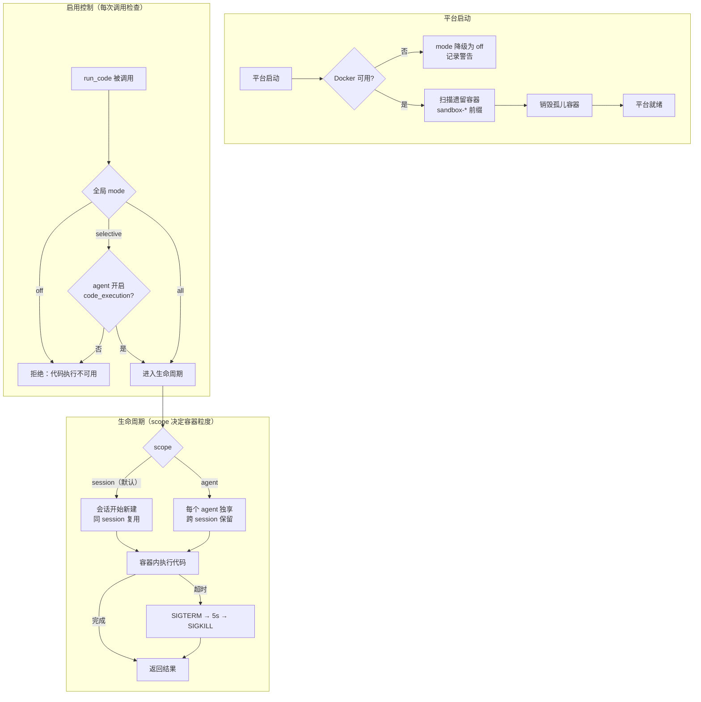

# sandbox

> 写作提醒：功能描述只写可观察的行为，不写内部实现细节。验收标准只写端到端可验证的行为。

## 概述

安全代码执行层，在隔离容器内运行 agent 触发的代码，保护主机系统不受恶意或失控代码影响。

**负责**：容器生命周期管理、启用控制、资源限制、环境变量过滤、输出截断、孤儿容器清理。

**不负责**：决定是否执行代码（→ agent_loop）、工具访问控制（→ `fleetent.governance.agent_policy`）、执行结果写入 trace（→ observability）。

**调用关系**：
- 依赖：config（sandbox 配置参数）、agent_store（agent 级别 `features.code_execution` 开关）
- 被依赖：tool_registry（注册 `run_code` 工具供 agent_loop 调用）

**模块归属**：
- owning package：`fleetent.integrations.sandbox`

## 关键流程



## 现状

- ⚡ **Docker 沙箱基本执行**：代码在 Docker 容器内隔离运行，返回 stdout / stderr / exit_code
  - 当前实现：`fleetent.integrations.sandbox` 封装 Docker CLI，资源限制（`--network none --memory 256m --cpus 0.5 --read-only`）硬编码
  - **目标**：迁移至 microsandbox SDK（v0.4.6 已安装），采用 microVM 级别隔离（见规划中）

- ⚡ **资源限制**：限制生效，但参数硬编码在 `fleetent.integrations.sandbox`，无法通过配置调整

- ⚡ **文件系统隔离**：`--read-only` 模式，整个文件系统只读，`/tmp` 目录可写
  - 当前缺失：无符号链接攻击防护

- ⚡ **执行过程可观测**：返回 stdout / stderr / exit_code，但未写入 observability trace event

## 规划中（v1.0）

- [ ] **迁移至 microsandbox SDK**：用 microsandbox 替换当前 Docker CLI 封装
  - microsandbox 为每个沙箱分配独立 Linux 内核（microVM），不共享宿主机内核，无命名空间逃逸风险
  - 无需 dockerd 守护进程，以子进程方式启动，无需 root 权限
  - 启动时间 < 100ms（使用 OCI 镜像缓存）
  - 支持 macOS（Apple Silicon）和 Linux（需 KVM）；不支持 KVM 的环境回退至 Docker 模式
  - Python SDK 接口：`Sandbox.create() → exec() → stop()`，全程 async/await

- [ ] **生命周期管理（scope）**：按配置决定沙箱存活粒度
  - `session`（默认）：会话开始创建，同一会话内复用，会话结束时销毁
  - `agent`：每个 agent 定义独享一个沙箱，跨会话长期保留；底层通过 microsandbox Snapshot 实现（捕获已安装依赖的状态 → 下次快速恢复，无需重新安装）
  - 闲置超时自动销毁（`idle_hours`，默认 2 小时，适用于 `agent` scope）

- [ ] **启用/关闭控制（三态模式）**：全局 `mode` + agent 级别开关双层控制
  - `off`：`run_code` 工具不注册，AI 完全不知道代码执行能力存在
  - `selective`：全局默认关闭，仅 `features.code_execution: true` 的 agent 可用
  - `all`（默认）：所有 agent 可用，agent 可显式设置 `code_execution: false` 关闭
  - microsandbox / Docker 均不可用时自动降级为 `off`，不阻断平台启动

- [ ] **资源限制可配置**：通过 `settings.yaml` 声明，不再硬编码
  ```yaml
  sandbox:
    resources:
      memory: 256       # MB
      cpus: 0.5
      network: "none"   # none / public_only / allow_all
      exec_timeout: 30  # 单次执行超时（秒）
  ```
  未配置时使用安全默认值；`network: none` 为默认且推荐值（对应 microsandbox `Network.none()`）

- [ ] **密钥安全注入（Secret）**：使用 microsandbox 原生 `Secret` 机制，密钥不以明文传入 VM
  - 沙箱内代码看到的是随机占位符，真实密钥只在网络边界透明替换（HTTP 请求发出时替换 header/body）
  - AI 生成的代码无法通过 `print()` 或文件读取方式泄露真实密钥
  - 比三层环境变量过滤更强：即使代码试图枚举环境变量，也只能看到占位符

- [ ] **输出截断**：防止海量输出占满对话空间
  - stdout 上限 50KB，stderr 上限 10KB
  - 超限时保留开头 + 结尾，中间插入截断说明
  - 非 UTF-8 字符做安全转义

- [ ] **执行超时与强制终止**：默认 30s（可配置，最长 600s）
  - microsandbox `exec()` 支持 per-command `timeout` 参数，超时后通过 `ExecHandle.kill()` 强制终止
  - 终止后按 scope 决定沙箱处理：`session` 保留沙箱供同 session 复用；`agent` 保留沙箱供该 agent 其他 session 使用

- [ ] **孤儿沙箱清理**：平台启动时检测并销毁上次崩溃遗留的 microsandbox 实例

- [ ] **执行结果写入 trace**：通过 observability 记录执行时长、退出码、输出大小、使用的沙箱类型

## 验收标准

**场景 1：代码在隔离环境中安全执行**
- Given：用户请求 agent 运行一段 Python 代码
- When：agent 执行 `run_code` 工具
- Then：代码在隔离 VM 内运行，无法访问外部网络；执行结果返回给用户；主机文件系统不受影响

**场景 2：代码执行超时自动终止**
- Given：用户请求运行一段耗时超出配置时限的代码
- When：执行超时
- Then：容器被强制终止并清理；用户收到超时提示；对话可继续进行

**场景 3：关闭沙箱后代码执行能力不可用**
- Given：管理员在配置中将沙箱 `mode` 设置为 `off`
- When：用户请求 agent 运行代码
- Then：agent 告知无法执行代码；不尝试任何代码执行操作

**场景 4：特定 agent 禁用代码执行**
- Given：平台沙箱全局 `mode=selective`；某客服 agent 未配置 `code_execution: true`
- When：用户与该 agent 对话并触发代码执行请求
- Then：该 agent 拒绝执行代码；其他具备代码执行权限的 agent 不受影响

**场景 5：平台重启后无遗留容器（v1.0）**
- Given：上次运行异常退出，留有未清理的沙箱容器
- When：平台重新启动
- Then：遗留容器在启动过程中自动清理；平台正常启动，无残留资源占用

**场景 6：Agent 级别沙箱跨会话保留环境（v1.0）**
- Given：沙箱配置为 `scope=agent`；数据分析 agent 在上一次会话中安装了某个数据处理库
- When：用户开启新的会话与同一 agent 对话，触发代码执行
- Then：上次安装的库仍然可用，无需重新安装；不同 agent 各自的沙箱相互隔离

## 测试边界

**需要单元测试的行为**：
- 启用控制：`mode=off` 时 `run_code` 拒绝执行；`mode=selective` 且 agent 未授权时拒绝
- Docker 不可用时自动降级为 `off`，不抛异常
- 资源限制参数：配置值正确传入 Docker 命令；未配置时使用安全默认值
- 输出截断：stdout 超过 50KB 时保留头尾并插入截断说明
- 环境变量过滤：含 `TOKEN`、`KEY`、`SECRET` 的变量不传入沙箱

**需要 mock 的依赖**：
- microsandbox SDK（`Sandbox.create / exec / stop`）：mock 整个 SDK，隔离真实 VM 创建
- `agent_store`：mock agent 的 `features.code_execution` 值
- `config/settings.yaml` 路径：`monkeypatch` 到临时文件

## 待决问题

- [ ] `scope=agent` 的容器是否支持手动重建（清空已安装依赖）？触发方式：admin CLI 还是 agent 配置变更？（负责人：待认领）
- [ ] 符号链接攻击防护：是在 v1.0 中修复，还是接受当前 `--read-only` 作为足够的防护层？（负责人：待认领）
