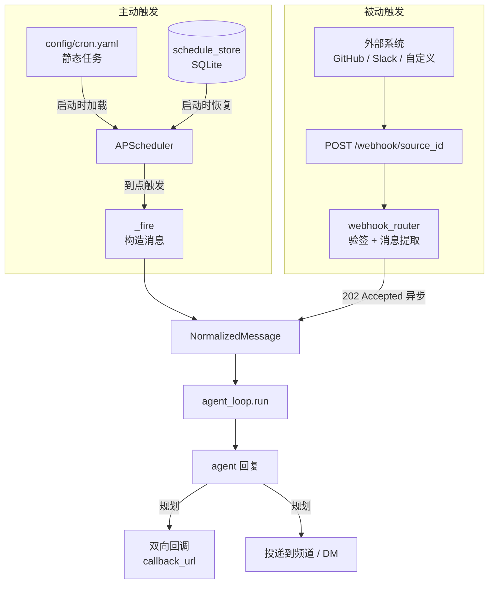
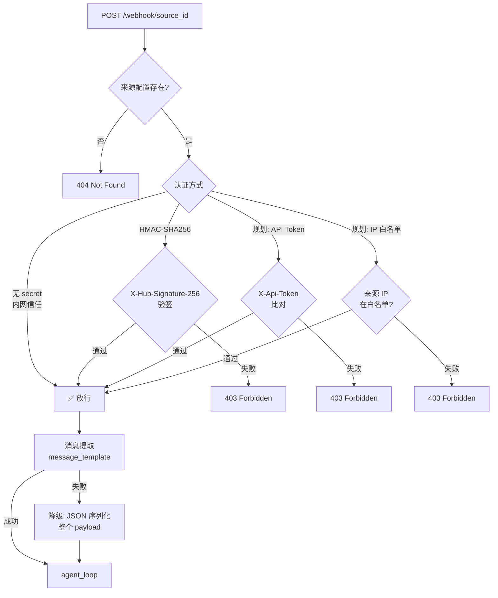
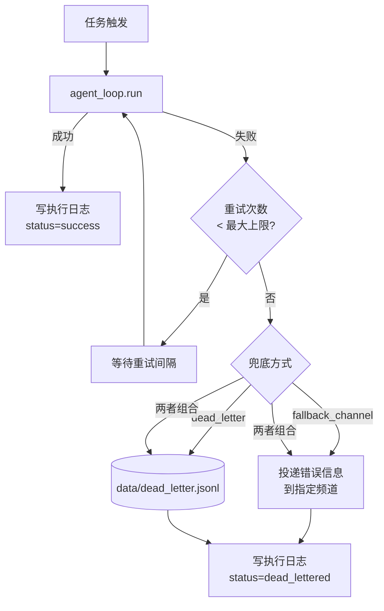

# scheduling

> 写作提醒：功能描述只写可观察的行为，不写内部实现细节。验收标准只写端到端可验证的行为。

## 概述

主动触发机制：定时任务（Cron）和外部事件驱动（Webhook）。让 agent 不只是被动响应，也能主动发起任务。

**调用关系**：
- 依赖：`schedule_store`、`agent_loop`、`webhook_router`、`normalizer`
- 被依赖：`server.py`（Webhook 路由）、APScheduler（Cron 触发）

---

## 架构图

### 触发链路总览

### Webhook 认证决策树

### 定时任务失败处理流程

---

## 现状

### 定时任务

- ✅ **APScheduler Cron 任务**：server 启动时初始化，支持标准五字段 cron 表达式和时区（IANA 格式，默认 UTC）
  - `schedule_task` 工具：创建 cron 任务，指定名称、cron 表达式、消息内容、时区、user_id
  - `cancel_task` 工具：取消指定任务（`risk_level=medium`，需审批）
  - `fleetent-admin list-schedules`：查看所有任务（id、name、cron_expr、user_id）
  - `fleetent-admin add-schedule --cron <expr> ...`：CLI 创建任务
  - `fleetent-admin remove-schedule --id <task_id>`：CLI 删除任务

- ✅ **任务持久化**：任务定义存 SQLite（`data/users.db`），server 重启后自动恢复调度
  - 字段：`id`（UUID）、`name`、`cron_expr`、`timezone`、`user_id`、`agent_name`、`message`、`enabled`、`source`（`dynamic` / `tool` / `static`）、`created_at`

- ✅ **静态任务配置**：`config/cron.yaml` 中定义 `jobs` 列表，server 启动时自动加载；SQLite 中同名 id 的任务优先级更高

### Webhook

- ✅ **Webhook 接入**：`POST /webhook/{source_id}` 接收外部事件，触发对应 agent
  - 来源配置文件：`config/webhooks.yaml`，字段：`id`、`user_id`、`secret`、`agent_name`、`message_template`

- ✅ **HMAC-SHA256 签名验证**（`X-Hub-Signature-256` 头）
  - 来源未配置 `secret` 时跳过验签，直接放行（信任内网来源）
  - 签名不匹配返回 403

- ✅ **消息提取**：支持 `message_template` 从 payload 中提取字段（`{key}` / `{key[subkey]}` 语法）
  - 提取失败时降级为 JSON 序列化整个 payload

---

## 规划中

### 定时任务

- [ ] **任务类型扩展**：支持三种触发模式
  - **一次性任务**（`type=once`）：指定未来某个时间点触发一次，执行后自动标记为 `done`
  - **固定间隔任务**（`type=interval`）：每隔 N 秒/分钟/小时触发（如"每 30 分钟巡检"）
  - **Cron 任务**（`type=cron`，现有）：标准五字段 cron 表达式，支持复杂周期

- [ ] **任务绑定**：每个任务记录投递目标
  - `agent_name`（必填）：指定执行 agent
  - 投递目标（必填）：主频道 channel 或私聊 DM
  - `user_id`（可选）：归属用户，用于权限过滤和查询
  - `session_id`（可选）：复用已有会话上下文，未指定时新建会话

- [ ] **暂停与恢复**：不删除任务的情况下暂停，之后可恢复
  - 对话工具：`pause_task` / `resume_task`
  - CLI：`fleetent-admin task pause --id <task_id>` / `fleetent-admin task resume --id <task_id>`
  - 暂停期间到点不触发；恢复后按原规则继续

- [ ] **单次手动触发**：立即触发一次，不影响原有调度
  - 对话工具：`run_task`
  - CLI：`fleetent-admin task run --id <task_id>`

- [ ] **完整 CRUD**：对话和 CLI 均可创建、编辑、删除、查询任务
  - `edit_task` 工具 / `fleetent-admin task edit --id <task_id> [--cron ...] [--message ...]`
  - 编辑支持修改触发规则、消息内容、绑定 agent/用户/会话，修改立即生效

- [ ] **触发时间预览**：创建或编辑任务后可预览接下来 N 次触发时间
  - CLI：`fleetent-admin task preview --id <task_id> [--n 5]`
  - 按任务时区输出

- [ ] **任务定义 Git 管理**：任务定义以 YAML 存储于 `config/tasks/`，纳入 Git 版本控制
  - 运行时状态（上次触发时间、执行次数、暂停标志）单独存 SQLite
  - 服务启动时自动同步 `config/tasks/` 变更到调度器；文件删除后对应状态自动清理

- [ ] **结构化执行记录**：每次任务触发后写入执行记录
  - 字段：`task_id`、`execution_id`、`triggered_at`、`finished_at`、`status`（`success` / `failed`）、`reply`、`error`（失败时）

- [ ] **失败重试与幂等**
  - 支持配置最大重试次数和重试间隔
  - 每次触发携带唯一 `execution_id`，重复投递时幂等跳过
  - 失败超过重试上限后保留完整失败日志，不静默丢弃

- [ ] **失败兜底**：重试耗尽后触发兜底（可在任务配置中组合选择）
  - `fallback_channel`：将错误信息投递到指定频道或私聊
  - `dead_letter`：写入 `data/dead_letter.jsonl`，支持人工重放
  - 兜底后执行日志标记 `status=dead_lettered`

- [ ] **完整执行日志**
  - 字段：`task_id`、`execution_id`、`triggered_at`、`finished_at`、`status`、`retry_count`、`reply`、`error`
  - CLI：`fleetent-admin task logs --id <task_id> [--status failed]`

### Webhook

- [ ] **官方平台适配**：内置主流平台的 Webhook 解析与验签
  - **Slack**：`X-Slack-Signature` + `X-Slack-Request-Timestamp` 验签；自动处理 URL verification challenge
  - **GitHub**：`X-Hub-Signature-256` 验签；按 `X-GitHub-Event` 头路由，支持 `event_filter` 配置
  - 在 `config/webhooks.yaml` 中声明 `type: slack` / `type: github`，框架自动套用对应解析逻辑

- [ ] **异步处理**：收到请求立即返回 202 Accepted，agent 执行在后台进行

- [ ] **多种认证方式**（按来源配置选择）
  - HMAC-SHA256 签名（现有，增强为可配置算法）
  - API Token：请求头携带 `X-Api-Token`，与来源配置中的 token 比对
  - IP 白名单：来源配置中指定允许的 IP 或 CIDR，不在名单内返回 403

- [ ] **请求携带标识字段**：每条 Webhook 请求包含 `task_id`、`session_id`、`user_id`

- [ ] **幂等处理**：请求头携带 `X-Idempotency-Key`，相同 key 的重复请求幂等跳过

- [ ] **结构化执行记录**
  - 字段：`source_id`、`task_id`、`session_id`、`received_at`、`status`、`reply`、`error`（失败时）

- [ ] **失败重试与幂等**：agent 执行失败时按配置重试，超限后记录失败日志

- [ ] **失败兜底**（可在来源配置中组合选择）
  - `fallback_channel`：将原始 payload 和错误信息投递到指定频道
  - `fallback_webhook`：转发到另一个 Webhook URL（如告警系统）
  - `dead_letter`：写入 `data/dead_letter.jsonl`

- [ ] **完整执行日志**
  - 字段：`source_id`、`task_id`、`session_id`、`received_at`、`finished_at`、`status`、`retry_count`、`reply`、`error`
  - CLI：`fleetent-admin webhook logs --source <source_id> [--status failed]`

- [ ] **路由预览**：不实际触发 agent，验证 Webhook 配置是否正确
  - CLI：`fleetent-admin webhook preview --source <source_id> --payload <file.json>`
  - 输出：匹配的 source、认证方式、提取的消息内容、将触发的 agent；配置有误时说明原因

- [ ] **双向回调**：agent 执行完成后主动回调调用方
  - 来源配置中指定 `callback_url`；回调携带 `task_id`、`status`、`reply`
  - 回调失败时记录日志，不影响本次执行结果

---

## 验收标准

### 现状

**场景 1：创建定时任务**
- Given：agent 支持 `schedule_task` 工具
- When：用户请求"每天早上 9 点发送日报"
- Then：任务创建成功，`list-schedules` 可查到；server 重启后仍然存在并自动触发

**场景 1a：静态任务配置加载**
- Given：`config/cron.yaml` 中定义了一个 job，`id=daily-report`
- When：server 启动
- Then：`list-schedules` 中出现 `id=daily-report` 的任务，调度正常

**场景 1b：SQLite 优先于 YAML**
- Given：`config/cron.yaml` 和 SQLite 中均有 `id=daily-report`，内容不同
- When：server 启动
- Then：以 SQLite 中的定义为准

**场景 2：Webhook 触发 agent**
- Given：配置来源 `id=github`、`secret=xxx`、`agent_name=dev-bot`
- When：GitHub 发送 `POST /webhook/github`，签名正确
- Then：dev-bot 收到提取后的消息内容，执行并回写结果

**场景 3：签名验证失败**
- Given：来源配置了 `secret`
- When：请求签名不正确
- Then：返回 403，不触发 agent

**场景 4：无 secret 来源**
- Given：来源未配置 `secret`（内网服务）
- When：发送 `POST /webhook/{source_id}`
- Then：跳过签名验证，直接触发 agent

**场景 4a：消息提取失败降级**
- Given：`message_template` 引用了 payload 中不存在的字段
- When：Webhook 请求到达
- Then：agent 收到 JSON 序列化的完整 payload，正常触发

### 规划

**场景 5：一次性任务**
- Given：用户对话"明天下午 3 点提醒我开会"
- When：agent 调用 `schedule_task` 工具，`type=once`，`at=明天 15:00`
- Then：到时触发一次，执行后状态变为 `done`，不再触发

**场景 5a：固定间隔任务**
- Given：用户对话"每 30 分钟检查一次服务状态"
- When：agent 调用 `schedule_task`，`type=interval`，`every=30m`
- Then：每隔 30 分钟触发，`list-schedules` 可查到下次触发时间

**场景 5b：时区运行**
- Given：创建任务 `cron="0 9 * * 1"`，`timezone=Asia/Shanghai`
- When：北京时间周一 09:00
- Then：任务触发；UTC 时间 01:00 不触发

**场景 5c：任务绑定用户和 agent**
- Given：创建任务时指定 `user_id=alice`、`agent_name=support-bot`、`target=dm`
- When：任务触发
- Then：support-bot 执行，归属用户=alice，消息投递到 alice 私聊

**场景 5d：任务绑定频道**
- Given：创建任务时指定 `channel_id=C123`、`target=channel`
- When：任务触发
- Then：执行结果投递到频道 C123

**场景 5e：暂停与恢复**
- Given：`task_id=t001` 每天 9 点触发
- When：`fleetent-admin task pause --id t001`，等待过了 9 点
- Then：该时间点不触发；`resume` 后恢复，下次到时间正常触发

**场景 5f：单次手动触发**
- Given：`task_id=t001` 处于暂停状态
- When：`fleetent-admin task run --id t001`
- Then：立即触发一次；任务仍保持暂停状态，原调度不受影响

**场景 5g：触发时间预览**
- Given：`task_id=t001`，`cron="0 9 * * 1-5"`，`timezone=Asia/Shanghai`
- When：`fleetent-admin task preview --id t001 --n 5`
- Then：输出接下来 5 次触发的北京时间

**场景 5h：任务定义 Git 管理**
- Given：在 `config/tasks/` 新增一个 YAML 文件定义任务，提交到 Git
- When：服务重启
- Then：新任务自动加载并开始调度

**场景 5i：运行状态重启不丢**
- Given：`task_id=t001` 已执行 10 次，最后触发时间为 T
- When：服务重启
- Then：`list-schedules` 仍显示执行次数=10、最后触发时间=T，任务恢复调度

**场景 6：CLI 编辑定时任务**
- Given：已存在 `task_id=t001`，cron 为每天 9 点
- When：`fleetent-admin task edit --id t001 --cron "0 10 * * *"`
- Then：下次触发时间变为每天 10 点，无需重启服务

**场景 7：定时任务失败重试**
- Given：任务配置最大重试 3 次，第 1 次因 API 超时失败
- When：自动重试
- Then：最多重试 3 次；全部失败后失败日志保留，含 `execution_id`、`error`、每次重试时间

**场景 7a：失败兜底——投递到频道**
- Given：任务配置 `fallback_channel=C-alert`，重试耗尽
- When：agent 执行连续失败 3 次
- Then：错误信息投递到频道 C-alert；执行日志 `status=dead_lettered`

**场景 7b：失败兜底——死信队列**
- Given：任务配置 `fallback=dead_letter`，重试耗尽
- When：agent 执行失败超过上限
- Then：`data/dead_letter.jsonl` 新增一条记录，含 `task_id`、`execution_id`、`error`

**场景 8：定时任务幂等**
- Given：相同 `execution_id` 的触发请求因网络抖动被投递两次
- When：第二次投递到达
- Then：第二次被幂等跳过，agent 仅执行一次

**场景 9：官方平台适配——Slack Events API**
- Given：配置 `type=slack`，`secret=xxx`；Slack 发送 `app_mention` 事件
- When：`POST /webhook/{source_id}`，携带正确 `X-Slack-Signature`
- Then：验签通过，agent 收到提取后的消息文本，正常触发；签名错误返回 403

**场景 9a：Slack URL verification**
- Given：首次配置 Slack Events API，Slack 发送 challenge 请求
- When：`POST /webhook/{source_id}`，body 含 `type=url_verification`
- Then：自动返回 `{"challenge": "..."}`，无需额外配置

**场景 9b：GitHub Webhook 触发**
- Given：配置 `type=github`，`secret=xxx`，`event_filter=push`
- When：GitHub 推送代码，发送 `X-GitHub-Event: push`，签名正确
- Then：agent dev-bot 被触发，收到 push 事件的结构化摘要

**场景 9c：GitHub 事件过滤**
- Given：配置 `event_filter=push`，收到 `X-GitHub-Event: pull_request`
- When：请求到达
- Then：返回 200 但不触发 agent（静默忽略）

**场景 10：Webhook 异步返回**
- Given：agent 执行预计耗时 5 秒
- When：`POST /webhook/{source_id}`
- Then：立即返回 202 Accepted，不等待 agent 执行完成

**场景 11：API Token 认证**
- Given：来源配置 `auth=api_token`，`token=secret123`
- When：请求头携带 `X-Api-Token: secret123`
- Then：认证通过，agent 被触发；token 错误返回 403

**场景 12：IP 白名单认证**
- Given：来源配置 `auth=ip_whitelist`，允许 `192.168.1.0/24`
- When：来自 `192.168.1.50` 的请求到达
- Then：认证通过；来自 `10.0.0.1` 的请求返回 403

**场景 13：Webhook 幂等**
- Given：调用方携带 `X-Idempotency-Key: evt-abc123` 重发同一请求
- When：第二次请求到达
- Then：返回 202，agent 不重复执行

**场景 13a：Webhook 失败兜底——投递到频道**
- Given：来源配置 `fallback_channel=C-alert`，重试耗尽
- When：agent 执行连续失败 3 次
- Then：原始 payload 和错误信息投递到频道 C-alert；执行日志 `status=dead_lettered`

**场景 13b：Webhook 失败兜底——死信队列**
- Given：来源配置 `fallback=dead_letter`，重试耗尽
- When：agent 执行失败超过上限
- Then：`data/dead_letter.jsonl` 新增一条记录，含 `source_id`、`task_id`、`payload`、`error`

**场景 13c：路由预览——配置正确**
- Given：`source_id=github`，配置 `type=github`，`event_filter=push`，`agent_name=dev-bot`
- When：`fleetent-admin webhook preview --source github --payload push_event.json`
- Then：输出 source=github、auth=hmac、提取的消息摘要、将触发 agent=dev-bot

**场景 13d：路由预览——配置有误**
- Given：`source_id=ops`，`message_template` 引用了 payload 中不存在的字段
- When：`fleetent-admin webhook preview --source ops --payload sample.json`
- Then：输出提取失败原因，并提示将降级为 JSON 序列化全量 payload

**场景 14：双向回调**
- Given：来源配置了 `callback_url=https://example.com/hook`
- When：agent 执行完成
- Then：向 `callback_url` POST 请求，body 含 `task_id`、`status=success`、`reply` 内容

**场景 15：定时任务完整执行日志**
- Given：`task_id=t001` 历史触发 5 次，第 3 次失败并重试 2 次后成功
- When：`fleetent-admin task logs --id t001`
- Then：输出 5 条记录，每条含 `execution_id`、`triggered_at`、`finished_at`、`status`、`retry_count`；第 3 条 `retry_count=2`、含 `error` 字段

**场景 15a：定时任务日志按状态过滤**
- Given：`task_id=t001` 历史 10 次执行，3 次失败
- When：`fleetent-admin task logs --id t001 --status failed`
- Then：仅返回 3 条失败记录

**场景 16：Webhook 完整执行日志**
- Given：`source_id=github` 历史收到 20 条请求，4 条执行失败
- When：`fleetent-admin webhook logs --source github`
- Then：输出 20 条记录，每条含 `task_id`、`session_id`、`received_at`、`finished_at`、`status`、`retry_count`

**场景 16a：Webhook 日志按状态过滤**
- Given：`source_id=github` 历史 20 条请求，4 条失败
- When：`fleetent-admin webhook logs --source github --status failed`
- Then：仅返回 4 条失败记录，每条含 `error` 字段

---

## 待决问题

- [ ] 失败日志的保留策略：条数上限还是时间上限？（负责人：待认领）
- [ ] 双向回调失败是否重试？重试策略与主任务是否共用？（负责人：待认领）
- [ ] `task_id` 的生成方式：服务端生成（现为 UUID）还是调用方传入？（负责人：待认领）
- [ ] `config/tasks/` YAML 变更检测：仅启动时扫描，还是支持运行时热重载？（负责人：待认领）
- [ ] `session_id` 绑定语义：复用已有会话上下文，还是每次触发新建会话但注入历史摘要？（负责人：待认领）
