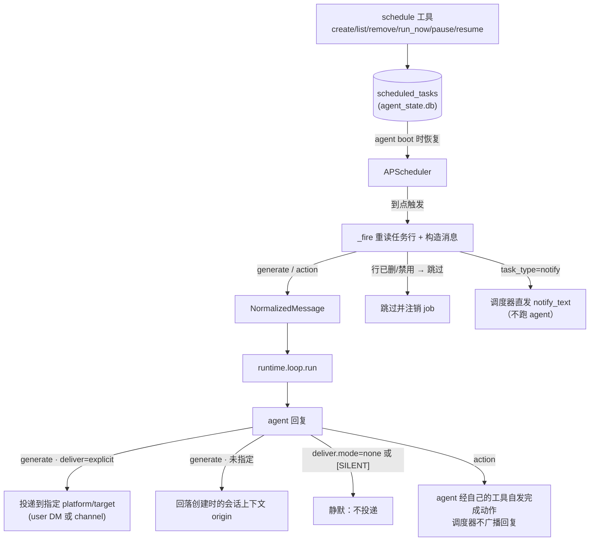
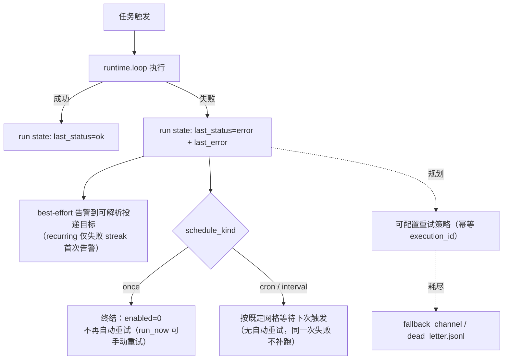

# scheduling

> 写作提醒：功能描述只写可观察的行为，不写内部实现细节。验收标准只写端到端可验证的行为。

## 概述

主动触发机制：让 agent 不只是被动响应，也能按计划主动发起任务。

**调度是 agent 全权能力**（agent-owned）：任务的创建、查询、暂停、删除全部通过与 agent 对话（统一 `schedule` 工具）完成；任务持久化在该 agent 自己的 `agent_state.db`，由 agent 进程自己的调度器恢复与触发。platform 不参与任务管理，也没有对应 admin CLI。

**负责**：定时调度 agent 运行（cron / 一次性 / 固定间隔）、触发后把回复主动投递到指定渠道目标。

**不负责**：agent 执行逻辑（→ `runtime/loop.py`）、IM 消息投递的传输细节（→ im_gateway / outbound）、执行结果的持久化分析（→ observability）。

**Webhook 现状说明**：外部事件入口 `POST /webhook/{source_id}` 已随 2026-06-04 的 control-plane 收敛从 `server.py` 移除（platform 只保留管理面路由）。`webhook_router.py` 中验签 / 消息提取两个纯函数保留备用。Webhook 触发将以 **agent runtime API** 形态回归（见「规划中」），不再挂在 platform server 上。

**调用关系**：
- 依赖：`schedule_store`（注入式 per-agent 存储）、`runtime/loop.py`（执行）、`outbound`（主动投递）、APScheduler（触发器）
- 被依赖：`tools/builtin_tools.py` 的 `schedule` 工具（对话管理入口）、`runtime/agent_app.py`（boot 时注入 DB 并启动调度器）

## 关键流程



定时任务失败处理（配置化重试/兜底仍是规划项；once 的默认策略与失败告警已实现）：



## 数据模型

`scheduled_tasks` 是 **agent 侧 per-agent 表**，住在该 agent 的 `agent_state.db`，**列级真相源 = `runtime/agent_state_migrations.py`（嵌入式 Y）**，此处不复制完整 DDL（避免与迁移漂移）。任务形态字段：

- **标识/归属**：`id`(UUID，服务端生成) · `name` · `user_id`(owner，取 resolved principal) · `source`(`static`/`dynamic`/`tool`) · `enabled` · `created_at`
- **触发**：`schedule_kind`(`cron`/`once`/`interval`) + 对应字段 `cron_expr`(cron) / `run_at`(once：ISO-8601 或相对 `+30m`) / `interval_seconds`+`anchor`(interval) · `timezone`
- **分型**：`task_type`(`notify`/`generate`/`action`，默认 `generate`) · `notify_text`(notify 型的冻结定稿正文，触发时原样直发)
- **执行**：`message`(generate/action 型触发注入的 prompt) · 可选 `session_id` · `origin`(创建上下文 JSON，投递回落目标) · 可选 `deliver`(显式投递目标 JSON)
- **运行态**：`last_run_at` · `last_status` · `last_error` · `next_run_at`
- **无 `agent_name` 列**：one agent per process，任务归属由物理库圈定。跨 agent 编排不在本能力域规划内（若将来需要，属 platform 侧编排，另立 change）

Cron jobs 不写入平台配置文件：通过 `schedule` 工具创建、存 SQLite、boot 时恢复。`platform.yaml` 只保存 `scheduling.enabled`、`scheduling.default_timezone` 等全局策略。

## 接口定义

```python
# schedule_store（注入式：boot 时经 set_state_db(agent_state_db) 注入，无 ensure_schema）
def set_state_db(db: SQLiteDatabase) -> None:
    """注入该 agent 的 agent_state.db 句柄；CRUD 经此句柄执行（未注入则抛错）。"""

def create(
    name: str,
    cron_expr: str | None = None,
    timezone: str = "UTC",
    user_id: str = "default",
    message: str = "",
    source: str = "dynamic",
    session_id: str | None = None,
    *,
    schedule_kind: str = "cron",       # "cron" | "once" | "interval"
    run_at: str | None = None,         # once：ISO-8601 或相对 "+30m"
    interval_seconds: int | None = None,
    anchor: str | None = None,         # interval 锚点
    origin: dict[str, Any] | None = None,
    deliver: dict[str, Any] | None = None,
) -> dict[str, Any]:
    """创建定时任务并写入 agent_state.db，返回完整任务字典。"""

def list_tasks(include_disabled: bool = False) -> list[dict[str, Any]]:
    """返回任务（默认仅 enabled），agent 进程 boot 时用于恢复调度。"""

def get(task_id: str) -> dict[str, Any] | None: ...
def set_enabled(task_id: str, enabled: bool) -> bool: ...
def update_run_state(task_id, *, last_run_at, last_status, last_error) -> None: ...
def delete(task_id: str) -> bool: ...


# 对话管理入口（tools/builtin_tools.py，@tool(risk_level="low")）
async def schedule(
    action: str,                # create | list | remove | run_now | pause | resume
    name: str = "",
    schedule_kind: str = "cron",
    cron_expr: str = "",
    run_at: str = "",
    interval_seconds: int = 0,
    message: str = "",
    timezone: str = "UTC",
    user_id: str = "default",   # 仅 principal 缺失时的 fallback；owner 一律取 resolved principal
    task_id: str = "",
    notify_platform: str = "",
    notify_target: str = "",
    notify_target_type: str = "user",   # user | channel
    task_type: str = "generate",        # notify | generate | action
    notify_text: str = "",              # notify 型的定稿正文（创建时优化确认后冻结）
    tool_context: ToolContext | None = None,
) -> str: ...


# webhook_router（孤儿工具函数，入口已移除，保留备 runtime API 回归复用）
def verify_signature(secret: str | None, body: bytes, header: str | None) -> bool:
    """HMAC-SHA256 验签。secret 为 None 时直接返回 True（内网信任）。"""

def extract_message(template: str | None, payload: Any) -> str:
    """按模板提取消息；模板为 None 或提取失败时降级为 json.dumps(payload)。"""
```

## 现状

### 定时任务

- ✅ **三种触发模式**：`cron`（标准五字段表达式 + IANA 时区，默认 UTC）、`once`（ISO-8601 绝对时间或 `+30m` 相对时间；naive 绝对时间按**任务时区**解释为本地钟面时间，不按宿主机系统时区、不预先换算为 UTC）、`interval`（固定间隔秒数，按调度网格 `前一计划时刻 + interval` 推进，不因运行耗时或写回时机漂移）

- ✅ **once 终结策略**：无论成功还是失败，`once` **只触发一次**——成功标记 `completed`；失败同样终结（`enabled=0`，保留 `last_status=error`/`last_error`），绝不因未被推进而在后续 tick 被反复热触发。需要重试时用 `schedule(action="run_now")` 手动重跑

- ✅ **失败主动告警**：一次触发失败（agent 执行报错、投递失败、或 `generate` 型产出非静默回复却没有可解析的投递目标）时，调度器 best-effort 向该任务可解析的投递目标发一条 `⚠️ 定时任务 <name> 执行失败: <error>`；告警本身失败只记日志不影响触发结果；recurring 任务连续失败只在失败 streak 的首次告警，避免刷屏

- ✅ **任务分型 + 投递契约**（typed-scheduled-task-delivery）：按「正文内容是否需要触发时刻才知道的信息」分三型
  - `notify`：内容固定的纯通知——创建对话中 agent 把用户糙文案**优化定稿、确认后冻结**进 `notify_text`；触发时调度器**原样直发，不跑 agent**（无 LLM 成本/延迟/改写风险）
  - `generate`（默认）：内容触发时生成（摘要、实时数据）——跑 agent，最终回复按投递契约发出
  - `action`：任务本体是动作（发 DM/文件、条件分发）——跑 agent，由 agent 经自己的工具自发完成，调度器**不广播回复**
  - 分型原则：**智能工作做在创建时（有对话者、有纠错回路），触发时只执行确定性动作**

- ✅ **统一 `schedule` 对话工具**：create / list / remove / run_now / pause / resume 全部经一个工具完成
  - owner 一律取 resolved principal 的 `user_id`（模型传入的 `user_id` 参数仅在无 principal 的运行中作为 fallback），防模型伪造归属
  - 本进程没有运行中的调度器时（如纯 CLI 一次性运行），create 仍落库并如实告知「待 agent 服务运行后生效」
  - 按型校验：如 `notify` 缺 `notify_text`/目标时创建被拒并给出可改正的提示

- ✅ **主动投递**（generate 型）：触发后的回复经 `outbound` 主动投递
  - 显式目标：创建时给 `notify_platform` + `notify_target`（`target_type` user=DM / channel=频道）——**二者须成对提供**，只给一个会被 create 拒绝并提示缺失的参数（不再静默忽略回落 origin）
  - 未指定：回落创建任务时的会话上下文（`origin`，含原平台/频道/线程）
  - 静默模式：`deliver.mode=none` 或回复恰为 `[SILENT]` 哨兵时成功但不投递（适合「只在有变化时报警」的巡检任务）
  - 无可解析目标（既无 `origin` 又无显式 `deliver`）且回复非静默时记为**失败**（`error: no_delivery_target`）——广播型任务的产出无处可去不算成功；唯一例外是显式 `deliver.mode=none`（有意不投递，仍记 `ok`）
  - **create 回执明示/警示最终投递目标**：显式目标写成 `platform:target(target_type)`；回落 origin 写明「投递回创建会话」；**既无显式目标又无 origin**（generate 型）时回执追加 ⚠️ 警示——不阻断创建，只做可见性提示（该场景 fire 时即触发上一条的 `no_delivery_target` 失败）

- ✅ **fired run 不含 `schedule` 工具**：定时触发的运行（无论 `generate` 还是 `action`）工具集中不出现 `schedule`——被 prompt 注入或误操作也无法在触发的这次运行里创建/修改/删除定时任务，任务管理仍是交互式会话的能力

- ✅ **触发期校验**：到点时从 store 重读任务行——已删除或已禁用的行绝不执行（绕过 facade 的写入者也拦得住）；owner 被拉黑或不存在时跳过执行

- ✅ **Principal recheck 解耦（direct-run 安全）**：cron 任务触发前会 recheck scheduled_task 的 principal（api_key 是否仍有效、未禁用）
  - recheck 逻辑通过注入的 resolver 解耦：platform 启动时调用 `cron_scheduler.set_principal_resolver(_cron_principal_recheck)` 注入平台侧检查；直接 `fleetent agent run` 的进程不注入（resolver=None），直接放行
  - fail-closed 语义：recheck 异常时拒绝执行，而非忽略异常继续运行
  - cron 触发路径因此不 import `user_store`，也不打开 management 库（`decouple-cron-principal-recheck`，2026-06-16 归档）

- ✅ **宕机错过处理（自研 tick-poll 引擎，非 APScheduler 内建 misfire）**：`interval` 快进到未来第一个未过期时刻，至多补跑一次，不逐槽回放；`cron` 额外设**宽限上界** `min(半周期, 2h)`（clamp 下界 2min）——迟到在宽限内补跑一次，超过宽限则不补跑、记一条 `missed` run-history 行并快进到下一次未来时刻（宕机三天不会把三天前的 daily digest 当新内容广播）；过期更久的 `once` 任务标记 `completed` 不补发
  - 引擎结构：持久化 `next_run_at` + 内存 tick loop（默认 10s 扫描周期，睡眠对齐最早到期时刻，见下）+ claim-before-execute 的 at-most-once 语义；不是 APScheduler 的调度引擎本身，`CronTrigger` 仅复用其纯 cron 数学
  - **tick 对齐睡眠**：不固定睡满一个 tick 周期——睡眠时长取 `min(tick_interval, 距最早到期时间)`（下界 0.5s 防忙轮询），到期任务的触发延迟从「至多一个 tick」收敛到亚秒级
  - **单进程内并发保护**：`asyncio.Semaphore` 有界并发（默认 4）+ 逐任务 `_inflight` 标记防重入；单进程模型下不需要跨进程文件锁

- ✅ **tick 逐行容错**：单个任务行的解码失败（如 `origin`/`deliver` 列的 JSON 损坏）或处理期异常（如 `cron_expr` 事后被改坏）只记 warning 跳过该行，绝不让一行坏数据瘫痪整个 tick、影响其余到期任务

- ✅ **boot 禁用坏行必告警**：启动注册阶段一个任务因数据问题（如无法解析的 `run_at`）被自动禁用时，best-effort 向其可解析的投递目标发一条禁用告警，不再纯静默禁用

- ✅ **单次触发看门狗**：每次触发套 `scheduling.fire_timeout_seconds`（默认 900 秒，0=关闭）超时保护——卡死不返回的触发会被取消，记一条 timeout 语义的 `error` 历史行，并释放其占用的并发槽与 in-flight 标记，不会让卡死的一次运行拖垮整个调度器

- ✅ **任务持久化与恢复**：`scheduled_tasks` 存该 agent 的 `agent_state.db`（嵌入式 Y 维护，非 Alembic、不在管理库），由 **agent 进程**的 `CronScheduler` 在 boot 时恢复调度（平台 managed 侧不触发用户定时任务，只跑自身维护）

- ✅ **全局调度配置**：`platform.yaml` 中只保存 `scheduling.enabled` 和 `scheduling.default_timezone`
  - 旧 `config/cron.yaml` 不再读取；文件存在时启动失败并提示通过 `schedule` 工具创建任务

- ✅ **跨触发会话绑定可配置**：`schedule` 工具的 `session` 参数——留空（默认）每次触发独立、互不可见；指定一个字符串则历次触发累积同一会话上下文（计数器、连续对比等场景）

- **无 admin CLI**：任务住 per-agent 库，platform CLI 不跨界管理（agent-owned 契约）；查看/管理一律对话完成

### Webhook

- ❌ **入口已移除**：`POST /webhook/{source_id}` 路由已随 control-plane 收敛（2026-06-04）从 `server.py` 删除；YAML source 配置同期废弃（旧 `config/webhooks.yaml` 不再读取）
- ✅ **工具函数保留**：`verify_signature`（HMAC-SHA256，无 secret 时内网信任放行）、`extract_message`（`{key}` / `{key[subkey]}` 模板提取，失败降级 JSON 序列化）有 unit 测试覆盖，备 runtime API 回归时复用

## 规划中（v1.0）

### 定时任务

- [ ] **编辑任务**：`schedule` 工具增加 `action=edit`，支持修改触发规则、消息内容、投递目标，修改立即生效（当前只能 remove + create）

- [ ] **触发时间预览**：按任务时区输出接下来 N 次触发时间（对话内完成）

- [ ] **失败重试与幂等**
  - 支持配置最大重试次数和重试间隔
  - 每次触发携带唯一 `execution_id`，重复投递时幂等跳过
  - 失败超过重试上限后保留完整失败日志，不静默丢弃

- [ ] **失败兜底**：重试耗尽后触发（可在任务配置中组合选择）
  - `fallback_channel`：将错误信息投递到指定频道或私聊
  - `dead_letter`：写入 `data/dead_letter.jsonl`，支持人工重放

- [ ] **完整执行日志**（当前只有 `last_run_at` / `last_status` / `last_error` 单条运行态）
  - 字段：`task_id`、`execution_id`、`triggered_at`、`finished_at`、`status`、`retry_count`、`reply`、`error`
  - 查询经对话工具完成（agent-owned，不走 platform CLI）

### Webhook（以 agent runtime API 形态回归）

- [ ] **runtime source management**：webhook 来源经 agent runtime API / store 注册（声明 `secret`、`message_template`、可选 `type`），不挂 platform server、不进 YAML
- [ ] **官方平台适配**：内置主流平台的解析与验签
  - **Slack**：`X-Slack-Signature` + `X-Slack-Request-Timestamp` 验签；自动处理 URL verification challenge
  - **GitHub**：`X-Hub-Signature-256` 验签；按 `X-GitHub-Event` 头路由，支持 `event_filter` 配置
- [ ] **异步处理**：收到请求立即返回 202 Accepted，agent 执行在后台进行
- [ ] **多种认证方式**（按来源配置选择）：HMAC-SHA256（可配置算法）、API Token（`X-Api-Token`）、IP 白名单（IP / CIDR）
- [ ] **幂等处理**：请求头携带 `X-Idempotency-Key`，相同 key 的重复请求幂等跳过
- [ ] **失败重试与兜底**：重试超限后 `fallback_channel` / `fallback_webhook` / `dead_letter`
- [ ] **完整执行日志**：`source_id`、`received_at`、`finished_at`、`status`、`retry_count`、`reply`、`error`
- [ ] **路由预览**：不实际触发 agent，验证来源配置（匹配 source、认证方式、提取的消息内容）
- [ ] **双向回调**：执行完成后向来源配置的 `callback_url` POST `task_id`、`status`、`reply`；回调失败记日志不影响本次执行

## 验收标准

### 现状

**场景 1：创建 cron 任务**
- Given：agent 支持 `schedule` 工具
- When：用户对话"每天早上 9 点发送日报"
- Then：任务创建成功，`schedule(action=list)` 可查到；agent 重启后仍存在并自动触发

**场景 2：一次性任务**
- Given：用户对话"30 分钟后提醒我开会"
- When：agent 调用 `schedule(action=create, schedule_kind=once, run_at="+30m")`
- Then：到时触发一次，成功后状态变为 `completed`，不再触发

**场景 3：固定间隔任务**
- Given：用户对话"每 30 分钟检查一次服务状态"
- When：agent 调用 `schedule(action=create, schedule_kind=interval, interval_seconds=1800)`
- Then：每隔 30 分钟触发

**场景 4：时区运行**
- Given：创建任务 `cron="0 9 * * 1"`，`timezone=Asia/Shanghai`
- When：北京时间周一 09:00
- Then：任务触发；UTC 时间 01:00 不触发

**场景 5：暂停与恢复**
- Given：任务每天 9 点触发
- When：`schedule(action=pause)` 后过了 9 点
- Then：该时间点不触发；`resume` 后恢复，下次到时间正常触发

**场景 6：单次手动触发**
- Given：任务处于暂停状态
- When：`schedule(action=run_now, task_id=...)`
- Then：立即触发一次；任务仍保持暂停状态，原调度不受影响

**场景 7：显式投递目标**
- Given：创建任务时指定 `notify_platform=slack`、`notify_target=U123`、`notify_target_type=user`
- When：任务触发
- Then：回复以 DM 投递给 U123，而非创建任务的频道

**场景 8：静默巡检**
- Given：任务为"有异常才报警"，agent 检查后无异常、回复 `[SILENT]`
- When：任务触发
- Then：执行成功（`last_status=ok`），不投递任何消息

**场景 9：触发期校验**
- Given：任务已被删除或禁用，但调度器中残留 job
- When：到点触发
- Then：不执行，job 注销，日志记录跳过原因

**场景 10：宕机错过**
- Given：agent 停机 30 分钟，期间错过一次 cron 触发
- When：agent 重启
- Then：错过的触发在宽限窗口内合并补发一次；超过 3600s 的一次性任务跳过不补发

**场景 11：一次性任务失败终结**
- Given：用户对话"30 分钟后提醒我开会"，agent 执行时报错（如 LLM 网关故障）
- When：到点触发失败
- Then：任务状态变为 `enabled=0`、`last_status=error`（保留 `last_error`），不再自动重试；用户可用 `schedule(action=run_now)` 手动重跑

**场景 12：失败告警**
- Given：一个 recurring 任务某次触发失败
- When：其投递目标可解析
- Then：该目标收到一条 ⚠️ 失败告警；若下一次触发仍失败（连续失败），不重复告警；若之后成功一次再失败，则重新告警

**场景 13：half-set 投递参数被拒**
- Given：用户只说了"发到 C123"（只给 `notify_target`，未给 `notify_platform`）
- When：agent 尝试创建任务
- Then：创建被拒，工具返回明确指出缺失 `notify_platform` 的错误，不静默回落到创建频道

**场景 14：无目标 generate 任务的创建期警示**
- Given：一个 `generate` 任务从非 IM 上下文创建（无法捕获 `origin`）、也未指定 `notify_platform`/`notify_target`
- When：创建完成
- Then：任务仍创建成功，但回执含 ⚠️ 警示——说明触发产出的内容将无法送达；该任务真正触发时会记 `error`（`no_delivery_target`）并触发失败告警

**场景 15：fired run 无法自我增殖**
- Given：一个 `action` 任务的 message 诱导 agent 在触发时再创建一个新的定时任务
- When：任务触发
- Then：该次运行的工具集中没有 `schedule` 工具，无法创建新任务；用户在交互式会话中创建/管理任务不受影响

**场景 16：宕机超宽限的 cron 任务不补发陈旧内容**
- Given：一个每日定时任务，agent 停机 3 天后重启
- When：调度器恢复
- Then：不触发该次陈旧的触发（迟到远超其 2 小时宽限上界），记一条 `missed` 历史行，`next_run_at` 快进到下一个未来时刻

**场景 17：一行坏数据不瘫痪调度器**
- Given：某任务行的 `origin` 列因外部改动变成非法 JSON，同时存在其他正常到期任务
- When：tick 运行
- Then：坏行被跳过并记 warning，其余到期任务照常触发，后续 tick 不受影响

**场景 18：卡死的触发被看门狗回收**
- Given：一次触发的 agent 运行卡死不返回
- When：超过 `fire_timeout_seconds`（默认 900 秒）
- Then：该次运行被取消，记一条 timeout 语义的失败历史行；该任务与其他任务的后续触发不受影响

**场景 19：定时任务跨触发累积上下文**
- Given：一个任务以 `schedule(action=create, session="cron/counter", ...)` 创建
- When：该任务先后触发两次
- Then：第二次触发能读取到第一次触发写入的历史上下文（如累计计数）；未指定 `session` 时两次触发互不可见（默认行为不变）

### 规划中（v1.0）

**场景 P1：编辑任务**
- Given：已存在任务，cron 为每天 9 点
- When：对话修改为每天 10 点（`action=edit`）
- Then：下次触发时间变为每天 10 点，无需重启

**场景 P2：触发时间预览**
- Given：任务 `cron="0 9 * * 1-5"`，`timezone=Asia/Shanghai`
- When：对话请求预览接下来 5 次触发
- Then：输出接下来 5 次触发的北京时间

**场景 P3：失败重试**
- Given：任务配置最大重试 3 次，第 1 次因 API 超时失败
- When：自动重试
- Then：最多重试 3 次；全部失败后失败日志保留，含 `execution_id`、`error`、每次重试时间

**场景 P4：失败兜底——投递到频道**
- Given：任务配置 `fallback_channel=C-alert`，重试耗尽
- When：agent 执行连续失败 3 次
- Then：错误信息投递到频道 C-alert；执行日志 `status=dead_lettered`

**场景 P5：失败兜底——死信队列**
- Given：任务配置 `fallback=dead_letter`，重试耗尽
- When：agent 执行失败超过上限
- Then：`data/dead_letter.jsonl` 新增一条记录，含 `task_id`、`execution_id`、`error`

**场景 P6：定时任务幂等**
- Given：相同 `execution_id` 的触发因网络抖动被投递两次
- When：第二次投递到达
- Then：第二次被幂等跳过，agent 仅执行一次

**场景 P7：完整执行日志**
- Given：任务历史触发 5 次，第 3 次失败并重试 2 次后成功
- When：对话查询执行日志
- Then：输出 5 条记录，每条含 `execution_id`、`triggered_at`、`finished_at`、`status`、`retry_count`；第 3 条 `retry_count=2`、含 `error`

**场景 P8：Webhook 来源注册与触发**
- Given：经 runtime API 注册来源 `id=github`、`secret=xxx`
- When：GitHub 发送 webhook，`X-Hub-Signature-256` 签名正确
- Then：agent 收到提取后的消息内容，执行并按 deliver 规则投递；签名错误返回 403；未注册来源返回 404

**场景 P9：Slack Events API**
- Given：来源 `type=slack`；Slack 发送 `app_mention` 事件
- When：携带正确 `X-Slack-Signature`
- Then：验签通过并触发；首次 URL verification challenge 自动返回 `{"challenge": "..."}`

**场景 P10：GitHub 事件过滤**
- Given：来源 `event_filter=push`，收到 `X-GitHub-Event: pull_request`
- When：请求到达
- Then：返回 200 但不触发 agent（静默忽略）

**场景 P11：Webhook 异步返回**
- Given：agent 执行预计耗时 5 秒
- When：webhook 请求到达
- Then：立即返回 202 Accepted，不等待执行完成

**场景 P12：API Token / IP 白名单认证**
- Given：来源配置 `auth=api_token, token=secret123` 或 `auth=ip_whitelist, allow=192.168.1.0/24`
- When：请求到达
- Then：凭证/来源 IP 匹配则触发；不匹配返回 403

**场景 P13：Webhook 幂等**
- Given：调用方携带 `X-Idempotency-Key: evt-abc123` 重发同一请求
- When：第二次请求到达
- Then：返回 202，agent 不重复执行

**场景 P14：双向回调**
- Given：来源配置了 `callback_url=https://example.com/hook`
- When：agent 执行完成
- Then：向 `callback_url` POST 请求，body 含 `task_id`、`status=success`、`reply` 内容

## 测试边界

**需要单元测试的行为**：
- `verify_signature`：secret 为 None 时直接放行；签名正确时返回 True；签名错误时返回 False
- `extract_message`：模板为 None 时返回 json.dumps；字段存在时正确替换；字段缺失时降级为 json.dumps
- `schedule_store`：`set_state_db` 未注入时 CRUD 抛错（注入契约）

**需要 integration 测试的行为**（涉及真实 SQLite / store 协作）：
- `schedule_store.create` 写入后 `list_tasks` 可查到；`delete` 后不再出现；`set_enabled` 切换生效
- `CronScheduler`：只从 SQLite 恢复任务；旧 `config/cron.yaml` 存在时 fail fast；遵守 `scheduling.enabled` 和 `scheduling.default_timezone`
- 触发期校验：已删/禁用行不执行；once 成功后标 `completed`

**需要 mock 的依赖**：
- `runtime.loop.run`：隔离 LLM 调用，只验证触发行为
- `schedule_store`：经 `set_state_db` 注入 `tmp_path` 下的临时 DB（无 `DB_PATH` 常量可 patch）
- `platform.yaml` 路径：`monkeypatch` 到临时文件，仅注入全局 scheduling 策略
- APScheduler：测试注册逻辑时可 mock `_scheduler.add_job`，不实际启动定时器

## 待决问题

- [ ] 失败日志的保留策略：条数上限还是时间上限？（负责人：待认领）
- [ ] 双向回调失败是否重试？重试策略与主任务是否共用？（负责人：待认领）
- [ ] `task_id` 的生成方式：现为服务端 UUID；是否需要支持调用方传入待 webhook 回归时一并定（负责人：待认领）
- [ ] 遗留 bug：`schedule_kind` 为历史值 `'run_at'`（cron_expr=NULL）的存量行会让启动恢复时 `_parse_cron` 崩溃 → agent 起不来。归属 AAA-8039，建议 `_register` 对未知 kind 容错跳过（负责人：AAA-8039 owner）
- [x] `session_id` 绑定语义：已决——指定时复用完整历史上下文（持续性任务）；未指定时每次新建独立 session（无状态操作）。详见 [session.md](./session.md)
- [x] 任务绑定 `agent_name`：已决（2026-06-11）——**不做**。one agent per process，任务归属由物理库圈定；跨 agent 编排若将来需要，属 platform 侧另立 change
- [x] 任务定义 Git 管理（`config/tasks/` YAML）：已决（2026-06-11）——**不做**。任务管理已收敛为 SQLite + `schedule` 工具，YAML 回潮与 `config/cron.yaml` fail-fast 设计矛盾
