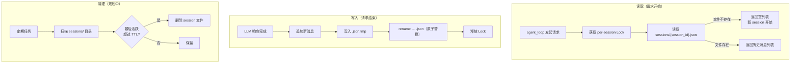

# session

> 写作提醒：功能描述只写可观察的行为，不写内部实现细节。验收标准只写端到端可验证的行为。

## 概述

session 持久化层，管理对话上下文的读写、并发保护和生命周期。session 是跨请求维护对话连续性的核心基础设施。

**负责**：session 消息历史的读写、并发锁、原子持久化、TTL 过期与清理（规划中）。

**不负责**：session 内消息的压缩（→ context_mgr）、执行记录写入（→ observability）、IM 平台 thread/channel 与 session 的映射（→ im-gateway）、定时任务触发逻辑（→ cron_scheduler）。

**调用关系**：
- 依赖：无（纯文件 I/O）
- 被依赖：agent_loop（每次请求前读取、完成后写入）、im-gateway（`/new` 命令清空 session）、cron_scheduler（按 session_id 复用上下文）

## 关键流程

## session_id 格式

session_id 是 session 的唯一标识，格式因来源而异：

| 来源 | 格式 | 示例 |
|------|------|------|
| IM 私信（DM） | `{user_id}/dm:{platform_user_id}` | `u123/dm:U08XYZ` |
| IM 消息线程 | `{user_id}/thread:{thread_ts}` | `u123/thread:1716890400.123` |
| IM 频道 | `{user_id}/channel:{channel_id}` | `u123/channel:C05ABC` |
| HTTP 接口 | 调用方传入，格式自定义 | `u123/web:sess_abc` |
| 定时任务 | `cron/{task_id}` 或调用方指定（见规划中） | `cron/daily-report` |

**约束**：session_id 包含 `/`，文件系统路径为 `data/sessions/{session_id}.json`，需确保目录层级自动创建。

## 现状

- ✅ **session 持久化**：消息历史以 JSON 格式存储于 `data/sessions/{session_id}.json`
  - 读取时文件不存在 → 返回空列表，新 session 自动开始，无需显式创建

- ✅ **并发保护**：per-session `asyncio.Lock`，同一 session 的并发请求串行处理
  - 锁在内存中维护（`_locks` dict）；服务重启后锁状态自动清除

- ✅ **原子写入**：先写 `.json.tmp`，完成后 `rename` 替换，防止写入中断损坏文件

- ❌ **TTL / 过期**：无自动清理，session 文件永久积累，磁盘持续增长

- ❌ **session 元数据**：无创建时间、最后活跃时间等索引，无法按时间排序或统计

- ❌ **大小保护**：单个 session 文件可无限增长（context_mgr 压缩缓解 token 问题，但不限制文件大小）

## 规划中（v1.0）

- [ ] **TTL 过期与自动清理**：防止磁盘无限增长
  - 配置 `session_ttl_days`（默认 30 天），定期后台任务扫描并删除超期 session
  - TTL 以最后活跃时间计算，而非创建时间

- [ ] **session 轻量元数据索引**：存储每个 session 的基本信息，支持管理和统计
  - 记录：创建时间、最后活跃时间、消息数、总 token 估算、关联 agent
  - 存于 `users.db` 的 `sessions` 表，不增加 session 文件本身体积

- [ ] **定时任务 session 绑定语义**（解决 scheduling.md 待决问题）
  - `session_id` 指定时：复用该 session 的完整历史上下文（适合持续性任务，如每日报告）
  - `session_id` 未指定时：每次新建独立 session，上下文不跨次保留（适合无状态定时操作）
  - 两种语义在 cron 任务配置中显式声明，不做隐式推断

- [ ] **磁盘空间管理**：总 session 文件大小上限或最大保留数量，超限时按 LRU 清理最旧的 session

## 验收标准

**场景 1：同一 session 并发请求不丢消息**
- Given：同一 session_id 同时收到两条消息触发两次 agent_loop
- When：两次执行几乎同时发生
- Then：两条消息均被写入 session 历史；消息顺序正确；不出现内容互相覆盖的情况

**场景 2：新 session 自动开始**
- Given：session_id 对应的文件不存在
- When：agent_loop 读取该 session
- Then：返回空消息列表；agent 正常处理请求；完成后 session 文件被创建

**场景 3：写入中断不损坏原文件**
- Given：一个已有历史的 session 正在写入新消息时进程异常退出
- When：服务重启后读取该 session
- Then：原有的历史消息完整；不出现 JSON 格式损坏；最多丢失中断那次写入的新消息

**场景 4：过期 session 自动清理（v1.0）**
- Given：某 session 的最后活跃时间超过配置的 TTL（如 30 天）
- When：后台清理任务触发
- Then：该 session 文件被删除；其他 session 不受影响；清理操作记录在系统日志中

**场景 5：定时任务复用 session 上下文（v1.0）**
- Given：cron 任务配置了 `session_id: "cron/daily-report"`
- When：任务触发执行
- Then：agent 能读取到上次执行的历史上下文；任务完成后新消息追加到同一 session

**场景 6：定时任务独立 session（v1.0）**
- Given：cron 任务未配置 `session_id`
- When：任务触发执行
- Then：本次执行使用全新的空 session；与历史执行记录完全隔离

## 测试边界

**需要单元测试的行为**：
- `load()`：文件不存在时返回空列表；文件存在时正确反序列化
- `save()`：原子写正确执行（tmp 文件先写，再 rename）；目录不存在时自动创建
- `session_lock()`：同一 session_id 的并发调用串行执行；不同 session_id 的调用不互相阻塞

**需要 mock 的依赖**：
- `SESSIONS_DIR`：`monkeypatch` 到 `tmp_path`，隔离真实数据目录
- 文件系统错误（磁盘满等）：mock `Path.write_text` 抛出异常，验证原文件不损坏

## 待决问题

- [ ] TTL 清理任务由谁触发？复用 cron_scheduler 的基础设施，还是 session_mgr 内部维护独立的后台任务？（负责人：待认领）
- [ ] 服务重启后内存中的 `_locks` dict 被清空，正在写入中的请求（极少概率）会不会留下 `.json.tmp` 孤儿文件？是否需要启动时扫描清理？（负责人：待认领）
