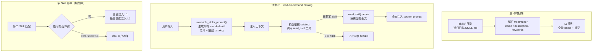

# skill

> 写作提醒：功能描述只写可观察的行为，不写内部实现细节。验收标准只写端到端可验证的行为。

## 概述

Skill 管理层，负责 Skill 的发现、加载、匹配和注入，将领域专家编写的行为指南注入 agent 的 system prompt。

**负责**：Skill 扫描与索引、关键词匹配、内容注入、热加载、安全审计。

**不负责**：Skill 的内容本身（→ skills/ 目录文件）、决定是否注入（→ agent_loop 触发匹配）、Skill 提案与审批流程（→ reflection）。

**调用关系**：
- 依赖：skills/ 目录（SKILL.md 文件）、config（`FLEETENT_SKILLS_DIR` 环境变量）
- 被依赖：agent_loop（在每次请求前触发匹配，将 Skill 内容注入 system_prompt）

Reflection 可生成 `SkillProposal` 并持久化到统一 `reflection_proposals(domain=skill)`，
proposal 类型包括 `create_skill`、`update_skill`、`deprecate_skill`。这些 proposal 初始状态为
`pending`，不自动改 skill；审批与触达由 agent-owned reflection / governance 流程处理，
approved 后的 apply 必须通过 Skill public boundary 执行。

## 关键流程

## 现状

- ✅ **Skill 扫描**：递归扫描 `skills/` 下任意层级的 `SKILL.md` 文件（`os.walk` 全递归），建立索引
  - 同名 Skill 冲突时输出 warning 日志，按 tier/path-sort 确定性选择（user tier 覆盖 builtin），不再静默覆盖
  - 支持通过 `FLEETENT_SKILLS_DIR` 覆盖默认 skills 目录；旧 `MINI_AGENT_SKILLS_DIR` 不再生效

- ✅ **元数据解析**：从 `SKILL.md` 文件头部使用标准 YAML 解析器（`yaml.safe_load`）完整解析 frontmatter
  - 支持 `name`、`description`、`tags`、`enabled`、`enabled_by_default`、`disable_model_invocation` 等扩展字段
  - 解析失败时明确报警，不静默跳过

- ✅ **Read-on-demand catalog 架构**：运行时由 `available_skills_prompt()` 生成所有 enabled skill 的 catalog（名称 + 描述），注入上下文；模型根据 catalog 调用 `read_skill` 工具按需加载 skill 全文，不预先注入完整内容

- ✅ **热加载**：通过 admin CLI 或管理 API 触发 `reload()` 重新扫描，无需重启服务
  - 重扫描期间继续使用旧索引，完成后原子交换
  - 扫描失败时保留旧索引并告警，不影响服务

- ✅ **安全审计（注入防护）**：`_audit_skill()` 加载时扫描 Skill 内容，识别已知的 prompt 注入模式
  - severe / suspicious 两级分级：命中 suspicious 写入审计日志 + 启动时控制台警告；命中 severe 拒绝加载，设 `audit_blocked` 字段
  - 被 `audit_blocked` 的 Skill 不进入 catalog，也不可被 `load()` 加载

- ✅ **禁用机制**：某 Skill「是否进入 `available_skills_prompt` 清单」由单一资格谓词（`_disabled_reason`）裁决，覆盖四类来源 + 安全审计，任一命中即排除（不向模型展示）；`load()` 按名显式加载不受任何禁用约束（人工排查的安全出口，`audit_blocked` 除外）
  - **`enabled`（作者级，frontmatter `enabled: false`）**：Skill 作者主动硬关停自身。**优先于 `enabled_by_default`**——即便 `enabled_by_default: true`，只要 `enabled: false` 仍被禁用。缺省 `true`
  - **`disabled_skills`（运维级，部署配置 `Settings.disabled_skills`）**：运维按名强制关停，对所有 agent 生效
  - **`enabled_by_default`（默认态，frontmatter）**：作者声明该 Skill 默认不自动进清单（缺省 `true`）。优先级最低
  - **`audit_blocked`（安全审计）**：命中 severe 注入模式，优先级最高；`load()` 也被阻止
  - **`model_invocation_disabled`（可见性级，frontmatter `disable_model_invocation: true`）**：仅从 catalog 隐藏，不出现在 `available_skills_prompt`，但不阻止手动 `load()`（供人工场景使用）
  - **来源优先级（裁决顺序，也是 trace 记录的来源标识）**：`audit_blocked` > `model_invocation_disabled` > `frontmatter_disabled`（`enabled:false`）> `config_disabled`（`disabled_skills`）> `default_disabled`（`enabled_by_default:false`）。任一命中即排除，trace 记首个（最高优先）命中来源
  - **可观测**：某 Skill 被排除出清单时，其 name 与来源标识写入该次运行日志的 `disabled_skills_trace` 字段（仅非空才写、向后兼容），便于排查「为什么这个 Skill 没生效/不在清单」；无禁用的运行不写该字段

## 规划中（v1.0）

- [ ] **多 Skill 共存**：同一请求多个 Skill 均相关时的冲突处理策略
  - `exclusive: true` 的 Skill 命中后向用户询问选择

## 验收标准

**场景 1：相关 Skill 自动注入**
- Given：平台已加载「CRM 操作规范」Skill；用户发送「帮我查一下这个客户的合同」
- When：agent 处理请求前
- Then：该 Skill 的内容自动融入 agent 的处理上下文；agent 的回复符合 CRM Skill 中定义的操作规范

**场景 2：无关请求不注入 Skill**
- Given：平台已加载若干业务 Skill；用户发送「今天天气怎么样」
- When：agent 处理请求
- Then：没有 Skill 被注入；agent 以通用能力回复，不引用任何业务规范

**场景 3：多个 Skill 同时可用（v1.0）**
- Given：用户请求同时涉及「客户查询」和「合同审批」两个 Skill 的内容
- When：agent 处理请求
- Then：两个 Skill 对 agent 均可见；agent 的回复综合了两个 Skill 的指导，不遗漏任何一方

**场景 4：运行中新增 Skill 立即生效（v1.0）**
- Given：平台运行中，管理员新增一个 Skill 并触发热加载
- When：下一条用户消息到达
- Then：新 Skill 对后续请求生效；正在进行中的对话不受影响

## 测试边界

**需要单元测试的行为**：
- 扫描：`SKILL.md` 存在时正确解析 `name` / `description`；文件缺失时跳过，不抛异常
- 关键词匹配：description 包含关键词时命中；不包含时返回空
- 注入内容：命中时 system_prompt 包含该 Skill 的完整内容；未命中时 system_prompt 不变
- 同名 Skill：扫描时产生警告日志，tier/path-sort 确定性选择
- 环境变量：`FLEETENT_SKILLS_DIR` 设置时使用该路径；未设置时使用默认 `./skills`

**需要 mock 的依赖**：
- `skills/` 目录路径：`monkeypatch` 到 `tmp_path` 下的临时目录
- 热加载触发信号：mock `reload()` 调用，不依赖真实文件变更事件

## 待决问题

- [ ] 安全审计规则由谁维护？是否纳入版本控制，如何更新？（负责人：待认领）
