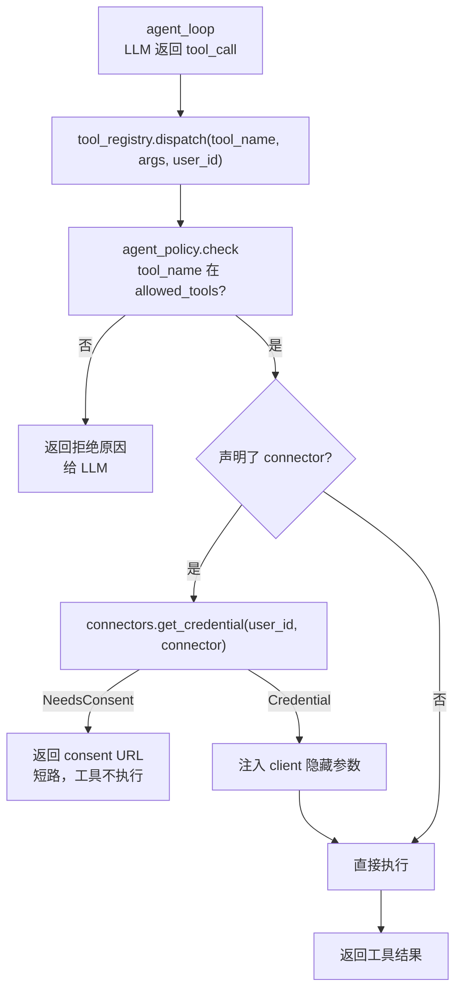

# tools

> 写作提醒：功能描述只写可观察的行为，不写内部实现细节。验收标准只写端到端可验证的行为。

## 概述

工具注册、schema 构建、dispatch，以及内置工具集合。`@tool` 装饰器是工具作者唯一需要理解的接口；`tool_registry` 在 dispatch 时统一处理访问控制、参数校验和凭证注入。

**负责**：`@tool` 装饰器注册与 schema 导出、工具 dispatch（参数反序列化 → 访问控制 → 凭证注入 → 调用 → 结果序列化）、内置工具集（`tools.py` import 副作用注册）、`risk_level` 映射（供 governance 判断是否触发审批）。

**不负责**：工具访问白名单检查（→ governance / agent_policy）、OAuth 凭证存储与刷新（→ connectors）、工具执行的超时传播（→ agent_loop）、沙箱隔离（→ sandbox）。

**调用关系**：
- 依赖：connectors（`@tool(connector=...)` 的凭证注入）、agent_policy（allowed_tools 白名单检查）
- 被依赖：agent_loop（schema 获取、工具 dispatch）
- 副作用：`tools.py` 被 import 时向 `tool_registry` 注册所有内置工具

## 关键流程



## @tool 装饰器契约

```python
@tool(
    description="...",          # 必填，面向 LLM 的工具描述
    risk_level="low",           # "low" | "medium" | "high"（默认 low）
    connector="google-drive",   # 可选：声明依赖哪个外部 connector
    scopes=["drive.readonly"],  # 配合 connector 使用
)
def my_tool(param: str) -> str:
    ...
```

- **schema 自动构建**：参数类型注解 → JSON Schema，LLM 可见
- **隐藏参数**：`*, client` 这类 keyword-only 参数不进入 LLM schema，由框架注入
- **副作用注册**：`tools/builtin_tools.py` 的每个 `@tool` 在 import 时注册到全局 registry；`runtime/loop.py` 顶部必须 `import fleetent.tools`（其 `__init__.py` 承载副作用），否则 `get_schemas()` 返回空

## 接口定义

```python
def get_schemas() -> list[dict]:
    """返回所有已注册工具的 JSON Schema 列表，供 LLM system prompt 使用。"""

async def dispatch(tool_name: str, args: dict, user_id: str, agent_id: str) -> str:
    """执行工具调用。返回序列化后的结果字符串。
    - tool_name 不存在：返回错误消息给 LLM，不抛异常
    - 访问控制拒绝：返回拒绝原因给 LLM
    - NeedsConsent：返回 consent URL，工具不执行
    """
```

## 现状

- ✅ **`@tool` 装饰器**：注册工具、构建 JSON Schema、支持 description / risk_level 声明
- ✅ **schema 导出**：`get_schemas()` 返回所有注册工具的 JSON Schema，import 副作用注册
- ✅ **dispatch**：参数反序列化 → agent_policy 检查 → 调用 → 结果序列化
- ✅ **risk_level 映射**：`low` / `medium` / `high`，`permission_gate` 据此决定是否触发审批
- ✅ **connector 声明**：`@tool(connector=..., scopes=[...])` 记录到 `_connectors`（与 `_risk_levels` 平行），不进 LLM schema；`get_connector(name)` 查询
- ✅ **connector 注入接通**：`dispatch` 调 `connectors.get_credential(user_id, connector, scopes)`——`Credential` 注入隐藏 keyword-only `client` 参数；`NeedsConsent` 短路返回 consent URL 提示串，不执行工具。`connectors`（工具 OAuth 凭证）与 `im_connector_*`（IM 平台连接适配器）无关，勿混用。默认 provider 永远返回 `NeedsConsent`（真实 OAuth 存储/刷新由后续 connector-oauth-store change 经可注入 provider 缝提供）

## 规划中（v1.0）
- [ ] **工具超时保护**：每次 `dispatch` 设置 per-tool 超时（可在 `@tool` 声明，默认 30s），超时后返回 `tool_timeout` 错误给 LLM
- [ ] **参数消毒**：dispatch 前校验 args 符合工具 JSON Schema，非法参数返回错误给 LLM 而非直接调用
- [ ] **工具结果截断**：输出超过阈值（如 10k tokens）时截断 + 写 breadcrumb，避免工具结果撑爆 context

## 验收标准

**场景 1：@tool 注册与 schema 导出**
- Given：`tools.py` 中有一个 `@tool(description="读取文件")` 装饰的函数
- When：`import tools`，再调用 `get_schemas()`
- Then：返回列表包含该工具的 JSON Schema，含 `description` 和参数定义

**场景 2：工具 dispatch 正常执行**
- Given：已注册的工具 `read_file`，用户有访问权限
- When：`dispatch("read_file", {"path": "/tmp/a.txt"}, user_id, agent_id)`
- Then：工具执行，返回文件内容字符串

**场景 3：工具不在白名单被拦截**
- Given：agent 的 allowed_tools 不含 `write_file`
- When：`dispatch("write_file", {...}, user_id, agent_id)`
- Then：返回拒绝原因字符串给 LLM，工具不执行，不抛异常

**场景 4：隐藏参数不进 schema**
- Given：工具声明 `def my_tool(query: str, *, client):`
- When：`get_schemas()` 返回该工具 schema
- Then：schema 中只有 `query` 参数，`client` 不出现在 LLM 可见的 schema 中

**场景 5：tools.py import 副作用**
- Given：`tool_registry` 为空
- When：执行 `import fleetent.tools`
- Then：`get_schemas()` 返回非空列表；重复 import 不重复注册

**场景 6：risk_level medium 触发审批**
- Given：工具 `delete_file` 声明 `risk_level="medium"`
- When：agent_loop dispatch 该工具
- Then：permission_gate 触发会话内自我确认，用户确认后才执行；未确认则中止

## 测试边界

**需要单元测试的行为**：
- `@tool` 注册：装饰后工具出现在 `get_schemas()` 返回列表中，schema 字段正确
- 隐藏参数过滤：keyword-only 参数不出现在 JSON Schema 的 `properties` 中
- dispatch 工具不存在：返回错误字符串，不抛 `KeyError`
- dispatch 访问控制拒绝：agent_policy 返回拒绝时，工具函数不被调用
- risk_level 传递：`@tool(risk_level="high")` 的工具，dispatch 时 permission_gate 收到正确 risk_level

**需要 mock 的依赖**：
- `agent_policy.check`：控制返回 allowed / denied
- `connectors.get_credential`：控制返回 Credential / NeedsConsent（connector 注入路径测试）
- `permission_gate`：使用短超时（`PermissionGate(medium_timeout=0.1)`）

## 待决问题

- [ ] 工具结果截断阈值：截断到多少 token？breadcrumb 格式是什么？（负责人：待认领）
- [ ] 工具超时默认值：30s 是否合理？是否需要 per-tool 可配置？（负责人：待认领）
- [ ] `tools.py` import 副作用在测试中的隔离：如何保证单测不受全局 registry 污染？（负责人：待认领）
