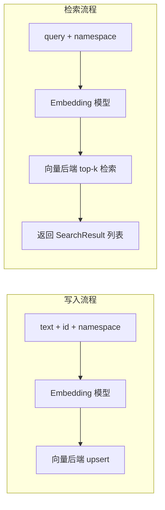

# vector-store

> 写作提醒：功能描述只写可观察的行为，不写内部实现细节。验收标准只写端到端可验证的行为。
> 共享基础设施模块，非用户可感知能力。

## 概述

共享向量索引基础设施，为 memory 和 knowledge_base 提供统一的 embedding 写入与相似度检索能力。

**负责**：文本 embedding、向量写入与更新、top-k 相似度检索、按 namespace 隔离不同来源的向量。

**不负责**：业务数据存储（→ memory / knowledge_base）、检索结果的业务过滤（如 TTL 过期判断，由调用方处理）、注入协调（→ long_term_ctx）。

**调用关系**：
- 依赖：embedding 模型（本地自托管，bge-m3 或 multilingual-e5）、向量后端（sqlite-vec 或 Qdrant）、config
- 被依赖：memory_layer（记忆条目的写入与检索）、knowledge_base（文档 chunk 的写入与检索）

## 关键流程



## 接口定义

```python
@dataclass
class SearchResult:
    id: str       # 调用方写入时传入的 id，原样返回
    score: float  # 相似度分数，范围 0~1


async def upsert(id: str, text: str, namespace: str) -> None:
    """将文本 embedding 后写入向量索引。id 已存在时覆盖更新。
    namespace 用于隔离来源，memory 用 'mem_{user_id}'，knowledge 用 'kb_{tenant_id}'。
    """


async def search(query: str, namespace: str, limit: int = 10) -> list[SearchResult]:
    """返回指定 namespace 内与 query 最相关的 top-k 条目。只返回 id 和 score，业务数据由调用方按 id 查询。"""


async def delete(id: str, namespace: str) -> None:
    """删除指定条目的向量。记忆过期或文档删除时由调用方触发。"""
```

## 现状

尚未实现。

## 规划中（v1.0）

- [ ] **统一抽象接口**：upsert / search / delete 三个接口，后端实现可替换
  - 调用方不感知后端类型，切换后端不影响上层代码

- [ ] **sqlite-vec 后端**：轻量内嵌实现，适合开发环境和小规模部署
  - 无需额外服务，随主进程启动

- [ ] **Qdrant 后端**：生产级实现，Docker 自托管
  - 通过 config 切换，接口不变

- [ ] **namespace 隔离**：不同来源的向量物理隔离，检索时不跨 namespace 返回结果

## 验收标准

**场景 1：写入后可检索**
- Given：向 namespace A 写入一条文本
- When：在 namespace A 用语义相关的 query 检索
- Then：该条目出现在返回结果中，score 大于 0

**场景 2：namespace 隔离**
- Given：向 namespace A 和 namespace B 各写入内容
- When：在 namespace A 检索
- Then：返回结果中只包含 namespace A 的条目，不出现 namespace B 的内容

**场景 3：upsert 覆盖更新**
- Given：某 id 已有向量
- When：用同一 id 写入新文本
- Then：检索时返回新文本对应的向量，旧向量不再出现

**场景 4：delete 后不可检索**
- Given：某 id 已写入向量
- When：delete 该 id 后检索
- Then：该条目不再出现在任何检索结果中

## 测试边界

**需要单元测试的行为**：
- namespace 隔离：写入 A 的内容不出现在 B 的检索结果
- upsert 幂等性：同一 id 重复写入，不产生重复条目
- delete 后检索不可见
- search 返回结果按 score 降序排列

**需要 mock 的依赖**：
- embedding 模型：mock 返回固定长度的随机向量，隔离模型加载
- 向量后端：单元测试用 sqlite-vec in-memory，不依赖 Qdrant 服务

## 待决问题

- [ ] 默认后端选型：开发用 sqlite-vec，生产用 Qdrant，通过 config 切换——确认这是唯一方案还是需要其他选项？（负责人：待认领）
- [ ] embedding 模型运行方式：in-process（fleetent 主进程内加载 bge-m3）还是 HTTP sidecar（`infinity_emb` / `text-embeddings-inference` 独立进程，vector_store 调 HTTP 接口）？
  - in-process：部署简单，但 bge-m3 约 500MB-1GB 内存、冷启动 30-60s，影响主进程重启体验
  - HTTP sidecar：多 fleetent 实例可共享同一 embedding 服务，主进程重启不影响 embedding；两者均完全自托管
  - 建议接口设计为 HTTP endpoint，开发时用本地 `infinity_emb`，生产时独立部署——现在决定，后续不改接口（负责人：待认领）
- [ ] namespace 命名规范：`mem_{user_id}` 和 `kb_{tenant_id}` 是否最终方案？（负责人：待认领）
